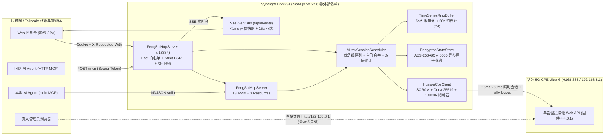
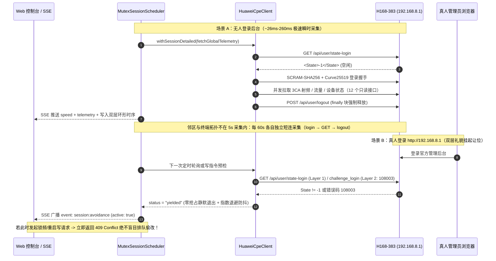

# cpe-dash · 烽燧 (FengSui)

<p align="center">
  <strong>华为 5G CPE Ultra 6 (H168-383) 私有化高阶射频遥测 · 3CA 载波聚合观测 · 邻区扫描 · 锁频锁站与 MCP 智能体网管平台</strong>
</p>

<p align="center">
  <strong>简体中文</strong> | <a href="README_EN.md">English</a>
</p>

<p align="center">
  <a href="https://nodejs.org/">
    = 22.6.0" />
  </a>
  <a href="https://www.typescriptlang.org/">
    
  </a>
  <a href="package.json">
    
  </a>
  <a href="test/">
     96%" />
  </a>
  <a href="AGENTS.md">
    
  </a>
  <a href=".env.example">
    
  </a>
  <a href="docs/PHASE2_BACKEND_CONTRACT.md">
    
  </a>
  <a href="LICENSE">
    
  </a>
</p>

---

**「烽燧」(FengSui / `cpe-dash`)** 是专为 **华为 5G CPE Ultra 6 (`H168-383`，固件 `4.4.0.1`)** 打造的私有化 5G 射频遥测、3CA 载波聚合分析、4G/5G 邻区扫描、锁频段/锁小区控制、双周期流量审计、局域网终端拓扑与 **Model Context Protocol (MCP)** 智能体网管平台（专注射频与网管，明确排除短信业务）。

项目针对 **群晖 Synology DS923+ (AMD Ryzen R1600 / 32GB RAM)** 等家庭私有内网环境设计，采用 **100% 严格 TypeScript (`strict: true`)** 独立闭环编写，**生产运行时零外部 npm 依赖**（100% 基于 Node.js 原生内置模块），默认监听独立高位端口 `:18384`。

---

## 目录

- [🏛️ 系统拓扑与单会话避让架构图](#️-系统拓扑与单会话避让架构图)
- [✨ 核心工程与协议特性](#-核心工程与协议特性)
- [📡《H168-383 硬件能力全景表》（真机实测验证）](#-h168-383-硬件能力全景表真机实测验证)
- [🏗️ 仓库架构与模块划分](#️-仓库架构与模块划分)
- [🚀 快速启动（守护进程、MCP Server 与真机探针）](#-快速启动守护进程mcp-server-与真机探针)
- [🔌 REST API、毫秒级 SSE 与 MCP 工具概览](#-rest-api毫秒级-sse-与-mcp-工具概览)
- [⚙️ `.env` 配置参考](#️-env-配置参考)
- [🛡️ 七大安全与 TDD 质量门禁](#️-七大安全与-tdd-质量门禁)
- [📚 权威技术文档索引](#-权威技术文档索引)
- [⚠️ 免责声明与开源许可](#️-免责声明与开源许可)

---

## 🏛️ 系统拓扑与单会话避让架构图

### 1. 群晖 DS923+ 私有部署与多端协同拓扑



### 2. 单管理员排他协议：瞬时短连与双层真人主动避让时序



---

## ✨ 核心工程与协议特性

- **⚡ `~26 ms` 极速瞬时短连与双层真人在线避让（含 Layer-2 指数退避防抖）**
  - H168-383 硬件限制同一时刻仅允许 1 个管理员在线。[`HuaweiCpeClient`](src/cpe-client.ts) 与 [`MutexSessionScheduler`](src/scheduler.ts) 将每次鉴权操作严格串行收敛为瞬时短连，并在 `finally` 块无条件调用 `POST /api/user/logout`（带 3s 硬超时兜底）。
  - **双层主动避让**：第 1 层通过 `GET /api/user/state-login` 零开销预检；第 2 层针对跨局域网终端占用返回 `108003`/`108009` 实施 `45s → 300s` 指数静默退避，彻底杜绝频繁敲击 `challenge_login`，并通过 SSE 实时广播避让横幅。
- **🛑 跨重启持久化的 `108006` / `108007` 防爆破熔断断路器**
  - 华为固件连续输错 3 次管理密码即锁定账户。内置断路器捕获 `108006`/`108007` 后立即熔断并将密码指纹写入加密状态库，即便守护进程重启也不会重复试错锁死路由器。因密码错误（`108006`/`108002`/`108001`）熔断时，必须先修正 `.env` 中的 `CPE_PASSWORD`，再调用 `POST /api/session/reset-breaker` 或重启服务；密码未变时重置请求会被拒绝（`400`）。`108007` 硬件锁定在锁定期结束后可直接通过 reset-breaker 解除。
- **📈 双层定长环形时序数据库 (`TimeSeriesRingBuffer`)**
  - 内存占用恒定 `< 6 MB`：`Tier 1` 维护 `3 小时 / 5 秒` 高频槽位，`Tier 2` 维护 `7 天 / 60 秒` 归档槽位；支持 `1h`、`6h`、`12h`、`24h` 与自定义 `[fromMs, toMs]` 无缝跨层拼接聚合，NSA 5G 空闲与未开放传感器保持精确 `null`（绝不拉偏均值至 `0`），配合 `EncryptedStateStore` 异步 `30 分钟` 批量刷盘保护群晖硬盘休眠。
- **🤖 原生双模 MCP Server (`stdio` + Streamable HTTP `/mcp`)**
  - 零外部依赖完整实现 JSON-RPC 2.0 MCP 服务端（[`FengSuiMcpServer`](src/mcp-server.ts)），向 Claude Desktop、Antigravity、Cursor 及内网自动化 Agent 暴露 **13 项强类型工具**与 **3 项实时资源**，`reboot_cpe` 与 `reconnect_cellular` 强制要求 `{ confirm: true }` 二次确认防误触。
- **🛡️ 现代 Web 纵深防御体系**
  - 内置 `Host` 白名单防 DNS Rebinding (`421`)、`SameSite=Strict; HttpOnly` 会话隔离、`X-Requested-With` + `Origin` 双重防 CSRF、`net.BlockList` 可信反代 CIDR 校验 + IPv6 `/64` 速率限制桶、无原型字典防 Prototype Pollution、线性扫描防 ReDoS 以及 `normalizeCpeUrl` 私网源防 SSRF。

---

## 📡《H168-383 硬件能力全景表》（真机实测验证）

| 能力模块 | 核心协议端点 | 真机实测验证指标与结构特征 | 状态 |
| :--- | :--- | :--- | :---: |
| **3CA 三载波聚合** | `GET /api/device/signal`<br/>`GET /api/device/seccellinfo` | 实测激活 **`B1(20MHz) + B3(20MHz) + N78(100MHz)`** 共 **`140 MHz`** EN-DC 三载波聚合；次载波以 8 列分号 CSV 暴露独立 `EARFCN, Band, BW, PCI, RSRP, RSRQ, RSSI, SINR` | ✅ 已验证 |
| **高阶调制与 MIMO** | `GET /api/device/signal`<br/>`GET /api/device/ri` | 实测暴露 4G/5G 上下行 **`256QAM` / `64QAM`** 码字级 MCS 索引、`TM[4]` 闭环空间复用、4G `RI=2` / 5G `nrrank` 流数及双码字 `CQI0/CQI1` | ✅ 已验证 |
| **物理层发射功率** | `GET /api/device/signal` | 独立暴露 4G `<txpower>` 与 5G `<nrtxpower>` 四通道功率：`PPusch`、`PPucch`、`PSrs`、`PPrach` (dBm) | ✅ 已验证 |
| **基站与跟踪区定位** | `GET /api/device/signal`<br/>`GET /api/net/cell-info` | 十进制 `<cell_id>` / `<tac>` 与十六进制 `<cellinfo>` / `<lac>` 100% 数学恒等；支持 28-bit ECI (`eNodeB = ECI >>> 8`) 与 36-bit NCI 精确拆分 | ✅ 已验证 |
| **4G / 5G 邻区扫描** | `GET /api/device/nbrcellinfo` | 原生输出 `<nbrcell_ltelist>` 与 `<nbrcell_nrlist>` 7 列分号 CSV（`EARFCN, Band, PCI, RSRP, RSRQ, RSSI, SINR`），支持一键映射锁小区参数 | ✅ 已验证 |
| **4G / 5G 锁频段与锁小区** | `GET/POST /api/net/net-mode`<br/>`POST /api/net/lock-freq` | 硬件开放 `select_band_switch=1` 与 `lock_freq_switch=3`；支持 4G `LTEBand` 位掩码、5G NR 锁频段 (`lock_mode=3`)、锁频点 (`lock_mode=1`) 与锁 `PCI+ARFCN` 小区 (`lock_mode=2`) | ✅ 已验证 |
| **当日 vs 当月流量审计** | `GET /api/monitoring/month_statistics`<br/>`GET /api/monitoring/traffic-statistics` | 原生支持**当日累计流量 (`<CurrentDayUsed>`)**、**当月上下行分项累计流量**、结算日 (`<StartDay>`) 与实时上下行字节速率 (`CurrentDownloadRate * 8`) | ✅ 已验证 |
| **终端拓扑与双栈租期** | `GET /api/system/HostInfo` (JSON)<br/>`GET /api/system/topology` (JSON) | 精确区分 **`LAN 1000M`** 千兆有线、`2.4GHz` 与 `5GHz` 无线终端，暴露协商 PHY 速率 (Mbps)、RSSI、IPv4/IPv6 双栈地址与剩余 DHCP 租期秒数 | ✅ 已验证 |
| **Wi-Fi 7 (802.11be) MLO** | `GET/POST /api/wlan/wlandbho`<br/>`GET /api/wlan/multi-security-settings-ex` | 原生支持三射频架构（`b/g/n/ax/be` + `a/n/ac/ax/be`）、**MLO 多链路聚合 (`MloEnable`)**、双频优选 (`DbhoEnable`)、EasyMesh 与自动信道优化 | ✅ 已验证 |
| **天线切换、静态 DHCP 与双栈 APN** | `/api/device/antenna_set_type`<br/>`/api/dhcp/static-addr-info`<br/>`/api/dialup/profiles` | 支持自动/内置/外置天线切换与插入状态检测、静态 MAC-IP 绑定管理、`IPv4/IPv6` (`iptype=2`) 双栈 APN 审计与定时维护重启配置 | ✅ 已验证 |

---

## 🏗️ 仓库架构与模块划分

```text
cpe-dash/
├── AGENTS.md                        # 工程架构、协议排他保护与七大安全/TDD 铁律守则
├── .env.example                     # 纯原生环境变量配置模板（默认端口 WEB_PORT=18384）
├── locales/                         # 零依赖强类型双语词典 (zh-CN.json / en.json)
├── public/                          # 离线静态前端占位目录（Phase 3 优先读取 dist/web/public）
├── docs/
│   ├── PHASE1_PROTOCOL_SPEC.md      # H168-383 完整私有协议、逆向算法与阶段一规范字典
│   ├── PHASE2_ARCHITECTURE_REPORT.md # 后端选型、零依赖安全论证与并发架构设计报告
│   └── PHASE2_BACKEND_CONTRACT.md   # Phase 2 -> Phase 3 完整 REST / SSE / MCP 强类型交接契约
├── src/
│   ├── types.ts                     # 全局严格接口与判别联合类型定义
│   ├── config.ts                    # 原生 .env 加载器、SSRF 私网源校验、BlockList CIDR 反代与 /64 桶
│   ├── i18n.ts                      # 零外部依赖编译期键安全多语言引擎 (zh-CN / en)
│   ├── crypto.ts                    # 非钳位大端 Curve25519、Huawei SCRAM-SHA256、AES-256-GCM
│   ├── xml.ts                       # 防原型链污染与防 ReDoS 的线性 O(N) XML 编解码器
│   ├── sanitize.ts                  # IMEI/IMSI/MAC/IP/TAC/CellID/主机名自动化 RFC 脱敏引擎
│   ├── encrypted-file.ts            # StorageCipher (scrypt + HKDF-SHA256 + AES-256-GCM 0600)
│   ├── band-lock.ts                 # 4G/5G BandMask 位运算、ECI/NCI 拆分与锁频锁站载荷构建器
│   ├── parsers.ts                   # 3CA 射频、MCS、发射功率、邻区、双周期流量与拓扑纯解析器
│   ├── cpe-client.ts                # 瞬时会话客户端、防重入保护、双层避让与 108006 熔断器
│   ├── cpe-domain.ts                # 聚合遥测、邻区扫描、锁频锁站、安全开关与 Wi-Fi 7 MLO 领域服务
│   ├── timeseries.ts                # 双层定长环形时序数据库 (5s 细粒度环 + 60s 7天归档环)
│   ├── state-store.ts               # 异步原子加密持久化与密钥轮换自愈状态库
│   ├── scheduler.ts                 # 全局单实例互斥调度器、单飞请求合并与 Layer-2 退避引擎
│   ├── sse-bus.ts                   # /api/events 毫秒级 SSE 扇出总线、慢消费背压剔除与心跳保活
│   ├── mcp-server.ts                # 原生 JSON-RPC 2.0 MCP Server (stdio NDJSON + Streamable HTTP)
│   ├── http-server.ts               # 纵深加固 HTTP/REST/SSE/MCP 与静态资源服务器 (:18384)
│   ├── cli.ts                       # 统一守护进程 (serve) 与 MCP (mcp) 命令行入口
│   └── index.ts                     # 公共 SDK 模块导出入口
├── scripts/
│   ├── audit-secrets.ts             # 工作区 + 全量 Git 历史零密钥/零硬件指纹/纯 TS 扫描门禁
│   └── probe-*.ts                   # 8 项非破坏性真机协议与硬件能力验证探针
└── test/                            # 基于 node:test 的全离线高覆盖率测试套件 (> 96%)
```

---

## 🚀 快速启动（守护进程、MCP Server 与真机探针）

### 1. 环境准备

```bash
git clone https://github.com/cky008/cpe-dash.git
cd cpe-dash
npm install

cp .env.example .env
chmod 600 .env
# 编辑 .env 填入真实的 CPE_PASSWORD 与独立的 API_TOKEN（切勿提交 .env）
```

### 2. 启动「烽燧」Web / REST / SSE / HTTP-MCP 守护进程

```bash
# 开发热重载模式（Node.js >= 22.6 原生 TypeScript 直接运行）
npm run dev

# 生产编译与启动（默认监听 http://0.0.0.0:18384）
npm run build
npm start
```

### 3. 接入 AI 智能体 (MCP Server)

- **本地 `stdio` 模式**（Claude Desktop / Antigravity / Cursor）：
  ```bash
  npm run mcp
  # 或指定配置文件：node --experimental-strip-types src/cli.ts mcp --env /path/to/.env
  # （Node 22.18+ / 23.6+ 可省略该标志；所有 npm 脚本已内置）
  ```
- **内网 / Tailscale Streamable HTTP 模式**：
  ```bash
  curl -X POST http://127.0.0.1:18384/mcp \
    -H "Authorization: Bearer $API_TOKEN" \
    -H "Content-Type: application/json" \
    -d '{"jsonrpc":"2.0","id":1,"method":"tools/list"}'
  ```

### 4. 运行只读真机探针套件

```bash
npm run probe:rf          # 采集 3CA 聚合链、256QAM MCS、MIMO 流数、发射功率与基站恒等校验
npm run probe:neighbors   # 扫描周边 4G/5G 候选邻区表 (EARFCN, Band, PCI, RSRP, RSRQ, RSSI, SINR)
npm run probe:traffic     # 读取瞬时上下行速率、当日累计流量与当月累计流量
npm run probe:topology    # 采集千兆 LAN / 2.4G / 5G 终端拓扑、协商速率与双栈 DHCP 租期
npm run probe:session     # 压测 ~26ms 瞬时短连释放并验证双层真人浏览器避让
```

---

## 🔌 REST API、毫秒级 SSE 与 MCP 工具概览

| 通道类型 | 核心端点 / 工具名 | 功能说明 |
| :--- | :--- | :--- |
| **认证与字典** | `POST /api/auth/login`, `POST /api/auth/logout`, `GET /api/i18n/:locale` | `SameSite=Strict; HttpOnly` 会话签发/销毁、离线中英词典拉取 |
| **只读遥测与时序** | `GET /api/telemetry`, `GET /api/timeseries`, `GET /api/neighbors`, `GET /api/topology`, `GET /api/settings` | 零 CPE 开销读取内存最新快照与 `1h/6h/12h/24h/custom` 速率/射频曲线 |
| **主动刷新与扫描** | `POST /api/telemetry/refresh`, `POST /api/neighbors/scan`, `POST /api/topology/refresh`, `POST /api/settings/refresh` | 单飞合并触发一次 `~150ms` 礼貌瞬时采样 |
| **射频与系统控制** | `POST /api/control/band-lock`, `cell-lock`, `unlock`, `reboot`, `reconnect`, `security`, `wifi7`, `antenna`, `mobile-data` | 动态锁 4G/5G 频段与 `PCI+ARFCN` 小区、开关安全/MLO/天线/移动数据（真人在线时礼貌返回 `409`） |
| **会话与熔断器** | `GET /api/session/status`, `POST /api/session/reset-breaker` | 查询调度器/避让/熔断状态；重新读取 `.env` 并重置熔断器 |
| **实时 SSE 总线** | `GET /api/events` | 实时推送 `hello`, `speed`, `telemetry`, `neighbors`, `topology`, `settings`, `session:avoidance`, `control:applied`, `alert` 及 `: heartbeat` |
| **MCP 智能体工具** | `get_cpe_telemetry`, `query_telemetry_history`, `list_neighbor_cells`, `get_cpe_session_status`, `lock_band`, `lock_cell`, `unlock_rf_locks`, `reboot_cpe` 等 13 项 | 供内网 AI 助手实时诊断 5G 信号、对比邻区、执行锁频锁站与二次确认重启 |

完整 TypeScript 请求/响应契约请参阅 👉 **[`docs/PHASE2_BACKEND_CONTRACT.md`](docs/PHASE2_BACKEND_CONTRACT.md)**。

---

## ⚙️ `.env` 配置参考

| 变量名 | 默认值 | 说明 |
| :--- | :--- | :--- |
| `CPE_URL` | `http://192.168.8.1` | CPE 局域网管理地址（严格限制私网单源 Origin，拦截跨网 SSRF） |
| `CPE_USERNAME` | `admin` | H168-383 管理员账号 |
| `CPE_PASSWORD` | *(必填)* | CPE 管理后台密码（`108006` 错误立即触发跨重启持久化熔断） |
| `DATA_ENCRYPTION_KEY` | *(回退至 `CPE_PASSWORD`)* | 本地 `data/*.json` 静态加密密钥（`scrypt` + `HKDF-SHA256`） |
| `API_TOKEN` | *(回退至 `CPE_PASSWORD`)* | Web 登录口令与 REST / `/mcp` Bearer 令牌（推荐独立设置高熵随机串） |
| `TRUSTED_PROXIES` | `127.0.0.1,::1` | 可信反向代理 IP / CIDR 白名单（`net.BlockList` 精确匹配后才解析 `X-Forwarded-For`） |
| `ALLOWED_HOSTS` | *(空)* | 额外放行的 HTTP `Host`（如反代域名），拦截 DNS Rebinding (`421`)；私网/环回/链路本地 IP、`localhost`、`*.local`/`*.lan`/`*.internal`/`*.ts.net` 与单标签主机名始终放行 |
| `WEB_PORT` | `18384` | Web 控制台、SSE 与 `/mcp` 默认监听端口 |
| `DEFAULT_LOCALE` | `zh-CN` | 默认界面与提示语言（`zh-CN` 或 `en`） |
| `MCP_HTTP_ENABLED` | `true` | 是否启用 `POST /mcp` Streamable HTTP 智能体端点 |
| `MCP_ALLOW_MUTATIONS` | `true` | 是否允许 MCP 调用写操作工具（设为 `false` 仅暴露只读观测工具） |
| `HISTORY_RETENTION_HOURS` | `168` | 环形时序数据库历史保留时长（默认 168 小时 = 7 天） |
| `POLL_INTERVAL_MS` | `5000` | 常规射频与实时速率采样周期（毫秒） |
| `NEIGHBOR_SCAN_INTERVAL_MS` | `60000` | 4G/5G 邻区扫描低频采样周期（毫秒） |
| `RESPECT_BROWSER_SESSION` | `true` | 真人浏览器在线自动挂起避让开关（强烈建议保持 `true`）。设为 `false` 时跳过让位：后台仍尝试登录，被跨 IP 占用（`108003`）时读请求报错、写请求返回 `502` 而非 `409` |

---

## 🛡️ 七大安全与 TDD 质量门禁

```bash
npm run check
# 依次执行：
# 1. npm run typecheck      -> tsc -p tsconfig.test.json (100% Strict TS，零隐式 any)
# 2. npm run test:coverage  -> c8 强制门禁 (Statements / Lines / Functions >= 90%，实测 > 96%)
# 3. npm run audit:secrets  -> 扫描工作区与完整 git log -p --all 历史，拦截密钥/PII 与任何 .js 源文件
```

---

## 📚 权威技术文档索引

- [`AGENTS.md`](AGENTS.md) — 工程契约、七大安全铁律与强制 TDD 守则
- [`docs/PHASE1_PROTOCOL_SPEC.md`](docs/PHASE1_PROTOCOL_SPEC.md) — 华为 H168-383 私有协议、逆向算法与真机实测字典
- [`docs/PHASE2_ARCHITECTURE_REPORT.md`](docs/PHASE2_ARCHITECTURE_REPORT.md) — 群晖 DS923+ 零依赖后端选型、安全防线与多语言架构论证报告
- [`docs/PHASE2_BACKEND_CONTRACT.md`](docs/PHASE2_BACKEND_CONTRACT.md) — Phase 2 → Phase 3 完整 REST API、SSE 事件流与前端托管交接契约

---

## ⚠️ 免责声明与开源许可

- 本项目为非官方独立自研网管工具，与华为技术有限公司无任何隶属或背书关系。锁频段与锁小区属于底层基带调优操作，请在充分了解所在运营商频谱规划的前提下谨慎使用。
- 本项目基于 **[PolyForm Noncommercial License 1.0.0](LICENSE)** 开源发布，仅限个人与非商业研究用途。
