<h1 align="center">烽燧 · FengSui <sub><code>cpe-dash</code></sub></h1>

<p align="center">
  <strong>华为 5G CPE Ultra 6（H168-383）私有化射频监控与短信网关：3CA 载波聚合 · 邻区扫描 · 锁频锁站 · 加密短信中心 · Telegram · MCP 智能体</strong>
</p>

<p align="center">
  <a href="README.md"></a>
  <a href="README_EN.md"></a>
</p>

<p align="center">
  <a href="https://github.com/cky008/cpe-dash/releases"></a>
  <a href="https://cky008.github.io/fengsui-demo/"></a>
  <a href="https://github.com/cky008/cpe-dash/actions/workflows/ci-docker.yml"></a>
  <a href="tsconfig.json"></a>
  <a href="#-docker--群晖-ds923-部署"></a>
  <a href="#-mcp-智能体接入"></a>
  <a href="#️-短信telegram-与告警"></a>
  <a href="#-docker--群晖-ds923-部署"></a>
  <a href="package.json"></a>
  <a href="test/"></a>
  <a href="LICENSE"></a>
</p>

<p align="center">
  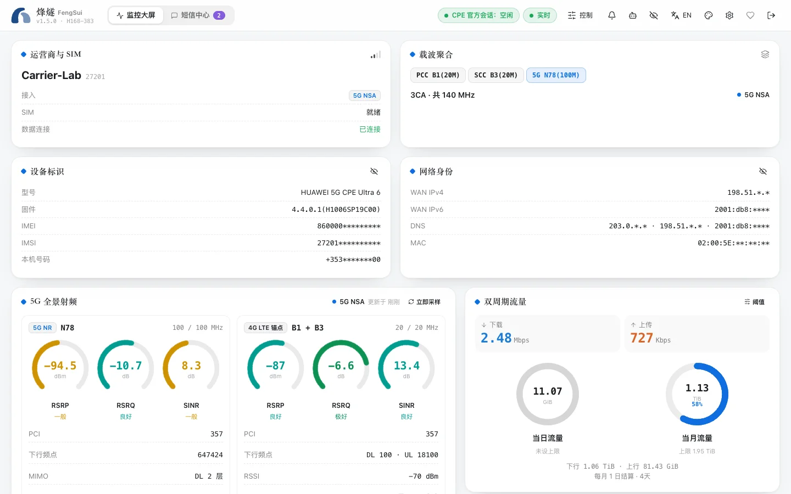
</p>

**「烽燧」(FengSui / `cpe-dash`)** 是一个跑在家里 NAS 上的单容器服务：一边以毫秒级瞬时会话采集 H168-383 的 5G 射频遥测（3CA 逐载波、MCS / MIMO / 发射功率、邻区、流量、终端拓扑），一边把路由器变成加密的短信网关（Web 短信中心、Telegram 双向机器人、签名 Webhook），并通过 **Model Context Protocol (MCP)** 让 AI 智能体安全地诊断信号、锁频锁站与收发短信。遥测与短信共用**唯一的管理员会话调度器**，真人登录 `192.168.8.1` 时自动让位，永不抢占。

- **100% 私有化，零上云**：全部数据只在你的 NAS 上，`AES-256-GCM` 加密落盘；Web 控制台零 CDN、零外链，离线可用。
- **0 额外硬件成本**：复用现有 NAS 与 CPE 自带的短信能力，不需要短信猫、USB 模块或第二台设备。
- **生产级容器**：非 root、只读根文件系统、`HEALTHCHECK`、`SIGTERM` 10 秒内优雅停机并释放路由器会话；`linux/amd64`（DS923+）与 `linux/arm64` 双架构。
- **零运行时依赖**：守护进程只用 Node.js 原生模块；全仓 100% 严格 TypeScript，420 项离线测试、语句覆盖率 98%。

---

## 目录

- [🖼️ 界面一览](#️-界面一览)
- [⚖️ 方案对比](#️-方案对比)
- [🏛️ 架构：唯一会话出口与真人避让](#️-架构唯一会话出口与真人避让)
- [✨ 核心特性](#-核心特性)
- [📡 H168-383 硬件能力全景表](#-h168-383-硬件能力全景表真机实测验证)
- [🚀 快速开始](#-快速开始)
- [🐳 Docker / 群晖 DS923+ 部署](#-docker--群晖-ds923-部署)
- [🤖 MCP 智能体接入](#-mcp-智能体接入)
- [✉️ 短信、Telegram 与告警](#️-短信telegram-与告警)
- [🔌 REST API 与 SSE](#-rest-api-与-sse)
- [⚙️ `.env` 配置参考](#️-env-配置参考)
- [🛡️ 安全与质量门禁](#️-安全与质量门禁)
- [🏗️ 仓库结构](#️-仓库结构)
- [📚 文档索引](#-文档索引)
- [⚠️ 免责声明与许可](#️-免责声明与许可)

---

## 🖼️ 界面一览

> 以下截图全部来自 `npm run demo`：真实守护进程栈 + 进程内严格 Mock 路由器，所有标识均为 RFC 保留占位值。

<table>
  <tr>
    <td width="50%">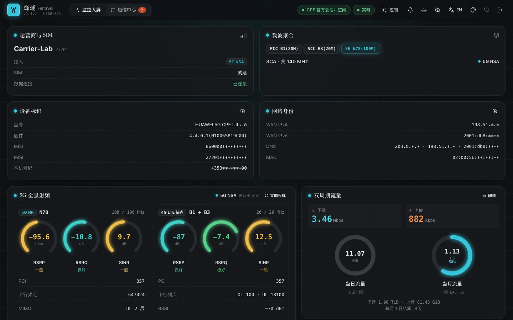<br /><sub><b>监控大屏 · 极夜</b>：3CA 胶囊、逐载波射频、双周期流量环、实时贝塞尔速率曲线</sub></td>
    <td width="50%">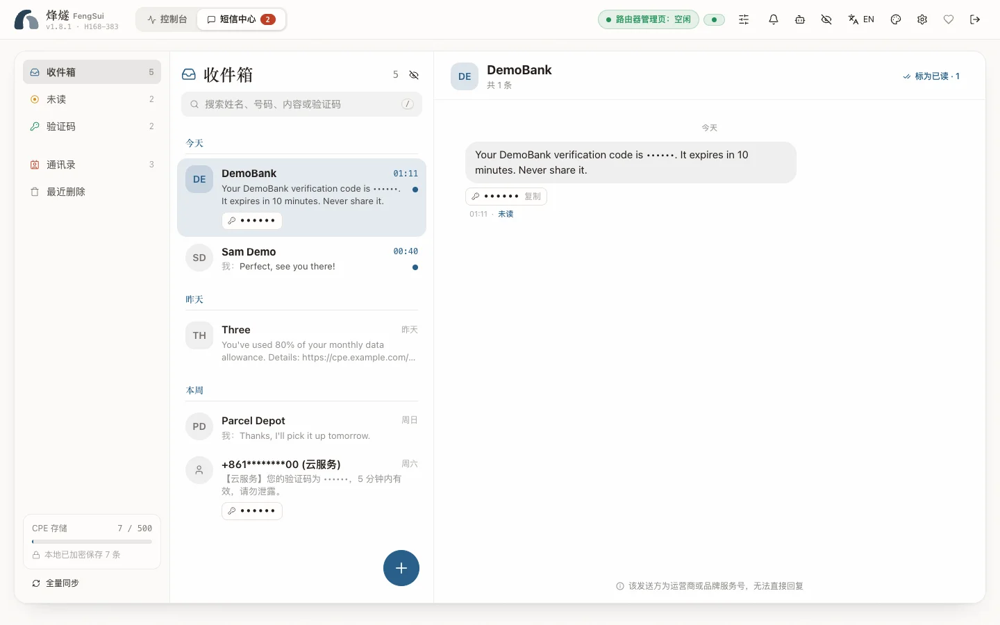<br /><sub><b>短信中心 · 素纸</b>：会话、长短信合并、验证码一键复制、联系人映射</sub></td>
  </tr>
  <tr>
    <td>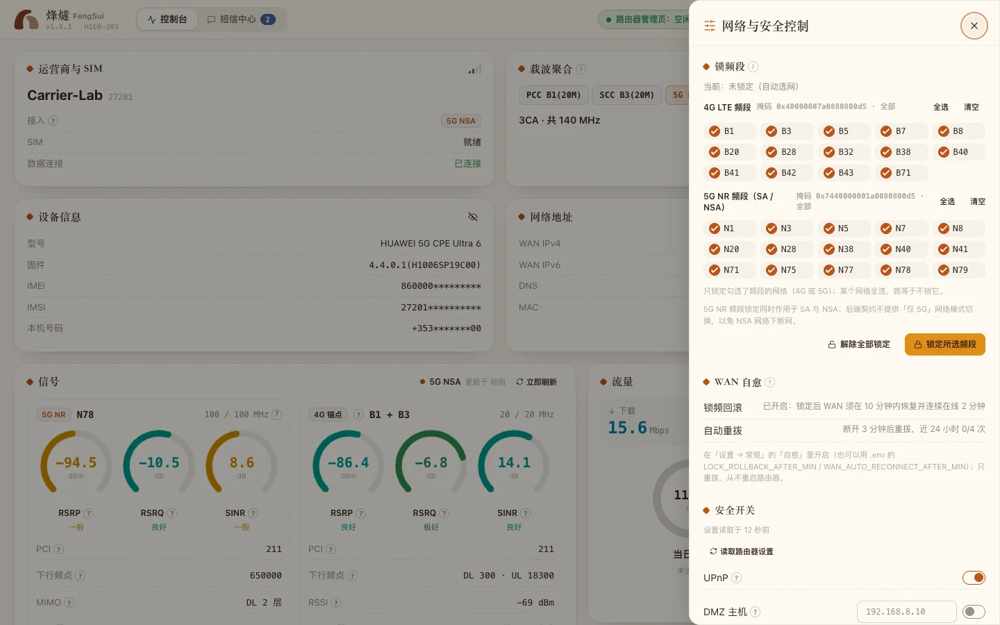<br /><sub><b>控制抽屉 · 晨曦</b>：4G / 5G 锁频段、安全开关、重拨与二次确认重启</sub></td>
    <td>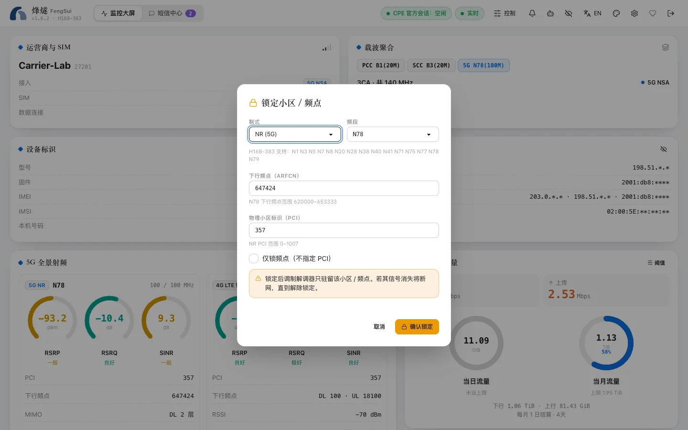<br /><sub><b>锁至此小区</b>：邻区一键带入 PCI + ARFCN，按制式校验范围后二次确认</sub></td>
  </tr>
  <tr>
    <td>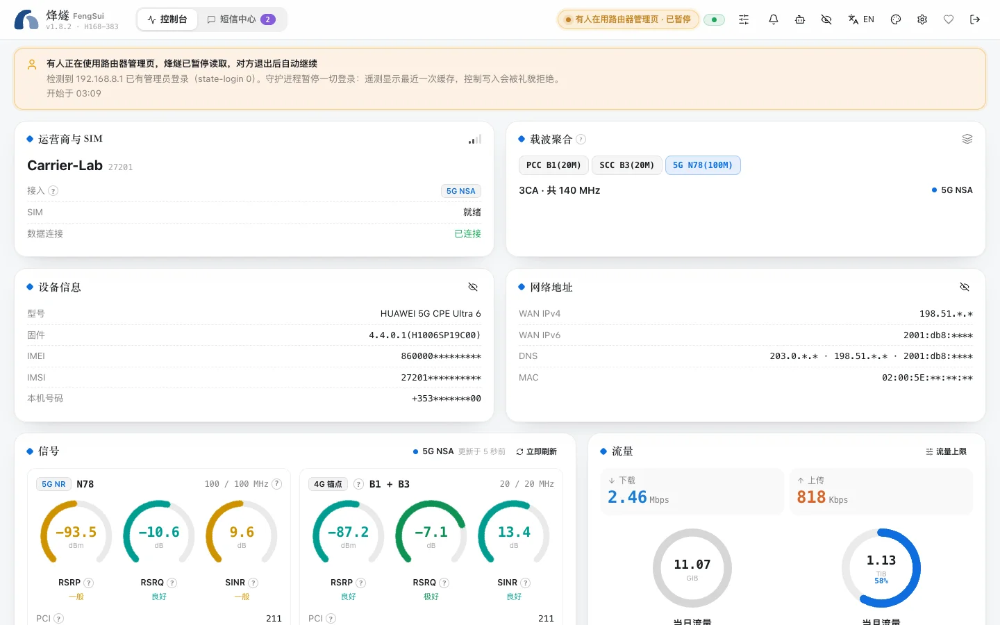<br /><sub><b>真人在线避让</b>：呼吸提示「真人用户正在访问官方后台，监控已智能避让」</sub></td>
    <td>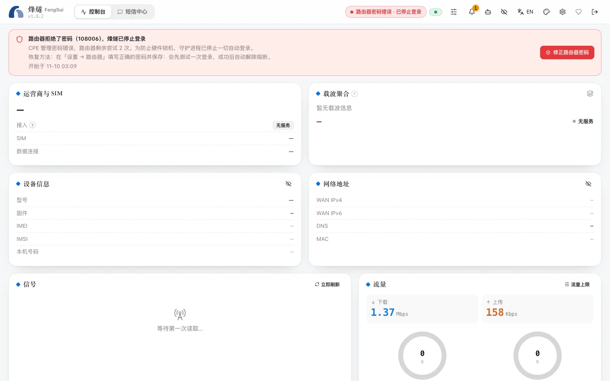<br /><sub><b>423 防爆破熔断</b>：明确区别于离线，附熔断原因与恢复步骤</sub></td>
  </tr>
  <tr>
    <td>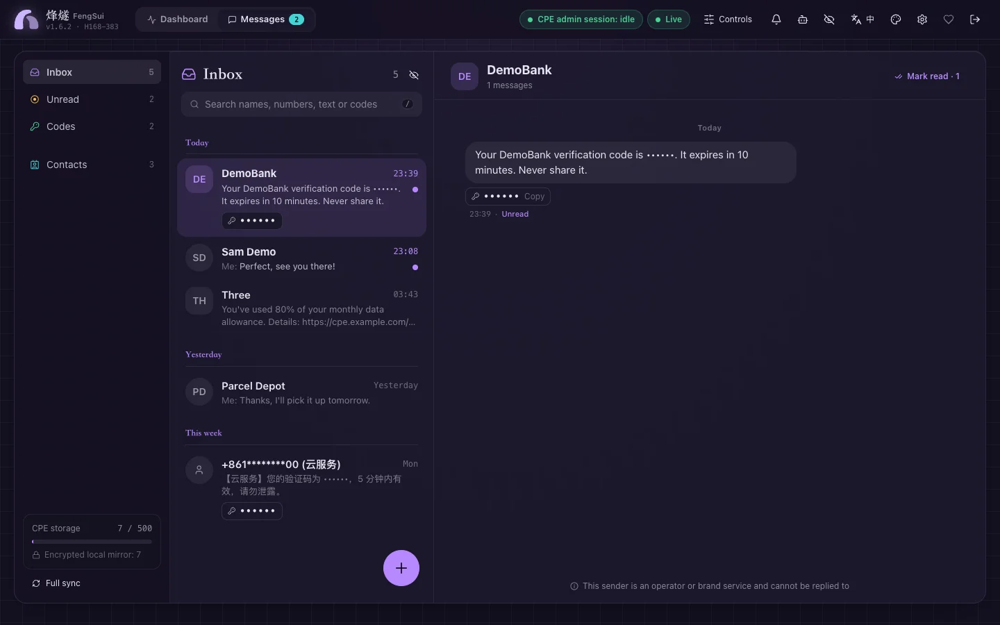<br /><sub><b>English · 紫溟</b>：中英文即时切换，词典按需懒加载</sub></td>
    <td align="center">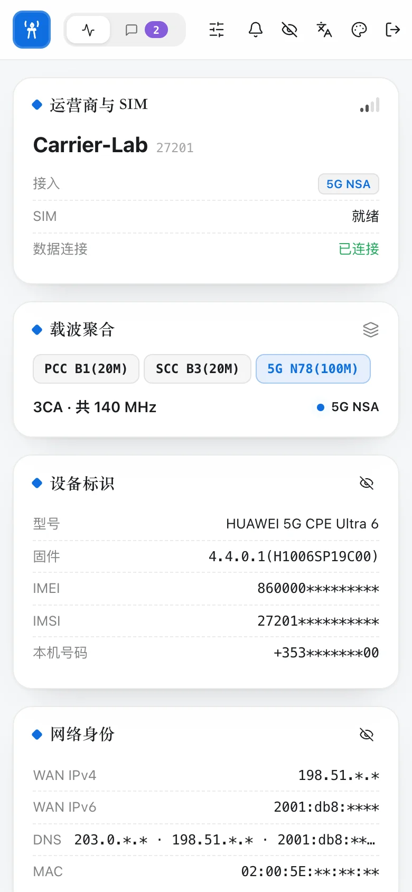<br /><sub><b>移动端</b>：390 px 窄屏自适应</sub></td>
  </tr>
  <tr>
    <td>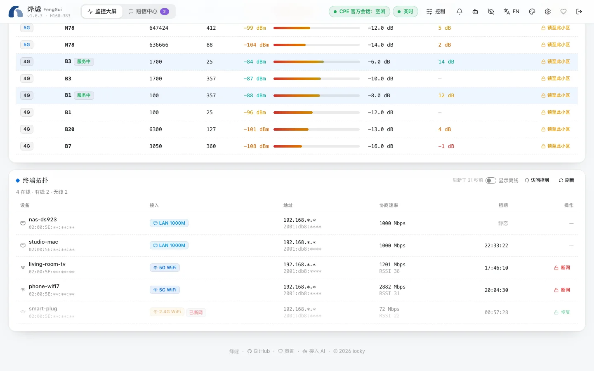<br /><sub><b>终端拓扑 · 断网 / 恢复</b>：Wi-Fi 设备一键断网，被断网的设备离线后仍可恢复</sub></td>
    <td>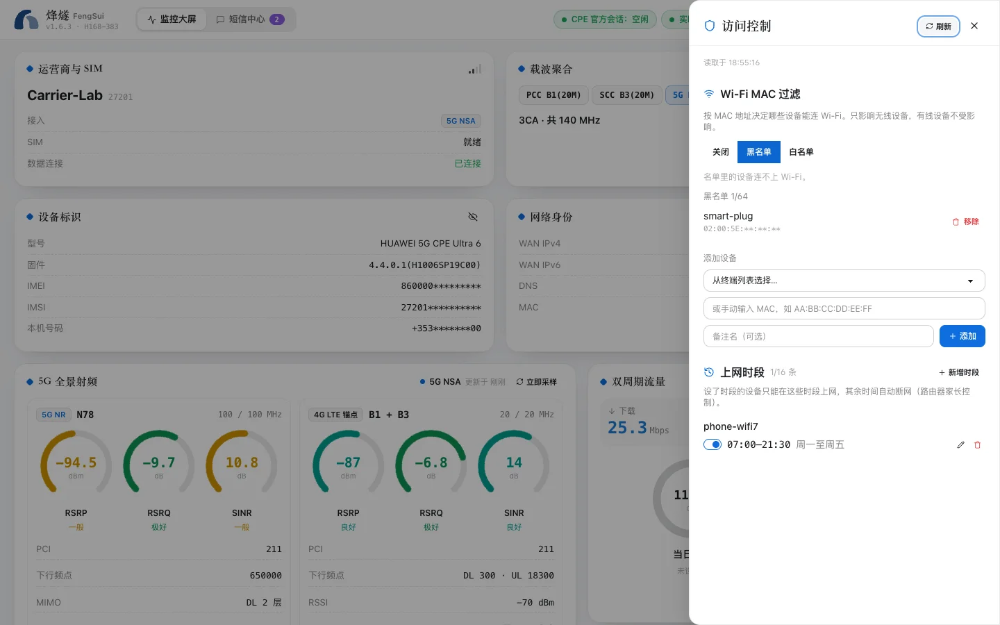<br /><sub><b>访问控制 · 极夜</b>：Wi-Fi MAC 黑白名单与按设备的上网时段</sub></td>
  </tr>
  <tr>
    <td>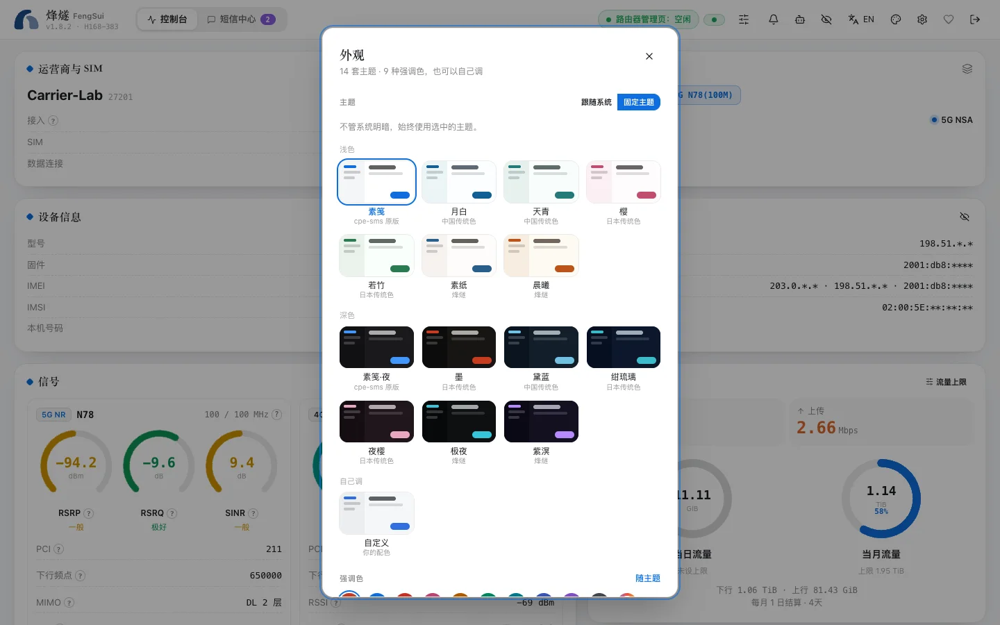<br /><sub><b>外观</b>：14 套主题（cpe-sms 原版、中国传统色、日本传统色、烽燧），白天 / 夜间分别选择，也可自定义</sub></td>
    <td>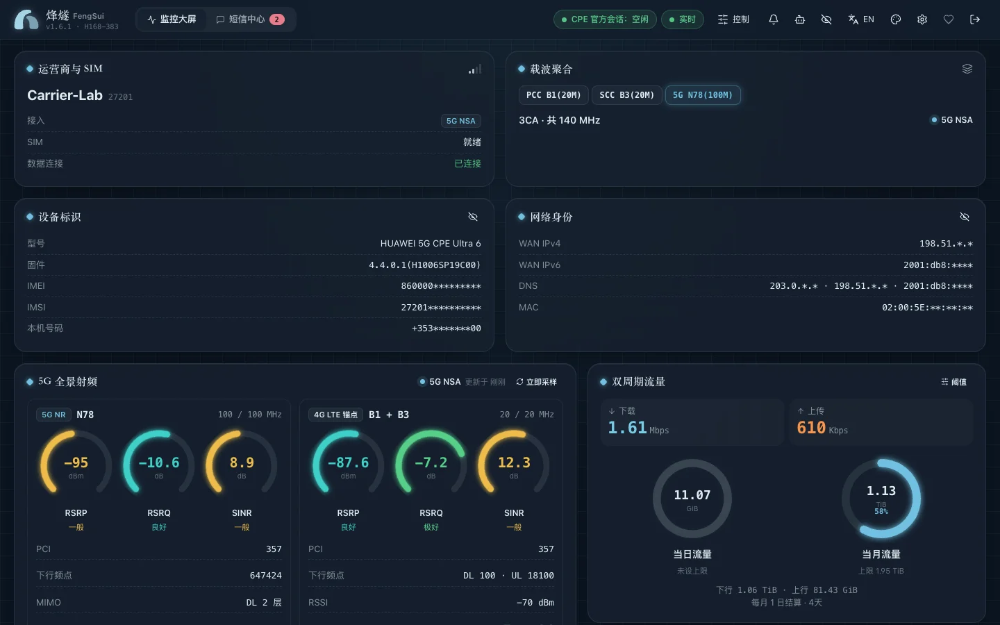<br /><sub><b>监控大屏 · 黛蓝</b>：中国传统色里的黛蓝、月白与天青</sub></td>
  </tr>
</table>

### 监控大屏
- **顶部横幅**：品牌与版本、监控大屏 / 短信中心切换（未读角标）、运营商与 SIM 状态、IMEI / IMSI / 本机号码（默认打码，点眼睛显示原值）、WAN IPv4 / IPv6 / DNS / MAC（可打码）、CPE 会话状态（空闲 / 真人避让 / 熔断）、SSE 连接状态与告警铃。
- **3CA 载波聚合胶囊**：如 `PCC B1(20M) + SCC B3(20M) + 5G N78(100M)`；SA / NSA 呼吸徽章。
- **射频卡**：逐载波 PCI、ARFCN、带宽；RSRP / RSRQ / SINR 分级圆环；TAC、eNodeB、MIMO 流数、上下行调制方式；PUSCH / PUCCH 发射功率条。
- **健康卡**：在线时长、在线终端数、锁定状态与锁定对账（路由器是否仍符合已下发的锁频 / 锁小区）。
- **双周期流量环**：当日 / 当月用量对比，可设阈值并变色告警。
- **实时与历史曲线**：单调三次贝塞尔速率曲线；`1h` / `6h` / `12h` / `24h` / 自定义区间，吞吐与信号两种指标，底部刷选条缩放。
- **邻区表**：渐变 RSRP 条、按制式校验 PCI（LTE `0–503` / NR `0–1007`）与 ARFCN 频段范围，「锁至此小区」二次确认。
- **终端拓扑**：`LAN 1000M` / `2.4G WiFi` / `5G WiFi` 徽章、IPv4 / IPv6、协商速率、DHCP 租期倒计时；Wi-Fi 设备一键「断网 / 恢复」，被断网的设备离线后仍保留在列表里，方便恢复。
- **访问控制抽屉**：Wi-Fi MAC 过滤（关闭 / 黑名单 / 白名单、增删、显示路由器上限 64 条），启用白名单时用勾选器挑选允许的设备；按设备设置「上网时段」（星期 + 15 分钟粒度，支持跨天），同一设备时段重叠时直接提示冲突。运行烽燧的设备和你正在用的设备永远不会被断网。
- **控制抽屉**：4G / 5G NR 锁频段（同时作用于 SA 与 NSA）、解锁、UPnP / DMZ 等安全开关、蜂窝重拨与重启（输入确认词）。

### 短信中心
- 会话列表与搜索、长短信合并展示、验证码识别与一键复制、发送 / 回复 / 标记已读 / 删除（防误触确认）、通讯录（新增、编辑、vCard 导入）。
- 发送前实时显示 GSM-7 / UCS-2 编码与分段数；路由器已受理但状态轮询超时的短信显示为**琥珀色「已提交、状态未确认」**，绝不误报失败，避免重复发送。
- 顶部隐私开关联动隐藏手机号与短信内容，方便截图与投屏。

### 外观与工程
- **14 套主题，7 浅 7 深**：cpe-sms 原版的**素笺 / 素笺·夜**（默认），中国传统色的**月白、天青、黛蓝**，日本传统色的**樱、若竹、墨、绀琉璃、夜樱**，以及烽燧自己的**素纸、晨曦、极夜、紫溟**。
- **跟随系统时白天、夜间主题分开选**；也可以固定一套主题，或者用背景、文字、主色三种颜色**自己调一套**（对比度不足会提示）。9 种强调色另可自定义取色。所有内置配色都经测试校验 WCAG 对比度（正文 ≥ 7:1，按钮 ≥ 4.5:1）。中英文即时切换，偏好保存在浏览器本地，首帧即生效不闪烁。
- 首屏 JS + CSS 约 **66 KiB gzip**（含一种语言），短信中心、控制抽屉、访问控制等按需懒加载；严格 CSP（`script-src 'self'`，无内联脚本），全程不使用 `innerHTML`。
- SSE 断线带抖动的指数退避自动重连；`423` 熔断、`409` 避让、`503` 停机分别给出不同的界面状态，绝不笼统显示为「离线」。

---

## ⚖️ 方案对比

| 维度 | 商业云管理 / 厂商 App 方案 | 分立服务方案（监控脚本 + 独立短信网关） | **烽燧 FengSui** |
| :--- | :--- | :--- | :--- |
| 部署与数据归属 | 通常依赖厂商云账号，遥测经公网上云 | 自托管，但多套服务各自存储、各自配置 | ✅ **100% 私有化**：单容器，数据加密落盘在自己的 NAS |
| 额外成本 | 常见订阅费或专用网关硬件 | 往往需要短信猫 / USB 模块或多台设备 | ✅ **0 额外硬件**：复用 NAS 与 CPE 自带短信能力 |
| 隐私 | 号码、短信与基站位置指纹离开本地网络 | 视实现而定，日志常含明文号码 | ✅ **零上云**：IMEI / IMSI / 号码默认脱敏，短信正文与验证码从不写日志 |
| 管理员会话 | — | ❌ 监控与短信各自登录，争抢唯一管理员会话 | ✅ **单实例融合**：遥测与短信同一调度器排队，单次占用约 26–260 ms 即登出 |
| 真人登录官方后台 | — | ❌ 常驻会话导致浏览器登录报错或被挤下线 | ✅ **礼貌避让**：`state-login` 预检 + 跨 IP `108003` 让位，真人永远优先 |
| 防密码锁定 | — | ⚠️ 自动重试可能连续输错触发 `108007` 硬件锁定 | ✅ `108006` / `108007` 立即熔断，跨重启持久化，绝不重试 |
| 射频深度 | 多为信号格与概要指标 | 取决于脚本 | ✅ 3CA 逐载波、MCS / MIMO / 发射功率、邻区扫描、一键锁小区 |
| 设备访问控制 | 厂商 App 内可操作，但需联网账号 | 通常没有 | ✅ 拓扑表一键断网 / 恢复、MAC 黑白名单、按设备上网时段；不会误断 NAS 与当前设备 |
| 历史与告警 | 视产品而定 | 分散在多个系统 | ✅ 7 天双层时序 + 持续窗口 / 迟滞告警 → Telegram / Webhook |
| AI 智能体 | 通常不提供 | 无 | ✅ **原生 MCP**：stdio 桥接 + Streamable HTTP，写操作强制 `confirm: true` |
| 供应链 | 闭源客户端 | 多语言、多依赖 | ✅ 零运行时 npm 依赖，Node.js 原生模块 |

---

## 🏛️ 架构：唯一会话出口与真人避让

### 1. 群晖 DS923+ 私有部署与多端协同拓扑

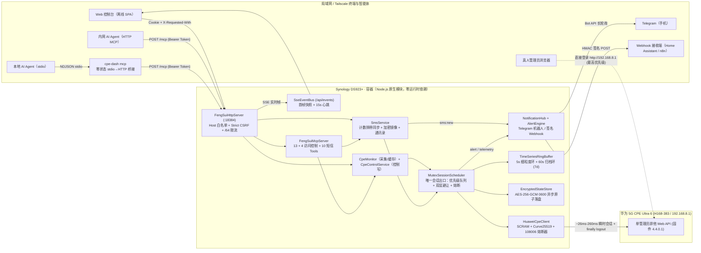

### 2. 瞬时短连与双层真人主动避让时序

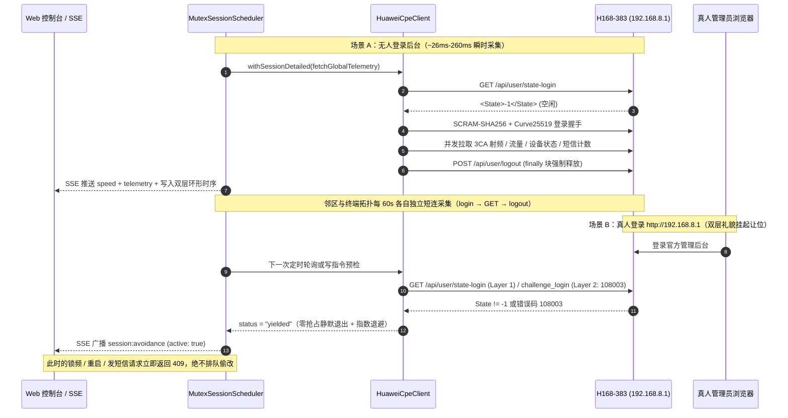

---

## ✨ 核心特性

- **⚡ 瞬时短连与双层真人在线避让**：每次鉴权操作在 [`HuaweiCpeClient`](src/cpe-client.ts) 与 [`MutexSessionScheduler`](src/scheduler.ts) 中串行收敛为瞬时会话，`finally` 中无条件 `POST /api/user/logout`；单次会话有最长占用时限，挂起的请求会被中止并登出。第 1 层 `GET /api/user/state-login` 预检，第 2 层对跨 IP 占用（`108003` / `108009`）实施 `45s → 300s` 指数静默退避。停机时在途会话 2 秒宽限后被取消并登出，整个停机 10 秒内完成，路由器管理员槽位不会被遗留占用。
- **🛑 跨重启持久化的 `108006` / `108007` 熔断器**：密码错误立即熔断，并把密码指纹写入加密状态库；修正 `.env` 中的 `CPE_PASSWORD` 后调用 `POST /api/session/reset-breaker`（或在界面熔断横幅中点击重置）即可恢复；密码未变时拒绝重置。`108007` 硬件锁定期结束后可直接重置。
- **📈 双层定长环形时序库**：内存恒定 `< 6 MB`；`3 小时 / 5 秒` 高频环 + `7 天 / 60 秒` 归档环，跨层无缝聚合；空闲的 NSA 5G 与未开放的传感器保持 `null`，不拉偏均值；`30 分钟` 批量加密刷盘，保护硬盘休眠。
- **✉️ 短信与遥测同源调度**：短信计数捎带在 5 秒遥测会话内，计数变化才触发增量同步；发送、已读、删除走同一调度器的控制写队列。短信镜像、通讯录与 Telegram 状态全部 `AES-256-GCM` 加密落盘，消息以不含号码的不透明 `uid` 标识。
- **📲 Telegram 双向机器人、签名 Webhook 与告警**：来信卡片（验证码、回复即发送、已读 / 会话 / 删除）、引导式发短信、告警推送与静音；Webhook 以 `HMAC-SHA256` 签名。告警覆盖离线、WAN 断开、信号劣化、载波聚合丢失、重启、短信存储、流量阈值与锁定漂移，带持续窗口与恢复迟滞。
- **🤖 原生 MCP Server**：零依赖实现 JSON-RPC 2.0 MCP（无状态 `2026-07-28` 与 `2025-11-25` / `2025-06-18` / `2025-03-26` / `2024-11-05`），挂载在守护进程 `/mcp`；`cpe-dash mcp` 只是零状态 stdio 桥接，**整个系统只有守护进程一个 CPE 会话出口**。
- **🚦 设备访问控制**：直接驱动路由器自带的 Wi-Fi MAC 过滤与家长控制，与官方「设备管理」页同一套名单。每次修改在一个控制会话内完成「读终端 → 读状态 → 规划 → 写入 → 回读核对」；运行烽燧的主机由路由器的 `IsLocalDevice` 标记自动识别，与发出请求的设备一起受服务端保护。固件没有按设备限速的接口，因此不提供限速。
- **🛡️ Web 纵深防御**：`Host` 白名单防 DNS Rebinding（`421`）、`SameSite=Strict; HttpOnly` 会话、`X-Requested-With` + `Origin` 双重防 CSRF、可信反代 CIDR 校验 + IPv6 `/64` 限流桶、无原型字典防原型链污染、线性扫描防 ReDoS、私网源校验防 SSRF。

---

## 📡 H168-383 硬件能力全景表（真机实测验证）

| 能力模块 | 核心协议端点 | 真机实测验证指标与结构特征 | 状态 |
| :--- | :--- | :--- | :---: |
| **3CA 三载波聚合** | `GET /api/device/signal`<br/>`GET /api/device/seccellinfo` | 实测激活 **`B1(20MHz) + B3(20MHz) + N78(100MHz)`** 共 **`140 MHz`** EN-DC 三载波聚合；次载波以 8 列分号 CSV 暴露独立 `EARFCN, Band, BW, PCI, RSRP, RSRQ, RSSI, SINR` | ✅ 已验证 |
| **高阶调制与 MIMO** | `GET /api/device/signal`<br/>`GET /api/device/ri` | 4G/5G 上下行 **`256QAM` / `64QAM`** 码字级 MCS、`TM[4]` 闭环空间复用、4G `RI=2` / 5G `nrrank` 流数及双码字 `CQI0/CQI1` | ✅ 已验证 |
| **物理层发射功率** | `GET /api/device/signal` | 4G `<txpower>` 与 5G `<nrtxpower>` 四通道功率：`PPusch`、`PPucch`、`PSrs`、`PPrach` (dBm) | ✅ 已验证 |
| **基站与跟踪区定位** | `GET /api/device/signal`<br/>`GET /api/net/cell-info` | 十进制 `<cell_id>` / `<tac>` 与十六进制 `<cellinfo>` / `<lac>` 数学恒等；支持 28-bit ECI（`eNodeB = ECI >>> 8`）与 36-bit NCI 拆分 | ✅ 已验证 |
| **4G / 5G 邻区扫描** | `GET /api/device/nbrcellinfo` | `<nbrcell_ltelist>` 与 `<nbrcell_nrlist>` 7 列分号 CSV（`EARFCN, Band, PCI, RSRP, RSRQ, RSSI, SINR`），可一键映射锁小区参数 | ✅ 已验证 |
| **4G / 5G 锁频段与锁小区** | `GET/POST /api/net/net-mode`<br/>`POST /api/net/lock-freq` | `select_band_switch=1` 与 `lock_freq_switch=3`；4G `LTEBand` 位掩码、5G NR 锁频段（`lock_mode=3`）、锁频点（`lock_mode=1`）与锁 `PCI+ARFCN` 小区（`lock_mode=2`） | ✅ 已验证 |
| **当日 vs 当月流量** | `GET /api/monitoring/month_statistics`<br/>`GET /api/monitoring/traffic-statistics` | 当日累计（`<CurrentDayUsed>`）、当月上下行分项累计、结算日（`<StartDay>`）与实时速率 | ✅ 已验证 |
| **终端拓扑与双栈租期** | `GET /api/system/HostInfo` (JSON)<br/>`GET /api/system/topology` (JSON) | 区分 **`LAN 1000M`**、`2.4GHz` 与 `5GHz` 终端，协商 PHY 速率、RSSI、IPv4/IPv6 与剩余 DHCP 租期 | ✅ 已验证 |
| **短信收发** | `/api/sms/sms-list` · `/api/sms/send-sms` · `/api/sms/send-status`<br/>`/api/sms/sms-count` · `/api/sms/set-read` · `/api/sms/delete-sms` | 收件箱 / 发件箱分页、长短信、发送状态轮询、已读与删除；计数接口捎带在遥测会话内，用于零额外会话的变化检测 | ✅ 已验证 |
| **Wi-Fi 7 (802.11be) MLO** | `GET/POST /api/wlan/wlandbho`<br/>`GET /api/wlan/multi-security-settings-ex` | `b/g/n/ax/be` + `a/n/ac/ax/be` 射频、**MLO 多链路聚合（`MloEnable`）**、双频优选（`DbhoEnable`）、EasyMesh 与自动信道优化 | ✅ 已验证 |
| **天线切换、静态 DHCP 与双栈 APN** | `/api/device/antenna_set_type`<br/>`/api/dhcp/static-addr-info`<br/>`/api/dialup/profiles` | 自动 / 内置 / 外置天线切换与插入检测、静态 MAC-IP 绑定、`IPv4/IPv6`（`iptype=2`）双栈 APN 审计 | ✅ 已验证 |

> 温度传感器与 gNodeB ID 未由固件 `4.4.0.1` 暴露，界面显示为 `N/A` / 仅显示 eNodeB。

---

## 🚀 快速开始

### 1. 在线演示（什么都不用装）

打开 **<https://cky008.github.io/fengsui-demo/>**：完整的控制台跑在浏览器里，数据全部是虚构的占位值，锁频、断网、上网时段、收发短信等操作都能点，只在当前页面生效，刷新即复原。演示的初始数据由真守护进程在构建时录制，页面内的模拟后端与守护进程共用同一套校验与规划代码，并有契约测试逐项比对（见架构报告第 9 节）。

### 2. 本地离线演示（无需路由器，30 秒看到完整界面）

```bash
git clone https://github.com/cky008/cpe-dash.git && cd cpe-dash
npm ci
npm run build:web
npm run demo          # http://127.0.0.1:18484 ，登录口令 fengsui-demo
# DEMO_SCENARIO=yield   npm run demo   → 每隔几分钟模拟真人登录官方后台（避让横幅）
# DEMO_SCENARIO=breaker npm run demo   → 错误的路由器密码，触发防爆破熔断（423 横幅）
```

演示进程**从不读取 `.env`、从不联网**：真实的调度器、监控、短信、SSE、REST、MCP 与 Web 界面，对接进程内的严格 H168-383 模型。

### 3. 本机运行（Node.js >= 22.6）

```bash
cp .env.example .env && chmod 600 .env
# 编辑 .env：CPE_PASSWORD（必填）、API_TOKEN 与 DATA_ENCRYPTION_KEY（强烈建议独立设置）
npm run build         # 编译守护进程 + Web 控制台到 dist/
npm start             # http://<本机 IP>:18384
# 开发模式：npm run dev（--watch 热重载，直接运行 TypeScript 源码）
```

### 4. 只读真机探针

```bash
npm run probe:rf          # 3CA 聚合链、256QAM MCS、MIMO 流数、发射功率与基站恒等校验
npm run probe:neighbors   # 4G / 5G 邻区表
npm run probe:traffic     # 实时速率、当日与当月累计流量
npm run probe:topology    # LAN / 2.4G / 5G 终端拓扑与 DHCP 租期
npm run probe:session     # 瞬时会话释放与双层真人避让
npm run probe:sms         # 只输出短信计数与耗时（不发送、不标记、不删除）
```

探针默认脱敏输出，且同样遵守单会话避让；请勿在守护进程运行时并发运行，以免占用管理员会话。

---

## 🐳 Docker / 群晖 DS923+ 部署

镜像由 [`Dockerfile`](Dockerfile) 多阶段构建：运行层基于 `node:26-alpine`（当前 LTS），只含编译产物、**无 `node_modules`**，以无特权 `node` 用户运行，内置 `HEALTHCHECK`（`GET /api/health`）。打 `v*.*.*` 标签后由 [`release.yml`](.github/workflows/release.yml) 发布 `linux/amd64` + `linux/arm64` 到 GHCR；每次推送由 [`ci-docker.yml`](.github/workflows/ci-docker.yml) 构建镜像并做容器冒烟测试（健康检查、登录、SSE、MCP、`SIGTERM` 停机与加密落盘）。

[`docker-compose.yml`](docker-compose.yml) 要点：

| 项 | 设置 |
| :--- | :--- |
| 时区 | `TZ=${TZ:-UTC}`（取自同目录 `.env`），发出短信的时间戳按此生成 |
| 端口 | 容器内固定 `18384`，宿主机端口取 `.env` 的 `WEB_PORT`（默认 `18384`） |
| 数据 | `./data:/app/data`：状态、短信镜像、通讯录全部加密落盘；`./.env` 只读挂载（`reset-breaker` 会重新读取） |
| 用户 | `user: "${PUID}:${PGID}"`，填 `data/` 与 `.env` 的属主 |
| 加固 | 只读根文件系统 + `tmpfs /tmp`、`cap_drop: ALL`、`no-new-privileges`、`init`、内存 1 GiB 与进程数 256 上限、15 秒停机宽限、日志轮转；基础镜像按摘要固定，GHCR 镜像附构建出处证明与 SBOM |

### 群晖 Container Manager（DSM 7.2+）

1. **准备目录**（SSH 登录 NAS）：
   ```bash
   mkdir -p /volume1/docker/cpe-dash/data && cd /volume1/docker/cpe-dash
   # 放入本仓库的 docker-compose.yml 与 .env.example
   cp .env.example .env && chmod 600 .env && chmod 700 data
   id -u && id -g      # 例如 1026 / 100，填入 .env 的 PUID / PGID
   ```
   编辑 `.env`：`CPE_PASSWORD`、`API_TOKEN`、`DATA_ENCRYPTION_KEY`、`TZ`（如 `Asia/Shanghai`）、`PUID` / `PGID`。
2. **获取镜像**（二选一）：
   - 拉取 GHCR：仓库为私有时，先在「Container Manager → 注册表 → 设置」添加 `ghcr.io`，或 SSH 执行 `sudo docker login ghcr.io -u <GitHub 用户名>`（令牌只需 `read:packages` 权限）；
   - 本地构建：把整个仓库放在该目录，执行 `sudo docker compose build`。
3. **创建项目**：「Container Manager → 项目 → 新增」，路径选 `/volume1/docker/cpe-dash`，来源选「使用现有 docker-compose.yml」，完成后启动。状态变为「健康」即可访问 `http://<NAS IP>:18384`。

命令行等价操作：

```bash
sudo docker compose up -d            # 旧版 DSM 为 docker-compose
sudo docker compose logs -f cpe-dash
sudo docker compose pull && sudo docker compose up -d   # 升级
sudo docker compose down             # SIGTERM：在途会话登出、加密状态刷盘，10 秒内退出
```

> **只运行一个实例**：一台路由器只能由一个守护进程管理（它独占管理员会话与 Telegram 机器人令牌）。启动前请停掉其他 cpe-dash / 旧 cpe-sms 实例。跨主机重复实例保护依赖局域网 UDP 广播（`18385`），Docker 桥接网络不转发广播；如需启用，请在 compose 中改用 `network_mode: host` 并移除 `ports:`。

### 自检、备份与换密钥

这些命令都不连接路由器：

```bash
# 自检：配置、数据目录权限、守护进程、每个加密文件能否用当前密钥解开（运行中也可执行）
sudo docker exec cpe-dash node dist/cli.js doctor
# 备份：把加密文件连同 SHA-256 清单复制到 data/backups/fengsui-backup-<时间>/（运行中也可执行）
sudo docker exec cpe-dash node dist/cli.js backup

# 以下两项要先停止守护进程（它们会获取数据目录锁）
sudo docker compose stop cpe-dash
# 恢复备份：校验清单与当前密钥后才写入，被替换的文件保留为 *.before-restore-<时间>
sudo docker compose run --rm cpe-dash node dist/cli.js restore /app/data/backups/fengsui-backup-<时间>
# 换主密钥：先把 .env 的 DATA_ENCRYPTION_KEY 改成新值，再输入旧密钥（不进命令历史）。
# 启动时因密钥不对而被隔离的 *.unreadable-* 文件也会用旧密钥解开并放回原处
read -rs OLD && printf '%s' "$OLD" | sudo docker compose run --rm -T cpe-dash node dist/cli.js rekey --old-key-stdin
sudo docker compose start cpe-dash
```

### 反向代理与 Tailscale

- 通过 Tailscale 访问时，`*.ts.net` 主机名与私网 / CGNAT 地址默认放行；自定义域名请加入 `ALLOWED_HOSTS`（如 `cpe.example.com`）。
- 经反向代理访问时，把代理的**精确 IP** 写入 `TRUSTED_PROXIES`，限流与审计才会采信 `X-Forwarded-For`；HTTPS 反代下会话 Cookie 自动追加 `Secure`。

### macOS：Apple `container` / `container-compose`

本机没有 Docker Desktop 时，可用 Apple 原生容器运行时验证镜像：

```bash
container system start                      # 首次可能需要 --enable-kernel-install
container build -t cpe-dash:local .
mkdir -p data
container run -d --name cpe-dash --init \
  --user "$(id -u):$(id -g)" --read-only --tmpfs /tmp --cap-drop ALL \
  -p 18384:18384 \
  -v "$PWD/.env:/app/.env:ro" -v "$PWD/data:/app/data" \
  cpe-dash:local
curl -s http://127.0.0.1:18384/api/health
container stop cpe-dash && container rm cpe-dash
```

使用 `container-compose` 时：把 compose 中的 `image:` 改为 `cpe-dash:local` 并删去 `build: .`；它不会对 `user:` 字段做变量插值，请把 `user:` 写成字面值（如 `"501:20"`，即 `id -u`:`id -g` 的输出）；它也会忽略 `tmpfs`，不影响运行。

---

## 🤖 MCP 智能体接入

「烽燧」在守护进程 `/mcp` 上提供 MCP 服务，有两种接入方式，**都不会产生第二个 CPE 会话**：

| 方式 | 适用客户端 | 说明 |
| :--- | :--- | :--- |
| **stdio 桥接** `cpe-dash mcp` | Claude Desktop、Cursor、Antigravity 等本地客户端 | 零状态转发：读取 `.env` 中的 `API_TOKEN` 与 `MCP_DAEMON_URL`（默认 `http://127.0.0.1:<WEB_PORT>/mcp`） |
| **Streamable HTTP** `POST /mcp` | 支持远程 MCP 的客户端、内网自动化 | `Authorization: Bearer <API_TOKEN>`；`MCP_HTTP_ENABLED=true`（默认） |

### Claude Desktop / Cursor / Antigravity（stdio，本机运行源码）

```json
{
  "mcpServers": {
    "fengsui": {
      "command": "node",
      "args": [
        "--experimental-strip-types",
        "/path/to/cpe-dash/src/cli.ts",
        "mcp",
        "--env",
        "/path/to/cpe-dash/.env"
      ]
    }
  }
}
```

已执行 `npm run build` 时，可把参数换成 `["/path/to/cpe-dash/dist/cli.js", "mcp", "--env", "/path/to/cpe-dash/.env"]`。若守护进程运行在 NAS 上，只需在本机 `.env` 中设置 `API_TOKEN` 与 `MCP_DAEMON_URL=http://<NAS IP>:18384/mcp`。

### 桥接到 Docker 容器内的守护进程

```json
{
  "mcpServers": {
    "fengsui": {
      "command": "docker",
      "args": ["exec", "-i", "cpe-dash", "node", "dist/cli.js", "mcp"]
    }
  }
}
```

适用于 MCP 客户端与容器在同一台主机（或 `DOCKER_HOST` 指向该主机）。容器内的 `/app/.env` 已提供 `API_TOKEN`，桥接自动连接容器内的 `http://127.0.0.1:18384/mcp`。

### Streamable HTTP（Cursor、Claude Code `.mcp.json`、VS Code 等支持远程 MCP 的客户端）

```json
{
  "mcpServers": {
    "fengsui": {
      "type": "http",
      "url": "http://<NAS IP 或 Tailscale 主机名>:18384/mcp",
      "headers": { "Authorization": "Bearer <API_TOKEN>" }
    }
  }
}
```

Claude Code：`claude mcp add --transport http fengsui http://<NAS IP>:18384/mcp --header "Authorization: Bearer <API_TOKEN>"`

控制台页头的机器人图标（手机上在监控大屏底部的「接入 AI」）会打开接入指南：显示当前地址对应的 MCP 端点；粘贴令牌（建议用 `API_TOKEN_READONLY`）后，生成可直接复制的智能体提示词、Claude Code 命令和 JSON 配置。令牌只在该页面里使用，屏幕上只显示末 4 位，不保存、不上传。

### 工具清单

| 分组 | 工具 |
| :--- | :--- |
| 观测（只读） | `get_cpe_telemetry`、`query_telemetry_history`、`list_neighbor_cells`、`get_cpe_session_status`、`list_terminal_topology`、`get_router_settings` |
| 控制（写） | `lock_band`、`lock_cell`、`unlock_rf_locks`、`set_security_switches`、`set_wifi_and_antenna`、`reconnect_cellular`†、`reboot_cpe`† |
| 访问控制 | `get_access_control`（只读，始终提供）；`MCP_ALLOW_ACCESS_CONTROL=true` 时追加 `set_device_internet_access`†、`set_wifi_mac_filter`†、`manage_internet_time_rule`† |
| 短信（`MCP_SMS_ACCESS=read`，默认） | `list_sms_threads`、`get_sms_thread`、`get_sms_status`、`search_contacts`、`preview_sms`、`sync_sms` |
| 短信（`MCP_SMS_ACCESS=full`） | 追加 `send_sms`†、`mark_sms_read`、`delete_sms`†、`upsert_contact` |

† 必须显式传入 `{ "confirm": true }`。`REDACT_SENSITIVE_IN_API=true`（默认）时，`get_cpe_telemetry`、`list_terminal_topology` 与资源 `fengsui://telemetry/latest` 返回脱敏副本：IMEI 只留前 6 位、IMSI 只留运营商代码、WAN 地址只留前两段，TAC / Cell ID / eNodeB 与终端名称为 `<REDACTED>`，便于把数据交给云端模型。所有入参按 `inputSchema` 在服务端强校验；锁频段只接受 H168-383 支持的频段，`lock_cell` 只能锁定已观测到的小区（服务小区、聚合载波或最近一次邻区扫描），防止模型幻觉参数导致断网。短信正文与发件人名称一律标注为不可信数据，`send_sms` 单收件人、默认仅限已知号码（`MCP_SMS_SEND_POLICY=known`）并按小时限额，`delete_sms` 默认拒绝删除未读短信。`MCP_ALLOW_MUTATIONS=false` 时只暴露观测类能力。只想让智能体读取时，把 `API_TOKEN_READONLY` 作为它的 Bearer 令牌（stdio 桥接则在本机 `.env` 中把 `API_TOKEN` 设为该值）：写工具既不出现也无法调用。

### 错误码

工具失败时返回 `isError: true`，`structuredContent` 为 `{ ok: false, errorCode, message, ... }`：

| `errorCode` | 含义与处理 |
| :--- | :--- |
| `BROWSER_SESSION_YIELDED` | 真人正在使用官方后台，已礼貌让位；附 `avoidance` 状态，稍后重试 |
| `PEER_DAEMON_ACTIVE` | 局域网内另有守护进程管理同一路由器，本实例待机 |
| `CIRCUIT_BREAKER_OPEN` | 防爆破熔断已触发；附 `circuitBreaker`，修正 `CPE_PASSWORD` 后由人工重置 |
| `QUEUE_FULL` | 调度队列已满或正在停机，稍后重试 |
| `CONFIRMATION_REQUIRED` / `VALIDATION_ERROR` | 缺少 `confirm: true` / 参数越界（频段、PCI、ARFCN 等） |
| `MUTATIONS_DISABLED` | 服务端设置了 `MCP_ALLOW_MUTATIONS=false` |
| `SMS_ACCESS_DENIED` / `RECIPIENT_NOT_ALLOWED` / `SMS_RATE_LIMITED` / `UNREAD_PROTECTED` | 短信权限、收件人策略、小时限额、未读保护 |
| `SMS_SEND_FAILED` | 路由器明确拒绝发送（已受理但状态未确认的短信会以成功返回并带 `timedOutWaitingStatus: true`，请勿重发） |
| `CPE_EXECUTION_ERROR` | 与路由器通信失败 |

JSON-RPC 层：桥接返回 `-32010`（守护进程不可达）与 `-32011`（令牌被拒绝）；`-32020` 为 `MCP-Protocol-Version` 头与请求体不一致，`-32022` 为不支持的协议版本。完整契约见 [`docs/PHASE2_BACKEND_CONTRACT.md`](docs/PHASE2_BACKEND_CONTRACT.md)。

---

## ✉️ 短信、Telegram 与告警

### 工作方式
- **同步**：启动时全量同步一次（CPE 上已有短信视为历史，不推送），之后由 5 秒遥测会话捎带的 `sms-count` 计数驱动增量同步，另有 30 分钟兜底全量对账。镜像与 CPE 严格一致：删除会同时删除 CPE 与本地记录。
- **发送**：Web、MCP、Telegram 共用同一条路径：会话前校验号码与长度（GSM-7 / UCS-2，最多 4 段、5 个收件人），会话内提交、轮询发送状态并回读发件记录。
- **真人优先**：有人登录 `http://192.168.8.1` 时，短信写操作返回 `409`，同步暂停，只用免登录接口探测未读数；对方退出后自动补同步。

### 配置 Telegram 机器人
1. 在 Telegram 中找 `@BotFather` 创建机器人，把令牌写入 `.env` 的 `TELEGRAM_BOT_TOKEN`；
2. 二选一：把自己的聊天 ID 写入 `TELEGRAM_CHAT_IDS`，或启动后在与机器人的**私聊**中发送 `/auth <API_TOKEN>`（令牌消息会被自动删除；群组里不接受 `/auth`，要给群组推送请把群组 ID 写入 `TELEGRAM_CHAT_IDS`；`API_TOKEN` 更换后需重新绑定）；
3. 重启服务，日志中出现 `telegram=on` 即生效。同一个机器人令牌只能有一个轮询者。

| 命令 / 交互 | 作用 |
| :--- | :--- |
| 来信卡片 | 发件人、国旗与联系人名，验证码一键复制；**直接回复卡片即发送短信**；按钮：已读 / 查看会话 / 删除（二次确认） |
| `/new` | 引导式发短信：选国家 → 输入号码或联系人名 → 输入正文（显示编码与分段）→ 确认发送 |
| `/send <号码> <正文>` | 快捷发送（同样需要点击确认） |
| `/inbox`、`/unread`、`/chat <号码>` | 会话列表、未读与会话详情（读取本地镜像，不开路由器会话） |
| `/contacts [关键字]`、`/contact <号码> <姓名>`、发送 `.vcf` 文件 | 查询、添加与批量导入联系人 |
| `/status`、`/alerts`、`/sync` | 设备与短信状态、最近告警、立即同步 |
| `/mute 30m\|2h\|1d\|off` | 暂停或恢复告警推送 |

### Webhook
设置 `WEBHOOK_URL` 后，新短信（`sms.received`）与告警（`alert`）以 JSON `POST` 推送。设置 `WEBHOOK_SECRET` 后，接收端可按如下方式校验签名：

```ts
import crypto from "node:crypto";
const expected = "sha256=" + crypto.createHmac("sha256", secret).update(`${req.headers["x-fengsui-timestamp"]}.${rawBody}`).digest("hex");
// 常量时间比较 expected 与 req.headers["x-fengsui-signature"]，并拒绝时间戳偏差过大的请求
```

### 告警
`CPE_UNREACHABLE`、`WAN_DOWN`、`SIGNAL_DEGRADED`（RSRP < `ALERT_RSRP_THRESHOLD_DBM` 或 SINR < `ALERT_SINR_THRESHOLD_DB` 持续 5 分钟）、`CA_DROPPED`、`REBOOT_DETECTED`、`SMS_STORAGE_HIGH` / `SMS_STORAGE_FULL`、`DATA_THRESHOLD`、锁定漂移、熔断告警、WAN 自愈的 `LOCK_ROLLED_BACK` / `LOCK_ROLLBACK_FAILED` / `WAN_AUTO_RECONNECT` / `WAN_RECONNECT_EXHAUSTED`、路由器换成未验证过的型号或固件版本时的 `FIRMWARE_UNVERIFIED`（每个版本只提醒一次，重启后不重复；华为会自动升级固件，所以只提醒、不阻止写操作，Telegram 推送还会附上一段可直接交给 Claude Code 核对兼容性的提示词），以及启动时加密数据无法解密而被隔离的 `DATA_QUARANTINED`，均记录在 `GET /api/alerts` 与 SSE `alert`，级别不低于 `ALERT_NOTIFY_MIN_SEVERITY` 的告警推送到 Telegram / Webhook。恢复类消息（`WAN_UP`、`CPE_RECOVERED`、`SIGNAL_RECOVERED`、`LOCK_REALIGNED`、`DUPLICATE_DAEMON_CLEARED`）按对应故障的级别推送，载波聚合下降 `CA_DROPPED` 按 warning 推送。NAS 经同一条蜂窝链路访问 Telegram，所以 WAN 断开期间发不出的 Telegram 通知（告警与新短信，最多 50 条、24 小时内）会暂存在内存中，恢复后按原顺序补发。

### WAN 自愈（可选，默认关闭）
这两项会在没人操作时写路由器，所以默认关闭，需要在 `.env` 中显式开启：

- **锁频回滚** `LOCK_ROLLBACK_AFTER_MIN`：锁频段或锁小区后，WAN 必须恢复并连续在线 2 分钟；到时间仍然断开，就自动解除全部锁定一次并发出 `LOCK_ROLLED_BACK`。窗口内重启守护进程会继续计时；解锁没能完成（熔断、连续失败、到期 1 小时后仍被真人登录挡住）时发出 `LOCK_ROLLBACK_FAILED`。
- **WAN 自动重拨** `WAN_AUTO_RECONNECT_AFTER_MIN`：WAN 断开持续这么久后自动重拨，之后间隔 10 / 30 / 60 分钟再试，24 小时内最多 4 次（`WAN_AUTO_RECONNECT` / `WAN_RECONNECT_EXHAUSTED`），从不自动重启路由器。锁定后的观察期由锁频回滚负责。

两者只依据最新遥测，走控制队列（真人登录官方后台时让位，熔断时不登录），并在写入前于同一会话内重新读取 WAN 状态与移动数据开关：WAN 已恢复或移动数据被手动关闭时不写入。

> **加密密钥提示**：`DATA_ENCRYPTION_KEY` 留空时等于 `CPE_PASSWORD`，而通讯录无法从路由器重新同步。建议设置独立密钥；更换密钥或路由器密码时，先修改 `.env` 并调用 `POST /api/session/reset-breaker`（立即用新密钥重写所有加密文件），再重启。

---

## 🔌 REST API 与 SSE

| 通道 | 核心端点 | 说明 |
| :--- | :--- | :--- |
| **认证与字典** | `POST /api/auth/login`、`POST /api/auth/logout`、`GET /api/auth/status`、`GET /api/i18n/:locale` | `SameSite=Strict; HttpOnly` 会话；中英词典 |
| **只读遥测与时序** | `GET /api/telemetry`、`/api/timeseries`、`/api/neighbors`、`/api/topology`、`/api/settings` | 零 CPE 开销读取内存快照与 `1h/6h/12h/24h/custom` 曲线 |
| **主动刷新** | `POST /api/telemetry/refresh`、`/api/neighbors/scan`、`/api/topology/refresh`、`/api/settings/refresh` | 单飞合并的一次礼貌瞬时采样；避让或熔断时返回缓存快照 |
| **射频与系统控制** | `POST /api/control/band-lock`、`cell-lock`、`unlock`、`reboot`、`reconnect`、`security`、`wifi7`、`antenna`、`mobile-data` | 真人在线返回 `409`，熔断后返回 `423 CIRCUIT_BREAKER_OPEN` |
| **会话与熔断器** | `GET /api/session/status`、`POST /api/session/reset-breaker` | 调度器 / 避让 / 熔断状态；重新读取 `.env` 并重置熔断器 |
| **短信与通讯录** | `GET /api/sms/status`、`threads`、`thread`、`contacts`、`countries`；`POST /api/sms/preview`、`send`、`read`、`delete`、`sync`、`contacts/upsert`、`contacts/delete`、`contacts/import-vcf` | 读接口直读加密镜像（零 CPE 会话）；写接口走控制队列 |
| **设备访问控制** | `GET /api/access-control`、`POST /api/access-control/refresh`；`POST /api/control/wifi-access`、`wifi-mac-filter`、`time-rule` | Wi-Fi MAC 过滤与上网时段；写操作必须带 `confirm: true`，在一个控制会话内回读核对 |
| **告警** | `GET /api/alerts` | 最近 100 条告警与投递统计 |
| **实时 SSE** | `GET /api/events` | `hello`、`speed`、`telemetry`、`neighbors`、`topology`、`settings`、`access-control`、`session:avoidance`、`control:applied`、`alert`、`sms:new`、`sms:sent`、`sms:updated`、`sms:sync`、`sms:status`、`contacts:updated` 与心跳 |
| **健康检查** | `GET /api/health` | 免鉴权，供 `HEALTHCHECK` 与监控使用 |

状态变更请求必须携带 `X-Requested-With: XMLHttpRequest` 与 `Content-Type: application/json`。登录后的 Web 控制台（Cookie 会话）始终拿到原值，由界面默认打码；用 `Authorization: Bearer` 调用的脚本与 SSE 订阅者在 `REDACT_SENSITIVE_IN_API=true` 时拿到与 MCP 相同的脱敏副本。REST / SSE 载荷类型定义在 [`src/api-contract.ts`](src/api-contract.ts)（服务端以 `satisfies` 校验，Web 前端直接复用），完整契约见 [`docs/PHASE2_BACKEND_CONTRACT.md`](docs/PHASE2_BACKEND_CONTRACT.md)。

---

## ⚙️ `.env` 配置参考

完整模板见 [`.env.example`](.env.example)。守护进程只读取项目根目录（容器内为 `/app/.env`）的 `.env` 与环境变量，不依赖 `dotenv`。

| 变量 | 默认值 | 说明 |
| :--- | :--- | :--- |
| `CPE_URL` | `http://192.168.8.1` | CPE 管理地址；只允许私网 / 环回 / CGNAT 主机，禁止内嵌凭据、查询串与重定向（防 SSRF） |
| `CPE_USERNAME` | `admin` | 管理员账号 |
| `CPE_PASSWORD` | *(必填)* | 管理员密码；`108006` 错误立即触发持久化熔断 |
| `TZ` | `UTC` | IANA 时区（如 `Asia/Shanghai`）；发出短信的 `<Date>` 按此生成，请与 CPE 所在时区一致 |
| `DATA_ENCRYPTION_KEY` | *(回退 `CPE_PASSWORD`)* | `data/*.json` 落盘加密主密钥（`scrypt` + `HKDF-SHA256` → `AES-256-GCM`），强烈建议独立设置 |
| `API_TOKEN_READONLY` | *(空，不启用)* | 只读 Bearer 令牌：可读取 REST / SSE、触发只读刷新，在 `/mcp` 上只看得到只读工具；任何写操作返回 `403 READ_ONLY_TOKEN`。适合看板、脚本和 AI 智能体；必须与 `API_TOKEN`、`CPE_PASSWORD` 不同 |
| `API_TOKEN` | *(回退 `CPE_PASSWORD`)* | Web 登录口令与 REST / `/mcp` Bearer 令牌，建议高熵随机串。未设置时路由器管理密码会出现在 MCP 客户端配置里、并经 Telegram `/auth` 发出，启动时会提示 |
| `TRUSTED_PROXIES` | `127.0.0.1,::1` | 可信反向代理 IP / CIDR；只有命中时才解析 `X-Forwarded-For` / `X-Forwarded-Proto` |
| `ALLOWED_HOSTS` | *(空)* | 额外放行的 `Host`（如 `cpe.example.com`）；私网 IP、`localhost`、`*.local` / `*.lan` / `*.internal` / `*.ts.net` 始终放行 |
| `WEB_ENABLED` | `true` | 是否启动 HTTP 服务（Web 控制台、REST、SSE 与 `/mcp`）；设为 `false` 时只运行后台采集、短信同步与通知 |
| `WEB_HOST` / `WEB_PORT` | `0.0.0.0` / `18384` | 监听地址与端口；compose 下 `WEB_PORT` 决定宿主机端口 |
| `DEFAULT_LOCALE` | `zh-CN` | 默认界面与提示语言（`zh-CN` / `en`） |
| `MCP_HTTP_ENABLED` | `true` | 是否启用 `POST /mcp`（stdio 桥接也依赖它） |
| `MCP_ALLOW_MUTATIONS` | `true` | 是否允许 MCP 调用写操作工具 |
| `MCP_ALLOW_ACCESS_CONTROL` | `false` | 是否向 MCP 开放会断网的工具（拉黑 / 恢复设备、MAC 过滤、上网时段）；读取访问控制状态始终可用 |
| `MCP_DAEMON_URL` | *(由 `WEB_HOST`/`WEB_PORT` 推导)* | stdio 桥接转发的 `/mcp` 地址；只接受局域网 / 环回主机 |
| `PEER_DISCOVERY_ENABLED` / `PEER_DISCOVERY_PORT` | `true` / `18385` | 跨主机重复守护进程保护（签名 UDP 广播信标；Docker 需 host 网络）。信标签名密钥由 `CPE_PASSWORD` 经 scrypt 派生，局域网内的设备可借信标离线猜测弱密码，只运行一台守护进程时可关闭 |
| `REDACT_SENSITIVE_IN_API` | `true` | 对 Bearer API、SSE 与 MCP 输出脱敏 IMEI、IMSI、本机号码、MAC、WAN 地址与 TAC / CellID 等位置指纹。Web 控制台不受影响：始终收到原值，界面默认打码、点眼睛显示。修改后重启或调用 `reset-breaker` 生效 |
| `SSE_HEARTBEAT_MS` / `SSE_MAX_CLIENTS` | `15000` / `32` | SSE 心跳间隔与最大并发连接数 |
| `POLL_INTERVAL_MS` | `5000` | 遥测与实时速率采样周期 |
| `NEIGHBOR_SCAN_INTERVAL_MS` | `60000` | 邻区扫描周期 |
| `REQUEST_TIMEOUT_MS` | `15000` | 单次 HTTP 请求超时 |
| `RESPECT_BROWSER_SESSION` | `true` | 真人在线自动避让（强烈建议保持开启） |
| `STATE_FILE` | `./data/state.json` | 加密状态文件；容器内为 `/app/data/state.json` |
| `HISTORY_RETENTION_HOURS` | `168` | 时序历史保留时长（7 天） |
| `STATE_FLUSH_INTERVAL_MS` | `1800000` | 加密状态的定期落盘间隔（30 分钟，最小 `10000`；停机时总会落盘） |
| `RATE_LIMIT_WINDOW_MS` / `RATE_LIMIT_MAX_AUTH_FAILURES` | `60000` / `8` | 登录失败限流窗口与窗口内允许的失败次数（按直连地址计） |
| `SESSION_TTL_MS` | `86400000` | 控制台登录会话有效期（24 小时） |
| `STATIC_DIR` | *(构建产物)* | 控制台静态文件目录，默认 `dist/web/public`，一般无需设置 |
| `SMS_ENABLED` | `true` | 启用短信同步、REST、SSE 与 MCP 短信工具 |
| `DEFAULT_COUNTRY_CODE` | `+353` | 无国际前缀号码的默认国家区号 |
| `SMS_FILE` / `CONTACTS_FILE` | *(与 `STATE_FILE` 同目录)* | 加密短信镜像与通讯录 |
| `SMS_FULL_SYNC_INTERVAL_MS` | `1800000` | 兜底全量对账间隔（最小 `60000`） |
| `SMS_SEED_EXISTING_ON_START` | `true` | 首次同步时把已有短信视为历史（不推送） |
| `SMS_AUTO_MARK_READ` | `false` | 推送新短信后自动在 CPE 上标记已读 |
| `SMS_SEND_STATUS_TIMEOUT_MS` | `45000` | 发送状态轮询上限（`5000..120000`） |
| `TELEGRAM_BOT_TOKEN` / `TELEGRAM_CHAT_IDS` | *(空)* | 机器人令牌与预授权聊天 ID |
| `TELEGRAM_API_BASE` / `TELEGRAM_STATE_FILE` | `https://api.telegram.org` / *(同目录 `telegram.json`)* | 自建 Bot API 地址与加密状态文件 |
| `WEBHOOK_URL` / `WEBHOOK_SECRET` | *(空)* | 新短信与告警的 JSON 推送地址与 HMAC 签名密钥 |
| `ALERTS_ENABLED` / `ALERT_NOTIFY_MIN_SEVERITY` | `true` / `warning` | 告警引擎与推送最低级别（`info` / `warning` / `critical`） |
| `ALERT_RSRP_THRESHOLD_DBM` / `ALERT_SINR_THRESHOLD_DB` | `-110` / `0` | 信号劣化告警阈值 |
| `LOCK_ROLLBACK_AFTER_MIN` | `0`（关闭） | 锁定后 WAN 仍断开多少分钟就自动解除全部锁定（`3..1440`） |
| `WAN_AUTO_RECONNECT_AFTER_MIN` | `0`（关闭） | WAN 断开多少分钟后自动重拨（`1..1440`；之后间隔 10 / 30 / 60 分钟，24 小时内最多 4 次，不重启） |
| `MCP_SMS_ACCESS` | `read` | MCP 短信工具权限：`none` / `read` / `full` |
| `MCP_SMS_SEND_POLICY` | `known` | `known` 仅限你保存的联系人或曾发过短信的号码（智能体自己用 `upsert_contact` 添加的不算）；`any` 不限制 |
| `MCP_SMS_SEND_LIMIT_PER_HOUR` | `10` | MCP 每小时发送上限（`0` 禁止） |
| `CPE_HAR_PATH` | *(空)* | 仅探针脚本使用的离线审计归档路径（严禁入库） |
| `PUID` / `PGID` | `1000` / `1000` | 仅供 docker compose 插值：容器运行用户（守护进程不读取） |

---

## 🛡️ 安全与质量门禁

```bash
npm run check
# 1. npm run typecheck      → 守护进程 / 脚本 / 测试与 Web 前端两套 tsconfig，100% 严格 TypeScript
# 2. npm run test:coverage  → node:test 全离线测试 + c8 门禁（语句 / 行 / 函数 >= 90%，实测 98% / 98% / 99%）
# 3. npm run audit:secrets  → 扫描工作区与完整 git 历史：密钥、硬件指纹、手机号与任何 .js 源文件
```

- 单元测试只对接注入式 Mock 路由器，**从不访问真实 `192.168.8.1`**；测试号码只用保留号段，从不向真实号码发短信。
- CI 在 Node.js 22.x（`engines` 下限）与 26.x 上跑完整门禁，再构建 `linux/amd64` 镜像，以无特权只读方式运行并验证健康检查、Web 与 CSP、登录、SSE、MCP、`SIGTERM` 停机与仅加密落盘。
- 七大工程与安全铁律见 [`AGENTS.md`](AGENTS.md)。

---

## 🏗️ 仓库结构

```text
cpe-dash/
├── src/                     # 守护进程（Node.js 原生模块，零运行时依赖）
│   ├── cpe-client.ts        # 瞬时会话客户端、双层避让与 108006 熔断器
│   ├── scheduler.ts         # MutexSessionScheduler：唯一 CPE 会话出口
│   ├── cpe-monitor.ts · cpe-controls.ts · cpe-domain.ts · parsers.ts · band-lock.ts
│   ├── sms/ · notify/       # 短信服务、加密镜像、通讯录 / Telegram 机器人、Webhook、通知中心
│   ├── http-server.ts · sse-bus.ts · mcp-server.ts · mcp-stdio-bridge.ts
│   ├── api-contract.ts      # REST / SSE 载荷类型（前后端共用）
│   └── cli.ts               # serve 守护进程与 mcp 桥接入口
├── web/                     # Web 控制台：严格 TS + Tailwind v4 / daisyUI v5，离线构建到 dist/web/public
│   ├── index.html · styles.css
│   └── src/                 # core/（无 DOM 逻辑，纳入覆盖率门禁）· ui/ · i18n/ · demo/（在线演示的页面内后端）
├── scripts/                 # build-web.ts · demo-router.ts · demo-server.ts · capture-demo-seed.ts · audit-secrets.ts · probe-*.ts
├── test/                    # node:test 离线测试（helpers/ 内含加密 Mock 路由器）
├── docs/                    # 协议规范、架构报告、后端契约与界面截图
├── Dockerfile · docker-compose.yml · .dockerignore
└── .github/workflows/       # ci-docker.yml · release.yml · demo-pages.yml
```

---

## 📚 文档索引

- [`AGENTS.md`](AGENTS.md) — 工程契约、七大安全铁律与强制 TDD 守则
- [`docs/PHASE1_PROTOCOL_SPEC.md`](docs/PHASE1_PROTOCOL_SPEC.md) — H168-383 私有协议（含短信接口与加密通道）、逆向算法与真机实测字典
- [`docs/PHASE2_ARCHITECTURE_REPORT.md`](docs/PHASE2_ARCHITECTURE_REPORT.md) — 零依赖后端选型、安全防线、短信融合与 Web 控制台架构
- [`docs/PHASE2_BACKEND_CONTRACT.md`](docs/PHASE2_BACKEND_CONTRACT.md) — REST API、SSE 事件、MCP 工具（含短信）与错误码权威契约

---

## ⚠️ 免责声明与许可

- **无线电合规**：锁频段、锁小区、锁频点会改变终端的接入与驻留行为。请仅在你合法使用的网络与频段上操作，遵守所在国家 / 地区的无线电管理法规与运营商服务条款；不当锁定可能导致断网、服务质量下降或违反合约。本项目不提供任何绕过运营商限制、修改射频参数或发射功率的功能。
- **短信与隐私**：通过本项目发送的短信由你本人负责并按运营商资费计费；使用 Telegram 机器人时，推送内容会经过 Telegram 服务器。请勿用于群发、骚扰或任何违法用途。
- **非官方项目**：本项目为独立的非官方工具，与华为技术有限公司及任何运营商均无隶属或背书关系；所有商标归其各自所有者。软件按「现状」提供，不附带任何明示或默示担保，使用风险自负。
- **许可**：本项目以 **[PolyForm Noncommercial License 1.0.0](LICENSE)** 发布，仅限个人、研究与其他非商业用途；商业使用需另行获得作者授权。
