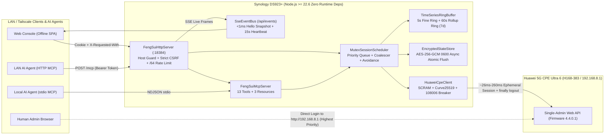
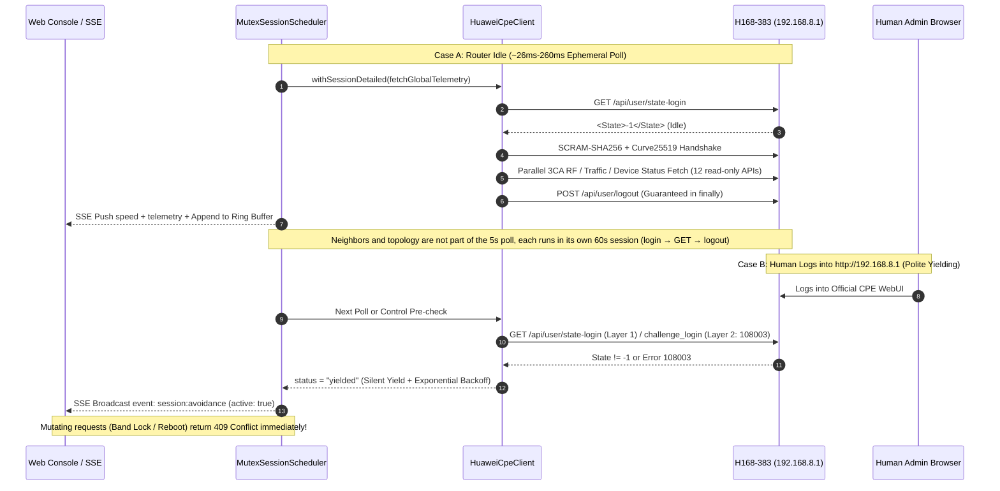

# cpe-dash · FengSui (烽燧)

<p align="center">
  <strong>Self-Hosted 5G RF Telemetry · 3CA Carrier Aggregation · Neighbor Cell Scanner · Band & Cell Locking · MCP Agent Platform for Huawei 5G CPE Ultra 6 (H168-383)</strong>
</p>

<p align="center">
  <a href="README.md">简体中文</a> | <strong>English</strong>
</p>

<p align="center">
  <a href="https://nodejs.org/">
    = 22.6.0" />
  </a>
  <a href="https://www.typescriptlang.org/">
    
  </a>
  <a href="package.json">
    
  </a>
  <a href="test/">
     96%" />
  </a>
  <a href="AGENTS.md">
    
  </a>
  <a href=".env.example">
    
  </a>
  <a href="docs/PHASE2_BACKEND_CONTRACT.md">
    
  </a>
  <a href="LICENSE">
    
  </a>
</p>

---

**FengSui (烽燧 / `cpe-dash`)** is a self-hosted 5G RF telemetry, 3CA carrier aggregation analyzer, 4G/5G neighbor cell scanner, band/cell lock controller, dual-period traffic auditor, LAN terminal topology, and **Model Context Protocol (MCP)** AI agent platform built specifically for the **Huawei 5G CPE Ultra 6 (`H168-383`, firmware `4.4.0.1`)** (strictly focused on RF & network management, excluding SMS).

Engineered for private NAS environments such as **Synology DS923+ (AMD Ryzen R1600 / 32GB RAM)**, `cpe-dash` is written in **100% Strict TypeScript (`strict: true`)** as a self-contained repository with **zero production runtime npm dependencies** (powered solely by Node.js built-in modules) and listens on isolated port `:18384` by default.

---

## Table of Contents

- [🏛️ System Architecture & Single-Session Avoidance Diagrams](#️-system-architecture--single-session-avoidance-diagrams)
- [✨ Core Engineering & Protocol Highlights](#-core-engineering--protocol-highlights)
- [📡 H168-383 Hardware Capability Panorama (Live-Verified)](#-h168-383-hardware-capability-panorama-live-verified)
- [🏗️ Repository Architecture](#️-repository-architecture)
- [🚀 Quick Start (Daemon, MCP Server & Hardware Probes)](#-quick-start-daemon-mcp-server--hardware-probes)
- [🔌 REST API, Real-Time SSE & MCP Tools Overview](#-rest-api-real-time-sse--mcp-tools-overview)
- [⚙️ `.env` Configuration Reference](#️-env-configuration-reference)
- [🛡️ Security Invariants & TDD Quality Gates](#️-security-invariants--tdd-quality-gates)
- [📚 Authoritative Documentation Index](#-authoritative-documentation-index)
- [⚠️ Disclaimer & License](#️-disclaimer--license)

---

## 🏛️ System Architecture & Single-Session Avoidance Diagrams

### 1. Synology DS923+ Private LAN / Tailscale Deployment Topology



### 2. Single-Admin Session Mutex & Dual-Layer Human Avoidance Sequence



---

## ✨ Core Engineering & Protocol Highlights

- **⚡ `~26 ms` Ephemeral Sessions & Anti-Flapping Dual-Layer Browser Avoidance**
  - The H168-383 strictly permits 1 active admin session. [`HuaweiCpeClient`](src/cpe-client.ts) and [`MutexSessionScheduler`](src/scheduler.ts) serialize all authenticated transactions into short-lived windows and unconditionally invoke `POST /api/user/logout` (with a hard 3s timeout cap) inside `finally`.
  - **Dual-Layer Avoidance**: Layer 1 checks `GET /api/user/state-login` before SCRAM; Layer 2 catches cross-IP `108003` / `108009` occupied responses and enters an exponential quiet cooldown (`45s → 300s`) so `challenge_login` is never hammered while a human uses the WebUI.
- **🛑 Persistent `108006` / `108007` Anti-Brute-Force Circuit Breaker**
  - Three wrong password attempts lock the router's admin account. Our `CircuitBreaker` latches immediately upon `108006` / `108007` and persists the credential fingerprint inside `EncryptedStateStore`, preventing restart loops from locking out the router. A wrong-password latch (`108006` / `108002` / `108001`) clears only after `CPE_PASSWORD` is corrected in `.env`, followed by `POST /api/session/reset-breaker` or a restart; a reset with the password unchanged is refused (`400`). A `108007` hardware lockout can be cleared with reset-breaker once the lockout period has passed.
- **📈 Dual-Tier Fixed-Memory Circular Time-Series (`TimeSeriesRingBuffer`)**
  - Bounded `< 6 MB` footprint: `Tier 1` stores `3h` at `5s` resolution while `Tier 2` stores `7d` at `60s` roll-ups, joined seamlessly for `1h`, `6h`, `12h`, `24h`, and custom `[fromMs, toMs]` queries. Intermittent NSA 5G and unsupported temperature channels remain `null` (never skewed toward `0`), backed by `30m` batched async flushes to preserve Synology HDD hibernation.
- **🤖 Native Dual-Transport MCP Server (`stdio` + Streamable HTTP `/mcp`)**
  - Zero-dependency JSON-RPC 2.0 MCP server ([`FengSuiMcpServer`](src/mcp-server.ts)) exposing **13 strongly-typed tools** and **3 resources** to Claude Desktop, Antigravity, Cursor, and LAN agents, with mandatory `{ confirm: true }` guards on `reboot_cpe` and `reconnect_cellular`.
- **🛡️ Defense-in-Depth Web Security**
  - Enforces DNS-rebinding `Host` allowlists (`421`), `SameSite=Strict; HttpOnly` session cookies, `X-Requested-With` + `Origin` CSRF validation, `net.BlockList` CIDR proxy trust + IPv6 `/64` rate-limit buckets, null-prototype parsers, linear O(N) XML scanning, and private-origin SSRF guards.

---

## 📡 H168-383 Hardware Capability Panorama (Live-Verified)

| Capability Domain | Verified Endpoints | Live-Measured Telemetry & Protocol Structure | Status |
| :--- | :--- | :--- | :---: |
| **3CA Carrier Aggregation** | `GET /api/device/signal`<br/>`GET /api/device/seccellinfo` | Live **`B1(20MHz) + B3(20MHz) + N78(100MHz)`** (**`140 MHz`** EN-DC 3CA); secondary carriers exposed via 8-column CSV (`EARFCN, Band, BW, PCI, RSRP, RSRQ, RSSI, SINR`) | ✅ Verified |
| **256QAM MCS & MIMO** | `GET /api/device/signal`<br/>`GET /api/device/ri` | Exposes 4G/5G UL & DL **`256QAM` / `64QAM`** codeword MCS indices, `TM[4]` spatial multiplexing, LTE `RI=2` / NR `nrrank` layers, and `CQI0/CQI1` | ✅ Verified |
| **PHY Transmit Power** | `GET /api/device/signal` | Separate 4G `<txpower>` and 5G `<nrtxpower>` reporting `PPusch`, `PPucch`, `PSrs`, and `PPrach` in dBm | ✅ Verified |
| **Tower & TAC Identity** | `GET /api/device/signal`<br/>`GET /api/net/cell-info` | Decimal `<cell_id>` / `<tac>` proven mathematically identical to hex `<cellinfo>` / `<lac>`; 28-bit ECI (`eNodeB = ECI >>> 8`) & 36-bit NCI bitwise decomposition | ✅ Verified |
| **4G / 5G Neighbor Scan** | `GET /api/device/nbrcellinfo` | Native `<nbrcell_ltelist>` & `<nbrcell_nrlist>` 7-column CSV (`EARFCN, Band, PCI, RSRP, RSRQ, RSSI, SINR`) directly mappable to cell-lock payloads | ✅ Verified |
| **Band & Cell Locking** | `GET/POST /api/net/net-mode`<br/>`POST /api/net/lock-freq` | Hardware exposes `select_band_switch=1` & `lock_freq_switch=3`; supports 4G `LTEBand` hex masks, 5G NR band lock (`lock_mode=3`), freq lock (`1`), and `PCI+ARFCN` cell lock (`2`) | ✅ Verified |
| **Today vs Monthly Traffic** | `GET /api/monitoring/month_statistics`<br/>`GET /api/monitoring/traffic-statistics` | Native **Today's cumulative bytes (`<CurrentDayUsed>`)**, **Monthly UL+DL bytes**, billing rollover `<StartDay>`, and live byte/bit rates (`CurrentDownloadRate * 8`) | ✅ Verified |
| **Terminal Topology & Leases** | `GET /api/system/HostInfo` (JSON)<br/>`GET /api/system/topology` (JSON) | Classifies **`LAN 1000M`** Gigabit Ethernet vs `2.4GHz` / `5GHz` Wi-Fi clients with PHY rate (Mbps), RSSI, dual-stack IPv4/IPv6, and remaining DHCP lease seconds | ✅ Verified |
| **Wi-Fi 7 (802.11be) MLO** | `GET/POST /api/wlan/wlandbho`<br/>`GET /api/wlan/multi-security-settings-ex` | Tri-radio `802.11be` (`b/g/n/ax/be` + `a/n/ac/ax/be`), **MLO (`MloEnable`)**, Dual-Band Handover (`DbhoEnable`), EasyMesh, and channel auto-optimization | ✅ Verified |
| **Antenna, Static DHCP & APN** | `/api/device/antenna_set_type`<br/>`/api/dhcp/static-addr-info`<br/>`/api/dialup/profiles` | Auto/Internal/External antenna mode & physical insertion telemetry, static MAC-IP reservations, `IPv4/IPv6` (`iptype=2`) dual-stack APN profiles, and scheduled reboot | ✅ Verified |

---

## 🏗️ Repository Architecture

```text
cpe-dash/
├── AGENTS.md                        # Mandatory architecture, session safety & 7 security/TDD invariants
├── .env.example                     # Pure native .env template (default WEB_PORT=18384)
├── locales/                         # Zero-dep strongly-typed bilingual catalogs (zh-CN.json / en.json)
├── public/                          # Offline static placeholder (Phase 3 prioritizes dist/web/public)
├── docs/
│   ├── PHASE1_PROTOCOL_SPEC.md      # Complete H168-383 API dictionary, reversed formulas & Phase 1 spec
│   ├── PHASE2_ARCHITECTURE_REPORT.md # Backend & i18n architectural evaluation & security hardening report
│   └── PHASE2_BACKEND_CONTRACT.md   # Phase 2 -> Phase 3 REST / SSE / MCP TypeScript handoff contract
├── src/
│   ├── types.ts                     # Strict TypeScript domain interfaces & discriminated unions
│   ├── config.ts                    # Zero-dep .env parser, SSRF validator, CIDR proxy trust & /64 buckets
│   ├── i18n.ts                      # Zero-dep compile-time key-safe i18n engine (zh-CN / en)
│   ├── crypto.ts                    # Unclamped big-endian Curve25519, Huawei SCRAM-SHA256, AES-256-GCM
│   ├── xml.ts                       # Linear O(N) ReDoS-safe & prototype-pollution-safe XML codec
│   ├── sanitize.ts                  # Automated RFC redaction engine for IMEI/IMSI/MAC/IP/TAC/CellID
│   ├── encrypted-file.ts            # StorageCipher (scrypt + HKDF-SHA256 + AES-256-GCM 0600)
│   ├── band-lock.ts                 # 4G/5G BandMask bitwise codec, ECI/NCI splitter & lock XML builders
│   ├── parsers.ts                   # Pure parsers for 3CA RF, MCS, TxPower, neighbors, traffic & topology
│   ├── cpe-client.ts                # Ephemeral session client, reentrancy guard, avoidance & 108006 breaker
│   ├── cpe-domain.ts                # Aggregated telemetry, neighbor scan, locking, security & Wi-Fi 7 MLO
│   ├── timeseries.ts                # Dual-tier circular ring buffer (5s fine ring + 60s 7-day rollup ring)
│   ├── state-store.ts               # Async atomic encrypted state persistence with key-rotation recovery
│   ├── scheduler.ts                 # Single-instance mutex scheduler, single-flight coalescer & backoff
│   ├── sse-bus.ts                   # /api/events sub-ms SSE fan-out bus, backpressure eviction & heartbeat
│   ├── mcp-server.ts                # Native JSON-RPC 2.0 MCP Server (stdio NDJSON + Streamable HTTP)
│   ├── http-server.ts               # Hardened HTTP/REST/SSE/MCP & static asset server (:18384)
│   ├── cli.ts                       # Unified daemon (serve) & MCP (mcp) CLI entrypoint
│   └── index.ts                     # Public SDK exports
├── scripts/
│   ├── audit-secrets.ts             # Working-tree + full git-history Zero-Secret/Zero-PII & Pure-TS gate
│   └── probe-*.ts                   # 8 read-only live hardware & protocol verification probes
└── test/                            # Offline deterministic simulation test suite (> 96% coverage)
```

---

## 🚀 Quick Start (Daemon, MCP Server & Hardware Probes)

### 1. Setup

```bash
git clone https://github.com/cky008/cpe-dash.git
cd cpe-dash
npm install

cp .env.example .env
chmod 600 .env
# Edit .env and set CPE_PASSWORD and a strong API_TOKEN (never commit .env)
```

### 2. Start the FengSui Web / REST / SSE / HTTP-MCP Daemon

```bash
# Development watch mode (Node.js >= 22.6 native TypeScript execution)
npm run dev

# Production build & start (listens on http://0.0.0.0:18384 by default)
npm run build
npm start
```

### 3. Connect AI Agents (MCP Server)

- **Local `stdio` Transport** (Claude Desktop / Antigravity / Cursor):
  ```bash
  npm run mcp
  # Or pass explicit .env path: node --experimental-strip-types src/cli.ts mcp --env /path/to/.env
  # (the flag is optional on Node 22.18+ / 23.6+; every npm script already passes it)
  ```
- **LAN / Tailscale Streamable HTTP Transport**:
  ```bash
  curl -X POST http://127.0.0.1:18384/mcp \
    -H "Authorization: Bearer $API_TOKEN" \
    -H "Content-Type: application/json" \
    -d '{"jsonrpc":"2.0","id":1,"method":"tools/list"}'
  ```

### 4. Run Non-Destructive Hardware Probes

```bash
npm run probe:rf          # Query 3CA chain, 256QAM MCS, MIMO rank, TxPower & hex/dec tower proof
npm run probe:neighbors   # Scan 4G/5G candidate neighbor cells (EARFCN, Band, PCI, RSRP, RSRQ, RSSI, SINR)
npm run probe:traffic     # Query live UL/DL bps rates, Today's bytes & Monthly UL+DL bytes
npm run probe:topology    # Classify LAN 1000M / 2.4G / 5G terminals, PHY speeds & dual-stack leases
npm run probe:session     # Benchmark ~26ms session release & verify dual-layer browser avoidance
```

---

## 🔌 REST API, Real-Time SSE & MCP Tools Overview

| Channel | Core Endpoints / Tool Names | Purpose |
| :--- | :--- | :--- |
| **Auth & i18n** | `POST /api/auth/login`, `POST /api/auth/logout`, `GET /api/i18n/:locale` | `SameSite=Strict; HttpOnly` session lifecycle & offline `zh-CN`/`en` dictionaries |
| **Cached Reads** | `GET /api/telemetry`, `GET /api/timeseries`, `GET /api/neighbors`, `GET /api/topology`, `GET /api/settings` | `< 1ms` side-effect-free reads from memory & `1h/6h/12h/24h/custom` ring buffer |
| **On-Demand Polls** | `POST /api/telemetry/refresh`, `POST /api/neighbors/scan`, `POST /api/topology/refresh`, `POST /api/settings/refresh` | Single-flight coalesced `~150ms` polite ephemeral CPE polls |
| **RF & Router Control** | `POST /api/control/band-lock`, `cell-lock`, `unlock`, `reboot`, `reconnect`, `security`, `wifi7`, `antenna`, `mobile-data` | Dynamic 4G/5G band & `PCI+ARFCN` cell locks, security/MLO/antenna/mobile-data switches & reboot (`409` on human yield) |
| **Session & Breaker** | `GET /api/session/status`, `POST /api/session/reset-breaker` | Scheduler, avoidance and breaker status; reload `.env` and reset the circuit breaker |
| **Real-Time SSE** | `GET /api/events` | Pushes `hello`, `speed`, `telemetry`, `neighbors`, `topology`, `settings`, `session:avoidance`, `control:applied`, `alert`, `: heartbeat` |
| **MCP Agent Tools** | `get_cpe_telemetry`, `query_telemetry_history`, `list_neighbor_cells`, `get_cpe_session_status`, `lock_band`, `lock_cell`, `unlock_rf_locks`, `reboot_cpe` (13 tools) | Enables AI agents to inspect 5G RF, compare neighbor towers, lock bands/cells, and reboot safely |

See **[`docs/PHASE2_BACKEND_CONTRACT.md`](docs/PHASE2_BACKEND_CONTRACT.md)** for complete TypeScript request/response schemas.

---

## ⚙️ `.env` Configuration Reference

| Variable | Default | Description |
| :--- | :--- | :--- |
| `CPE_URL` | `http://192.168.8.1` | CPE LAN origin URL (strictly validated against private/LAN ranges to prevent SSRF) |
| `CPE_USERNAME` | `admin` | H168-383 administrator username |
| `CPE_PASSWORD` | *(Required)* | CPE admin password (`108006` latches persistent CircuitBreaker immediately) |
| `DATA_ENCRYPTION_KEY` | *(Falls back to `CPE_PASSWORD`)* | Master secret for `data/*.json` encryption at rest (`scrypt` + `HKDF-SHA256`) |
| `API_TOKEN` | *(Falls back to `CPE_PASSWORD`)* | Web login & REST / `/mcp` Bearer secret (use an independent high-entropy token) |
| `TRUSTED_PROXIES` | `127.0.0.1,::1` | Trusted reverse-proxy peer IPs/CIDRs (`net.BlockList` verified before reading `X-Forwarded-For`) |
| `ALLOWED_HOSTS` | *(empty)* | Extra HTTP `Host` values to accept (e.g. a reverse-proxy domain) on top of the DNS-rebinding guard (`421`); private/loopback/link-local IPs, `localhost`, `*.local` / `*.lan` / `*.internal` / `*.ts.net` and single-label hostnames are always accepted |
| `WEB_PORT` | `18384` | Default Web console, SSE & `/mcp` listening port |
| `DEFAULT_LOCALE` | `zh-CN` | Default UI & message locale (`zh-CN` or `en`) |
| `MCP_HTTP_ENABLED` | `true` | Enable `POST /mcp` Streamable HTTP MCP endpoint |
| `MCP_ALLOW_MUTATIONS` | `true` | Allow mutating MCP tools (`false` restricts MCP to read-only tools) |
| `HISTORY_RETENTION_HOURS` | `168` | Circular time-series retention window in hours (`168` = 7 days) |
| `POLL_INTERVAL_MS` | `5000` | Standard RF & throughput polling interval (ms) |
| `NEIGHBOR_SCAN_INTERVAL_MS` | `60000` | Low-frequency 4G/5G neighbor cell scan interval (ms) |
| `RESPECT_BROWSER_SESSION` | `true` | Automatically yield whenever a human admin session is active on the router (keep `true`). With `false` the daemon skips yielding and still tries to log in: a cross-IP `108003` makes reads fail and writes return `502` instead of `409` |

---

## 🛡️ Security Invariants & TDD Quality Gates

```bash
npm run check
# Runs in sequence:
# 1. npm run typecheck      -> tsc -p tsconfig.test.json (100% Strict TS, zero implicit any)
# 2. npm run test:coverage  -> c8 >= 90% threshold (currently > 96% Statements / Lines / Functions)
# 3. npm run audit:secrets  -> Scans working tree & full git log -p --all for secrets, PII & .js files
```

---

## 📚 Authoritative Documentation Index

- [`AGENTS.md`](AGENTS.md) — Engineering constitution, 7 security invariants & mandatory TDD rules
- [`docs/PHASE1_PROTOCOL_SPEC.md`](docs/PHASE1_PROTOCOL_SPEC.md) — Huawei H168-383 protocol dictionary, reversed formulas & live measurements
- [`docs/PHASE2_ARCHITECTURE_REPORT.md`](docs/PHASE2_ARCHITECTURE_REPORT.md) — Synology DS923+ zero-dependency backend & i18n architecture evaluation report
- [`docs/PHASE2_BACKEND_CONTRACT.md`](docs/PHASE2_BACKEND_CONTRACT.md) — Phase 2 → Phase 3 REST API, SSE stream & static frontend handoff contract

---

## ⚠️ Disclaimer & License

- This project is an independent, unofficial management platform and is not affiliated with or endorsed by Huawei Technologies Co., Ltd. Band and cell locking modify cellular modem radio behavior — use responsibly in accordance with your carrier's network policies.
- Licensed under the **[PolyForm Noncommercial License 1.0.0](LICENSE)** for personal and non-commercial research use only.
