<h1 align="center">烽燧 · FengSui <sub><code>cpe-dash</code></sub></h1>

<p align="center">
  <strong>Self-hosted RF monitoring and SMS gateway for the Huawei 5G CPE Ultra 6 (H168-383): 3CA carrier aggregation · Neighbor cell scanning · Band & cell lock · Encrypted SMS center · Telegram · MCP agents</strong>
</p>

<p align="center">
  <a href="README.md"></a>
  <a href="README_EN.md"></a>
</p>

<p align="center">
  <a href="https://github.com/cky008/cpe-dash/releases"></a>
  <a href="https://cky008.github.io/fengsui-demo/"></a>
  <a href="https://github.com/cky008/cpe-dash/actions/workflows/ci-docker.yml"></a>
  <a href="tsconfig.json"></a>
  <a href="#-docker--synology-ds923-deployment"></a>
  <a href="#-mcp-agent-integration"></a>
  <a href="#️-sms-telegram-and-alerts"></a>
  <a href="#-docker--synology-ds923-deployment"></a>
  <a href="package.json"></a>
  <a href="test/"></a>
  <a href="LICENSE"></a>
</p>

<p align="center">
  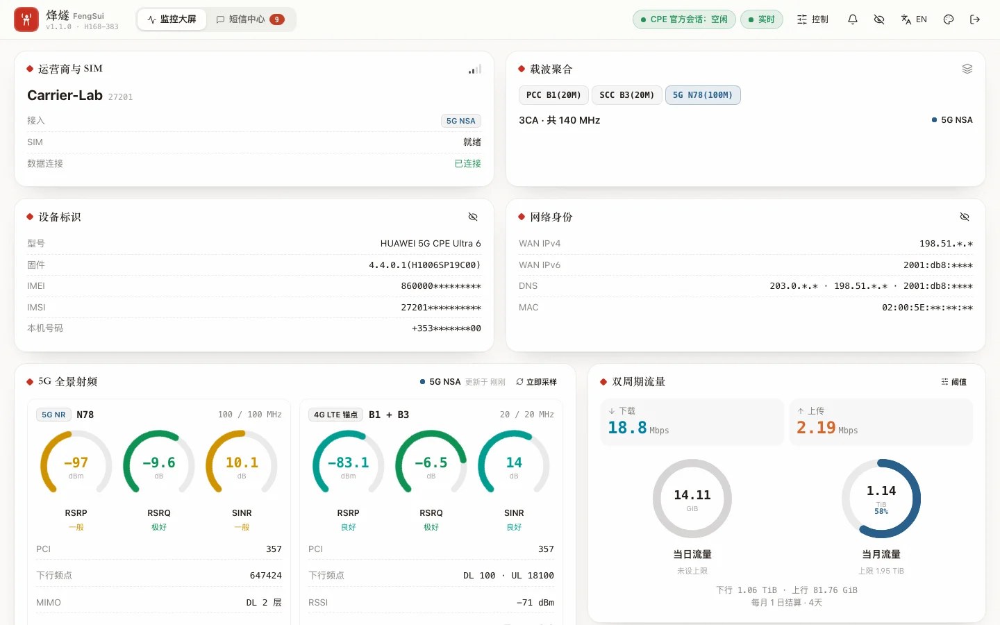
</p>

**FengSui (`cpe-dash`)** is a single-container service running on your home NAS: on one hand, it collects 5G RF telemetry from the H168-383 via millisecond-level ephemeral sessions (per-carrier 3CA, MCS / MIMO / transmit power, neighbor cells, traffic, and client topology); on the other hand, it turns the router into an encrypted SMS gateway (Web Messages center, two-way Telegram bot, and signed Webhook), while allowing AI agents to safely diagnose signal quality, lock bands/cells, and send/receive SMS via the **Model Context Protocol (MCP)**. Telemetry and SMS share a **single admin session scheduler** that automatically yields to the human admin when someone logs in to `192.168.8.1`, never preempting.

- **100% private, zero cloud dependencies**: All data stays on your NAS, encrypted at rest with `AES-256-GCM`; the Web console uses zero CDNs, zero external links, and works completely offline.
- **Zero additional hardware cost**: Reuses your existing NAS and the CPE's built-in SMS capabilities without requiring SMS modems, USB dongles, or secondary devices.
- **Production-grade container**: Non-root, read-only root filesystem, `HEALTHCHECK`, graceful shutdown via `SIGTERM` within 10 seconds while releasing router sessions; dual-architecture support for `linux/amd64` (DS923+) and `linux/arm64`.
- **Zero runtime dependencies**: Daemon built entirely with native Node.js modules; repository-wide 100% strict TypeScript, 346 offline tests with 98% statement coverage.

---

## Table of Contents

- [🖼️ Interface Overview](#️-interface-overview)
- [⚖️ Solution Comparison](#️-solution-comparison)
- [🏛️ Architecture: Single Session Gateway and Yielding to Human Admin](#️-architecture-single-session-gateway-and-yielding-to-human-admin)
- [✨ Core Features](#-core-features)
- [📡 H168-383 Hardware Capability Matrix](#-h168-383-hardware-capability-matrix-hardware-verified)
- [🚀 Quick Start](#-quick-start)
- [🐳 Docker / Synology DS923+ Deployment](#-docker--synology-ds923-deployment)
- [🤖 MCP Agent Integration](#-mcp-agent-integration)
- [✉️ SMS, Telegram and Alerts](#️-sms-telegram-and-alerts)
- [🔌 REST API and SSE](#-rest-api-and-sse)
- [⚙️ `.env` Configuration Reference](#️-env-configuration-reference)
- [🛡️ Security and Quality Gates](#️-security-and-quality-gates)
- [🏗️ Repository Structure](#️-repository-structure)
- [📚 Documentation Index](#-documentation-index)
- [⚠️ Disclaimer and License](#️-disclaimer-and-license)

---

## 🖼️ Interface Overview

> All screenshots below are taken from `npm run demo`: real daemon stack + in-process strict mock router, with all identifiers set to RFC-reserved placeholder values.

<table>
  <tr>
    <td width="50%">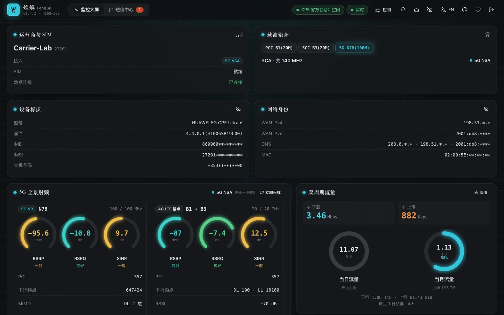<br /><sub><b>Dashboard · Polar Night</b>: 3CA pill, per-carrier RF metrics, dual-period data gauge, real-time Bézier throughput curve</sub></td>
    <td width="50%">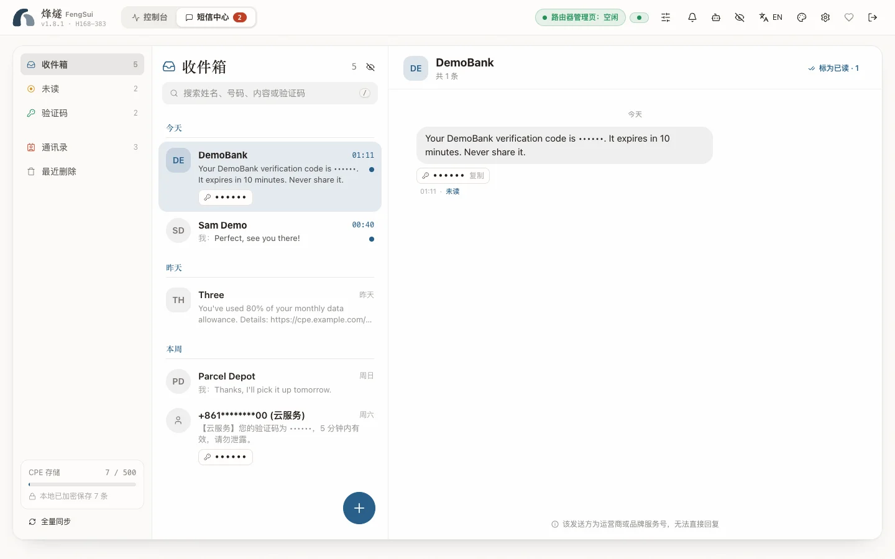<br /><sub><b>Messages · Paper</b>: Threads, multipart SMS concatenation, one-click verification code copy, contact mapping</sub></td>
  </tr>
  <tr>
    <td>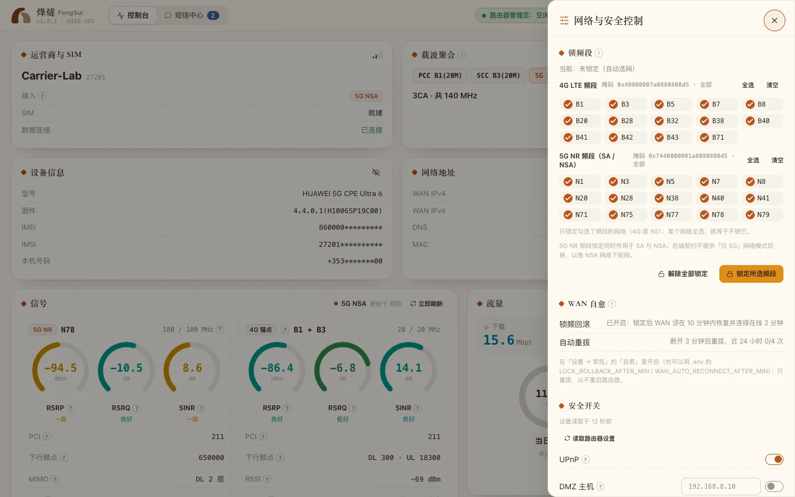<br /><sub><b>Controls drawer · Dawn</b>: 4G / 5G band locking, security toggles, cellular reconnection, and reboot with double confirmation</sub></td>
    <td>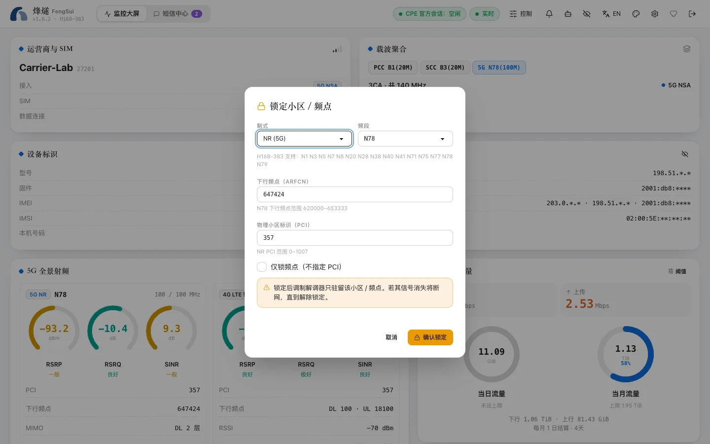<br /><sub><b>"Lock to this cell"</b>: One-click populate PCI + ARFCN from neighbor cells, RAT-aware range validation, and double confirmation</sub></td>
  </tr>
  <tr>
    <td>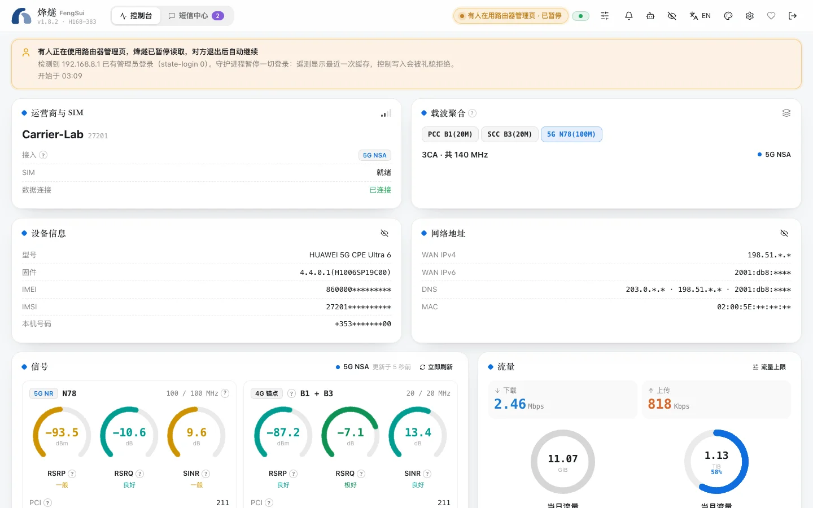<br /><sub><b>Human admin yielding</b>: Pulsing banner: "A person is using the router's admin page — monitoring has politely stepped aside"</sub></td>
    <td>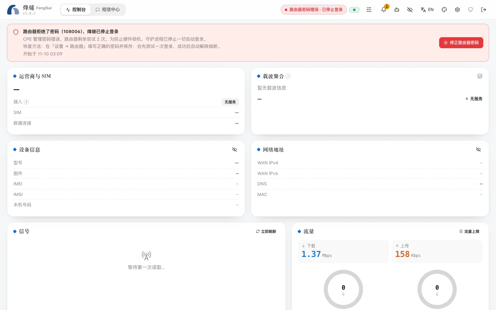<br /><sub><b>423 anti-lockout circuit breaker</b>: Clearly distinguished from offline, with trip reason and recovery steps</sub></td>
  </tr>
  <tr>
    <td>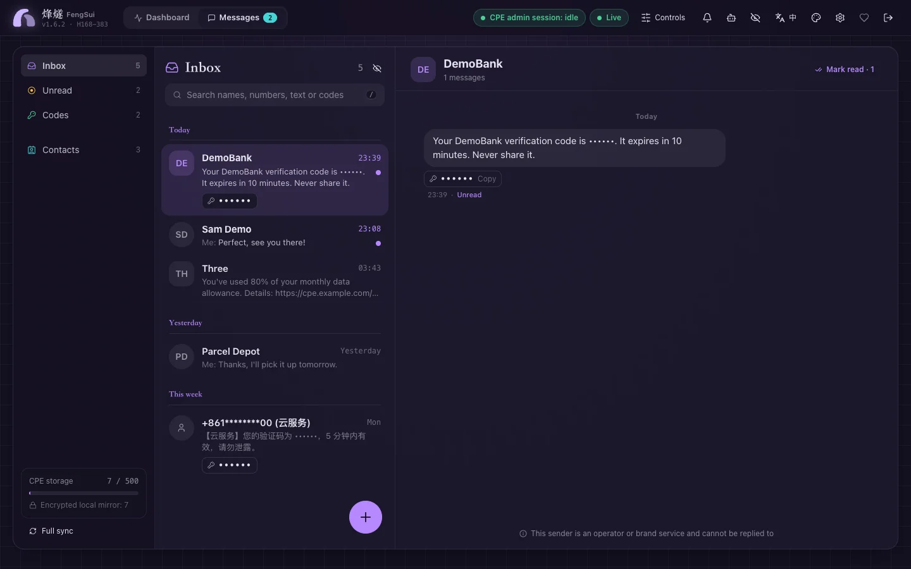<br /><sub><b>English · Violet Abyss</b>: Instant switching between English and Chinese, on-demand dictionary lazy loading</sub></td>
    <td align="center">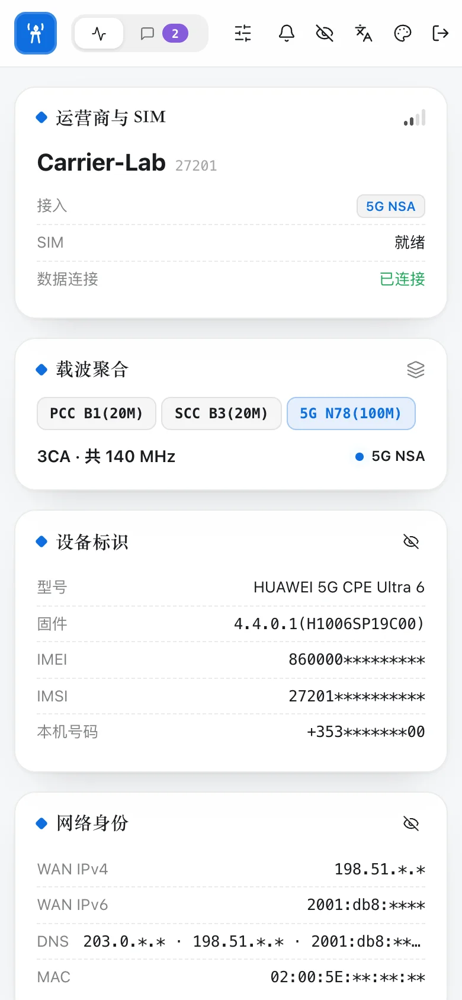<br /><sub><b>Mobile view</b>: Adaptive 390 px viewport</sub></td>
  </tr>
  <tr>
    <td>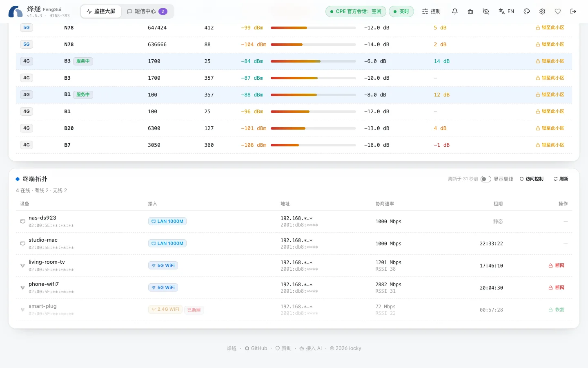<br /><sub><b>Client topology · Block / Restore</b>: One click per Wi-Fi device; blocked devices can be restored while offline</sub></td>
    <td>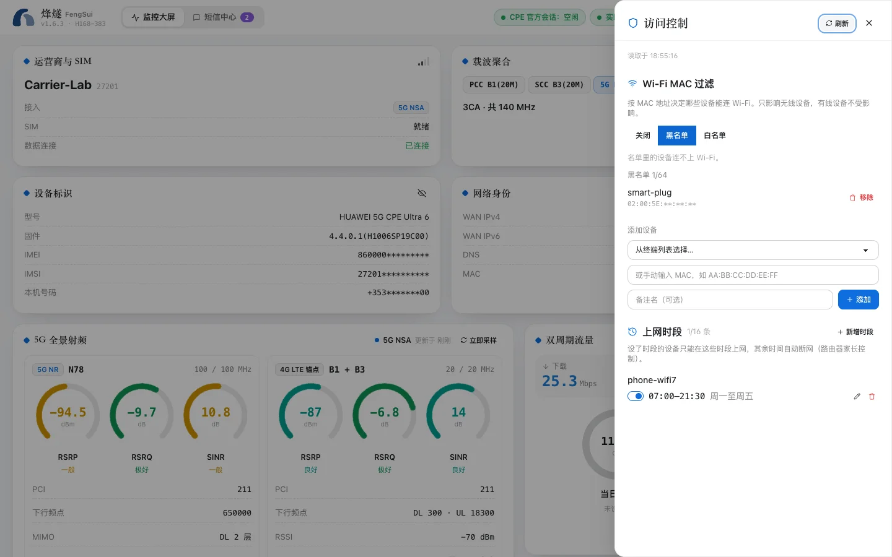<br /><sub><b>Access control · Polar Night</b>: Wi-Fi MAC blacklist / whitelist and per-device internet time</sub></td>
  </tr>
</table>

### Dashboard
- **Top banner**: Branding and version, Dashboard / Messages toggle (unread badge), carrier and SIM status, IMEI / IMSI / phone number (masked on screen by default, the eye button reveals the real values), WAN IPv4 / IPv6 / DNS / MAC (maskable), CPE session status (Idle / Human Admin Yielding / Tripped), SSE connection status, and alert bell.
- **3CA carrier aggregation pill**: e.g., `PCC B1(20M) + SCC B3(20M) + 5G N78(100M)`; SA / NSA pulsing badge.
- **RF cards**: Per-carrier PCI, ARFCN, bandwidth; graded circular gauges for RSRP / RSRQ / SINR; TAC, eNodeB, MIMO rank/streams, uplink/downlink modulation; PUSCH / PUCCH transmit power bars.
- **Health card**: Uptime, connected client count, lock status, and lock reconciliation (verifying whether router state matches configured band / cell locks).
- **Dual-period data gauges**: Daily vs. monthly usage comparison with configurable thresholds and color-coded alerts.
- **Real-time and historical curves**: Monotonic cubic Bézier rate curves; `1h` / `6h` / `12h` / `24h` / custom ranges, throughput and signal metrics, zoomable with bottom brush slider.
- **Neighbor cell table**: Gradient RSRP bars, RAT-aware PCI validation (LTE `0–503` / NR `0–1007`) and ARFCN band range checks, "Lock to this cell" with double confirmation.
- **Client topology**: `LAN 1000M` / `2.4G WiFi` / `5G WiFi` badges, IPv4 / IPv6, negotiated PHY rate, DHCP lease countdown; one-click **Block / Restore** for Wi-Fi devices, and blocked devices stay listed while offline so they can be restored.
- **Access control drawer**: Wi-Fi MAC filter (off / blacklist / whitelist, add and remove, the router's 64-entry limit), a picker for the devices to keep when enabling the whitelist, and per-device **internet time** windows (weekdays, 15-minute steps, overnight windows) that flag overlaps before saving. The machine running FengSui and the device you are using can never be cut off.
- **Controls drawer**: 4G / 5G NR band locking (applies to both SA and NSA), unlocking, security toggles (UPnP / DMZ, etc.), cellular reconnection, and reboot (with confirmation keyword).

### Messages
- Thread list and search, multipart SMS concatenation, verification code detection with one-click copy, send / reply / mark as read / delete (with accidental-deletion confirmation), Contacts (add, edit, vCard import).
- Real-time GSM-7 / UCS-2 encoding and segment count display before sending; messages accepted by the router whose status polling times out are marked with an amber **"Submitted · unconfirmed"** tag, never misreported as failed to prevent duplicate sends.
- Top privacy toggle redacts phone numbers and message contents in sync for safe screenshots and screencasts.

### Visuals and Engineering
- Four themes: **Paper** (light Xuan paper), **Dawn** (warm light), **Polar Night** (deep black), and **Violet Abyss** (geek dark purple), with six accent colors and system dark/light mode following; instant English/Chinese switching with local preference persistence.
- First-load JS + CSS is only **60.4 KiB gzip** (including one language); Messages, Controls drawer, Access control, etc., are lazy-loaded on demand; strict CSP (`script-src 'self'`, no inline scripts), zero usage of `innerHTML`.
- SSE auto-reconnect with jittered exponential backoff; `423` breaker tripped, `409` yielding, and `503` shutdown present distinct UI states, never lumped together as "offline".

---

## ⚖️ Solution Comparison

| Dimension | Commercial cloud management / vendor apps | Separate services (monitoring script + standalone SMS gateway) | **FengSui** |
| :--- | :--- | :--- | :--- |
| Deployment and data ownership | Typically relies on vendor cloud accounts; telemetry traverses the public internet | Self-hosted, but multiple services store data and configure separately | ✅ **100% private**: Single container, data encrypted at rest on your NAS |
| Additional cost | Often involves subscription fees or proprietary gateway hardware | Frequently requires SMS modems / USB dongles or multiple devices | ✅ **Zero extra hardware**: Reuses existing NAS and CPE built-in SMS capabilities |
| Privacy | Phone numbers, SMS messages, and cell tower location fingerprints leave the local network | Varies by implementation; logs often contain plaintext numbers | ✅ **Zero cloud**: IMEI / IMSI / phone numbers masked by default; SMS body and verification codes are never logged |
| Admin session | — | ❌ Monitoring and SMS log in independently, fighting for the single admin session | ✅ **Single-instance fusion**: Telemetry and SMS queue in the same scheduler; each session holds the admin slot for ~26–260 ms before logging out |
| Human login to official web admin | — | ❌ Persistent sessions cause browser login errors or kick the user offline | ✅ **Polite yielding**: `state-login` pre-check + cross-IP `108003` yielding; human admin always takes precedence |
| Password lockout protection | — | ⚠️ Auto-retries can cause consecutive failed attempts, triggering `108007` hardware lockout | ✅ `108006` / `108007` trips the breaker immediately; persists across restarts; never retries |
| RF depth | Mostly signal bars and high-level summaries | Script-dependent | ✅ Per-carrier 3CA, MCS / MIMO / transmit power, neighbor cell scanning, one-click cell lock |
| Device access control | In the vendor app, behind an online account | Usually none | ✅ One-click Block / Restore from the topology, MAC blacklist / whitelist, per-device internet time; never cuts off the NAS or your own device |
| History and alerts | Varies by product | Fragmented across multiple systems | ✅ 7-day dual-tier time series + duration-window / hysteresis alerting → Telegram / Webhook |
| AI agents | Typically not offered | None | ✅ **Native MCP**: stdio bridge + Streamable HTTP; mutations enforce `confirm: true` |
| Supply chain | Closed-source client | Multiple languages, heavy dependencies | ✅ Zero runtime npm dependencies; 100% native Node.js modules |

---

## 🏛️ Architecture: Single Session Gateway and Yielding to Human Admin

### 1. Synology DS923+ Private Deployment and Multi-Client Topology

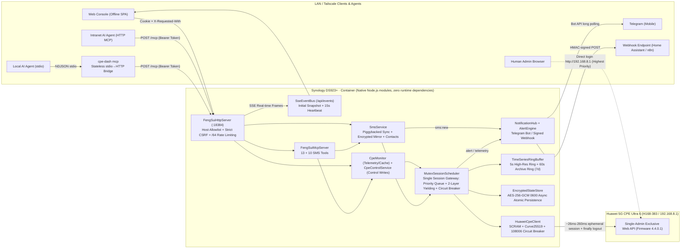

### 2. Ephemeral Sessions and Two-Layer Polite Yielding Sequence

```mermaid
sequenceDiagram
  autonumber
  participant UI as Web Console / SSE
  participant Sched as MutexSessionScheduler
  participant Client as HuaweiCpeClient
  participant CPE as H168-383 (192.168.8.1)
  participant Human as Human Admin Browser

  Note over Sched,CPE: Scenario A: No one logged in (~26ms-260ms ephemeral collection)
  Sched->>Client: withSessionDetailed(fetchGlobalTelemetry)
  Client->>CPE: GET /api/user/state-login
  CPE-->>Client: <State>-1</State> (Idle)
  Client->>CPE: SCRAM-SHA256 + Curve25519 login handshake
  Client->>CPE: Concurrent fetch: 3CA RF / Traffic / Device Status / SMS Count
  Client->>CPE: POST /api/user/logout (Mandatory release in finally block)
  Sched-->>UI: SSE pushes speed + telemetry + writes to dual-tier ring buffer
  Note over Sched,CPE: Neighbor cells & client topology collected independently every 60s (login → GET → logout)

  Note over Human,CPE: Scenario B: Human logs in to http://192.168.8.1 (Two-layer polite yielding)
  Human->>CPE: Logs in to official web admin
  Sched->>Client: Next scheduled poll or write command pre-check
  Client->>CPE: GET /api/user/state-login (Layer 1) / challenge_login (Layer 2: 108003)
  CPE-->>Client: State != -1 or error code 108003
  Client-->>Sched: status = "yielded" (Silent exit with zero preemption + exponential backoff)
  Sched-->>UI: SSE broadcasts session:avoidance (active: true)
  Note over Sched,UI: Band lock / reboot / SMS requests made meanwhile get 409 at once; nothing is queued behind the human admin's back
```

---

## ✨ Core Features

- **⚡ Ephemeral sessions & two-layer polite yielding to human admin**: Every authenticated operation in [`HuaweiCpeClient`](src/cpe-client.ts) and [`MutexSessionScheduler`](src/scheduler.ts) is serialized into an ephemeral session, with an unconditional `POST /api/user/logout` in the `finally` block; single sessions enforce a maximum duration limit, and hung requests are aborted and logged out. Layer 1 uses `GET /api/user/state-login` pre-checking, while Layer 2 applies a `45s → 300s` exponential silent backoff upon encountering cross-IP occupancy (`108003` / `108009`). On shutdown, inflight sessions are cancelled and logged out after a 2-second grace period, completing the entire teardown within 10 seconds without leaving lingering router admin sessions.
- **🛑 `108006` / `108007` anti-lockout circuit breaker persisting across restarts**: Incorrect passwords trip the breaker immediately and write the password fingerprint to the encrypted state store; after correcting `CPE_PASSWORD` in `.env`, call `POST /api/session/reset-breaker` (or click reset in the UI breaker banner) to recover; reset is rejected if the password remains unchanged. When a `108007` hardware lockout period expires, it can be reset directly.
- **📈 Dual-tier fixed-size ring buffer time series store**: Constant memory `< 6 MB`; `3 hours / 5 seconds` high-frequency ring + `7 days / 60 seconds` archive ring, seamlessly aggregated across layers; idle NSA 5G and unexposed sensors stay `null` without skewing averages; `30-minute` batch encrypted disk flush to preserve HDD hibernation.
- **✉️ Unified scheduling for SMS and telemetry**: SMS count is piggybacked inside the 5-second telemetry session, triggering incremental synchronization only when the count changes; send, mark-as-read, and delete actions route through the same scheduler's control write queue. SMS mirror, contacts, and Telegram state are all encrypted at rest with `AES-256-GCM`, identifying messages with number-free opaque `uid`s.
- **📲 Two-way Telegram bot, signed Webhooks, and alerting**: Incoming message cards (verification code, reply-to-send, mark read / thread / delete), guided SMS sending, alert notifications and muting; Webhooks signed with `HMAC-SHA256`. Alerts cover offline status, WAN disconnection, signal degradation, carrier aggregation drop, reboots, SMS storage limits, traffic thresholds, and lock drift, with duration windows and recovery hysteresis.
- **🤖 Native MCP Server**: Zero-dependency JSON-RPC 2.0 MCP implementation (stateless `2026-07-28` and `2025-11-25` / `2025-06-18` / `2025-03-26` / `2024-11-05`), mounted on daemon `/mcp`; `cpe-dash mcp` serves as a stateless stdio bridge, ensuring **the entire system has only one single CPE session gateway in the daemon**.
- **🚦 Device access control**: Drives the router's own Wi-Fi MAC filter and parental control, the same lists as its Device management page. Each change runs in one control session (read clients → read state → plan → write → read back and verify); the machine running FengSui is recognized from the router's `IsLocalDevice` mark and, like the requesting device, protected server-side. The firmware has no per-device rate-limit API, so there is no throttling.
- **🛡️ Web defense-in-depth**: `Host` allowlist against DNS Rebinding (`421`), `SameSite=Strict; HttpOnly` sessions, dual CSRF defense with `X-Requested-With` + `Origin`, trusted reverse proxy CIDR validation + IPv6 `/64` rate limiting buckets, prototype-free dictionaries against prototype pollution, linear-time scanning against ReDoS, and private network origin validation against SSRF.

---

## 📡 H168-383 Hardware Capability Matrix (Hardware Verified)

| Capability Module | Core Protocol Endpoints | Real Hardware Verified Metrics & Structural Features | Status |
| :--- | :--- | :--- | :---: |
| **3CA Carrier Aggregation** | `GET /api/device/signal`<br/>`GET /api/device/seccellinfo` | Verified active **`B1(20MHz) + B3(20MHz) + N78(100MHz)`** for a total of **`140 MHz`** EN-DC 3CA; secondary carriers exposed via 8-column semicolon-separated CSV with discrete `EARFCN, Band, BW, PCI, RSRP, RSRQ, RSSI, SINR` | ✅ Verified |
| **Higher-Order Modulation & MIMO** | `GET /api/device/signal`<br/>`GET /api/device/ri` | 4G/5G uplink and downlink **`256QAM` / `64QAM`** codeword-level MCS, `TM[4]` closed-loop spatial multiplexing, 4G `RI=2` / 5G `nrrank` stream count, and dual-codeword `CQI0/CQI1` | ✅ Verified |
| **Physical Layer Transmit Power** | `GET /api/device/signal` | 4G `<txpower>` and 5G `<nrtxpower>` 4-channel power metrics: `PPusch`, `PPucch`, `PSrs`, `PPrach` (dBm) | ✅ Verified |
| **Cell Tower & Tracking Area Positioning** | `GET /api/device/signal`<br/>`GET /api/net/cell-info` | Decimal `<cell_id>` / `<tac>` mathematically identical to hexadecimal `<cellinfo>` / `<lac>`; supports splitting 28-bit ECI (`eNodeB = ECI >>> 8`) and 36-bit NCI | ✅ Verified |
| **4G / 5G Neighbor Cell Scanning** | `GET /api/device/nbrcellinfo` | `<nbrcell_ltelist>` and `<nbrcell_nrlist>` 7-column semicolon-separated CSV (`EARFCN, Band, PCI, RSRP, RSRQ, RSSI, SINR`), mappable directly to cell lock parameters | ✅ Verified |
| **4G / 5G Band & Cell Locking** | `GET/POST /api/net/net-mode`<br/>`POST /api/net/lock-freq` | `select_band_switch=1` and `lock_freq_switch=3`; 4G `LTEBand` bitmask, 5G NR band locking (`lock_mode=3`), frequency lock (`lock_mode=1`), and `PCI+ARFCN` cell locking (`lock_mode=2`) | ✅ Verified |
| **Daily vs. Monthly Traffic** | `GET /api/monitoring/month_statistics`<br/>`GET /api/monitoring/traffic-statistics` | Daily cumulative (`<CurrentDayUsed>`), monthly uplink/downlink itemized cumulative, billing day (`<StartDay>`), and real-time rates | ✅ Verified |
| **Client Topology & Dual-Stack Leases** | `GET /api/system/HostInfo` (JSON)<br/>`GET /api/system/topology` (JSON) | Distinguishes **`LAN 1000M`**, `2.4GHz`, and `5GHz` clients, negotiated PHY rates, RSSI, IPv4/IPv6, and remaining DHCP lease time | ✅ Verified |
| **SMS Transmission & Reception** | `/api/sms/sms-list` · `/api/sms/send-sms` · `/api/sms/send-status`<br/>`/api/sms/sms-count` · `/api/sms/set-read` · `/api/sms/delete-sms` | Inbox / Outbox pagination, multipart SMS, send status polling, mark-as-read, and deletion; count endpoint piggybacked inside telemetry sessions for zero-overhead change detection | ✅ Verified |
| **Wi-Fi 7 (802.11be) MLO** | `GET/POST /api/wlan/wlandbho`<br/>`GET /api/wlan/multi-security-settings-ex` | `b/g/n/ax/be` + `a/n/ac/ax/be` radios, **MLO multi-link operation (`MloEnable`)**, dual-band steering (`DbhoEnable`), EasyMesh, and auto channel optimization | ✅ Verified |
| **Antenna Switching, Static DHCP & Dual-Stack APN** | `/api/device/antenna_set_type`<br/>`/api/dhcp/static-addr-info`<br/>`/api/dialup/profiles` | Auto / internal / external antenna switching and insertion detection, static MAC-IP binding, and `IPv4/IPv6` (`iptype=2`) dual-stack APN auditing | ✅ Verified |

> Temperature sensors and gNodeB ID are not exposed by firmware `4.4.0.1`; the UI displays `N/A` / shows eNodeB only.

---

## 🚀 Quick Start

### 1. Live Demo (nothing to install)

Open **<https://cky008.github.io/fengsui-demo/>**: the complete console runs in your browser on fictional placeholder data. Band and cell locks, blocking devices, internet time windows, sending SMS and the rest all work, inside that page only, and reset on reload. The demo's starting data is recorded from the real daemon at build time, and its in-page backend shares the daemon's validation and planning code, checked call by call by a contract test (see section 9 of the architecture report).

### 2. Local Offline Demo (No router needed, see the full UI in 30 seconds)

```bash
git clone https://github.com/cky008/cpe-dash.git && cd cpe-dash
npm ci
npm run build:web
npm run demo          # http://127.0.0.1:18484 , login token: fengsui-demo
# DEMO_SCENARIO=yield   npm run demo   → Simulates human admin web login every few minutes (yielding banner)
# DEMO_SCENARIO=breaker npm run demo   → Simulates bad router password, triggering anti-lockout breaker (423 banner)
```

The demo process **never reads `.env` and never accesses the network**: real scheduler, monitoring, SMS, SSE, REST, MCP, and Web interface backed by a strict in-process H168-383 model.

### 3. Local Run (Node.js >= 22.6)

```bash
cp .env.example .env && chmod 600 .env
# Edit .env: CPE_PASSWORD (required); API_TOKEN and DATA_ENCRYPTION_KEY (strongly recommended to set independently)
npm run build         # Build daemon + Web console to dist/
npm start             # http://<local IP>:18384
# Development mode: npm run dev (--watch hot reload, runs directly from TypeScript source)
```

### 4. Read-Only Hardware Probes

```bash
npm run probe:rf          # 3CA aggregation chain, 256QAM MCS, MIMO streams, transmit power, and cell identity cross-checks
npm run probe:neighbors   # 4G / 5G neighbor cell table
npm run probe:traffic     # Real-time throughput, daily and monthly cumulative traffic
npm run probe:topology    # LAN / 2.4G / 5G client topology and DHCP leases
npm run probe:session     # Ephemeral session release and two-layer human admin yielding
npm run probe:sms         # Outputs SMS count and query latency only (does not send, mark, or delete)
```

Probes output masked data by default and strictly adhere to single-session polite yielding; do not run them concurrently while the daemon is running to avoid competing for the admin session.

---

## 🐳 Docker / Synology DS923+ Deployment

Images are multi-stage built from [`Dockerfile`](Dockerfile): runtime layer based on `node:26-alpine` (current LTS), containing only compiled assets with **no `node_modules`**, running as the unprivileged `node` user, with built-in `HEALTHCHECK` (`GET /api/health`). Pushing a `v*.*.*` tag triggers [`release.yml`](.github/workflows/release.yml) to publish `linux/amd64` + `linux/arm64` images to GHCR; each push triggers [`ci-docker.yml`](.github/workflows/ci-docker.yml) to build the image and execute container smoke tests (health check, login, SSE, MCP, `SIGTERM` shutdown, and encrypted storage).

Key points in [`docker-compose.yml`](docker-compose.yml):

| Item | Setting |
| :--- | :--- |
| Timezone | `TZ=${TZ:-UTC}` (inherited from `.env` in the same directory); outbound SMS timestamps are generated accordingly |
| Port | Fixed to `18384` inside container; host port set via `WEB_PORT` in `.env` (default `18384`) |
| Data | `./data:/app/data`: State, SMS mirror, and contacts all encrypted at rest; `./.env` mounted read-only (`reset-breaker` re-reads it) |
| User | `user: "${PUID}:${PGID}"`, specify the owner of `data/` and `.env` |
| Hardening | Read-only root filesystem + `tmpfs /tmp`, `cap_drop: ALL`, `no-new-privileges`, `init`, 15-second shutdown grace period, log rotation |

### Synology Container Manager (DSM 7.2+)

1. **Prepare directories** (SSH into NAS):
   ```bash
   mkdir -p /volume1/docker/cpe-dash/data && cd /volume1/docker/cpe-dash
   # Place docker-compose.yml and .env.example from this repo
   cp .env.example .env && chmod 600 .env && chmod 700 data
   id -u && id -g      # e.g., 1026 / 100, populate into PUID / PGID in .env
   ```
   Edit `.env`: `CPE_PASSWORD`, `API_TOKEN`, `DATA_ENCRYPTION_KEY`, `TZ` (e.g. `Asia/Shanghai`), `PUID` / `PGID`.
2. **Obtain image** (Choose one):
   - Pull from GHCR: if the repository is private, add `ghcr.io` under "Container Manager → Registry → Settings", or run `sudo docker login ghcr.io -u <GitHub username>` via SSH (token only requires `read:packages` permission);
   - Local build: Place the entire repository in this directory and run `sudo docker compose build`.
3. **Create project**: "Container Manager → Project → Create", set path to `/volume1/docker/cpe-dash`, select source "use the existing docker-compose.yml", and start upon completion. Once the status shows "Healthy", access `http://<NAS IP>:18384`.

Equivalent CLI operations:

```bash
sudo docker compose up -d            # docker-compose on older DSM versions
sudo docker compose logs -f cpe-dash
sudo docker compose pull && sudo docker compose up -d   # Upgrade
sudo docker compose down             # SIGTERM: inflight session logs out, encrypted state flushed, exits within 10s
```

> **Run only one instance**: A single router can only be managed by one daemon instance (it holds exclusive access to the admin session and Telegram bot token). Stop any other cpe-dash or legacy cpe-sms instances before starting. Cross-host duplicate instance protection relies on local UDP broadcast (`18385`), which Docker bridge networks do not forward; to enable this, switch to `network_mode: host` in compose and remove `ports:`.

### Reverse Proxy & Tailscale

- When accessing via Tailscale, `*.ts.net` hostnames and private / CGNAT addresses are allowed by default; add custom domains to `ALLOWED_HOSTS` (e.g., `cpe.example.com`).
- When accessing through a reverse proxy, set the **exact IP** of the proxy in `TRUSTED_PROXIES` so that rate limiting and auditing trust `X-Forwarded-For`; session cookies automatically append `Secure` behind an HTTPS reverse proxy.

### macOS: Apple `container` / `container-compose`

If Docker Desktop is not installed, verify the image using the Apple native container runtime:

```bash
container system start                      # May require --enable-kernel-install on first run
container build -t cpe-dash:local .
mkdir -p data
container run -d --name cpe-dash --init \
  --user "$(id -u):$(id -g)" --read-only --tmpfs /tmp --cap-drop ALL \
  -p 18384:18384 \
  -v "$PWD/.env:/app/.env:ro" -v "$PWD/data:/app/data" \
  cpe-dash:local
curl -s http://127.0.0.1:18384/api/health
container stop cpe-dash && container rm cpe-dash
```

When using `container-compose`: change `image:` in compose to `cpe-dash:local` and remove `build: .`; note that it does not interpolate variables in the `user:` field, so write `user:` as literal values (e.g., `"501:20"`, matching the output of `id -u`:`id -g`); it will also ignore `tmpfs`, which does not affect operation.

---

## 🤖 MCP Agent Integration

FengSui provides an MCP service on daemon `/mcp` via two integration methods, **neither of which creates a second CPE session**:

| Method | Applicable Clients | Description |
| :--- | :--- | :--- |
| **stdio bridge** `cpe-dash mcp` | Claude Desktop, Cursor, Antigravity, and other local clients | Stateless forwarding: reads `API_TOKEN` and `MCP_DAEMON_URL` from `.env` (defaults to `http://127.0.0.1:<WEB_PORT>/mcp`) |
| **Streamable HTTP** `POST /mcp` | Clients supporting remote MCP, intranet automation | `Authorization: Bearer <API_TOKEN>`; `MCP_HTTP_ENABLED=true` (default) |

### Claude Desktop / Cursor / Antigravity (stdio, running from source locally)

```json
{
  "mcpServers": {
    "fengsui": {
      "command": "node",
      "args": [
        "--experimental-strip-types",
        "/path/to/cpe-dash/src/cli.ts",
        "mcp",
        "--env",
        "/path/to/cpe-dash/.env"
      ]
    }
  }
}
```

If `npm run build` has been executed, replace args with `["/path/to/cpe-dash/dist/cli.js", "mcp", "--env", "/path/to/cpe-dash/.env"]`. If the daemon runs on a NAS, simply set `API_TOKEN` and `MCP_DAEMON_URL=http://<NAS IP>:18384/mcp` in the local `.env`.

### Bridging to Daemon inside Docker Container

```json
{
  "mcpServers": {
    "fengsui": {
      "command": "docker",
      "args": ["exec", "-i", "cpe-dash", "node", "dist/cli.js", "mcp"]
    }
  }
}
```

Applicable when the MCP client is on the same host as the container (or `DOCKER_HOST` points to it). `/app/.env` inside the container already supplies `API_TOKEN`, and the bridge automatically connects to `http://127.0.0.1:18384/mcp` inside the container.

### Streamable HTTP (Cursor, Claude Code `.mcp.json`, VS Code, and other clients supporting remote MCP)

```json
{
  "mcpServers": {
    "fengsui": {
      "type": "http",
      "url": "http://<NAS IP or Tailscale hostname>:18384/mcp",
      "headers": { "Authorization": "Bearer <API_TOKEN>" }
    }
  }
}
```

Claude Code: `claude mcp add --transport http fengsui http://<NAS IP>:18384/mcp --header "Authorization: Bearer <API_TOKEN>"`

### Tool List

| Group | Tools |
| :--- | :--- |
| Observation (read-only) | `get_cpe_telemetry`, `query_telemetry_history`, `list_neighbor_cells`, `get_cpe_session_status`, `list_terminal_topology`, `get_router_settings` |
| Control (write) | `lock_band`, `lock_cell`, `unlock_rf_locks`, `set_security_switches`, `set_wifi_and_antenna`, `reconnect_cellular`†, `reboot_cpe`† |
| Access control | `get_access_control` (read-only, always offered); with `MCP_ALLOW_ACCESS_CONTROL=true` also `set_device_internet_access`†, `set_wifi_mac_filter`†, `manage_internet_time_rule`† |
| SMS (`MCP_SMS_ACCESS=read`, default) | `list_sms_threads`, `get_sms_thread`, `get_sms_status`, `search_contacts`, `preview_sms`, `sync_sms` |
| SMS (`MCP_SMS_ACCESS=full`) | Appends `send_sms`†, `mark_sms_read`, `delete_sms`†, `upsert_contact` |

† Must explicitly pass `{ "confirm": true }`. With `REDACT_SENSITIVE_IN_API=true` (the default), `get_cpe_telemetry`, `list_terminal_topology` and the `fengsui://telemetry/latest` resource return redacted copies: the IMEI keeps its first 6 digits, the IMSI only the operator code, WAN addresses their first two parts, and TAC / Cell ID / eNodeB and client names read `<REDACTED>`, so the data can go to a cloud model. All input parameters are strictly validated on the server against `inputSchema`; band locks only accept bands supported by the H168-383; `lock_cell` can only lock to previously observed cells (serving cell, aggregated carriers, or latest neighbor scan), preventing model hallucinations from causing network outages. SMS bodies and sender names are treated as untrusted data; `send_sms` targets a single recipient, defaults to known contacts only (`MCP_SMS_SEND_POLICY=known`), enforces hourly limits, and `delete_sms` refuses to delete unread messages by default. When `MCP_ALLOW_MUTATIONS=false`, only observational tools are exposed.

### Error Codes

When a tool fails, it returns `isError: true` with `structuredContent` set to `{ ok: false, errorCode, message, ... }`:

| `errorCode` | Meaning and Handling |
| :--- | :--- |
| `BROWSER_SESSION_YIELDED` | Human admin is using the official web admin; politely yielded; includes `avoidance` state; retry later |
| `PEER_DAEMON_ACTIVE` | Another daemon in the LAN is managing the same router; this instance is on standby |
| `CIRCUIT_BREAKER_OPEN` | Anti-lockout circuit breaker tripped; includes `circuitBreaker`; manual reset required after correcting `CPE_PASSWORD` |
| `QUEUE_FULL` | Scheduler queue full or shutting down; retry later |
| `CONFIRMATION_REQUIRED` / `VALIDATION_ERROR` | Missing `confirm: true` / parameters out of bounds (band, PCI, ARFCN, etc.) |
| `MUTATIONS_DISABLED` | Server configured with `MCP_ALLOW_MUTATIONS=false` |
| `SMS_ACCESS_DENIED` / `RECIPIENT_NOT_ALLOWED` / `SMS_RATE_LIMITED` / `UNREAD_PROTECTED` | SMS permissions, recipient policy, hourly rate limit, or unread protection |
| `SMS_SEND_FAILED` | Router explicitly rejected sending (messages accepted but status unconfirmed return success with `timedOutWaitingStatus: true`; do not resend) |
| `CPE_EXECUTION_ERROR` | Communication failure with router |

JSON-RPC layer: Bridge returns `-32010` (daemon unreachable) and `-32011` (token rejected); `-32020` indicates mismatch between `MCP-Protocol-Version` header and payload, `-32022` indicates unsupported protocol version. See [`docs/PHASE2_BACKEND_CONTRACT.md`](docs/PHASE2_BACKEND_CONTRACT.md) for full contract.

---

## ✉️ SMS, Telegram and Alerts

### How It Works
- **Synchronization**: Full sync on startup (pre-existing messages on CPE are treated as historical and not pushed); thereafter, incremental sync is driven by the `sms-count` piggybacked inside the 5-second telemetry session, supplemented by a 30-minute fallback full reconciliation. The local mirror is strictly synchronized with the CPE: deleting a message removes it from both the CPE and local records.
- **Sending**: Web, MCP, and Telegram share the same code path: pre-session recipient and length validation (GSM-7 / UCS-2, max 4 segments, max 5 recipients), submit within session, poll transmission status, and read back sent records.
- **Human admin priority**: When someone logs in to `http://192.168.8.1`, SMS write operations return `409`, sync is suspended, and only the unauthenticated endpoint is used to probe unread counts; sync catches up automatically once the admin logs out.

### Configuring Telegram Bot
1. Create a bot with `@BotFather` in Telegram and paste the token into `TELEGRAM_BOT_TOKEN` in `.env`;
2. Choose one: Add your chat ID to `TELEGRAM_CHAT_IDS`, or send `/auth <API_TOKEN>` to the bot after startup (the message containing the token is automatically deleted; re-authentication is required if `API_TOKEN` changes);
3. Restart the service; active status is indicated by `telegram=on` in logs. A single bot token can only have one polling consumer.

| Command / Interaction | Action |
| :--- | :--- |
| Incoming message card | Sender, country flag, and contact name; one-click verification code copy; **replying directly to the card sends an SMS**; buttons: Mark Read / View Thread / Delete (with double confirmation) |
| `/new` | Guided SMS sending: select country → enter number or contact name → enter message body (displays encoding and segments) → confirm to send |
| `/send <number> <message>` | Quick send (also requires confirmation click) |
| `/inbox`, `/unread`, `/chat <number>` | Thread list, unread messages, and thread view (reads local mirror without opening router sessions) |
| `/contacts [query]`, `/contact <number> <name>`, send `.vcf` file | Search, add, and batch import contacts |
| `/status`, `/alerts`, `/sync` | Device and SMS status, recent alerts, immediate sync |
| `/mute 30m\|2h\|1d\|off` | Mute or resume alert notifications |

### Webhook
When `WEBHOOK_URL` is configured, incoming messages (`sms.received`) and alerts (`alert`) are pushed via JSON `POST`. When `WEBHOOK_SECRET` is configured, the receiver can verify signatures as follows:

```ts
import crypto from "node:crypto";
const expected = "sha256=" + crypto.createHmac("sha256", secret).update(`${req.headers["x-fengsui-timestamp"]}.${rawBody}`).digest("hex");
// Perform constant-time comparison of expected against req.headers["x-fengsui-signature"], and reject requests with excessive timestamp drift
```

### Alerts
`CPE_UNREACHABLE`, `WAN_DOWN`, `SIGNAL_DEGRADED` (RSRP < `ALERT_RSRP_THRESHOLD_DBM` or SINR < `ALERT_SINR_THRESHOLD_DB` for 5 consecutive minutes), `CA_DROPPED`, `REBOOT_DETECTED`, `SMS_STORAGE_HIGH` / `SMS_STORAGE_FULL`, `DATA_THRESHOLD`, lock drift, and breaker trip alerts are recorded in `GET /api/alerts` and pushed via SSE `alert`. Alerts meeting or exceeding `ALERT_NOTIFY_MIN_SEVERITY` are delivered to Telegram / Webhook.

> **Encryption Key Tip**: When `DATA_ENCRYPTION_KEY` is left blank, it falls back to `CPE_PASSWORD`, but contacts cannot be re-synced from the router. It is strongly recommended to configure an independent key; when changing keys or router passwords, update `.env` first, call `POST /api/session/reset-breaker` (which immediately re-encrypts all data files with the new key), and then restart.

---

## 🔌 REST API and SSE

| Channel | Core Endpoints | Description |
| :--- | :--- | :--- |
| **Authentication & Localization** | `POST /api/auth/login`, `POST /api/auth/logout`, `GET /api/auth/status`, `GET /api/i18n/:locale` | `SameSite=Strict; HttpOnly` sessions; English / Chinese dictionaries |
| **Read-Only Telemetry & Time Series** | `GET /api/telemetry`, `/api/timeseries`, `/api/neighbors`, `/api/topology`, `/api/settings` | Zero-CPE-overhead access to in-memory snapshots and `1h/6h/12h/24h/custom` curves |
| **Active Refresh** | `POST /api/telemetry/refresh`, `/api/neighbors/scan`, `/api/topology/refresh`, `/api/settings/refresh` | Single-flight consolidated polite ephemeral sampling; returns cached snapshot during yielding or breaker trips |
| **RF & System Control** | `POST /api/control/band-lock`, `cell-lock`, `unlock`, `reboot`, `reconnect`, `security`, `wifi7`, `antenna`, `mobile-data` | Returns `409` when human admin is online, returns `423 CIRCUIT_BREAKER_OPEN` when breaker is tripped |
| **Session & Circuit Breaker** | `GET /api/session/status`, `POST /api/session/reset-breaker` | Scheduler / avoidance / breaker status; re-reads `.env` and resets circuit breaker |
| **SMS & Contacts** | `GET /api/sms/status`, `threads`, `thread`, `contacts`, `countries`; `POST /api/sms/preview`, `send`, `read`, `delete`, `sync`, `contacts/upsert`, `contacts/delete`, `contacts/import-vcf` | Read endpoints query the encrypted mirror directly (zero CPE sessions); write endpoints route via control queue |
| **Device access control** | `GET /api/access-control`, `POST /api/access-control/refresh`; `POST /api/control/wifi-access`, `wifi-mac-filter`, `time-rule` | Wi-Fi MAC filter and internet time; writes need `confirm: true` and are read back and verified in one control session |
| **Alerts** | `GET /api/alerts` | Last 100 alerts and delivery statistics |
| **Real-Time SSE** | `GET /api/events` | `hello`, `speed`, `telemetry`, `neighbors`, `topology`, `settings`, `access-control`, `session:avoidance`, `control:applied`, `alert`, `sms:new`, `sms:sent`, `sms:updated`, `sms:sync`, `sms:status`, `contacts:updated`, and heartbeats |
| **Health Check** | `GET /api/health` | Unauthenticated endpoint for `HEALTHCHECK` and monitoring |

State-mutating requests must include `X-Requested-With: XMLHttpRequest` and `Content-Type: application/json`. The logged-in web console (cookie session) always receives the real values and masks them on screen; scripts and SSE subscribers using `Authorization: Bearer` get the same redacted copies as MCP while `REDACT_SENSITIVE_IN_API=true`. REST / SSE payload types are defined in [`src/api-contract.ts`](src/api-contract.ts) (validated on the backend with `satisfies` and reused directly by the Web frontend); see [`docs/PHASE2_BACKEND_CONTRACT.md`](docs/PHASE2_BACKEND_CONTRACT.md) for full contract.

---

## ⚙️ `.env` Configuration Reference

Full template available in [`.env.example`](.env.example). The daemon reads only `.env` in the project root (`/app/.env` inside container) and environment variables, with zero dependency on `dotenv`.

| Variable | Default | Description |
| :--- | :--- | :--- |
| `CPE_URL` | `http://192.168.8.1` | CPE management address; restricted to private / loopback / CGNAT hosts; embedded credentials, query strings, and redirects are forbidden (SSRF defense) |
| `CPE_USERNAME` | `admin` | Admin username |
| `CPE_PASSWORD` | *(Required)* | Admin password; `108006` errors immediately trip the persistent circuit breaker |
| `TZ` | `UTC` | IANA timezone (e.g. `Asia/Shanghai`); used to generate outbound SMS `<Date>`; must match the CPE's timezone |
| `DATA_ENCRYPTION_KEY` | *(Falls back to `CPE_PASSWORD`)* | Master encryption key for `data/*.json` at rest (`scrypt` + `HKDF-SHA256` → `AES-256-GCM`); strongly recommended to configure independently |
| `API_TOKEN` | *(Falls back to `CPE_PASSWORD`)* | Web login token and REST / `/mcp` Bearer token; a high-entropy random string is recommended |
| `TRUSTED_PROXIES` | `127.0.0.1,::1` | Trusted reverse proxy IPs / CIDRs; `X-Forwarded-For` / `X-Forwarded-Proto` parsed only when matching |
| `ALLOWED_HOSTS` | *(Empty)* | Additional permitted `Host` headers (e.g. `cpe.example.com`); private IPs, `localhost`, `*.local` / `*.lan` / `*.internal` / `*.ts.net` are always permitted |
| `WEB_ENABLED` | `true` | Whether to start the HTTP service (Web console, REST, SSE, and `/mcp`); set to `false` to run background collection, SMS sync, and notifications only |
| `WEB_HOST` / `WEB_PORT` | `0.0.0.0` / `18384` | Listening address and port; in compose, `WEB_PORT` dictates the host port |
| `DEFAULT_LOCALE` | `zh-CN` | Default UI and notification language (`zh-CN` / `en`) |
| `MCP_HTTP_ENABLED` | `true` | Whether to enable `POST /mcp` (required by stdio bridge as well) |
| `MCP_ALLOW_MUTATIONS` | `true` | Whether to allow MCP to invoke mutation tools |
| `MCP_ALLOW_ACCESS_CONTROL` | `false` | Whether MCP may use the tools that cut devices off (block / restore, MAC filter, internet time); reading the access-control state is always available |
| `MCP_DAEMON_URL` | *(Derived from `WEB_HOST`/`WEB_PORT`)* | Address of `/mcp` forwarded by stdio bridge; restricted to LAN / loopback hosts |
| `PEER_DISCOVERY_ENABLED` / `PEER_DISCOVERY_PORT` | `true` / `18385` | Cross-host duplicate daemon protection (signed UDP broadcast beacon; requires host networking in Docker) |
| `REDACT_SENSITIVE_IN_API` | `true` | Redacts IMEI, IMSI, phone number, MAC, WAN addresses and TAC / CellID location fingerprints in Bearer API, SSE and MCP output. The web console is not affected: it always receives the real values, masked on screen until you click the eye button. Applies after a restart or `reset-breaker` |
| `SSE_HEARTBEAT_MS` / `SSE_MAX_CLIENTS` | `15000` / `32` | SSE heartbeat interval and maximum concurrent connections |
| `POLL_INTERVAL_MS` | `5000` | Telemetry and real-time throughput sampling interval |
| `NEIGHBOR_SCAN_INTERVAL_MS` | `60000` | Neighbor cell scan interval |
| `REQUEST_TIMEOUT_MS` | `15000` | Single HTTP request timeout |
| `RESPECT_BROWSER_SESSION` | `true` | Automatic yielding when human admin is online (strongly recommended to keep enabled) |
| `STATE_FILE` | `./data/state.json` | Encrypted state file; `/app/data/state.json` inside container |
| `HISTORY_RETENTION_HOURS` | `168` | Time-series history retention duration (7 days) |
| `SMS_ENABLED` | `true` | Enables SMS synchronization, REST, SSE, and MCP SMS tools |
| `DEFAULT_COUNTRY_CODE` | `+353` | Default country calling code for numbers without international prefix |
| `SMS_FILE` / `CONTACTS_FILE` | *(Same directory as `STATE_FILE`)* | Encrypted SMS mirror and contacts store |
| `SMS_FULL_SYNC_INTERVAL_MS` | `1800000` | Fallback full reconciliation interval (minimum `60000`) |
| `SMS_SEED_EXISTING_ON_START` | `true` | Treats existing SMS on CPE as history on initial sync (will not push notifications) |
| `SMS_AUTO_MARK_READ` | `false` | Automatically marks SMS as read on CPE after pushing notification |
| `SMS_SEND_STATUS_TIMEOUT_MS` | `45000` | Send status polling timeout limit (`5000..120000`) |
| `TELEGRAM_BOT_TOKEN` / `TELEGRAM_CHAT_IDS` | *(Empty)* | Bot token and pre-authorized chat IDs |
| `TELEGRAM_API_BASE` / `TELEGRAM_STATE_FILE` | `https://api.telegram.org` / *(Same directory `telegram.json`)* | Custom Bot API base URL and encrypted state file |
| `WEBHOOK_URL` / `WEBHOOK_SECRET` | *(Empty)* | JSON push URL and HMAC signature secret for new SMS and alerts |
| `ALERTS_ENABLED` / `ALERT_NOTIFY_MIN_SEVERITY` | `true` / `warning` | Alert engine toggle and minimum notification severity (`info` / `warning` / `critical`) |
| `ALERT_RSRP_THRESHOLD_DBM` / `ALERT_SINR_THRESHOLD_DB` | `-110` / `0` | Signal degradation alert thresholds |
| `MCP_SMS_ACCESS` | `read` | MCP SMS tool access level: `none` / `read` / `full` |
| `MCP_SMS_SEND_POLICY` | `known` | `known` restricts sending to contacts or previously messaged numbers; `any` allows unrestricted recipients |
| `MCP_SMS_SEND_LIMIT_PER_HOUR` | `10` | Maximum SMS messages sent via MCP per hour (`0` disables) |
| `CPE_HAR_PATH` | *(Empty)* | Offline audit archive path used only by probe scripts (never commit it) |
| `PUID` / `PGID` | `1000` / `1000` | Docker Compose interpolation only: container execution user (not read by daemon) |

---

## 🛡️ Security and Quality Gates

```bash
npm run check
# 1. npm run typecheck      → Dual tsconfig for daemon / scripts / tests and Web frontend, 100% strict TypeScript
# 2. npm run test:coverage  → node:test fully offline tests + c8 quality gate (statements / lines / functions >= 90%, actual 98% / 98% / 99%)
# 3. npm run audit:secrets  → Scans workspace and complete git history for secrets, hardware fingerprints, phone numbers, and any .js source files
```

- Unit tests interact exclusively with an injected mock router, **never accessing the real `192.168.8.1`**; test phone numbers use reserved number blocks only, never sending SMS to real numbers.
- CI executes the complete verification gate on Node.js 22.x (minimum `engines` requirement) and 26.x, builds the `linux/amd64` image, runs it in unprivileged read-only mode, and validates health checks, Web and CSP, login, SSE, MCP, `SIGTERM` shutdown, and that state reaches disk only encrypted.
- See [`AGENTS.md`](AGENTS.md) for the seven engineering and security iron rules.

---

## 🏗️ Repository Structure

```text
cpe-dash/
├── src/                     # Daemon (native Node.js modules, zero runtime dependencies)
│   ├── cpe-client.ts        # Ephemeral session client, two-layer yielding, and 108006 circuit breaker
│   ├── scheduler.ts         # MutexSessionScheduler: Single CPE session gateway
│   ├── cpe-monitor.ts · cpe-controls.ts · cpe-domain.ts · parsers.ts · band-lock.ts
│   ├── sms/ · notify/       # SMS service, encrypted mirror, contacts / Telegram bot, Webhook, NotificationHub
│   ├── http-server.ts · sse-bus.ts · mcp-server.ts · mcp-stdio-bridge.ts
│   ├── api-contract.ts      # REST / SSE payload types (shared between frontend and backend)
│   └── cli.ts               # Entrypoint for serve daemon and mcp bridge
├── web/                     # Web console: Strict TS + Tailwind v4 / daisyUI v5, built offline to dist/web/public
│   ├── index.html · styles.css
│   └── src/                 # core/ (DOM-free logic, covered by test gate) · ui/ · i18n/ · demo/ (the live demo's in-page backend)
├── scripts/                 # build-web.ts · demo-router.ts · demo-server.ts · capture-demo-seed.ts · audit-secrets.ts · probe-*.ts
├── test/                    # node:test offline tests (helpers/ contains encrypted mock router)
├── docs/                    # Protocol specs, architecture reports, backend contracts, and UI screenshots
├── Dockerfile · docker-compose.yml · .dockerignore
└── .github/workflows/       # ci-docker.yml · release.yml · demo-pages.yml
```

---

## 📚 Documentation Index

- [`AGENTS.md`](AGENTS.md) — Engineering contract, seven security iron rules, and mandatory TDD guidelines
- [`docs/PHASE1_PROTOCOL_SPEC.md`](docs/PHASE1_PROTOCOL_SPEC.md) — H168-383 proprietary protocol (including SMS endpoints and encryption channels), reverse-engineered algorithms, and hardware-verified dictionary
- [`docs/PHASE2_ARCHITECTURE_REPORT.md`](docs/PHASE2_ARCHITECTURE_REPORT.md) — Zero-dependency backend technology choices, security defenses, SMS integration, and Web console architecture
- [`docs/PHASE2_BACKEND_CONTRACT.md`](docs/PHASE2_BACKEND_CONTRACT.md) — Authoritative contract for REST APIs, SSE events, MCP tools (including SMS), and error codes

---

## ⚠️ Disclaimer and License

- **Radio compliance**: Band locking, cell locking, and frequency locking alter the connection and camping behavior of the terminal. Operate only on networks and frequency bands that you are legally authorized to use, and adhere to local radio regulatory requirements and carrier terms of service. Improper locking may cause connection loss, degraded service quality, or violation of agreements. This project does not provide any functionality to bypass carrier restrictions, alter radio frequency parameters, or modify transmit power.
- **SMS and privacy**: SMS messages sent through this project are your sole responsibility and subject to carrier billing rates. When using the Telegram bot, notification contents pass through Telegram servers. Do not use for bulk messaging, harassment, or any unlawful activities.
- **Unofficial project**: This project is an independent, unofficial tool with no affiliation with or endorsement from Huawei Technologies Co., Ltd. or any telecommunications carrier. All trademarks belong to their respective owners. The software is provided "as is" without warranty of any kind, express or implied; use at your own risk.
- **License**: This project is licensed under the **[PolyForm Noncommercial License 1.0.0](LICENSE)** for personal, research, and other non-commercial use only. Commercial use requires a separate license from the author.
