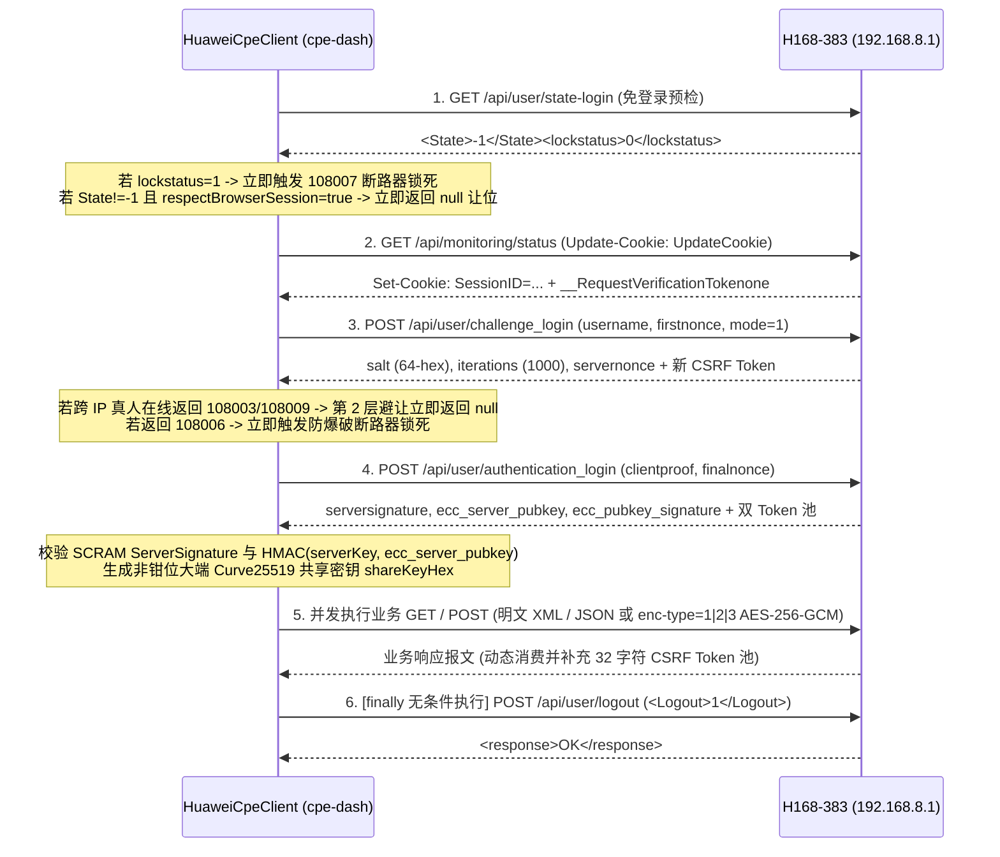

# H168-383 私有协议、逆向算法与阶段交接规范字典 (`PHASE1_PROTOCOL_SPEC.md`)

> **目标硬件**：华为 5G CPE Ultra 6 (`H168-383` / 硬件代号 `WL1H168M`)  
> **实测固件**：`4.4.0.1 (H1006SP19C00)` | **WebUI 版本**：`WEBUI 4.4.0.1 (W2SP24C03)`  
> **适用范围**：「烽燧」(FengSui / `cpe-dash`) Phase 1 侦察收官与 Phase 2 后端守护进程 / 前端可视化开发权威契约（Phase 2.2 起纳入短信接口，见 3.8 节）  
> **脱敏审计承诺**：本文档全部报文样本均严格遵循 RFC 5737 / RFC 3849 / RFC 7042 与合成占位符规范，零真实密码、零真实公网 IP、零真实 MAC/IMEI/IMSI/ICCID/TAC/CellID。

---

## 1. 侦察资产溯源与三方交叉印证综述

本规范所有路由、字段语义、编码进制与位运算公式均经过以下三路独立证据源 **100% 交叉闭环印证**：

1. **真机 WebInspector HAR 全量抓包审计**（`754` 条 HTTP 事务，提取去重 `122` 个 `/api/*` 接口、`17` 个 `/config/*.xml` 静态配置与 `44` 个 Vue 3 Webpack 组件包 `/js/*-vue.js`，覆盖 `150` 个 Vuex `commonGet`/`commonPost` 符号分发动作）。
2. **双端成熟客户端二进制逆向（REA 静态取证 + 指令流还原）**：
   - Windows PC 端 `CPEManager 3.8.2` 与 Android 端 `CPEManager 3.8.3_beta1` 均基于 **Qt 6.5.3 C++ 动态插件架构 (`QPluginLoader`)**；
   - 核心华为 5G 驱动模块 `CpeVendorHUAWEI` (`v3.8.4`，原生适配 `H153 / H155 / H165 / H168 / E6888`) 与密码/位运算库 `CpeUtil` (`v3.8.0`，核心函数 `CpeUtil::bandListToHex` 位于虚拟偏移 `0x0000dd1c`)；
   - REA 静态密码学取证摘要：
     - `CpeNet.dll` (`sha256: a5e6f0bc7839de1615cacc0e043feadfa2cee7deb3475823417510fbba4b093e`)
     - `CpeVendorManager.dll` (`sha256: 809f54961d9a034e0b6080400379b3276eba6709e9c9c18bfc08d2866613de06`)
     - `CpeUtil.dll` (`sha256: 1f1f3fd60f3cab3a9dc78f14690c639504610abae674a4891792984956fc1cdb`)
     - `CPEManager_3.8.3_beta1.apk` (`sha256: 2467aa14f540ef0e1003fb693e4c6cbf4ebd81d7e8ca187d5c5582a60c011262`)
3. **局域网 `192.168.8.1` 真机非破坏性探针实测**（`scripts/probe-*.ts` 共 8 组探针全部实机跑通）。

---

## 2. 会话生命周期、双层真人避让与错误码断路器规范

### 2.1 SCRAM-SHA256 + 非钳位大端 Curve25519 + AES-256-GCM 握手状态机



#### 核心密码学细节（已封装于 [`src/crypto.ts`](../src/crypto.ts)）
1. **SCRAM-SHA256 派生顺序（注意 HMAC 参数顺序与标准 RFC 相反，系华为私有实现）**：
   - `saltedPwd = PBKDF2-HMAC-SHA256(latin1(password), hex(salt), iterations, 32)`
   - `clientKey = HMAC-SHA256(key = "Client Key", data = saltedPwd)`
   - `storedKey = SHA256(clientKey)`
   - `authMsg = utf8("${firstNonce},${serverNonce},${serverNonce}")`
   - `clientSig = HMAC-SHA256(key = authMsg, data = storedKey)`（注意：`authMsg` 作为 HMAC Key！）
   - `clientProof = clientKey XOR clientSig`
   - `serverKey = HMAC-SHA256(key = "Server Key", data = saltedPwd)`
   - `expectedServerSig = HMAC-SHA256(key = authMsg, data = serverKey)`
   - `eccPubSigCheck = HMAC-SHA256(key = serverKey, data = hex(ecc_server_pubkey))`
2. **非钳位大端 Curve25519 (`curve25519Mul`)**：
   - 素数域 $p = 2^{255} - 19$，$A_{24} = 121665$，基点 $u = 9$；
   - 私钥为 32 字节随机数直接按**大端序**解析为 `BigInt`（**严禁执行 RFC 7748 小端反转与低 3 位清零钳位**），左移 256 位内保持 `64` 个十六进制字符定长输出。
3. **AES-256-GCM 载荷加解密 (`enc-type=1|2|3`)**：
   - URL 追加查询串：`?ecc-client-pubkey=<64-hex>&enc-type=<1|2|3>`（`1`=请求明文/响应密文，`2`=请求密文/响应明文，`3`=双向密文）；
   - Key = `shareKeyHex` 前 64 个 hex 字符（32 字节），AAD = **16 个零字节**（`Buffer.alloc(16, 0)`）；
   - 密文十六进制串结构：`[4字节小端序明文长度 Header (8 hex)] + [12字节随机 IV (24 hex)] + [16字节 AuthTag (32 hex)] + [Ciphertext]`（AuthTag 位于密文**之前**）；
   - 以上格式以 [`src/crypto.ts`](../src/crypto.ts) 的 `aesGcmEncrypt` / `aesGcmDecrypt` 为准。仓库内目前仅有自洽往返测试覆盖，Phase 2 路由均未使用加密通道；后续启用前应先用真机加密响应完成一次解密验证。

---

### 2.2 真机实测会话占用耗时与双层真人避让机制

在局域网直连实测（[`scripts/probe-session-avoidance.ts`](../scripts/probe-session-avoidance.ts)）中记录的真实耗时基准与固件行为：

| 操作场景 | 实测会话占用窗口 (`lastSessionHoldMs`) | 实测结论 |
| :--- | :--- | :--- |
| 单接口轻量采集（如 `status` / `traffic` / `HostInfo`） | **`25 ms – 47 ms`**（3 轮均值 `26 ms`） | 远低于 `200 ms` 设计上限，`logout` 后路由器瞬间恢复 `State=-1` |
| 5 接口并发采集（3CA 射频 + 邻区 + PLMN + RI） | **`219 ms – 443 ms`** | 单次短连一次性拉齐全部射频上下文 |
| 18 接口全量并发采集（Wi-Fi 7 + 天线 + DHCP + APN + SNTP） | **`130 ms – 260 ms`** | 证明 `Promise.all` 批处理可在单次瞬时窗口内完成全站巡检 |

#### ⚠️ 固件 `4.4.0.1` 会话作用域关键实测发现与双层避让契约
1. **Cookie 作用域特性**：在 H168-383 固件 `4.4.0.1` 上，`GET /api/user/state-login` 携带有效 `SessionID` Cookie 时返回 `<State>0</State><accounts_number>1</accounts_number>`；但**不携带 Cookie 的外部进程**请求同一接口时，固件可能返回 `<State>-1</State>`。
2. **同源 IP 与跨 IP 差异**：
   - **同源 IP**（如本机同时打开浏览器与运行探针）：瞬时探针完成 `login -> GET -> logout` **不会踢掉**同 IP 浏览器的活跃 `SessionID`（实测浏览器会话全程保持认证态）。
   - **跨局域网 IP**（生产典型拓扑：群晖 NAS `192.168.8.10` 轮询 vs 用户电脑/手机 `192.168.8.44` 登录网页后台）：当用户电脑已登录时，NAS 发起 `challenge_login` / `authentication_login` 会收到硬件级排他错误码 **`108003`**（已有其他管理员登录）或 **`108009`**（会话被占用），且**不会踢掉真人浏览器**。
3. **双层自动避让实现（[`HuaweiCpeClient.withSession()`](../src/cpe-client.ts)）**：
   - **第 1 层（免握手预检）**：调用 `GET /api/user/state-login`，若 `State !== "-1"`，零 SCRAM 开销直接自增 `browserYieldCount` 并返回 `null`。
   - **第 2 层（跨 IP `108003`/`108009` 静默让位）**：当 `respectBrowserSession: true`（默认开启）且握手捕获 `isSessionOccupied` (`108003` / `108005` / `108009`) 时，禁止延迟重试，立即自增 `browserYieldCount`、执行 `finally` 清理并返回 `null`。

---

### 2.3 错误码全景矩阵与 `108006`/`108007` 熔断断路器规则

| 错误码 | 固件含义 | `HuaweiCpeClient` 强制处置策略 |
| :--- | :--- | :--- |
| `100002` | 系统不支持该接口 (`No support`) | 抛出非致命 `CpeApiError`（例如 `/api/monitoring/daily-data-limit`、`/api/ntwk/ethwanrate`）；调用方按特性降级处理 |
| `100003` | 权限不足、未登录或前置动作未触发 (`Unauthorized`) | 抛出非致命 `CpeApiError`（注意：`GET /api/net/lock-freq` 与未触发 `POST` 前的 `GET /api/diagnosis/ping_result` 均返回 `100003`） |
| `100004` | 系统繁忙 (`System busy`) | 非致命异常，等待下一轮轮询周期 |
| `100005` / `100006` | XML 格式错误 / 参数越界 (`Format / Parameter error`) | 立即终止当前控制指令并校验 `BandMask` / `PCI` / `ARFCN` 入参 |
| `108001` / `108002` / **`108006`** | 用户名或管理密码错误 (`Authentication failed`) | **立即触发防爆破断路器 (`CircuitBreaker`) 永久锁死**！严禁任何自动重试（H168-383 连续错 3 次即锁机），后续调用零网络请求直接短路报错，须人工修正 `.env` 并调用 `resetCircuitBreaker()` |
| **`108007`** | 密码错误超限，硬件账户已锁定 (`Login locked`) | **立即触发防爆破断路器锁死**，记录 `<remainwaittime>` 秒数 |
| **`108003`** / `108005` / **`108009`** | 其他管理员已在线 / 会话被占用 (`Session occupied`) | `respectBrowserSession: true` 时立即静默让位返回 `null`；显式控制指令可按需提示“当前已有管理员在线” |
| `108010` | 登录过于频繁 (`Too frequent login`) | 退避至下一轮 `POLL_INTERVAL_MS`（建议 `>= 5000ms`） |
| `125001` / `125002` / `125003` | CSRF Token 错误 / 会话过期 / Session Token 无效 | 单次短连失效，`finally` 清理后由下一次 `withSession()` 重新获取干净会话 |

---

### 2.4 会话占用上限与采集保真规则（Phase 2.5）

1. **单会话占用上限**：`HuaweiCpeClient.withSessionDetailed()` 为每个会话（登录到登出）设置截止时间（`sessionMaxHoldMs`，默认 `90s`，运行时取 `max(90s, SMS_SEND_STATUS_TIMEOUT_MS + 30s)`）。会话内所有请求共用截止信号，登录与业务函数都与之竞速；到期后在途请求立即中止，`finally` 中的 `POST /api/user/logout` 改用独立的新信号执行，互斥锁随即释放（错误类型 `CpeSessionDeadlineError`）。`authentication_login` 发出后、路由器应答前一律视为「可能已登录」，因此被中止的握手同样会执行登出。
2. **读取失败绝不变成数据**：会话内的可选读取只在路由器返回 CPE 错误码（如 `100002`）时降级为空；超时、连接重置等传输层失败使整个快照失败。遥测核心接口（`/api/device/signal`、`/api/monitoring/status`、`/api/monitoring/traffic-statistics`、`/api/monitoring/month_statistics`）与全部路由器配置接口必须成功。
3. **读-改-写**：`/api/security/firewall-switch`、`/api/security/dmz`、`/api/wlan/wlandbho` 的写入以严格读取的当前值为基础，读取失败或缺字段即在任何写入之前中止。
4. **唯一 CPE 进程**：只有 `serve` 守护进程连接 CPE，并独占数据目录（`state.json.lock`）。`cpe-dash mcp` 是转发到守护进程 `/mcp` 的零状态 stdio 桥接，不会登录 CPE。

---

## 3. 已验证 API 路由与脱敏报文全量字典

> **通用请求头规范**：
> - 所有请求统一携带：`X-Requested-With: XMLHttpRequest`、`_ResponseSource: Broswer`（注：固件原生拼写即为 `Broswer`）；
> - 所有 `POST` 请求额外携带：`Content-Type: application/x-www-form-urlencoded; charset=UTF-8`、`Cookie: SessionID=...` 以及单次消费的 32 字符 `__RequestVerificationToken` 请求头；
> - 每次 `POST` 响应头会返回新的 `__RequestVerificationToken`（登录成功时返回 64 字符拼接串或 `__RequestVerificationTokenone` + `two`）。

### 3.1 鉴权与会话管理接口

#### `GET /api/user/state-login`（免登录预检）
- **加密模式**：明文 XML
- **最小完备脱敏响应样本**：
```xml
<?xml version="1.0" encoding="UTF-8"?>
<response>
  <extern_password_type>1</extern_password_type>
  <wifipwdsamewithwebpwd>0</wifipwdsamewithwebpwd>
  <rsapadingtype>1</rsapadingtype>
  <lockstatus>0</lockstatus>
  <remainwaittime>0</remainwaittime>
  <State>-1</State>
  <password_type>4</password_type>
  <firstlogin>0</firstlogin>
  <history_login_flag>0</history_login_flag>
  <accounts_number>1</accounts_number>
</response>
```
*(注：携带已登录 `SessionID` 时 `<State>` 为 `0`，并额外返回 `<Username>admin</Username><userlevel>2</userlevel>`。)*

#### `GET /api/webserver/token`
- **加密模式**：明文 XML（取 `<token>` 后 32 位作为初始 `__RequestVerificationToken`）
```xml
<?xml version="1.0" encoding="UTF-8"?>
<response>
  <token>0000000000000000000000000000000011111111111111111111111111111111</token>
</response>
```

#### `POST /api/user/logout`
- **请求体**：
```xml
<?xml version="1.0" encoding="UTF-8"?><request><Logout>1</Logout></request>
```
- **响应体**：`<?xml version="1.0" encoding="UTF-8"?><response>OK</response>`

---

### 3.2 3CA 载波聚合、高阶射频与基站参数接口

#### `GET /api/device/signal`（主小区 PCC + 5G NR 锚点 + MCS + 发射功率核心遥测）
- **鉴权要求**：需 `SessionID` Cookie | **编码**：明文 XML
- **真机实测完整脱敏响应样本**：
```xml
<?xml version="1.0" encoding="UTF-8"?>
<response>
  <pci>357</pci>
  <sc></sc>
  <cell_id>134217758</cell_id>
  <rsrq>-5.5dB</rsrq>
  <rsrp>-87dBm</rsrp>
  <rssi>-72dBm</rssi>
  <sinr>13dB</sinr>
  <rscp></rscp>
  <ecio></ecio>
  <mode>7</mode>
  <ulbandwidth>20MHz</ulbandwidth>
  <dlbandwidth>20MHz</dlbandwidth>
  <txpower>PPusch:12dBm PPucch:-9dBm PSrs:0dBm PPrach:-3dBm</txpower>
  <tdd></tdd>
  <ul_mcs>mcsUpCarrier1:27@256QAM</ul_mcs>
  <dl_mcs>mcsDownCarrier1Code0:20@256QAM mcsDownCarrier1Code1:18@64QAM</dl_mcs>
  <earfcn>DL:100 UL:18100</earfcn>
  <rrc_status>1</rrc_status>
  <rac></rac>
  <lac></lac>
  <tac>10001</tac>
  <band>20MHz@100(B1) + 20MHz@1700(B3) + 100MHz@647424(N78)</band>
  <bandInfo>B1</bandInfo>
  <nei_cellid></nei_cellid>
  <plmn>27201</plmn>
  <ims>0</ims>
  <wdlfreq></wdlfreq>
  <lteulfreq>19300</lteulfreq>
  <ltedlfreq>21200</ltedlfreq>
  <transmode>TM[4]</transmode>
  <enodeb_id>0524288</enodeb_id>
  <cqi0>12</cqi0>
  <cqi1>11</cqi1>
  <ulfrequency>1930000kHz</ulfrequency>
  <dlfrequency>2120000kHz</dlfrequency>
  <nrulbandwidth>100MHz</nrulbandwidth>
  <nrdlbandwidth>100MHz</nrdlbandwidth>
  <nrulmcs>NRmcsUpCarrier1:20@256QAM</nrulmcs>
  <nrdlmcs>NRmcsDownCarrier1Code0:17@64QAM NRmcsDownCarrier1Code1:0</nrdlmcs>
  <nrtxpower>PPusch:23dBm PPucch:23dBm PSrs:0dBm PPrach:5dBm</nrtxpower>
  <nrearfcn>647424</nrearfcn>
  <nrulfreq>3750000kHz</nrulfreq>
  <nrdlfreq>3750000kHz</nrdlfreq>
  <nrsinr>8dB</nrsinr>
  <nrrsrp>-95dBm</nrrsrp>
  <nrrsrq>-10.0dB</nrrsrq>
  <nrrssi>-72dBm</nrrssi>
  <nrbler>0</nrbler>
  <nrrank>1</nrrank>
  <nrcqi0>12</nrcqi0>
  <nrcqi1>11</nrcqi1>
  <scc_pci>357</scc_pci>
</response>
```

#### `GET /api/device/seccellinfo`（次载波聚合分量表 SCC）
- **编码**：明文 XML（分号 `;` 分隔行，逗号 `,` 分隔 **8 列**：`earfcn,band,bandwidth,pci,rsrp,rsrq,rssi,sinr;`）
```xml
<?xml version="1.0" encoding="UTF-8"?>
<response>
  <lteseccell_list>1700,B3,20MHz,357,-84dBm,-6dB,-70dBm,14dB;</lteseccell_list>
  <nrseccell_list>647424,N78,100MHz,357,-95dBm,-10dB,-72dBm,8dB;</nrseccell_list>
</response>
```

#### `GET /api/device/ri`（4G LTE MIMO 空间流数 Rank Indicator）
```xml
<?xml version="1.0" encoding="UTF-8"?>
<response><ri>2</ri></response>
```

#### `GET /api/net/cell-info`（十六进制 ECI 与 TAC 交叉校验）
```xml
<?xml version="1.0" encoding="UTF-8"?>
<response>
  <cellinfo>0800001E</cellinfo>
  <lac>2711</lac>
</response>
```
*(真机数学恒等已验证：`parseInt("0800001E", 16) === 134217758 === Number(cell_id)`；`parseInt("2711", 16) === 10001 === Number(tac)`。)*

#### `GET /api/net/current-plmn`（当前注册运营商与接入制式）
```xml
<?xml version="1.0" encoding="UTF-8"?>
<response>
  <State>0</State>
  <FullName>Carrier-Lab</FullName>
  <ShortName>CARRIER</ShortName>
  <Numeric>27201</Numeric>
  <Rat>7</Rat>
  <Spn></Spn>
</response>
```

---

### 3.3 4G / 5G 邻区基站扫描接口

#### `GET /api/device/nbrcellinfo`
- **编码**：明文 XML（分号 `;` 分隔行，逗号 `,` 分隔 **7 列**：`earfcn,band,pci,rsrp,rsrq,rssi,sinr;`，未测出项为 `--`）
```xml
<?xml version="1.0" encoding="UTF-8"?>
<response>
  <nbrcell_ltelist>1700,B3,357,-87dBm,-10dB,-69dBm,--;1700,B3,25,-93dBm,-16dB,-69dBm,--;100,B1,25,-96dBm,-12dB,-70dBm,--;</nbrcell_ltelist>
  <nbrcell_nrlist></nbrcell_nrlist>
</response>
```

---

### 3.4 锁频段 (`BandMask`) 与锁小区 (`PCI + ARFCN`) 控制接口

#### `GET /api/net/net-feature-switch`（硬件锁频/锁频点能力开关读取）
```xml
<?xml version="1.0" encoding="UTF-8"?>
<response>
  <net_premode_switch>2</net_premode_switch>
  <lteband_switch>0</lteband_switch>
  <select_band_switch>1</select_band_switch>
  <lock_freq_switch>3</lock_freq_switch>
  <antenna_select_switch>0</antenna_select_switch>
  <reconnect_switch>1</reconnect_switch>
  <net_mode_enable>1</net_mode_enable>
</response>
```

#### `GET / POST /api/net/net-mode`（网络制式切换与 4G LTE 频段掩码读写）
- **`GET` 响应样本**：
```xml
<?xml version="1.0" encoding="UTF-8"?>
<response>
  <NetworkMode>00</NetworkMode>
  <NetworkBand>2000004680380</NetworkBand>
  <LTEBand>40000007A0880800D5</LTEBand>
  <networkOption>2</networkOption>
  <LTEBandOption>0</LTEBandOption>
</response>
```
- **`POST` 锁定 4G B1+B3 频段请求模板**（`NetworkMode`: `00`=自动, `03`=仅4G, `08`=仅5G）：
```xml
<?xml version="1.0" encoding="UTF-8"?>
<request>
  <NetworkMode>00</NetworkMode>
  <NetworkBand>3fffffff</NetworkBand>
  <LTEBand>5</LTEBand>
  <networkOption>2</networkOption>
</request>
```

#### `POST /api/net/lock-freq`（5G NR 锁频段 & 4G/5G 锁频点/锁小区统一控制）
- **重要边界**：H168-383 零售固件 `4.4.0.1` 上 `GET /api/net/lock-freq` 返回 `[CPE 100003]`（仅开放 `POST` 下发），因此 Phase 2 后端须在本地加密状态文件 [`data/state.json`](../src/encrypted-file.ts) 中持久化当前用户下发的锁小区/NR 锁频配置，并与 `/api/device/signal` 实测驻留频点/PCI 对账校验！
  - **Phase 2 实现状态**：本地持久化已实现（`lockState`）；与 `/api/device/signal` 的对账校验**尚未实现**，`lockState` 仅代表「烽燧」最近一次成功下发的锁定配置（见 [`PHASE2_BACKEND_CONTRACT.md`](PHASE2_BACKEND_CONTRACT.md) §2.2）。
- **载荷模板详见第 4.2 节**。

---

### 3.5 分周期流量审计与实时速率接口

#### `GET /api/monitoring/month_statistics`（当日流量 + 当月流量核心数据源）
```xml
<?xml version="1.0" encoding="UTF-8"?>
<response>
  <CurrentMonthDownload>1160491161608</CurrentMonthDownload>
  <CurrentMonthUpload>587430687669</CurrentMonthUpload>
  <MonthDuration>2511543</MonthDuration>
  <MonthLastClearTime>2026-10-01</MonthLastClearTime>
  <CurrentDayUsed>11888746002</CurrentDayUsed>
  <CurrentDayDuration>13250</CurrentDayDuration>
</response>
```

#### `GET /api/monitoring/traffic-statistics`（瞬时上下行字节速率 + 本次拨号与历史累计总流量）
```xml
<?xml version="1.0" encoding="UTF-8"?>
<response>
  <CurrentConnectTime>346909</CurrentConnectTime>
  <CurrentUpload>80240562176</CurrentUpload>
  <CurrentDownload>191780421632</CurrentDownload>
  <CurrentDownloadRate>14722</CurrentDownloadRate>
  <CurrentUploadRate>6897</CurrentUploadRate>
  <TotalUpload>2418923415594</TotalUpload>
  <TotalDownload>5541561494560</TotalDownload>
  <TotalConnectTime>12193610</TotalConnectTime>
  <showtraffic>1</showtraffic>
</response>
```

#### `GET /api/monitoring/start_date`（结算日与月度流量配额阈值）
```xml
<?xml version="1.0" encoding="UTF-8"?>
<response>
  <StartDay>1</StartDay>
  <DataLimit>0MB</DataLimit>
  <DataLimitAwoke>0</DataLimitAwoke>
  <MonthThreshold>90</MonthThreshold>
  <DayThreshold>90</DayThreshold>
  <SetMonthData>0</SetMonthData>
</response>
```
*(注：`GET /api/monitoring/daily-data-limit` 在当前固件配置下返回 `100002` 不支持，客户端需捕获忽略。)*

---

### 3.6 终端拓扑、接入介质分类与静态 DHCP 绑定接口

#### `GET /api/system/HostInfo`（注意：返回 **JSON 数组**，非 XML！）
- **最小完备脱敏响应样本**：
```json
[
  {
    "ID": "InternetGatewayDevice.LANDevice.1.Hosts.Host.1.",
    "MACAddress": "00:00:5E:00:53:01",
    "HostName": "lan-client-01",
    "ActualName": "lan-client-01",
    "IPAddress": "192.168.8.10",
    "IPv6Address": "fe80::1;2001:db8::42",
    "V6Active": true,
    "Active": true,
    "InterfaceType": "Ethernet",
    "Layer2Interface": "LAN1",
    "Frequency": "",
    "PhyType": 1000,
    "EthernetSpeed": 1000,
    "rate": 0,
    "rssi": 0,
    "AddressSource": "STATIC",
    "LeaseTime": 0,
    "AssociatedTime": 86400
  },
  {
    "ID": "InternetGatewayDevice.LANDevice.1.Hosts.Host.2.",
    "MACAddress": "00:00:5E:00:53:02",
    "HostName": "lan-client-02",
    "ActualName": "",
    "IPAddress": "192.168.8.44",
    "IPv6Address": "fe80::1",
    "V6Active": true,
    "Active": true,
    "InterfaceType": "Wireless",
    "Layer2Interface": "SSID7",
    "Frequency": "5GHz_1",
    "PhyType": 0,
    "EthernetSpeed": 0,
    "rate": 864,
    "rssi": 31,
    "AddressSource": "DHCP",
    "LeaseTime": 72302,
    "AssociatedTime": 14400
  }
]
```

#### `GET /api/system/topology`（JSON 树形 Mesh 拓扑结构）
```json
[
  {
    "ConnectedDevices": [],
    "LinkQuality": "High",
    "Active": true,
    "HiLinkType": "None",
    "MACAddress": "00:00:5E:00:53:02",
    "HostID": "InternetGatewayDevice.LANDevice.1.Hosts.Host.2.",
    "RSSI": 31,
    "AccessType": "Wireless",
    "LastAccessTime": 41
  }
]
```

#### `GET / POST /api/dhcp/static-addr-info`（DHCP 静态 MAC-IP 绑定）
- **`GET` 响应样本**：
```xml
<?xml version="1.0" encoding="UTF-8"?>
<response>
  <Hosts>
    <Host>
      <ID>InternetGatewayDevice.LANDevice.1.LANHostConfigManagement.DHCPStaticAddress.1</ID>
      <HostIndex>1</HostIndex>
      <HostEnabled>1</HostEnabled>
      <HostHw>00:00:5E:00:53:01</HostHw>
      <HostIp>192.168.8.10</HostIp>
      <hostname>lan-static-01</hostname>
    </Host>
  </Hosts>
</response>
```
- **`POST` 更新静态绑定请求模板**（全量提交 `<Hosts><Host>...</Host></Hosts>` 列表）：
```xml
<?xml version="1.0" encoding="UTF-8"?>
<request>
  <Hosts>
    <Host>
      <index>1</index>
      <hostname>lan-static-01</hostname>
      <HostHw>00:00:5E:00:53:01</HostHw>
      <HostIp>192.168.8.10</HostIp>
    </Host>
  </Hosts>
</request>
```

---

### 3.7 拓展网管能力接口（Wi-Fi 7 MLO、天线切换、双栈 APN、系统维护与诊断）

| 能力域 | 方法与路径 | 载荷编码 | 关键字段与真机实测值 |
| :--- | :--- | :--- | :--- |
| **Wi-Fi 7 MLO 与双频优选** | `GET / POST /api/wlan/wlandbho` | **JSON** | `{"MloEnable":true,"DbhoEnable":true}`（原生支持 802.11be MLO 多链路聚合开关） |
| **Wi-Fi 7 三射频模式与信道优化** | `GET /api/wlan/multi-security-settings-ex` | XML | `Radio.1`: `b/g/n/ax/be`；`Radio.2`: `a/n/ac/ax/be`；`Radio.3`: `a/n/ac/ax`；`WifiChannelAutoOptimize`: `0\|1` |
| **外置/内置天线切换** | `GET / POST /api/device/antenna_set_type` | XML | `<antennasettype>0</antennasettype>`（`0`=自动检测, `1`=内置天线, `2`=外置天线） |
| **物理外置天线插入状态** | `GET /api/device/antenna_type` | XML | `<antenna1insertstatus>0\|1</antenna1insertstatus>`、`<antenna2insertstatus>0\|1</antenna2insertstatus>` |
| **APN 双栈协议配置** | `GET / POST /api/dialup/profiles` | XML | `<iptype>2</iptype>`（`0`=IPv4, `1`=IPv6, `2`=IPv4v6 双栈）；`ReadOnly` 标识运营商预置锁定状态 |
| **蜂窝移动数据总开关** | `GET / POST /api/dialup/mobile-dataswitch` | XML | `<dataswitch>1</dataswitch>`（`1`=开启, `0`=关闭） |
| **蜂窝重拨 / 重新搜网** | `POST /api/net/reconnect` | XML | `<request><reconnect_action>1</reconnect_action></request>` |
| **定时重启维护窗口** | `GET / POST /api/diagnosis/time_reboot` | XML | `<enable>1</enable><dayinterval>7</dayinterval><begintime>60</begintime><endtime>300</endtime>` |
| **设备软重启控制** | `POST /api/device/control` | XML | `<request><Control>1</Control></request>`（高危写操作，前端须二次确认） |
| **Ping / Traceroute 诊断** | `POST` 触发 -> `GET` 轮询 `/api/diagnosis/ping_result` & `traceroute_result` | XML | 重要边界：未先发送 `POST` 触发任务前直接 `GET` 返回 `100003`；触发后轮询 `<DiagnosticsState>` 直至 `Complete` |


### 3.8 短信接口（Phase 2.2 纳入，封装于 `src/sms/protocol.ts`）

> **来源与验证状态**：路由、载荷与加密格式和 `cpe-sms` 在同一台 H168-383（固件 `4.4.0.1`）上实际运行的实现一致。「烽燧」侧由加密 Mock 路由器（`test/helpers/mock-sms-cpe.ts`）覆盖。2026-10-30 已用只读探针 `npm run probe:sms` 在真机确认：明文 `POST /api/sms/sms-list` 可用（未触发加密回退），单次会话 `259 ms` 内完成 193 条全量拉取，列表条数与 `sms-count` 收件箱 + 发件箱计数一致，免登录 `check-notifications` 正常；同日 `serve` 守护进程完成首轮同步（33 个会话）。加密列表回退（`sms-list-contact` / `sms-list-phone`）在该固件上未被触发，仅由 Mock 测试覆盖；发送、标记已读与删除按铁律只在 Mock 路由器上验证。
>
> **会话约束**：除免登录的 `check-notifications` 外，以下接口都必须在 `MutexSessionScheduler` 分配的瞬时会话内调用（铁律四），严禁独立登录轮询。

#### 3.8.1 接口总表

| 能力 | 方法与路径 | 编码（`enc-type`） | 说明 |
| :--- | :--- | :--- | :--- |
| 未读与存储满探测（免登录） | `GET /api/monitoring/check-notifications` | 明文 | `<UnreadMessage>`、`<SmsStorageFull>`；让位期间每 5s 探测，零会话 |
| 短信计数 | `GET /api/sms/sms-count` | 明文 | `<LocalUnread>`、`<LocalInbox>`、`<LocalOutbox>`、`<LocalDraft>`、`<LocalMax>`；捎带在 5s 遥测会话内，作为同步触发器 |
| 按信箱分页列表（首选） | `POST /api/sms/sms-list` | 明文 XML | `BoxType` `1`=收件箱、`2`=发件箱；每页 ≤50 |
| 会话（联系人）列表（回退） | `POST /api/sms/sms-list-contact` | `enc-type=1` | 每个会话的最新一条；`sms-list` 返回 CPE 错误码时启用 |
| 会话总数 | `GET /api/sms/sms-count-contact` | 明文 | `<count>` |
| 单号码消息数 | `POST /api/sms/sms-count-contact` | `enc-type=2` | 请求体 `<phone>` 需经 Huawei `xss()` 转义 |
| 单号码消息列表（回退） | `POST /api/sms/sms-list-phone` | `enc-type=3` | 双向消息，每页 ≤20 |
| 发送 | `POST /api/sms/send-sms` | `enc-type=2` | 最多 5 个收件人、4 段 |
| 发送状态轮询 | `POST /api/sms/send-status` | `enc-type=1` | 每 2s 一次，最长 45s（`SMS_SEND_STATUS_TIMEOUT_MS`） |
| 标记已读 | `POST /api/sms/set-read` | 明文 XML | 每批 ≤20 个 `<Index>` |
| 删除 | `POST /api/sms/delete-sms` | 明文 XML | 每批 ≤20 个 `<Index>` |

#### 3.8.2 加密通道（`enc-type`）

1. 会话内首次加密调用前，`GET /api/webserver/publickey` 取得 `<ecc_server_pubkey>`；客户端按 2.1 节的非钳位大端 Curve25519 生成临时密钥对并派生共享密钥（同一会话内复用）。
2. 请求 URL 追加查询串 `?ecc-client-pubkey=<客户端公钥 hex>&enc-type=<1|2|3>`：

   | `enc-type` | 请求体 | 响应体 |
   | :--- | :--- | :--- |
   | `1` | 明文 XML | AES-256-GCM 密文 |
   | `2` | AES-256-GCM 密文 | 明文 XML |
   | `3` | AES-256-GCM 密文 | AES-256-GCM 密文 |

3. 密文为十六进制串：`[8 hex：uint32 LE 明文 UTF-8 字节长度][24 hex：12 字节 IV][32 hex：16 字节 GCM Tag][密文 hex]`，**AAD 固定为 16 个零字节**。解密后截取明文长度，并从 `<response>` 或 `<error>` 起始处解析；`<error><code>…</code></error>` 按 2.3 节错误码处理。

#### 3.8.3 请求模板与脱敏样本

```xml
<!-- POST /api/sms/sms-list（明文） -->
<?xml version="1.0" encoding="UTF-8"?>
<request><PageIndex>1</PageIndex><ReadCount>50</ReadCount><BoxType>1</BoxType><SortType>0</SortType><Ascending>0</Ascending><UnreadPreferred>0</UnreadPreferred></request>

<!-- 响应（仅列出「烽燧」解析的字段；字段名大小写不敏感） -->
<response>
  <Messages>
    <Message><Smstat>0</Smstat><Index>40001</Index><Phone>DemoBank</Phone><Content>Your verification code is 482913</Content><Date>2026-10-29 09:00:00</Date></Message>
    <Message><Smstat>1</Smstat><Index>40002</Index><Phone>+353830000001</Phone><Content>Dinner at 7?</Content><Date>2026-10-29 18:00:00</Date></Message>
  </Messages>
</response>

<!-- POST /api/sms/sms-list-contact?ecc-client-pubkey=…&enc-type=1（请求明文，响应解密后） -->
<request><pageindex>1</pageindex><readcount>20</readcount></request>
<response><messages><message><smstat>0</smstat><index>40002</index><phone>+353830000001</phone><content>Dinner at 7?</content><date>2026-10-29 18:00:00</date><curbox>0</curbox></message></messages></response>

<!-- POST /api/sms/sms-list-phone?…&enc-type=3（加密前明文） -->
<request><phone>+353830000001</phone><pageindex>1</pageindex><readcount>20</readcount></request>

<!-- POST /api/sms/send-sms?…&enc-type=2（加密前明文；Content 已按 xss() 转义，Length 为转义后长度） -->
<request><Index>-1</Index><Phones><Phone>+353830000001</Phone></Phones><Sca></Sca><Content>See you at 7 &#40;table for 2&#41;</Content><Length>34</Length><Reserved>1</Reserved><Date>2026-10-30 09:00:00</Date></request>

<!-- POST /api/sms/send-status?…&enc-type=1 响应（解密后）：<Phone> 非空表示仍在发送 -->
<response><Phone></Phone><SucPhone>+353830000001</SucPhone><FailPhone></FailPhone><SendFailCode>0</SendFailCode></response>

<!-- POST /api/sms/set-read 与 /api/sms/delete-sms（明文，每批 ≤20） -->
<request><Index>40001</Index><Index>40002</Index></request>
```

#### 3.8.4 字段语义与编码规则

- **`Smstat`**：`0` 未读来信、`1` 已读来信、`3` 已发送、`4` 发送失败；加密列表中的 `<curbox>`（`0` 收件、`1` 发件）优先决定方向。
- **`Index` 会被复用**：删除后 CPE 可能把同一索引分配给新短信，因此「烽燧」以 `sha256(index \0 date \0 phone)` 截断得到的不透明 `uid` 识别消息，对外不暴露号码。
- **文本模式 `Reserved`**：`1` = GSM 7-bit（单段 160、长短信每段 153 个 septet，扩展字符计 2）；`0` = UCS-2（单段 70、长短信每段 67 个码元）。单次发送上限 4 段，超出在会话前拒绝。
- **Huawei `xss()` 转义**：`send-sms` 的 `Content` 与 `sms-count-contact` 的 `phone` 须预先转义 `& ' " < > / ( )` 为 `&amp; &#39; &quot; &lt; &gt; &#x2F; &#40; &#41;`，并原样写入 XML（`PreEscapedXmlText`，避免二次转义）；`Length` 取转义后的字符数。响应中的正文按同一映射反转义，保留原始换行。
- **发送状态判定**：轮询直到 `<Phone>` 为空；`<SucPhone>` / `<FailPhone>` 以逗号或分号分隔，`<SendFailCode>` 非 `0` 视为失败码（如 `113018`）。45s 内未收敛时视为「已提交、状态未确认」。
- **同步策略**：计数中 `LocalInbox` 增长且不超过 20 条、发件箱不变 → 只拉取收件箱首页（增量）；其余变化（删除、发件箱变化、大量到达）→ 全量对账（分页拉取两个信箱，或回退为逐会话拉取）。另有 30 分钟兜底全量对账，失败后退避 60s。

---

## 4. 核心逆向算法与数学计算公式（已封装于 `src/band-lock.ts` 与 `src/parsers.ts`）

### 4.1 4G LTE / 5G NR `BandMask` 位掩码算法 (`CpeUtil::bandListToHex`)

华为巴龙基带将 3GPP 频段号 $N \in [1, 255]$ 映射为从第 0 位起算的精确位偏移：

$$
\text{BitOffset}(N) = N - 1, \qquad \text{BandMask}(\mathcal{B}) = \sum_{N \in \mathcal{B}} 2^{N - 1}
$$

编码为**不含 `0x` 前缀、去除前导零的小写十六进制字符串**（见 [`bandsToHexMask()`](../src/band-lock.ts) 与 [`hexMaskToBands()`](../src/band-lock.ts)）：

| 常见频段 | 位偏移 ($N-1$) | 单频段掩码 (`hex`) | H168-383 实测说明 |
| :--- | :--- | :--- | :--- |
| `B1` / `N1` | `0` | `1` | 实测主力 4G PCC (20 MHz) |
| `B3` / `N3` | `2` | `4` | 实测主力 4G SCC (20 MHz) |
| `B5` | `4` | `10` | FDD 低频覆盖 |
| `B7` | `6` | `40` | FDD 2600 MHz |
| `B8` | `7` | `80` | FDD 900 MHz |
| `B20` | `19` | `80000` | 欧洲主力 800 MHz 低频 |
| `B28` / `N28` | `27` | `8000000` | 700 MHz 黄金广覆盖频段 |
| `B32` | `31` | `80000000` | 1500 MHz SDL 辅助下行 |
| `B38` | `37` | `2000000000` | TDD 2600 MHz |
| `B40` | `39` | `8000000000` | TDD 2300 MHz |
| `B41` / `N41` | `40` | `10000000000` | TDD 2500 MHz |
| `B42` | `41` | `20000000000` | TDD 3500 MHz |
| `B43` | `42` | `40000000000` | TDD 3700 MHz |
| `B71` | `70` | `400000000000000000` | 600 MHz 超远距频段 |
| `N78` | `77` | `20000000000000000000` | 实测主力 5G NR 3.5 GHz (100 MHz) |
| **H168-383 原厂 14 频段全集** | `{1,3,5,7,8,20,28,32,38,40,41,42,43,71}` | **`40000007a0880800d5`** | 真机 `/api/net/net-mode` 100% 逐位吻合 |
| **LTE 自动全频段常量** | `0..62` | **`7fffffffffffffff`** | 恢复 4G 自动选频固定常量 |
| **2G/3G `NetworkBand` 自动常量** | `0..29` | **`3fffffff`** | 写入 `/api/net/net-mode` 固定常量 |

#### 锁定参数边界（Phase 2.5，[`src/band-lock.ts`](../src/band-lock.ts)）

- **LTE 频段白名单**：真机 `GET /api/net/net-mode-list` 的 `<LTEBandList>` 通告 `LTE BC1/BC3/BC5/BC7/BC8/BC20/BC28/BC32/BC38/BC40/BC41/BC42/BC43/BC71`（掩码 `40000007a0880800d5`，与 HAR 抓包一致）。锁 LTE 频段（`buildLteBandNetModeXml`）与 LTE 锁小区只接受这 14 个频段：锁到设备不支持的频段会让调制解调器失去 LTE 锚点，也就失去全部连接。
- **NR 频段**：路由器不通告 NR 频段列表；NR 锁频段与锁小区限定在 3GPP TS 38.101-1 FR1 表中的 `N1/N3/N5/N7/N8/N20/N28/N38/N40/N41/N75/N76/N77/N78/N79`（3GPP 边界，非硬件能力）。
- **ARFCN 与频段一致**：锁小区 / 锁频点的频点必须落在该频段的下行范围内：

| LTE 频段 | DL EARFCN（TS 36.101 表 5.7.3-1） | NR 频段 | DL NR-ARFCN（TS 38.101-1 表 5.4.2.3-1） |
| :--- | :--- | :--- | :--- |
| B1 | 0–599 | N1 | 422000–434000 |
| B3 | 1200–1949 | N3 | 361000–376000 |
| B5 | 2400–2649 | N5 | 173800–178800 |
| B7 | 2750–3449 | N7 | 524000–538000 |
| B8 | 3450–3799 | N8 | 185000–192000 |
| B20 | 6150–6449 | N20 | 158200–164200 |
| B28 | 9210–9659 | N28 | 151600–160600 |
| B32 | 9920–10359 | N38 | 514000–524000 |
| B38 | 37750–38249 | N40 | 460000–480000 |
| B40 | 38650–39649 | N41 | 499200–537999 |
| B41 | 39650–41589 | N75 / N76 | 286400–303400 / 285400–286400 |
| B42 | 41590–43589 | N77 | 620000–680000 |
| B43 | 43590–45589 | N78 | 620000–653333 |
| B71 | 68586–68935 | N79 | 693334–733333 |

  真机邻区样本 `1700,B3`、`100,B1`、`647424,N78` 均落在表内。

---

### 4.2 `POST /api/net/lock-freq` 四种锁定模式载荷规范 (`lock_mode = 0..3`)

- **`lock_mode = 0`**：解除锁定（恢复基带自动选频/选小区）
- **`lock_mode = 1`**：锁频点（指定 `band` + `freq`，不限 `pci`）
- **`lock_mode = 2`**：锁物理小区（精确指定 `band` + `freq` + `pci`）
- **`lock_mode = 3`**：5G NR 锁频段（`<freq_infos>` 枚举 `<band>`，`<all_bands>` 填入十六进制 `BandMask`）

```xml
<!-- 示例 A：5G NR 锁定 N78 频段 (buildNrBandLockXml(["N78"])) -->
<?xml version="1.0" encoding="UTF-8"?>
<request>
  <lte_info>
    <lock_mode>0</lock_mode>
    <freq_infos></freq_infos>
    <all_bands></all_bands>
  </lte_info>
  <nr_info>
    <lock_mode>3</lock_mode>
    <freq_infos>
      <freq_info><band>78</band></freq_info>
    </freq_infos>
    <all_bands>20000000000000000000</all_bands>
  </nr_info>
</request>

<!-- 示例 B：4G LTE 锁物理小区 B3 / EARFCN 1700 / PCI 357 (buildLteCellLockXml) -->
<?xml version="1.0" encoding="UTF-8"?>
<request>
  <lte_info>
    <lock_mode>2</lock_mode>
    <freq_infos>
      <freq_info>
        <band>3</band>
        <freq>1700</freq>
        <pci>357</pci>
      </freq_info>
    </freq_infos>
    <all_bands>4</all_bands>
  </lte_info>
</request>

<!-- 示例 C：5G NR 锁物理小区 N78 / NR-ARFCN 647424 / PCI 357 (buildNrCellLockXml) -->
<?xml version="1.0" encoding="UTF-8"?>
<request>
  <lte_info>
    <lock_mode>0</lock_mode>
    <freq_infos></freq_infos>
    <all_bands></all_bands>
  </lte_info>
  <nr_info>
    <lock_mode>2</lock_mode>
    <freq_infos>
      <freq_info>
        <band>78</band>
        <freq>647424</freq>
        <pci>357</pci>
      </freq_info>
    </freq_infos>
    <all_bands>20000000000000000000</all_bands>
  </nr_info>
</request>
```
*(注：固件根据 3GPP NR 频段表在基带内部自动推导子载波间隔 SCS，无需且禁止传入额外 SCS 标签。全量解锁时依次执行 `POST /api/net/lock-freq` (`buildUnlockAllLocksXml()`) 与 `POST /api/net/net-mode` (`buildLteBandNetModeXml("all")`)。)*

---

### 4.3 基站标识位拆分与双周期流量换算公式

1. **28-bit 4G LTE ECI 拆分（[`decomposeLteEci()`](../src/band-lock.ts)）**：
   $$
   \text{eNodeB ID} = \text{ECI} \ggg 8 \quad (\text{高 20 位}), \qquad \text{Sector ID} = \text{ECI} \ \& \ \mathtt{0xFF} \quad (\text{低 8 位})
   $$
2. **36-bit 5G NR NCI 拆分（[`decomposeNrNci()`](../src/band-lock.ts)，运营商可配高 $k \in [22, 32]$ 位为 `gNodeB ID`，默认 $k=24$）**：
   $$
   \text{gNodeB ID} = \text{NCI} \gg (36 - k), \qquad \text{Sector ID} = \text{NCI} \ \& \ \left(2^{36 - k} - 1\right)
   $$
3. **分周期流量与速率换算（[`parseTrafficSnapshot()`](../src/parsers.ts)）**：
   - **瞬时下行 / 上行比特率 (`bps`)**：`8 * CurrentDownloadRate` / `8 * CurrentUploadRate`（WebUI 按 `1024` 二进制阶梯换算 `Kbps` / `Mbps` / `Gbps`）；
   - **当日累计总流量 (`当日流量`)**：直接读取 `/api/monitoring/month_statistics` 中的 `<CurrentDayUsed>`（单位：Bytes）；
   - **当月累计总流量 (`当月流量`)**：`BigInt(CurrentMonthDownload) + BigInt(CurrentMonthUpload)`（单位：Bytes）；
   - **历史累计总流量**：`max(BigInt(TotalDownload) + BigInt(TotalUpload), monthTotalBytes)`。

---

## 5. Phase 1 探针脚本索引与真机验证结论总表

| 探针脚本 | 执行命令 | 核心职责 | 真机 (`192.168.8.1`) 验证结论 |
| :--- | :--- | :--- | :--- |
| [`scripts/probe-har-endpoints.ts`](../scripts/probe-har-endpoints.ts) | `npm run probe:har -- --har <path>` | 流式解构 HAR 抓包，提取去重 API 路由与自动脱敏样本 | 成功解构 `754` 条请求、`122` 个 `/api/*` 端点，零敏感数据残留 |
| [`scripts/probe-locking-algo.ts`](../scripts/probe-locking-algo.ts) | `npm run probe:locking` | 验证 PC/APK 逆向 `BandMask` 与锁小区载荷，对账真机频段表 | `37 ms` 完成短连，真机 14 频段掩码 `0x40000007a0880800d5` 100% 吻合 |
| [`scripts/probe-rf-ca.ts`](../scripts/probe-rf-ca.ts) | `npm run probe:rf` | 抓取 3CA 聚合链、256QAM MCS、MIMO 流数、发射功率与基站恒等校验 | 实测 `B1(20M)+B3(20M)+N78(100M)` 140MHz 3CA、UL/DL 256QAM、TM4 RI=2、PUSCH 12/23dBm |
| [`scripts/probe-neighbor-cells.ts`](../scripts/probe-neighbor-cells.ts) | `npm run probe:neighbors` | 扫描周边 4G/5G 候选邻区并生成只读锁小区预览 XML | 成功抓取 B1/B3 多扇区候选邻区（PCI 357/25/127/360）及 RSRP/RSRQ/RSSI |
| [`scripts/probe-traffic.ts`](../scripts/probe-traffic.ts) | `npm run probe:traffic` | 验证瞬时上下行速率、当日流量与当月流量双周期统计 | `30 ms` 短连读取当日流量、当月上下行明细、结算日及 `100002` 降级边界 |
| [`scripts/probe-topology.ts`](../scripts/probe-topology.ts) | `npm run probe:topology` | 解析 `HostInfo` 与 `topology` JSON，分类千兆网口与双频 Wi-Fi 终端 | `47 ms` 识别 `32` 台历史设备、`12` 台在线（`LAN_1000M` / `2.4G` / `5G`）、双栈 IPv6 与租期 |
| [`scripts/probe-session-avoidance.ts`](../scripts/probe-session-avoidance.ts) | `npm run probe:session` | 压测瞬时短连耗时，验证 Cookie 作用域与双层真人浏览器避让 | 3 轮均值 `26 ms` 即登出释放；验证同 IP 零抢占及 `State=0` / `108003` 双层静默让位 |
| [`scripts/probe-extended-capabilities.ts`](../scripts/probe-extended-capabilities.ts) | `npm run probe:extended` | 探索 Wi-Fi 7 MLO、天线切换、静态 DHCP、双栈 APN 与网络诊断 | `130 ms` 并发拉取 18 接口，确认 `802.11be` MLO、5 条静态绑定、IPv4v6 双栈 APN 与定时重启 |
| [`scripts/probe-sms.ts`](../scripts/probe-sms.ts) | `npm run probe:sms` | 只读验证短信计数、列表通道（明文 `sms-list` 或加密回退）与全量拉取会话耗时，仅输出聚合计数 | `259 ms` 单次会话完成 193 条全量拉取（与 `sms-count` 一致，容量 500 占用 39%），确认明文 `sms-list` 可用、无需加密回退；不发送、不标记已读、不删除 |
| [`scripts/audit-secrets.ts`](../scripts/audit-secrets.ts) | `npm run audit:secrets` | 扫描工作区与全量 `git log -p --all` 历史，拦截密钥/PII 与纯 `.js` | 全仓源码、测试、文档与全量提交历史 100% 通过门禁 |
