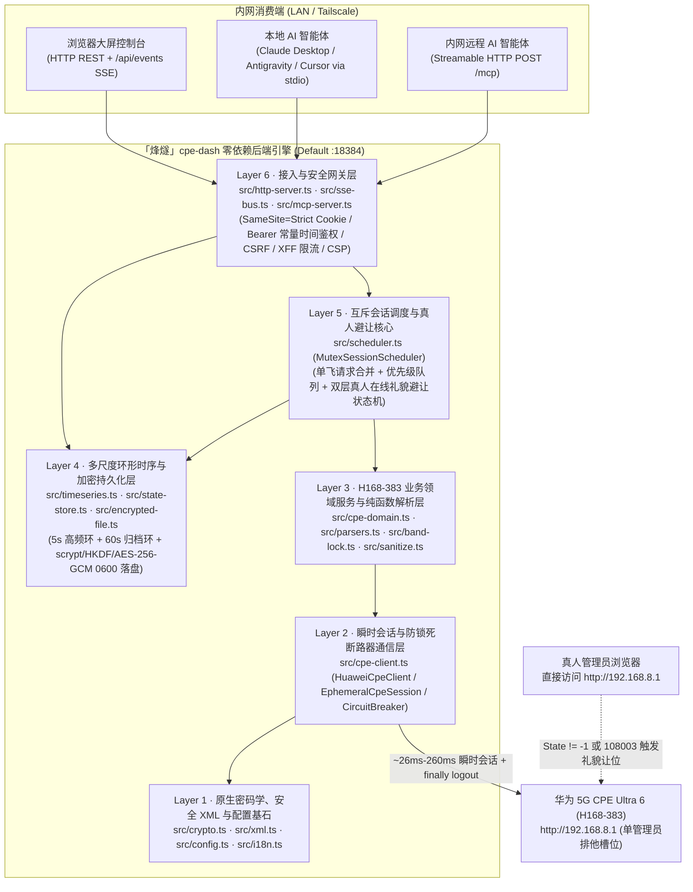
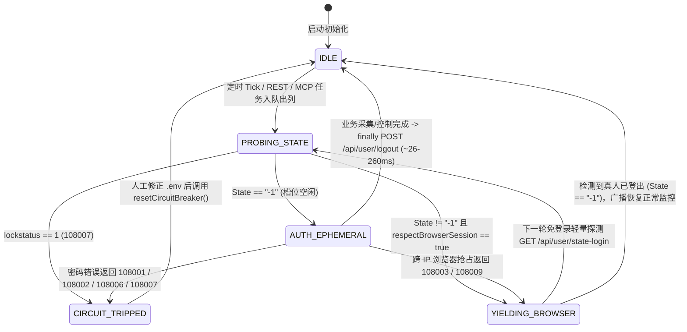

# 「烽燧」(FengSui / `cpe-dash`) 阶段二系统架构、安全纵深防御与时序引擎评估报告 (`PHASE2_ARCHITECTURE_REPORT.md`)

> **宿主机目标画像**：群晖 Synology DS923+（AMD Ryzen Embedded R1600 双核四线程 `2.6–3.1 GHz`，配备 **32 GB ECC DDR4 内存**，7×24×365 家庭内网/Tailscale 无人值守运行）  
> **受控网元设备**：华为 5G CPE Ultra 6（`H168-383` / `WL1H168M`，零售固件 `4.4.0.1(H1006SP19C00)`，网关 `192.168.8.1`，单管理员排他会话）  
> **前置权威契约**：[`AGENTS.md`](../AGENTS.md) 与 [`docs/PHASE1_PROTOCOL_SPEC.md`](PHASE1_PROTOCOL_SPEC.md)

---

## 1. 后端语言与运行时架构选型论证

### 1.1 四套候选技术栈多维客观评估

在拥有 **32 GB 充裕物理内存** 与双核 Zen+ 算力的群晖 DS923+ 宿主机上，单节点 5G CPE 监控与控制守护进程的并发吞吐量（每秒 `0.2–2` 次路由器短连采样、`< 20` 个局域网浏览器 SSE 订阅流与内网 AI Agent MCP 调用）远未触及任何现代语言运行时的 CPU 或内存瓶颈。真正的架构胜负手在于 **全生命周期（5–10 年）无人值守免维护性、零供应链投毒攻击面、华为私有密码学协议保真度** 以及 **前后端与 MCP 契约的端到端强类型同构能力**。

| 评估维度 | 方案 A：Node.js 22+ 原生零依赖 + 100% 严格 TypeScript（选定方案） | 方案 B：Go (`net/http` 编译单二进制) | 方案 C：Rust (`axum` / `tokio`) | 方案 D：Node.js + Fastify / NestJS 框架体系 |
| :--- | :--- | :--- | :--- | :--- |
| **生产运行时第三方依赖数** | **`0` 个外部 npm 包**（100% `node:http` / `node:crypto` / `node:fs` / `node:net` / `fetch`） | 标准库为主，但 Curve25519 非钳位大端数学与 MCP Schema 常引入若干模块 | 典型引入 `tokio`、`axum`、`hyper`、`serde`、`ring` 等 `120–250` 个传递 crate | Fastify 约 `40+` 传递包；NestJS 达 `150–300+` 传递包（含反射装饰器链） |
| **供应链投毒风险面** | **趋近于 0**（无运行时 `node_modules` 分发，彻底免疫 `postinstall` 与传递包投毒） | 低（Go Checksum DB 保护，但仍需跟进第三方模块 CVE） | 中低（`build.rs` 宏执行面与庞大 crate 树审计成本高） | **高**（深层传递依赖频繁爆出原型链污染、路径穿越与上游弃坑维护警报） |
| **华为私有密码学协议保真度** | **100% 已真机验证复用**（非钳位大端 `BigInt` Curve25519、反向 HMAC Key SCRAM-SHA256、`enc-type=1\|2\|3` AES-256-GCM 均已在 [`src/crypto.ts`](../src/crypto.ts) 跑通） | **需完全重写并重验边界**（标准 `crypto/ecdh` 强制执行 RFC 7748 小端钳位，直接调用会导致握手失败，须用 `math/big` 手写蒙哥马利梯） | **需完全重写**（`x25519-dalek` 同样强制 RFC 7748 钳位，无法直接对接华为非标实现） | 复用 Node `crypto`，但装饰器/插件生命周期徒增复杂度，且违反 `erasableSyntaxOnly` |
| **5–10 年 NAS 无人值守免维护性** | **极高**（容器镜像仅含 Node LTS 官方二进制 + 纯标准 API，无框架大版本迁移债务） | 极高（静态单文件部署简便，但前后端与 i18n/MCP 类型需双语言重复维护） | 高（运行稳健，但交叉编译群晖 `x86_64` musl/glibc 与重构心智负担过重） | **差**（框架每 12–18 个月发生 Breaking Change，`npm audit` 告警迫使人工频繁介入） |
| **端到端类型同构（后端 + 前端 + MCP）** | **原生 100% 共享** [`src/types.ts`](../src/types.ts) 接口定义，零代码生成漂移 | 需维护 OpenAPI/JSON Schema 代码生成器同步 TS 前端类型 | 需借助 `ts-rs` 等外部工具导出前端类型 | 虽同属 TS，但 NestJS 依赖实验性装饰器元数据，与现代 TypeScript 7 类型擦除相悖 |
| **DS923+ (32GB RAM) 资源占用** | 常驻 RSS 约 **`55–75 MiB`**（仅占 32GB 内存的 **`0.22%`**），事件循环空闲 CPU `< 0.3%` | 常驻 RSS 约 `18–30 MiB` | 常驻 RSS 约 `10–20 MiB` | 常驻 RSS 约 `110–190 MiB` |

### 1.2 核心因果推演与最终选型结论

1. **算力充裕场景下的“依赖树熵增定律”**：在 32GB 内存的 DS923+ 上，用 Rust/Go 节省出的 `40 MiB` 内存对系统稳定性没有任何实质增益；相反，任何引入数百个第三方依赖包的框架（如 NestJS / Fastify 生态插件）都会在长达数年的家庭 NAS 静默运行期中持续积累 CVE 漏洞与传递依赖腐化风险。
2. **非标硬件密码学的“零回归铁律”**：Phase 1 逆向与真机探针已证实，H168-383 的 ECDH 协商采用**非钳位大端序 Curve25519**，且 SCRAM-SHA256 将 `authMsg` 作为 HMAC Key（与 RFC 5802 相反）。Node.js 22+ 原生 `BigInt` 与 `node:crypto` 已在真机实现 `~26 ms` 零误差握手，继续采用 **Node.js `>= 22.6.0` 原生零运行时依赖 + 100% 严格 TypeScript (`strict: true`)** 能够实现 **零协议重写风险、零外部运行时依赖、100% 前后端类型同构** 的帕累托最优解。

### 1.3 后端六层自包含分层架构

### 1.4 现代高危 Web 漏洞纵深防御落地矩阵

| 威胁类别 | 攻击向量剖析 | 「烽燧」代码级强制防御落地细节 |
| :--- | :--- | :--- |
| **1. 原型链污染 (Prototype Pollution)** | 攻击者构造含 `{"__proto__":{"isAdmin":true}}` 或 `?constructor.prototype.x=1` 的 JSON / Query / XML 载荷篡改全局 `Object.prototype` | ① JSON 请求体解析统一传入自定义 `reviver`，显式丢弃 `__proto__`、`constructor`、`prototype` 键； ② URL Query、`.env`、XML 键值表及 i18n 词典全部基于 `Object.create(null)` 或 `Map` 存储，严禁向普通对象动态挂接未白名单化的外部键名。 |
| **2. 正则回溯拒绝服务 (ReDoS)** | 超长畸形 XML/JSON/Header 触发指数级 NFA 回溯卡死 Node 单线程事件循环 | ① HTTP 请求体实施硬性字节上限截断（控制/MCP JSON 上限 `64 KiB`，超限立即返回 `413 Payload Too Large` 并销毁流）； ② [`src/xml.ts`](../src/xml.ts) 采用 `indexOf` 确定性线性 `O(N)` 扫描提取标签，全仓严禁对外部输入使用嵌套量词正则。 |
| **3. 服务端请求伪造 (SSRF)** | 通过篡改目标地址或诱导 CPE 返回 `302 Location: http://169.254.169.254/...` 探测宿主机内网其他服务 | ① [`normalizeCpeUrl()`](../src/config.ts) 仅允许 `http:` / `https:`，阻断内嵌凭据、查询串与 `#fragment`，并强制校验目标属于合法私网/局域网地址空间； ② 所有 `fetch()` 强制设置 `redirect: "error"`，且后端无任何接收用户传入任意 URL 发起请求的图片/Webhook 代理接口。 |
| **4. 跨站请求伪造 (CSRF) 与同站跨端口隔离** | 外网恶意页面或群晖同 IP 其他容器端口（RFC 6265 Cookie 不隔离端口）伪造状态变更请求 | ① 会话 Cookie (`fengsui_sid`) 强制设置 `HttpOnly; SameSite=Strict; Path=/`（TLS 或可信 HTTPS 反代下追加 `Secure`），登录成功强制轮换全新随机 Session ID； ② 不下发任何宽松 CORS 响应头并拒绝跨源 `OPTIONS` 预检，使同 IP 异端口无法附加自定义头； ③ Cookie 鉴权下的状态变更（`POST`/`PUT`/`DELETE`）强制校验 `X-Requested-With: XMLHttpRequest`、`Content-Type: application/json` 及精确 `URL.origin` 同源匹配（显式拦截 `Origin: null`），且所有 `GET` 路由严格保持只读无副作用（刷新/扫描操作均走 `POST`）； ④ 当请求携带 `Authorization: Bearer` 时严格走独立令牌通道（忽略 Cookie）；口令与令牌统一经 SHA-256 定长摘要后执行 `crypto.timingSafeEqual`。 |
| **5. DNS 重绑定攻击 (DNS Rebinding)** | 攻击者域名 TTL 过期重绑定至 `127.0.0.1` 或 NAS 局域网 IP，绕过单纯 `Origin === Host` 比对攻击本地 `/api/*` 或 `/mcp` | 接入层在路由分发前优先校验 `Host` 头：仅放行合法局域网/私网 IP、本机 `localhost`/单标签主机名、`.local`/`.lan`/`.ts.net` 或 `.env` 显式配置的 `ALLOWED_HOSTS`，其余一律立即返回 `421 Misdirected Request`；即使是 `127.0.0.1` 回环请求也绝不豁免鉴权。 |
| **6. 伪造反向代理头绕过限流 (XFF Spoofing)** | 攻击者伪造随机 `X-Forwarded-For` 或 IPv6 SLAAC 临时地址绕过 `/api/auth/login` 防爆破限流 | 基于 Node 原生 `net.BlockList` 升级 [`resolveClientIp()`](../src/config.ts)，原生支持单 IP 与 CIDR 网段（如 `172.16.0.0/12`），逐跳执行 `net.isIP` 合法性校验；未命中 `TRUSTED_PROXIES` 时彻底忽略转发头，并结合单 IP 桶（IPv6 归并至 `/64` 前缀）+ 全局失败预算双重限流。 |
| **7. AI 智能体误触与提示词注入防护** | MCP 客户端误调用高危动作，或局域网终端恶意 `HostName` 夹带换行/提示词注入污染上下文 | ① `reboot_cpe` 等高危工具强制校验 `confirm === true` 且在真人避让期间返回礼貌拒绝（`409/423`），绝不排队延迟突袭重启； ② MCP 输出默认对敏感蜂窝位置指纹（IMEI/IMSI/TAC/CellID）执行 [`sanitize.ts`](../src/sanitize.ts) 脱敏，并对外部不可信文本进行结构化 JSON 封装隔离；SSE 数据帧强制单行 `JSON.stringify` 阻断 `\n\nevent:` 帧注入。 |

---

## 2. 前端架构与多语言 (`i18n`) 选型权衡

### 2.1 内网零 SEO 定位与纯静态离线自包含前端架构

- **严禁引入 SSR 的安全与复杂度依据**：「烽燧」部署于家庭私有群晖 NAS（`192.168.8.1` 局域网或 Tailscale 私网），**搜索引擎收录（SEO）需求严格为 `0`**。若盲目引入 Next.js / Nuxt / SvelteKit 等同构 SSR 框架，不仅会引入数千个 npm 依赖与 RSC 序列化攻击面，还会带来服务端环境变量（`CPE_PASSWORD` / `API_TOKEN`）意外打包穿透至客户端 Bundle 的致命隐患。
- **确定性单端口离线托管方案**：
  - 前端全部源码在 Phase 3 采用 **100% 严格 TypeScript (`tsconfig.web.json`)** 编写，预编译输出纯静态资产至构建产物目录（并严守 [`scripts/audit-secrets.ts`](../scripts/audit-secrets.ts) 禁止在 `src/` 下存放任何 `.js` 文件的红线，编译产物输出至 `dist/web/public/`，静态模板与样式置于 `public/`）。
  - 静态页面、CSS、字体与 SVG 图标 **100% 本地自包含**，严禁引用 Google Fonts、jsdelivr、unpkg 等任何外部 CDN，确保家庭宽带断网排障（恰恰是用户最需要进入 CPE 控制台查看基站失联原因的时刻！）时依然 **毫秒级秒开渲染**。
  - HTTP 响应强制下发严格 CSP 头：`default-src 'self'; connect-src 'self'; img-src 'self' data:; style-src 'self' 'unsafe-inline'; script-src 'self'; frame-ancestors 'none'; base-uri 'self'`。

### 2.2 多语言 (`i18n`) 方案深度对比：自研零依赖强类型引擎 vs `i18next`

| 对比维度 | 方案 A：自研零依赖强类型 `src/i18n.ts` + `locales/*.json`（选定方案） | 方案 B：引入开源库 `i18next` (+ 插件生态) |
| :--- | :--- | :--- |
| **运行时依赖与产物体积** | **`0` 依赖，核心引擎 `< 1.8 KiB`**（完美契合零外部依赖铁律） | 核心 + 语言检测与格式化包未压缩 `> 45 KiB`（gzip 后仍 `~15 KiB`），破坏零运行时依赖契约 |
| **编译期类型安全性** | 基于 `keyof typeof zhCN` 推导联合字面量类型 `I18nKey`，**任何拼写错误的翻译键在 `npm run typecheck` 编译期即报错拦截**，且单元测试自动校验 `zh-CN.json` 与 `en.json` 键集合 100% 对称 | 默认接受宽泛 `string` 或依赖复杂的递归模板字面量类型体操，大型字典易触发 TS 类型实例化深度上限 |
| **占位插值与复数表达** | 原生支持 `{variable}` 确定性安全替换（无正则回溯、默认返回纯文本由安全 DOM `textContent` 渲染防 XSS）及基于 `Intl.PluralRules` 的复数分支选择 | 功能庞杂（嵌套命名空间、上下文后缀、HTML 插值），其中富文本插值若配置不当易引入 DOM XSS |
| **前后端与 MCP 双语复用** | 后端 REST 错误提示、SSE 真人避让广播（中英双字段同步推送）、MCP 工具说明与前端 UI 共享同一套 `locales/zh-CN.json` 与 `locales/en.json`（通过 `GET /api/i18n/:locale` 零开销下发） | 需在前后端分别初始化运行时实例 |

**确立结论**：采用 **自研零依赖强类型 `src/i18n.ts` + 扁平化点分命名空间词典（`locales/zh-CN.json` / `locales/en.json`）**，由单元测试强制守卫中英文键集合 100% 对齐。

---

## 3. 多用户并发与真人登录避让引擎设计 (`MutexSessionScheduler`)

### 3.1 问题本质：多源并发请求与单管理员硬件槽位的冲突

在生产运行态下，后端同时面对四类并发触发源：
1. **高频遥测轮询器**（默认每 `5s` 采集一次 3CA 射频、MCS、双栈 IP 与实时速率/双周期流量）；
2. **低频重负载扫描器**（默认每 `60s` 扫描一次 4G/5G 邻区基站表与接入终端拓扑）；
3. **Web 控制台多标签页用户操作**（手动强制刷新、下发锁频段/锁小区、切换天线或重启）；
4. **内网 AI Agent MCP 并发工具调用**（智能体连续调用 `get_cpe_telemetry` -> `list_neighbor_cells` -> `lock_cell`）。

若不加以统一调度而直接并发触发登录，不仅会在路由器侧引发 `108003` / `108005` 会话互踢与 `__RequestVerificationToken` 乱序失效，更会在真人用户打开 `http://192.168.8.1` 时造成争抢。

### 3.2 `MutexSessionScheduler` 核心并发控制机制

1. **全局单实例 FIFO 优先级互斥队列 (`#queue`)**：
   - 所有需访问 CPE 的任务统一进入单实例串行调度器：控制类写操作（`priority: "high"`，如锁频、锁站、重启）排在后台常规轮询（`priority: "normal"`）与低频扫描（`priority: "low"`）之前，但严格等待当前正在执行的 `~200ms` 瞬时会话自然 `logout` 完毕后再出列执行，**绝不允许两个 `EphemeralCpeSession` 重叠存活**。
   - 队列设有硬性积压上限（`maxQueueDepth = 32`），防止网络超时期间无限堆积内存请求。
2. **只读请求单飞合并 (Single-Flight Request Coalescing)**：
   - 当 5 个浏览器标签页与 2 个 MCP 智能体在同一窗口内同时请求 `getTelemetry(forceRefresh)`、`scanNeighbors` 或 `getTopology` 时，调度器通过 `#inflightReads` Map 将同类型只读请求合并复用同一个 Promise，仅向路由器发起 **1 次** `~26–200ms` 瞬时会话即可同时满足所有调用方。
3. **双层真人在线礼貌避让与实时广播**：
   - **第 1 层（零认证开销预检）**：每次开启会话前先调用免登录接口 `GET /api/user/state-login`；若 `<State>` 不为 `"-1"`，立即进入 `YIELDING_BROWSER` 状态，不发送任何 SCRAM 握手包。
   - **第 2 层（跨终端并发兜底）**：若预检至握手的数毫秒间隙内局域网另一台电脑刚登录了 `192.168.8.1`，路由器在 `challenge_login` 返回 `108003` / `108009`，客户端立即静默放弃并返回让位结果。
   - **状态广播与平滑恢复**：进入避让态时，调度器立即通过 `SseEventBus`（事件名 `session:avoidance`）与 MCP 会话状态暴露双语通知：
     - `messageZh`: `"用户正在使用 CPE 后台，监控自动避让中"`
     - `messageEn`: `"Human administrator is using the CPE WebUI; monitoring is politely yielding"`
   - 避让期间，REST / MCP 只读查询直接返回最近一次缓存快照 + `avoidance.active = true` 标记（零阻塞、零报错）；待后续免登录探测发现 `<State>-1</State>` 后，自动解除避让并推送恢复事件。
4. **`__RequestVerificationToken` 会话级完全隔离与写操作安全边界**：
   - Token 池 (`session.tokens`) 严格封装在单次 `EphemeralCpeSession` 实例内部，单次会话内的多个 `POST` 控制指令按顺序消费 `consumeToken()`，杜绝跨会话 Token 串扰。
   - **写操作零自动重放**：占用重试仅允许发生在 `session.login()` 阶段（`fn(session)` 执行前）；一旦进入业务回调绝不自动重放写请求，且在真人避让期间对写控制指令立即返回礼貌拒绝（`409 Conflict`），防止陈旧的重启/锁频指令在数十分钟后突袭生效。
5. **并发安全与持久化故障边界不变量（经 Opus 5.5 深度交叉审计加固）**：
   - **防抖动冷却退避（Anti-Flapping Backoff）**：由于固件 `4.4.0.1` 的 `GET /api/user/state-login` 在无 Cookie 时对跨 IP 会话仍可能返回 `State=-1`（由第 2 层 `108003`/`108009` 捕获），第 2 层触发避让后强制进入指数退避静默期（如 `30s -> 60s -> 180s` 带随机抖动），避免每 `5s` 反复触发 `challenge_login` 干扰真人会话；SSE `session:avoidance` 仅在状态跃迁时推送，杜绝事件风暴。
   - **跨重启熔断器记忆与热重载（Persistent Circuit Breaker）**：将熔断状态与当前 `CPE_PASSWORD` 的 SHA-256 指纹持久化至 `EncryptedStateStore`；若容器因 `restart: always` 重启但错误密码未改，启动即保持熔断锁死，严防 3 次重启累计触发 `108007` 硬件锁机；当检测到 `.env` 密码指纹已更新或人工执行 `reloadAndResetBreaker()` 时安全解锁。
   - **防重入死锁与有界 `logout` 超时**：使用 `AsyncLocalStorage` 检测并阻断 `withSession` 嵌套重入死锁；为 `logout()` 设置独立短超时上限（`3s`），并在进程收到 `SIGINT`/`SIGTERM` 时等待在途瞬时会话完成 `logout` 后再退出，确保路由器管理员槽位干净释放。

---

## 4. 时序数据流与多尺度环形缓冲区设计 (`TimeSeriesRingBuffer`)

### 4.1 硬件实情对齐：关于设备温度指标的诚实建模

根据 [`docs/PHASE1_PROTOCOL_SPEC.md`](PHASE1_PROTOCOL_SPEC.md) 对全部 `122` 个真实 HAR 接口与 `8` 组真机探针的穷尽核查，H168-383 零售固件 `4.4.0.1` 的 HTTP API（含 `/api/device/signal`、`/api/device/information`、`/api/monitoring/status`）**未暴露基带或 CPU 温度标签**（`coulometer_enabled=0`）。遵循“严禁臆造 CPE 字段或伪造假数据”的铁律：
- 遥测解析器支持读取可选的 `<temperature>` / `<chip_temp>` 标签（兼容未来固件升级），当固件未返回时诚实输出 `temperatureCelsius: null` 并附带能力标识 `temperatureSupported: false`；
- 时序环形缓冲区完整保留 `temperatureCelsius: number | null` 通道（聚合时自动跳过 `null` 样本而不污染均值），确保前端图表与契约面向未来 100% 兼容。

### 4.2 双层定长循环内存环形缓冲区（Dual-Tier Circular Ring Buffer）

为同时满足 **秒级丝滑实时曲线 (`1h`)**、**中长周期趋势分析 (`6h / 12h / 24h`)** 与 **跨天自定义时间跨度回溯 (`custom`, 最长 7 天)**，同时保持恒定 `O(1)` 写入复杂度与零磁盘磨损（保护群晖 NAS SSD/HDD 寿命），设计双层定长环形缓冲区：

| 层级 | 采样粒度 (`stepMs`) | 环形槽位数 (`capacity`) | 覆盖时间跨度 | 记录核心指标通道 | 内存占用估算 (DS923+ 32GB) |
| :--- | :---: | :---: | :---: | :--- | :---: |
| **Tier-1 高频明细环 (`fineRing`)** | **`5,000 ms` (5 秒)** | **`2,160` 槽** | **最近 `3 小时`** | 时间戳、下行/上行 `bps`、LTE `RSRP/SINR/RSRQ`、5G NR `RSRP/SINR/RSRQ`、温度 `°C \| null` | **`~380 KiB`** |
| **Tier-2 分钟聚合环 (`coarseRing`)** | **`60,000 ms` (1 分钟)** | **`10,080` 槽** | **最近 `7 天 (168 小时)`** | 每分钟 `sampleCount`、上下行速率 `avg/max`、4G/5G 信号 `avg/min/max`、温度 `avg/max` | **`~2.4 MiB`** |

- **总常驻内存开销**：两层合计仅 **`< 3 MiB`**（不到 DS923+ 32GB 内存的 `0.01%`），无任何 SQLite 原生 C++ 编译绑定需求，彻底规避容器跨架构 ABI 兼容问题。
- **群晖硬盘休眠友好的异步加密快照持久化**：为避免高频写盘阻止群晖 DSM 机械硬盘休眠或同步 `fs` 阻塞事件循环，`EncryptedStateStore` 采用单队列异步写入（`fs.promises` + 临时文件 `fsync` + 原子 `rename`），仅在关键控制状态变更、低频检查点（默认 `30 分钟`）及 `SIGINT`/`SIGTERM` 优雅退出时刷盘；若恢复 `108006` 修改密码导致旧快照密钥不匹配，自动将其归档重命名为 `.unreadable-<ts>` 并平滑重建空状态，绝不引发启动崩溃循环。
- **双层拼接与每通道独立聚合精度保证**：
  - 每个数值通道独立维护 `{ sum, count, min, max, last }` 统计量，确保 NSA 模式下偶发休眠的 `nrRsrpDbm` 或恒为 `null` 的 `temperatureCelsius` 绝不会把均值拉向 `0`；合并桶时严格按加权 `Σsum / Σcount` 计算，严禁对均值二次求平均。
  - 统一以已封口分钟水位线 `lastClosedMinuteMs` 无缝拼接 `coarseRing`（`< lastClosedMinuteMs`）与 `fineRing`（`>= lastClosedMinuteMs`，若刚重启 `fineRing` 为空则自动回退读取 `coarseRing`），且所有输出聚合桶对齐至固定纪元网格（`Math.floor(ts / bucketMs) * bucketMs`），确保滑动刷新时曲线零抖动。

### 4.3 预设时间轴 (`1h / 6h / 12h / 24h`) 与自定义跨度 (`custom`) 聚合查询算法

查询接口统一支持 `preset` 与任意 `[fromMs, toMs, bucketMs | maxPoints]` 自定义区间：

| 查询模式 | 时间跨度 | 数据源自动路由 | 默认聚合桶宽 (`bucketMs`) | 返回点数上限 |
| :--- | :---: | :--- | :---: | :---: |
| `preset = "1h"` | 最近 1 小时 | **Tier-1 高频环**（5s 原始精度或按 `bucketMs` 降采样） | `10,000 ms` (10s) | `360` 点 |
| `preset = "6h"` | 最近 6 小时 | **Tier-2 分钟环 + 当前活跃分钟桶** | `60,000 ms` (1m) | `360` 点 |
| `preset = "12h"` | 最近 12 小时 | **Tier-2 分钟环 + 当前活跃分钟桶** | `120,000 ms` (2m) | `360` 点 |
| `preset = "24h"` | 最近 24 小时 | **Tier-2 分钟环 + 当前活跃分钟桶** | `300,000 ms` (5m) | `288` 点 |
| `preset = "custom"` | 任意 `[fromMs, toMs]`（最长 7d） | 若 `fromMs >= now - 3h` 且桶宽 `< 60s` 优先取 **Tier-1**；否则无缝拼接 **Tier-2 + Tier-1 尾部** | 自适应 `ceil((toMs - fromMs) / maxPoints)`（默认 `maxPoints = 360`，上限 `1,440`） | `<= 1,440` 点 |

每个输出时序数据桶统一提供 `tsMs`、上下行速率（`dlAvgBps` / `dlPeakBps` / `ulAvgBps` / `ulPeakBps`）、4G/5G 关键射频（`lteRsrpDbm` / `lteSinrDb` / `nrRsrpDbm` / `nrSinrDb`）及 `temperatureCelsius`，使前端 ECharts / Canvas 曲线组件与 AI Agent `query_telemetry_history` 工具可直接消费，无需在客户端做二次重采样。
