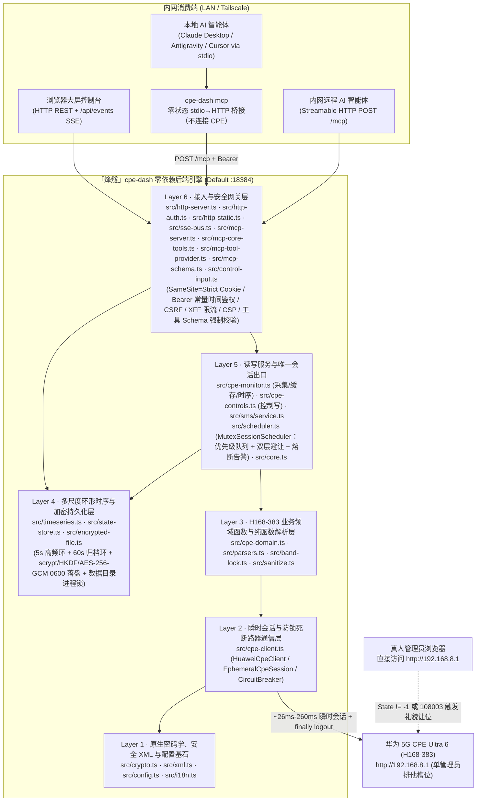
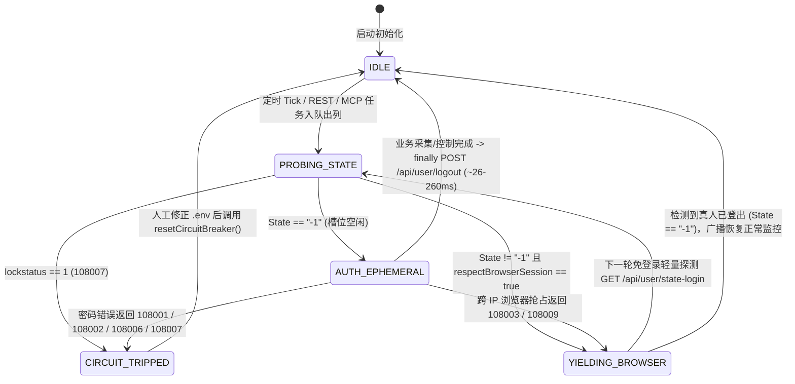
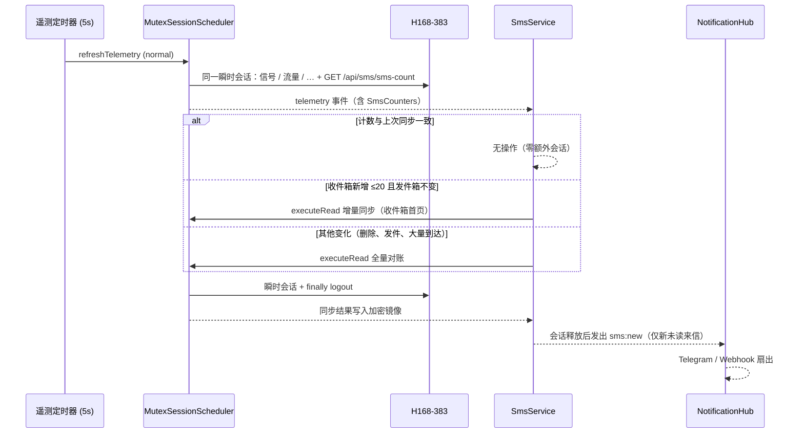

# 「烽燧」(FengSui / `cpe-dash`) 阶段二系统架构、安全纵深防御与时序引擎评估报告 (`PHASE2_ARCHITECTURE_REPORT.md`)

> **宿主机目标画像**：群晖 Synology DS923+（AMD Ryzen Embedded R1600 双核四线程 `2.6–3.1 GHz`，配备 **32 GB ECC DDR4 内存**，7×24×365 家庭内网/Tailscale 无人值守运行）  
> **受控网元设备**：华为 5G CPE Ultra 6（`H168-383` / `WL1H168M`，零售固件 `4.4.0.1(H1006SP19C00)`，网关 `192.168.8.1`，单管理员排他会话）  
> **前置权威契约**：[`AGENTS.md`](../AGENTS.md) 与 [`docs/PHASE1_PROTOCOL_SPEC.md`](PHASE1_PROTOCOL_SPEC.md)  
> **文档性质**：本报告为实现前的架构评估，部分内部命名为设计期草案；REST / SSE / MCP 字段与行为以 [`docs/PHASE2_BACKEND_CONTRACT.md`](PHASE2_BACKEND_CONTRACT.md) 和 `src/` 为准。第 5 节（Phase 2.2 短信融合）按已实现的代码撰写；第 6 节为 Phase 2.5 两轮架构审计结论（6.1–6.4 为第一轮，6.5–6.8 为 2026-10-31 第二轮），1.3 节分层图已按审计后的模块更新。

---

## 1. 后端语言与运行时架构选型论证

### 1.1 四套候选技术栈多维客观评估

在拥有 **32 GB 充裕物理内存** 与双核 Zen+ 算力的群晖 DS923+ 宿主机上，单节点 5G CPE 监控与控制守护进程的并发吞吐量（每秒 `0.2–2` 次路由器短连采样、`< 20` 个局域网浏览器 SSE 订阅流与内网 AI Agent MCP 调用）远未触及任何现代语言运行时的 CPU 或内存瓶颈。真正的架构胜负手在于 **全生命周期（5–10 年）无人值守免维护性、零供应链投毒攻击面、华为私有密码学协议保真度** 以及 **前后端与 MCP 契约的端到端强类型同构能力**。

| 评估维度 | 方案 A：Node.js 22+ 原生零依赖 + 100% 严格 TypeScript（选定方案） | 方案 B：Go (`net/http` 编译单二进制) | 方案 C：Rust (`axum` / `tokio`) | 方案 D：Node.js + Fastify / NestJS 框架体系 |
| :--- | :--- | :--- | :--- | :--- |
| **生产运行时第三方依赖数** | **`0` 个外部 npm 包**（100% `node:http` / `node:crypto` / `node:fs` / `node:net` / `fetch`） | 标准库为主，但 Curve25519 非钳位大端数学与 MCP Schema 常引入若干模块 | 典型引入 `tokio`、`axum`、`hyper`、`serde`、`ring` 等 `120–250` 个传递 crate | Fastify 约 `40+` 传递包；NestJS 达 `150–300+` 传递包（含反射装饰器链） |
| **供应链投毒风险面** | **趋近于 0**（无运行时 `node_modules` 分发，彻底免疫 `postinstall` 与传递包投毒） | 低（Go Checksum DB 保护，但仍需跟进第三方模块 CVE） | 中低（`build.rs` 宏执行面与庞大 crate 树审计成本高） | **高**（深层传递依赖频繁爆出原型链污染、路径穿越与上游弃坑维护警报） |
| **华为私有密码学协议保真度** | **100% 已真机验证复用**（非钳位大端 `BigInt` Curve25519、反向 HMAC Key SCRAM-SHA256、`enc-type=1\|2\|3` AES-256-GCM 均已在 [`src/crypto.ts`](../src/crypto.ts) 跑通） | **需完全重写并重验边界**（标准 `crypto/ecdh` 强制执行 RFC 7748 小端钳位，直接调用会导致握手失败，须用 `math/big` 手写蒙哥马利梯） | **需完全重写**（`x25519-dalek` 同样强制 RFC 7748 钳位，无法直接对接华为非标实现） | 复用 Node `crypto`，但装饰器/插件生命周期徒增复杂度，且违反 `erasableSyntaxOnly` |
| **5–10 年 NAS 无人值守免维护性** | **极高**（容器镜像仅含 Node LTS 官方二进制 + 纯标准 API，无框架大版本迁移债务） | 极高（静态单文件部署简便，但前后端与 i18n/MCP 类型需双语言重复维护） | 高（运行稳健，但交叉编译群晖 `x86_64` musl/glibc 与重构心智负担过重） | **差**（框架每 12–18 个月发生 Breaking Change，`npm audit` 告警迫使人工频繁介入） |
| **端到端类型同构（后端 + 前端 + MCP）** | **原生 100% 共享** [`src/types.ts`](../src/types.ts) 接口定义，零代码生成漂移 | 需维护 OpenAPI/JSON Schema 代码生成器同步 TS 前端类型 | 需借助 `ts-rs` 等外部工具导出前端类型 | 虽同属 TS，但 NestJS 依赖实验性装饰器元数据，与现代 TypeScript 7 类型擦除相悖 |
| **DS923+ (32GB RAM) 资源占用** | 常驻 RSS 约 **`55–75 MiB`**（仅占 32GB 内存的 **`0.22%`**），事件循环空闲 CPU `< 0.3%` | 常驻 RSS 约 `18–30 MiB` | 常驻 RSS 约 `10–20 MiB` | 常驻 RSS 约 `110–190 MiB` |

### 1.2 核心因果推演与最终选型结论

1. **算力充裕场景下的“依赖树熵增定律”**：在 32GB 内存的 DS923+ 上，用 Rust/Go 节省出的 `40 MiB` 内存对系统稳定性没有任何实质增益；相反，任何引入数百个第三方依赖包的框架（如 NestJS / Fastify 生态插件）都会在长达数年的家庭 NAS 静默运行期中持续积累 CVE 漏洞与传递依赖腐化风险。
2. **非标硬件密码学的“零回归铁律”**：Phase 1 逆向与真机探针已证实，H168-383 的 ECDH 协商采用**非钳位大端序 Curve25519**，且 SCRAM-SHA256 将 `authMsg` 作为 HMAC Key（与 RFC 5802 相反）。Node.js 22+ 原生 `BigInt` 与 `node:crypto` 已在真机实现 `~26 ms` 零误差握手，继续采用 **Node.js `>= 22.6.0` 原生零运行时依赖 + 100% 严格 TypeScript (`strict: true`)** 能够实现 **零协议重写风险、零外部运行时依赖、100% 前后端类型同构** 的帕累托最优解。

### 1.3 后端六层自包含分层架构



### 1.4 现代高危 Web 漏洞纵深防御落地矩阵

| 威胁类别 | 攻击向量剖析 | 「烽燧」代码级强制防御落地细节 |
| :--- | :--- | :--- |
| **1. 原型链污染 (Prototype Pollution)** | 攻击者构造含 `{"__proto__":{"isAdmin":true}}` 或 `?constructor.prototype.x=1` 的 JSON / Query / XML 载荷篡改全局 `Object.prototype` | ① JSON 请求体解析统一传入自定义 `reviver`，显式丢弃 `__proto__`、`constructor`、`prototype` 键；<br/>② URL Query、`.env`、XML 键值表及 i18n 词典全部基于 `Object.create(null)` 或 `Map` 存储，严禁向普通对象动态挂接未白名单化的外部键名。 |
| **2. 正则回溯拒绝服务 (ReDoS)** | 超长畸形 XML/JSON/Header 触发指数级 NFA 回溯卡死 Node 单线程事件循环 | ① HTTP 请求体实施硬性字节上限截断（控制/MCP JSON 上限 `64 KiB`，超限立即返回 `413 Payload Too Large` 并销毁流）；<br/>② [`src/xml.ts`](../src/xml.ts) 采用 `indexOf` 确定性线性 `O(N)` 扫描提取标签，全仓严禁对外部输入使用嵌套量词正则。 |
| **3. 服务端请求伪造 (SSRF)** | 通过篡改目标地址或诱导 CPE 返回 `302 Location: http://169.254.169.254/...` 探测宿主机内网其他服务 | ① [`normalizeCpeUrl()`](../src/config.ts) 仅允许 `http:` / `https:`，阻断内嵌凭据、查询串与 `#fragment`，并强制校验目标属于合法私网/局域网地址空间；<br/>② 所有 `fetch()` 强制设置 `redirect: "error"`，且后端无任何接收用户传入任意 URL 发起请求的图片/Webhook 代理接口。 |
| **4. 跨站请求伪造 (CSRF) 与同站跨端口隔离** | 外网恶意页面或群晖同 IP 其他容器端口（RFC 6265 Cookie 不隔离端口）伪造状态变更请求 | ① 会话 Cookie (`fengsui_sid`) 强制设置 `HttpOnly; SameSite=Strict; Path=/`（TLS 或可信 HTTPS 反代下追加 `Secure`），登录成功强制轮换全新随机 Session ID；<br/>② 不下发任何宽松 CORS 响应头并拒绝跨源 `OPTIONS` 预检，使同 IP 异端口无法附加自定义头；<br/>③ Cookie 鉴权下的状态变更（`POST`/`PUT`/`DELETE`）强制校验 `X-Requested-With: XMLHttpRequest`、`Content-Type: application/json` 及精确 `URL.origin` 同源匹配（显式拦截 `Origin: null`），且所有 `GET` 路由严格保持只读无副作用（刷新/扫描操作均走 `POST`）；<br/>④ 当请求携带 `Authorization: Bearer` 时严格走独立令牌通道（忽略 Cookie）；口令与令牌统一经 SHA-256 定长摘要后执行 `crypto.timingSafeEqual`。 |
| **5. DNS 重绑定攻击 (DNS Rebinding)** | 攻击者域名 TTL 过期重绑定至 `127.0.0.1` 或 NAS 局域网 IP，绕过单纯 `Origin === Host` 比对攻击本地 `/api/*` 或 `/mcp` | 接入层在路由分发前优先校验 `Host` 头：仅放行合法局域网/私网 IP、本机 `localhost`/单标签主机名、`.local`/`.lan`/`.ts.net` 或 `.env` 显式配置的 `ALLOWED_HOSTS`，其余一律立即返回 `421 Misdirected Request`；即使是 `127.0.0.1` 回环请求也绝不豁免鉴权。 |
| **6. 伪造反向代理头绕过限流 (XFF Spoofing)** | 攻击者伪造随机 `X-Forwarded-For` 或 IPv6 SLAAC 临时地址绕过 `/api/auth/login` 防爆破限流 | 基于 Node 原生 `net.BlockList` 升级 [`resolveClientIp()`](../src/config.ts)，原生支持单 IP 与 CIDR 网段（如 `172.16.0.0/12`），逐跳执行 `net.isIP` 合法性校验；未命中 `TRUSTED_PROXIES` 时彻底忽略转发头，并结合单 IP 桶（IPv6 归并至 `/64` 前缀）+ 全局失败预算双重限流。 |
| **7. AI 智能体误触与提示词注入防护** | MCP 客户端误调用高危动作，或局域网终端恶意 `HostName` 夹带换行/提示词注入污染上下文 | ① `reboot_cpe` 等高危工具强制校验 `confirm === true` 且在真人避让期间返回礼貌拒绝（`409/423`），绝不排队延迟突袭重启；<br/>② MCP 输出默认对敏感蜂窝位置指纹（IMEI/IMSI/TAC/CellID）执行 [`sanitize.ts`](../src/sanitize.ts) 脱敏，并对外部不可信文本进行结构化 JSON 封装隔离；SSE 数据帧强制单行 `JSON.stringify` 阻断 `\n\nevent:` 帧注入。 |

---

## 2. 前端架构与多语言 (`i18n`) 选型权衡

### 2.1 内网零 SEO 定位与纯静态离线自包含前端架构

- **严禁引入 SSR 的安全与复杂度依据**：「烽燧」部署于家庭私有群晖 NAS（`192.168.8.1` 局域网或 Tailscale 私网），**搜索引擎收录（SEO）需求严格为 `0`**。若盲目引入 Next.js / Nuxt / SvelteKit 等同构 SSR 框架，不仅会引入数千个 npm 依赖与 RSC 序列化攻击面，还会带来服务端环境变量（`CPE_PASSWORD` / `API_TOKEN`）意外打包穿透至客户端 Bundle 的致命隐患。
- **确定性单端口离线托管方案**：
  - 前端全部源码在 Phase 3 采用 **100% 严格 TypeScript (`tsconfig.web.json`)** 编写，预编译输出纯静态资产至构建产物目录（并严守 [`scripts/audit-secrets.ts`](../scripts/audit-secrets.ts) 禁止在 `src/` 下存放任何 `.js` 文件的红线，编译产物输出至 `dist/web/public/`，静态模板与样式置于 `public/`）。
  - 静态页面、CSS、字体与 SVG 图标 **100% 本地自包含**，严禁引用 Google Fonts、jsdelivr、unpkg 等任何外部 CDN，确保家庭宽带断网排障（恰恰是用户最需要进入 CPE 控制台查看基站失联原因的时刻！）时依然 **毫秒级秒开渲染**。
  - HTTP 响应强制下发严格 CSP 头：`default-src 'self'; connect-src 'self'; img-src 'self' data:; style-src 'self' 'unsafe-inline'; script-src 'self'; frame-ancestors 'none'; base-uri 'self'`。

### 2.2 多语言 (`i18n`) 方案深度对比：自研零依赖强类型引擎 vs `i18next`

| 对比维度 | 方案 A：自研零依赖强类型 `src/i18n.ts` + `locales/*.json`（选定方案） | 方案 B：引入开源库 `i18next` (+ 插件生态) |
| :--- | :--- | :--- |
| **运行时依赖与产物体积** | **`0` 依赖，核心引擎 `< 1.8 KiB`**（完美契合零外部依赖铁律） | 核心 + 语言检测与格式化包未压缩 `> 45 KiB`（gzip 后仍 `~15 KiB`），破坏零运行时依赖契约 |
| **编译期类型安全性** | 基于 `keyof typeof zhCN` 推导联合字面量类型 `I18nKey`，**任何拼写错误的翻译键在 `npm run typecheck` 编译期即报错拦截**，且单元测试自动校验 `zh-CN.json` 与 `en.json` 键集合 100% 对称 | 默认接受宽泛 `string` 或依赖复杂的递归模板字面量类型体操，大型字典易触发 TS 类型实例化深度上限 |
| **占位插值与复数表达** | 原生支持 `{variable}` 确定性安全替换（无正则回溯、默认返回纯文本由安全 DOM `textContent` 渲染防 XSS）及基于 `Intl.PluralRules` 的复数分支选择 | 功能庞杂（嵌套命名空间、上下文后缀、HTML 插值），其中富文本插值若配置不当易引入 DOM XSS |
| **前后端与 MCP 双语复用** | 后端 REST 错误提示、SSE 真人避让广播（中英双字段同步推送）、MCP 工具说明与前端 UI 共享同一套 `locales/zh-CN.json` 与 `locales/en.json`（通过 `GET /api/i18n/:locale` 零开销下发） | 需在前后端分别初始化运行时实例 |

**确立结论**：采用 **自研零依赖强类型 `src/i18n.ts` + 扁平化点分命名空间词典（`locales/zh-CN.json` / `locales/en.json`）**，由单元测试强制守卫中英文键集合 100% 对齐。

---

## 3. 多用户并发与真人登录避让引擎设计 (`MutexSessionScheduler`)

### 3.1 问题本质：多源并发请求与单管理员硬件槽位的冲突

在生产运行态下，后端同时面对四类并发触发源：
1. **高频遥测轮询器**（默认每 `5s` 采集一次 3CA 射频、MCS、双栈 IP 与实时速率/双周期流量）；
2. **低频重负载扫描器**（默认每 `60s` 扫描一次 4G/5G 邻区基站表与接入终端拓扑）；
3. **Web 控制台多标签页用户操作**（手动强制刷新、下发锁频段/锁小区、切换天线或重启）；
4. **内网 AI Agent MCP 并发工具调用**（智能体连续调用 `get_cpe_telemetry` -> `list_neighbor_cells` -> `lock_cell`）。

若不加以统一调度而直接并发触发登录，不仅会在路由器侧引发 `108003` / `108005` 会话互踢与 `__RequestVerificationToken` 乱序失效，更会在真人用户打开 `http://192.168.8.1` 时造成争抢。

### 3.2 `MutexSessionScheduler` 核心并发控制机制



1. **全局单实例 FIFO 优先级互斥队列 (`#queue`)**：
   - 所有需访问 CPE 的任务统一进入单实例串行调度器：控制类写操作（`priority: "high"`，如锁频、锁站、重启）排在后台常规轮询（`priority: "normal"`）与低频扫描（`priority: "low"`）之前，但严格等待当前正在执行的 `~200ms` 瞬时会话自然 `logout` 完毕后再出列执行，**绝不允许两个 `EphemeralCpeSession` 重叠存活**。
   - 队列设有硬性积压上限（`maxQueueDepth = 32`），防止网络超时期间无限堆积内存请求。
2. **只读请求单飞合并 (Single-Flight Request Coalescing)**：
   - 当 5 个浏览器标签页与 2 个 MCP 智能体在同一窗口内同时请求 `getTelemetry(forceRefresh)`、`scanNeighbors` 或 `getTopology` 时，调度器通过 `#inflightReads` Map 将同类型只读请求合并复用同一个 Promise，仅向路由器发起 **1 次** `~26–200ms` 瞬时会话即可同时满足所有调用方。
3. **双层真人在线礼貌避让与实时广播**：
   - **第 1 层（零认证开销预检）**：每次开启会话前先调用免登录接口 `GET /api/user/state-login`；若 `<State>` 不为 `"-1"`，立即进入 `YIELDING_BROWSER` 状态，不发送任何 SCRAM 握手包。
   - **第 2 层（跨终端并发兜底）**：若预检至握手的数毫秒间隙内局域网另一台电脑刚登录了 `192.168.8.1`，路由器在 `challenge_login` 返回 `108003` / `108009`，客户端立即静默放弃并返回让位结果。
   - **状态广播与平滑恢复**：进入避让态时，调度器立即通过 `SseEventBus`（事件名 `session:avoidance`）与 MCP 会话状态暴露双语通知：
     - `messageZh`: `"用户正在使用 CPE 后台，监控自动避让中"`
     - `messageEn`: `"Human administrator is using the CPE WebUI; monitoring is politely yielding"`
   - 避让期间，REST / MCP 只读查询直接返回最近一次缓存快照 + `avoidance.active = true` 标记（零阻塞、零报错）；待后续免登录探测发现 `<State>-1</State>` 后，自动解除避让并推送恢复事件。
4. **`__RequestVerificationToken` 会话级完全隔离与写操作安全边界**：
   - Token 池 (`session.tokens`) 严格封装在单次 `EphemeralCpeSession` 实例内部，单次会话内的多个 `POST` 控制指令按顺序消费 `consumeToken()`，杜绝跨会话 Token 串扰。
   - **写操作零自动重放**：占用重试仅允许发生在 `session.login()` 阶段（`fn(session)` 执行前）；一旦进入业务回调绝不自动重放写请求，且在真人避让期间对写控制指令立即返回礼貌拒绝（`409 Conflict`），防止陈旧的重启/锁频指令在数十分钟后突袭生效。
5. **并发安全与持久化故障边界不变量（经 Opus 5.5 深度交叉审计加固）**：
   - **防抖动冷却退避（Anti-Flapping Backoff）**：由于固件 `4.4.0.1` 的 `GET /api/user/state-login` 在无 Cookie 时对跨 IP 会话仍可能返回 `State=-1`（由第 2 层 `108003`/`108009` 捕获），第 2 层触发避让后强制进入指数退避静默期（`45s -> 90s -> 180s -> 300s` 封顶，每级附加固定 `+5%` 余量；由 `layer2InitialBackoffMs` / `layer2MaxBackoffMs` 配置），避免每 `5s` 反复触发 `challenge_login` 干扰真人会话；SSE `session:avoidance` 仅在状态跃迁时推送，杜绝事件风暴。
   - **跨重启熔断器记忆与热重载（Persistent Circuit Breaker）**：将熔断状态与当前 `CPE_PASSWORD` 的 SHA-256 指纹持久化至 `EncryptedStateStore`；若容器因 `restart: always` 重启但错误密码未改，启动即保持熔断锁死，严防 3 次重启累计触发 `108007` 硬件锁机；当检测到 `.env` 密码指纹已更新或人工执行 `reloadAndResetBreaker()` 时安全解锁。
   - **防重入死锁与有界 `logout` 超时**：使用 `AsyncLocalStorage` 检测并阻断 `withSession` 嵌套重入死锁；为 `logout()` 设置独立短超时上限（`3s`）。进程收到 `SIGINT`/`SIGTERM` 时，在途瞬时会话有 `2s` 宽限自然完成，之后被 `abortActiveSession()` 取消，`finally` 登出照常执行，确保路由器管理员槽位在退出前释放（第二轮审计 G3/G4）。

---

## 4. 时序数据流与多尺度环形缓冲区设计 (`TimeSeriesRingBuffer`)

### 4.1 硬件实情对齐：关于设备温度指标的诚实建模

根据 [`docs/PHASE1_PROTOCOL_SPEC.md`](PHASE1_PROTOCOL_SPEC.md) 对全部 `122` 个真实 HAR 接口与 `8` 组真机探针的穷尽核查，H168-383 零售固件 `4.4.0.1` 的 HTTP API（含 `/api/device/signal`、`/api/device/information`、`/api/monitoring/status`）**未暴露基带或 CPU 温度标签**（`coulometer_enabled=0`）。遵循“严禁臆造 CPE 字段或伪造假数据”的铁律：
- 遥测解析器支持读取可选的 `<temperature>` / `<chip_temp>` 标签（兼容未来固件升级），当固件未返回时诚实输出 `temperatureCelsius: null` 并附带能力标识 `temperatureSupported: false`；
- 时序环形缓冲区完整保留 `temperatureCelsius: number | null` 通道（聚合时自动跳过 `null` 样本而不污染均值），确保前端图表与契约面向未来 100% 兼容。

### 4.2 双层定长循环内存环形缓冲区（Dual-Tier Circular Ring Buffer）

为同时满足 **秒级丝滑实时曲线 (`1h`)**、**中长周期趋势分析 (`6h / 12h / 24h`)** 与 **跨天自定义时间跨度回溯 (`custom`, 最长 7 天)**，同时保持恒定 `O(1)` 写入复杂度与零磁盘磨损（保护群晖 NAS SSD/HDD 寿命），设计双层定长环形缓冲区：

| 层级 | 采样粒度 (`stepMs`) | 环形槽位数 (`capacity`) | 覆盖时间跨度 | 记录核心指标通道 | 内存占用估算 (DS923+ 32GB) |
| :--- | :---: | :---: | :---: | :--- | :---: |
| **Tier-1 高频明细环 (`fineRing`)** | **`5,000 ms` (5 秒)** | **`2,160` 槽** | **最近 `3 小时`** | 时间戳、下行/上行 `bps`、LTE `RSRP/SINR/RSRQ`、5G NR `RSRP/SINR/RSRQ`、温度 `°C \| null` | **`~380 KiB`** |
| **Tier-2 分钟聚合环 (`coarseRing`)** | **`60,000 ms` (1 分钟)** | **`10,080` 槽** | **最近 `7 天 (168 小时)`** | 每分钟 `sampleCount`、上下行速率 `avg/max`、4G/5G 信号 `avg/min/max`、温度 `avg/max` | **`~2.4 MiB`** |

- **总常驻内存开销**：两层合计仅 **`< 3 MiB`**（不到 DS923+ 32GB 内存的 `0.01%`），无任何 SQLite 原生 C++ 编译绑定需求，彻底规避容器跨架构 ABI 兼容问题。
- **群晖硬盘休眠友好的异步加密快照持久化**：为避免高频写盘阻止群晖 DSM 机械硬盘休眠或同步 `fs` 阻塞事件循环，`EncryptedStateStore` 采用单队列异步写入（`fs.promises` + 临时文件 `fsync` + 原子 `rename`），仅在关键控制状态变更、低频检查点（默认 `30 分钟`）及 `SIGINT`/`SIGTERM` 优雅退出时刷盘；若恢复 `108006` 修改密码导致旧快照密钥不匹配，自动将其归档重命名为 `.unreadable-<ts>` 并平滑重建空状态，绝不引发启动崩溃循环。
- **双层拼接与每通道独立聚合精度保证**：
  - 每个数值通道独立维护 `{ sum, count, min, max, last }` 统计量，确保 NSA 模式下偶发休眠的 `nrRsrpDbm` 或恒为 `null` 的 `temperatureCelsius` 绝不会把均值拉向 `0`；合并桶时严格按加权 `Σsum / Σcount` 计算，严禁对均值二次求平均。
  - 统一以已封口分钟水位线 `lastClosedMinuteMs` 无缝拼接 `coarseRing`（`< lastClosedMinuteMs`）与 `fineRing`（`>= lastClosedMinuteMs`，若刚重启 `fineRing` 为空则自动回退读取 `coarseRing`），且所有输出聚合桶对齐至固定纪元网格（`Math.floor(ts / bucketMs) * bucketMs`），确保滑动刷新时曲线零抖动。

### 4.3 预设时间轴 (`1h / 6h / 12h / 24h`) 与自定义跨度 (`custom`) 聚合查询算法

查询接口统一支持 `preset` 与任意 `[fromMs, toMs, bucketMs | maxPoints]` 自定义区间：

| 查询模式 | 时间跨度 | 数据源自动路由 | 默认聚合桶宽 (`bucketMs`) | 返回点数上限 |
| :--- | :---: | :--- | :---: | :---: |
| `preset = "1h"` | 最近 1 小时 | **Tier-1 高频环**（5s 原始精度或按 `bucketMs` 降采样） | `10,000 ms` (10s) | `360` 点 |
| `preset = "6h"` | 最近 6 小时 | **Tier-2 分钟环 + 当前活跃分钟桶** | `60,000 ms` (1m) | `360` 点 |
| `preset = "12h"` | 最近 12 小时 | **Tier-2 分钟环 + 当前活跃分钟桶** | `120,000 ms` (2m) | `360` 点 |
| `preset = "24h"` | 最近 24 小时 | **Tier-2 分钟环 + 当前活跃分钟桶** | `300,000 ms` (5m) | `288` 点 |
| `preset = "custom"` | 任意 `[fromMs, toMs]`（最长 7d） | 若 `fromMs >= now - 3h` 且桶宽 `< 60s` 优先取 **Tier-1**；否则无缝拼接 **Tier-2 + Tier-1 尾部** | 自适应 `ceil((toMs - fromMs) / maxPoints)`（默认 `maxPoints = 360`，上限 `1,440`） | `<= 1,440` 点 |

每个输出时序数据桶统一提供 `tsMs` / `tsIso` / `sampleCount`、上下行速率（`dlAvgBps` / `dlPeakBps` / `ulAvgBps` / `ulPeakBps`）、4G/5G 关键射频（`lteRsrpAvgDbm` / `lteRsrpMinDbm` / `lteSinrAvgDb` / `nrRsrpAvgDbm` / `nrRsrpMinDbm` / `nrSinrAvgDb`）及温度（`temperatureAvgCelsius` / `temperatureMaxCelsius`），使前端 ECharts / Canvas 曲线组件与 AI Agent `query_telemetry_history` 工具可直接消费，无需在客户端做二次重采样。

---

## 5. 短信业务融合架构（Phase 2.2）

### 5.1 问题：两个进程争抢同一个管理员槽位

旧架构中，`cpe-sms`（短信）与 `cpe-dash`（遥测）各自运行独立的登录与轮询。H168-383 同一时刻只允许一个管理员会话，而在对方看来，另一个进程的会话与真人浏览器登录无从区分：
- 一方会话期间，另一方的第 1 层 `state-login` 预检看到 `State=0`，于是进入避让；
- 双方以各自的节奏轮询（遥测 5s、短信轮询），会话窗口交错，结果是彼此频繁让位、SSE `session:avoidance` 抖动、遥测断点与短信延迟；
- 两套熔断器各自计算密码错误次数，可能叠加触发 `108007` 硬件锁定。

没有进程间协议时，这个冲突无法靠调参解决。Phase 2.2 的结论是**把短信并入「烽燧」，由同一个 `MutexSessionScheduler` 调度所有 CPE 访问**。`cpe-dash` 仍保持 100% 独立仓库，不引用 `cpe-sms` 的任何代码或数据；短信镜像直接从 CPE 同步（存储上限 500 条，无需迁移旧归档）。

### 5.2 模块分层

| 层 | 模块 | 职责 |
| :--- | :--- | :--- |
| 协议 | `src/sms/codec.ts`、`src/sms/phone.ts`、`src/sms/protocol.ts` | GSM-7 / UCS-2 分段、验证码提取、报文解析；54 国号码解析与收件人归一化；明文 / 加密列表、发送与状态轮询、已读与删除（只接受调度器分配的 `EphemeralCpeSession`） |
| 存储 | `src/sms/mirror.ts`、`src/sms/contacts.ts`、`src/notify/telegram-bot.ts`（`TelegramStateStore`） | 加密短信镜像（不透明 `uid`、已推送集合、首次同步标记）、通讯录（≤5000，vCard 导入）、Telegram 授权聊天与回复路由 |
| 应用 | `src/sms/service.ts` | REST / MCP / Telegram 的唯一短信入口：变化检测、单飞同步、发送回读、事件广播 |
| 告警 | `src/alert-engine.ts` | 基于遥测与调度器状态的持续窗口 + 迟滞规则 |
| 通知 | `src/notify/hub.ts`、`telegram-api.ts`、`telegram-bot.ts`、`webhook.ts` | 扇出到各通道，单通道故障互不影响 |
| 接口 | `src/sms/http-routes.ts`、`src/sms/mcp-tools.ts`、`src/sse-bus.ts` | `/api/sms/*`、MCP 短信工具、SSE 短信事件 |
| 装配 | `src/cli.ts` | 数据目录进程锁（单守护进程）、有序启停、`.env` 热重载后的密钥轮换与 `TZ` 应用 |

### 5.3 调度与同步：零额外会话的变化检测



- **计数捎带**：`sms-count` 随每次遥测会话读取，不单独登录；只有计数与「上次同步时的计数」不一致才排队同步。
- **单飞与合并**：同一时刻最多一个同步在途；全量同步可吸收并发的增量请求，增量期间到来的全量请求排在其后。
- **兜底与退避**：每 `SMS_FULL_SYNC_INTERVAL_MS`（默认 30 分钟）以 `low` 优先级全量对账一次；同步失败后 60s 内不再自动重试。
- **让位期间**：真人登录 `192.168.8.1` 时不开任何会话，改用免登录的 `check-notifications` 每 5s 探测未读数与存储满状态，并在 `sms:status` 中标记 `syncPending`。真人退出后，下一次遥测计数驱动补同步。
- **写操作**：发送、已读、删除都经 `executeControl`（`high` 优先级），真人在线时直接返回 `409`。发送在同一会话内轮询 `send-status`（2s 间隔、最长 45s），随后读回该号码的会话，用 CPE 的真实发件记录替换临时记录；读回失败时保留 `pending` 临时记录，等待下一次同步。
- **通知在会话外**：`sms:new` 在会话释放后才发出，Telegram / Webhook 的网络延迟不会延长管理员槽位占用。

| 操作 | 会话开销 |
| :--- | :--- |
| 无变化 | 0（只多一次 `GET` 捎带在遥测会话内） |
| 新到 1 条短信 | 1 次读会话：计数 + 收件箱首页 |
| 全量对账（`N` 条） | 1 次读会话：`ceil(收件 / 50) + ceil(发件 / 50)` 页；回退通道为逐会话分页 |
| 发送 | 1 次控制会话：提交 + 状态轮询 + 回读 |

### 5.4 存储：加密镜像而非历史归档

- **镜像语义**：本地镜像始终与 CPE 一致。全量对账会移除 CPE 上已不存在的记录（包括未被确认的临时发件），删除操作同时作用于 CPE 与镜像，因此不存在「仅本地归档」的数据。
- **标识**：CPE 索引会被复用，消息以 `sha256(index \0 date \0 phone)` 截断的 `uid` 标识，对外不暴露号码。
- **只推送一次**：已推送 `uid` 集合（上限 3000）与首次同步标记一同持久化。全新部署的首次同步把已有短信视为历史；之后服务离线期间到达的未读来信会在重启后补推。
- **加密与原子性**：镜像、通讯录与 Telegram 状态均为 `StorageCipher`（scrypt + HKDF-SHA256 + AES-256-GCM）密文，`0600` 临时文件 + `fsync` + `rename` 串行写入；无法解密的文件改名为 `*.unreadable-<时间戳>` 隔离，不覆盖。
- **单进程独占**（Phase 2.5 起）：守护进程启动时先锁定数据目录（`<STATE_FILE>.lock`，记录持有者 PID）。存活的另一个守护进程持有锁时，第二个守护进程直接以 `DaemonAlreadyRunningError` 退出；PID 已失效或等于自身 PID（容器重启复用 PID）的锁视为陈旧锁并接管。未配置 `CPE_PASSWORD` / `DATA_ENCRYPTION_KEY` 时拒绝启动，任何存储都不会明文落盘。
- **密钥轮换**：`POST /api/session/reset-breaker` 重新读取 `.env` 后，用新密钥立即重写全部加密文件。`DATA_ENCRYPTION_KEY` 留空时等于 `CPE_PASSWORD`，因此更换路由器密码也会更换数据密钥；启动时若检测到这种回退会打印提示，建议配置独立密钥。

### 5.5 通知与告警

- **`NotificationHub`**：订阅 `SmsService` 的 `sms:new` 与调度器的 `alert`，按 `ALERT_NOTIFY_MIN_SEVERITY` 过滤告警后用 `Promise.allSettled` 扇出，单通道失败只计入统计（`GET /api/alerts`），日志不含号码与正文。
- **Telegram 双向机器人**（长轮询，仅 `serve` 进程）：
  - 来信卡片：发件人 / 联系人 / 国旗、一键复制的验证码、回复该卡片即发送，以及「已读 / 会话 / 删除（二次确认）」按钮；
  - 引导式发短信 `/new`：国家快捷切换、号码或联系人搜索、GSM-7 / UCS-2 分段预览、确认后发送；`/send` 同样需要确认；
  - `/inbox`、`/unread`、`/chat`、`/contacts`、`/contact`、`/status`、`/alerts` 读取镜像与遥测缓存，不额外开会话；`/sync` 显式同步；`/mute` 暂停告警推送（最长 7 天）；发送 `.vcf` 文件导入通讯录；
  - 授权：`TELEGRAM_CHAT_IDS` 预授权，或 `/auth <API_TOKEN>`（常量时间比对，单聊天 5 次 / 全局 20 次每 10 分钟限流，令牌消息自动删除）；`API_TOKEN` 轮换后，经 `/auth` 绑定的聊天全部解绑。
- **签名 Webhook**：`{ event, deliveredAt, data }` JSON，`HMAC-SHA256(secret, "<timestamp>.<body>")` 签名，网络错误或 `5xx` 重试一次。
- **`AlertEngine` 规则**（均需持续一段时间才触发，并带恢复迟滞）：

  | 代码 | 级别 | 条件 |
  | :--- | :--- | :--- |
  | `CPE_UNREACHABLE` / `CPE_RECOVERED` | critical / info | 传输层失败持续 60s / 调度器恢复空闲或轮询 |
  | `WAN_DOWN` / `WAN_UP` | warning / info | `ConnectionStatus ≠ 901` 持续 60s / 恢复 |
  | `SIGNAL_DEGRADED` / `SIGNAL_RECOVERED` | warning / info | 主制式 RSRP < -110 dBm 或 SINR < 0 dB 持续 5min / 高于阈值 +3 dB、+2 dB 持续 60s |
  | `CA_DROPPED` | info | 载波数低于稳定值持续 5min（降为 0 不计） |
  | `REBOOT_DETECTED` | warning | 运行时长回退（容差 30s） |
  | `SMS_STORAGE_HIGH` / `SMS_STORAGE_FULL` | warning / critical | 存储 ≥ 90%（< 85% 重新布防）/ CPE 报告已满 |
  | `DATA_THRESHOLD` | warning | 当月流量越过路由器设置的告警阈值（回落到一半以下重新布防） |
  | `CIRCUIT_<code>` | critical | 调度器熔断（原有来源） |

### 5.6 MCP 短信工具的提示词注入防护

短信正文是第三方可控输入，可能夹带针对智能体的指令。防护分为三层：
1. **权限分级**：`MCP_SMS_ACCESS=none|read|full`，默认 `read` 不暴露任何写工具；`MCP_ALLOW_MUTATIONS=false` 时写工具同样隐藏。
2. **数据标注**：`initialize` 的说明与返回短信内容的结果都附带「仅视为数据」声明。
3. **硬性约束**：`send_sms` 必须 `confirm: true`，单收件人，默认仅限联系人或曾发过短信的号码，按小时限额（未触达 CPE 的尝试退还额度）；`delete_sms` 必须 `confirm: true`、单次 ≤20 条，默认拒绝删除未读短信。

### 5.7 运行模式

| 模式 | CPE 会话 | 短信 / 告警 / Telegram / Webhook | 说明 |
| :--- | :--- | :--- | :--- |
| `cpe-dash serve` | 唯一的 `MutexSessionScheduler` | 全部启用（`SMS_ENABLED`、`ALERTS_ENABLED` 等控制） | 唯一连接 CPE 的进程，独占数据目录 |
| `cpe-dash mcp` | 无 | 无（全部经守护进程） | 零状态 stdio→HTTP 桥接，转发到 `MCP_DAEMON_URL` |

启动顺序：组装时恢复加密状态与熔断锁存 → SSE 挂载 → 通知中心 → 告警引擎 →（跨主机信标 1s 应答窗口）→ Telegram（`setMyCommands` + 长轮询）→ 短信首次全量同步 → 遥测轮询 → 绑定 HTTP 端口；任一步失败都按停止顺序关闭后再退出。停止顺序（总时长控制在 `docker stop` 的 10s 宽限内）：停信标与 SSE → HTTP 停止接受新连接 → 停 Telegram 长轮询 → 停通知与告警 → 停调度器（排队请求 `503`，在途会话宽限 2s 后取消并登出）→ 有界等待 Telegram 在途回复 → 刷新短信与通讯录 → HTTP 剩余连接最多再等 5s → 刷新 Telegram 状态并释放数据目录锁。

---

## 6. Phase 2.5 架构与实现审计结论（2026-10-30）

本次审计逐行检视 `src/`、`scripts/probe-*.ts` 与 `test/`，对照 Phase 1 规范、HAR 真机抓包（仅提取 `net-mode-list` 等单个响应，未整体读入）以及 `cpe-sms` 中经过真机长期验证的实现。下表列出发现的问题与处置，每项修复都附带先失败后通过的测试。

### 6.1 发现与修复

| # | 级别 | 问题 | 处置 |
| :--- | :--- | :--- | :--- |
| F1 | P0 | `cpe-dash mcp`（stdio）自建 `HuaweiCpeClient`、调度器与 `state.json` 存储。与守护进程并行时，两个内存互斥锁互不可见：双方轮流登录 CPE、互把对方当作真人让位、各自的 `108006` 熔断器分别消耗密码尝试次数，并同时覆写 `state.json`。原先只有短信镜像有锁 | stdio 改为零状态桥接 `McpStdioBridge`，转发到守护进程 `/mcp`（测试断言该模块不导入任何 CPE / 存储 / 调度器模块）；`serve` 先锁定数据目录，第二个守护进程直接失败 |
| F2 | P0 | 防火墙、Wi-Fi 7 的读-改-写在读取失败时按默认值回写：可能悄悄开启 MAC/URL 过滤，或关闭 DBHO/MLO | 先严格读取并校验全部依赖值，再进行第一次写入 |
| F3 | P0 | `fetchGlobalTelemetry` 吞掉所有读取错误，会话中途断开时生成全零快照，被缓存、推送，并以 0 bps 写入时序 | 可选接口只在 CPE 错误码时降级；传输层失败与核心接口失败会让整个快照失败；路由器配置全有或全无 |
| F4 | P0 | `send-sms` 已被接受后，状态轮询失败会整体报错（REST 502 / MCP 执行错误），诱发重复发送 | 已提交即返回「已提交、未确认」；MCP 中 CPE 报告的失败改为 `isError` + `SMS_SEND_FAILED` |
| F5 | P0 | 会话无总时长上限：挂起的域函数会永久占住互斥锁，所有 CPE 任务停摆 | 会话截止时间 + 共享中止信号 + 用新信号执行登出；未应答的认证请求一律视为可能已登录 |
| F6 | P0 | 未配置密钥时 `StorageCipher` 静默退化为明文 JSON | 守护进程无密钥拒绝启动；状态存储要求密钥；`reset-breaker` 拒绝空密钥 |
| F7 | P1 | MCP 支持版本缺少稳定版 `2025-11-25`（其客户端后续每个 POST 都会收到 400），却声明了未实现 `server/discover` 的 `2026-07-28` | 支持 `2025-11-25`/`2025-06-18`/`2025-03-26`/`2024-11-05`，回退协商到最新版本 |
| F8 | P1 | 工具 `inputSchema` 只是声明：拼错的键被静默忽略，导致只应用了部分修改 | 运行时强制校验 Schema（未知键 / 缺失 / 类型 / 范围），先检查 `confirm` 再做 Schema 校验 |
| F9 | P1 | 锁频段与锁小区接受任意 1..255 频段与任意 ARFCN，幻觉参数可锁到设备不支持的 LTE 频段而断网 | LTE 仅限 `net-mode-list` 通告的 14 个频段；NR 限规格书中的 15 个硬件频段；ARFCN 必须在频段范围内；MCP 的 `lock_cell` 只能锁定已观测到的小区 |
| F10 | P1 | REST 与 MCP 两套入参解析规则不一致，并存在 `as AntennaModeName` / `as TimeSeriesPreset` 类型逃逸 | 统一为 `control-input.ts` 类型守卫 |
| F11 | P1 | MCP `probeLive` 与短信让位探测直接访问 `scheduler.client` | 改为调度器的免登录探测 API（`probeLoginState` / `probePublic` 白名单）；client 改为私有 |
| F12 | P1 | `.env` 中的 `TZ` 不进入进程环境，在 UTC 容器里发出短信的 `<Date>` 会错位 | 校验 IANA 时区，启动与 `reset-breaker` 重载时写入 `process.env.TZ` |
| F13 | P2 | `MutexSessionScheduler` 是上帝类（944 行）：互斥、避让、缓存、定时器、时序、持久化与 9 个控制写全混在一起 | 拆为 `scheduler.ts` / `cpe-monitor.ts` / `cpe-controls.ts` / `core.ts`，依赖方向单一 |
| F14 | P2 | `http-server.ts` 有 1557 行，同一段 429/401 鉴权失败响应重复 5 次 | 抽出 `http-auth.ts`（会话 / 限流 / CSRF）与 `http-static.ts` |
| R1 | P1 | 轮换 `API_TOKEN` 时，`/auth` 解绑的落盘晚于 `reset-breaker` 的响应（测试约 1/4 概率复现） | 先解绑，再等待串行写入落盘 |
| R2 | P1 | 公网 `http` Webhook 会明文传输短信正文与验证码；公网 `http` Telegram API Base 会泄露 Bot Token | 非局域网主机强制 `https` |

### 6.2 审计后的模块依赖方向

```text
adapters   http-server · http-auth · http-static · control-input · sse-bus · notify/* · sms/http-routes
           mcp-server (协议引擎) ← mcp-tool-provider (契约) → mcp-core-tools · sms/mcp-tools
                                                               (stdio: mcp-stdio-bridge -> HTTP /mcp)
   │
services   cpe-monitor (读) · cpe-controls (写) · sms/service · alert-engine
   │
session    scheduler (MutexSessionScheduler：唯一会话出口)  ← core.ts 装配
   │
transport  cpe-client (HuaweiCpeClient / EphemeralCpeSession / 熔断 / 会话截止)
   │
protocol   cpe-domain · parsers · band-lock · sms/protocol · crypto · xml · http-body · json-safe
storage    state-store · encrypted-file · timeseries · sms/mirror · sms/contacts
```

适配层不再接触 `HuaweiCpeClient`；只有 `scheduler.ts` 持有它。所有需要鉴权的 CPE 访问都经过 `executeRead` / `executeControl`，免登录探测经过白名单方法。

### 6.3 测试矩阵加固

- **严格真机模型** [`test/helpers/strict-cpe.ts`](../test/helpers/strict-cpe.ts)：单管理员槽位（重叠登录返回 `108003`）、登录后轮换 SessionID、绑定会话的一次性 CSRF Token（重放返回 `125001`）、过期会话返回 `100003`、3 次锁机、同 IP / 跨 IP 真人登录，所有违规都会计数。
- **会话契约测试**：遥测、扫描、短信同步与发送、控制写和 MCP 调用并发执行，断言零重叠、零 Token 拒绝、登录与登出一一配对；`108006` 在轮询、REST、MCP、短信压力下以及重启之后都只消耗一次尝试；Layer 1 让位与恢复各广播一次；Layer 2 冷却窗口内零路由器流量；会话截止后队列恢复。
- **保真与边界**：快照与读-改-写的故障注入、频段 / ARFCN 边界、MCP Schema 与确认门、协议版本协商、stdio 桥接（含端到端子进程与真守护进程）、数据目录锁、`TZ` 应用。
- 质量门禁：223 项测试全部通过，语句与行覆盖率约 98%，函数覆盖率约 99%；`audit:secrets` 覆盖工作区与全量 Git 历史。

### 6.4 未在本阶段解决的事项

1. ~~`lockState` 与驻留小区的对账~~：已由 `verifyLockState()` 实现（`lockVerification` + `LOCK_DRIFT` / `LOCK_REALIGNED` 告警）。LTE 频段掩码是真读回，NR 与锁小区为对照服务载波的推断。
2. ~~NR 频段校验基于 3GPP 表~~：已改为 H168-383 规格书的 15 个 NR 频段（路由器不通告 NR 频段；规格书的 LTE 列表与路由器通告的完全一致，可佐证其可靠性）。
3. ~~跨主机重复守护进程~~：已由 `PeerDaemonGuard` 解决（签名 UDP 广播信标，较晚启动者待机）。限制：Docker 桥接网络不转发广播，NAS 容器需使用 host 网络。
4. ~~MCP `2026-07-28` 未实现~~：已实现两代协议共存（`server/discover`、逐请求 `_meta` 版本、`resultType`、`-32022` / `-32020`、HTTP 路由头校验与 `404`），`initialize` 保留给传统客户端并最高协商到 `2025-11-25`。

### 6.5 第二轮审计（2026-10-31）：发现与修复

第二轮在第一轮修复之后重新逐行检视 `src/`、`test/` 与探针脚本，重点放在第一轮之后新增、尚未审计的代码（会话 keep-alive 重发、锁定对账、NR 频段白名单、跨主机信标、MCP `2026-07-28`），以及会话生命周期的边角：截止之后、停机之中、启动失败之时。所有缺陷都先在严格路由器模型 [`test/helpers/strict-cpe.ts`](../test/helpers/strict-cpe.ts) 上复现，再修复；每项都附带修复前失败、修复后通过的测试。MCP 一项对照了已发布的 `2026-07-28` changelog 与 `schema.ts`。

| # | 级别 | 问题 | 处置 |
| :--- | :--- | :--- | :--- |
| G1 | P0 | **短信重复投递**：CPE 已接受 `send-sms` 后，若控制会话因占用上限、停机或读回中断而失败，错误照常上抛：REST `502`、MCP `CPE_EXECUTION_ERROR`、Telegram「发送失败」，调用方重发即重复投递。复现：`send-status` 挂起 + 300 ms 上限，发件箱已有 1 条而 `send()` 拒绝。另外状态轮询按次数（`ceil(45 / 2) = 23` 次）而非时间限界，单次轮询可耗 `REQUEST_TIMEOUT_MS`，「45 s」可拉长到数分钟，在慢路由器上必然撞上会话上限 | `submitSms` 通过 `onAccepted` 报告接受；接受后的任何失败都转为「已提交、未确认」与 `pending` 临时记录；轮询改按墙钟时间限界（与 `cpe-sms` 原实现一致） |
| G2 | P1 | **超时会话的遗留请求**：会话超时后业务函数仍在运行；登出开始后请求不再带截止信号，被放弃的代码用已登出的 Cookie 继续访问路由器（复现：登出后 2 个请求） | 截止触发或登出开始后，该会话上除登出外的请求在本地直接失败（`CpeSessionDeadlineError` / `CpeSessionClosedError`），不产生任何网络 I/O |
| G3 | P1 | **停机遗留管理员槽位**：`scheduler.stop()` 最多等 4 s，却从不取消在途会话；更长的会话（短信状态轮询 ≤ 45 s、挂起请求 ≤ 15 s）在 CLI 退出时仍处于登录态，真人随后登录 WebUI 被拒，直到路由器自身的会话超时（复现：`stop()` 4013 ms 返回时槽位仍被占用） | `HuaweiCpeClient.abortActiveSession()` 取消整个会话运行（预检、登录、业务函数、占用重试等待）；`stop()` 给 2 s 宽限后以 `SchedulerStoppedError` 取消，登出走新的有界信号；被取消的会话不把模式标为 `cpe_unreachable` |
| G4 | P1 | **停机超出 `docker stop` 宽限**：`close()` 在停调度器之前先 `await httpServer.close()`（等全部在途请求，CPE 请求可长达 90 s）与 `TelegramBot.stop()`（等完轮询退避，Telegram 不可达时最长 30 s）。10 s 后 SIGKILL：在途会话不登出、加密状态不刷盘 | 重排停止顺序（见 5.7）；HTTP 空闲连接随即关闭、宽限后强制关闭；Telegram 的退避与待机暂停可被 `stop()` 打断，新增有界 `drain()` 让在途回复（如「已提交」卡片）完成 |
| G5 | P1 | LTE 锁小区接受 PCI `504..1007`（LTE 只有 504 个物理小区标识，TS 36.211 §6.11）。MCP 因「只能锁已观测小区」侥幸拦下，REST 会下发不存在的 `lock_mode=2` 目标 | PCI 按制式限界：LTE `0..503`、NR `0..1007`（TS 38.211 §7.4.2.1） |
| G6 | P2 | 启动失败（如端口被占用）时 `process.exit(1)`：初始短信同步或遥测会话仍处于登录态，Telegram 已开始长轮询。另外运行时组装之后、`start()` 之前，持久化的 `108006` 熔断尚未恢复，适配层可能再花掉一次密码尝试 | `startServeDaemon()` 失败时按停止顺序关闭后再抛出；组装运行时即恢复熔断锁存 |
| G7 | P2 | 加密存储遇到**任何**错误都隔离文件，包括 I/O 错误：容器换 UID 后文件仍归旧用户（`EACCES`），通讯录、短信通知游标与 Telegram 绑定被悄悄挪走，守护进程以空状态启动 | 只隔离无法解析或解密的内容（损坏、密钥轮换）；读取失败直接抛出，守护进程拒绝启动并给出真实原因 |
| G8 | P2 | 熔断期间写操作返回 `502 CPE_UPSTREAM_ERROR` / MCP `CPE_EXECUTION_ERROR`，与路由器离线无法区分；前端无法提示「修正密码后重置」 | 调度器抛出 `CircuitBreakerOpenError`（`CpeApiError` 子类）：REST `423 CIRCUIT_BREAKER_OPEN`、MCP `CIRCUIT_BREAKER_OPEN`，附公开熔断状态与恢复方法；MCP 的队列已满 / 停机改为 `QUEUE_FULL`，与 REST 一致 |
| G9 | P2 | MCP `send_sms` 额度只在校验失败、真人让位、队列已满时退还；另一守护进程领先、停机、熔断、CPE 以错误码拒绝时同样没有发出短信，却占用额度 | 统一规则：凡未把短信交给 CPE 的失败都退还；只有传输层故障（`send-sms` 可能已到达 CPE）计入 |
| G10 | P1 | **MCP `2026-07-28` 合规**（第一轮之后新增）：缺少 `CacheableResult` 必需的 `ttlMs` / `cacheScope`；该版本已移除的 `ping` / `initialize` 仍可调用；资源未找到对所有版本都返回 `-32602`（`2025-11-25` 规定 `-32002`）；stdio 桥接用 `-32001`（SDK 的 `RequestTimeout`）和 `-32002`（传统版资源未找到）表示守护进程拒绝 / 不可达 | 现代结果带 `cacheScope: "private"`、`ttlMs`（列表 300000、资源内容 0）；已移除方法按未知方法处理（`404` + `-32601`）；资源未找到按版本返回 `-32002` / `-32602` 并附 `data.uri`；桥接改用 `-32010` / `-32011` |
| G11 | P2 | `mcp-server.ts` 同时承担协议引擎与 13 个 CPE 工具的定义、执行和 3 个资源；CPE 工具与短信工具走两条不同的代码路径（写死的 `switch` + `MUTATING_TOOLS` 对比 `McpToolProvider`） | 拆出 [`mcp-tool-provider.ts`](../src/mcp-tool-provider.ts)（提供者契约）与 [`mcp-core-tools.ts`](../src/mcp-core-tools.ts)（`CoreMcpTools`）；服务端只做协议，所有工具同一路径；`src/` 47 个模块零运行时循环依赖 |
| G12 | P3 | 全仓唯一的显式 `any`（`test/mcp-modern.test.ts`）；门禁只拦 `.js`，`noImplicitAny` 放行显式 `any` | 改为精确类型；`audit:secrets` 拦截显式 `any` 与 `@ts-ignore` / `@ts-expect-error` / `@ts-nocheck` |
| T1 | 测试 | 「`stop()` 停止监听遥测并刷盘」在调度器上发 `telemetry` 事件（服务只监听 monitor），也不检查刷盘；删掉退订或刷盘都照样通过 | 改为在 monitor 上发事件，断言无同步、无路由器流量、刷盘后的密文可读回；已验证删除任一行为都会失败 |

### 6.6 结构评估：采纳与未采纳

- **采纳**：MCP 协议引擎与工具提供者分离（G11）。`FengSuiMcpServerOptions` 不变（`core` 成为第一个提供者），工具顺序、资源与说明文字完全一致，原有 MCP 测试无需改动即通过。
- **未拆分 `http-server.ts`（约 1070 行）**：Host 校验、鉴权、CSRF、请求体上限与错误映射彼此内聚，路由分发是平铺的 `switch`；第一轮已拆出 `http-auth.ts` 与 `http-static.ts`，继续拆分只是搬运代码。
- **多次 POST 的控制写不做补偿**：锁 LTE + NR、安全开关等由多个 POST 组成，中途失败时前面的写入已生效。补偿写入本身也可能失败，因此不做；由 `verifyLockState()`、`LOCK_DRIFT` 告警与写后回读发现不一致，调用方收到错误后重试即可收敛。短信标记已读 / 删除的部分生效会改变 `sms-count`，下一次遥测捎带即触发同步纠正镜像。
- **提交签名**：本轮开始时 `main` 上的 54 个提交（含当时尚未推送的 5 个）全部为用户 SSH 签名（`%G? = G`），本轮新增提交同样签名、作者与提交者均为用户、无 AI 署名行，因此无需重写历史。仅本地 `backup/pre-resign-20261030` 分支保留 3 个未签名提交，那是上一轮重写前的备份副本，未改动。

### 6.7 第二轮测试矩阵

- **会话契约**（严格路由器模型）：截止切断状态轮询时短信仍报告为已提交（REST 与 MCP 路径、发件箱各 1 条）；超时会话的遗留请求零网络流量；`stop()` 取消挂起会话后槽位立即释放、排队任务被拒、模式为 `idle`；停机打断短信发送时仍报告为已提交；全部断言零重叠登录、零 Token 拒绝、零过期会话请求、登录登出一一配对。
- **运行时**：挂起的 CPE 请求 + Telegram 退避下 `close()` 约 2 s 完成，在途 HTTP 请求得到 `503`，状态已刷盘；用旧停止顺序运行同一测试会失败（5 s）。端口被占用时启动失败，会话已登出、数据目录锁释放、Telegram 停止轮询。组装后、`start()` 前的控制请求遵守持久化熔断，零密码尝试。
- **协议与边界**：轮询按墙钟时间限界（注入时钟）；LTE / NR PCI 边界；`423 CIRCUIT_BREAKER_OPEN`（REST、短信路由、MCP）；MCP 额度在待机、停机下退还；`2026-07-28` 的 `ttlMs` / `cacheScope`、已移除方法、按版本区分的资源未找到；桥接错误码。
- **存储**：`EISDIR` / `EACCES` 读取失败抛出且文件留在原处；损坏内容与换密钥后的密文被隔离。
- 质量门禁：258 项测试全部通过，语句与行覆盖率约 98%，函数覆盖率约 99%；`audit:secrets` 覆盖工作区、全量 Git 历史与 TypeScript 类型逃逸。

### 6.8 已知限制

1. **跨主机信标的时钟偏差**：信标的 `sentAtMs` 与本机时间相差超过 120 s 时被当作重放丢弃，两台时钟严重不同步的主机会互相看不见，并各自运行。部署时请确保 NAS 与其他主机启用 NTP。
2. **数据目录锁基于 PID**：两个容器若挂载同一数据卷但处于不同的 PID 命名空间，彼此看不到对方的 PID。此时只能依赖跨主机信标（需 host 网络）发现重复守护进程。
3. **短信发送的不确定窗口**：`send-sms` 请求本身遇到传输层失败（已发出但没有应答）时，无法判断路由器是否已经接受，因此仍报告为错误（MCP 额度不退还）。下一次同步会以 CPE 发件箱为准。
