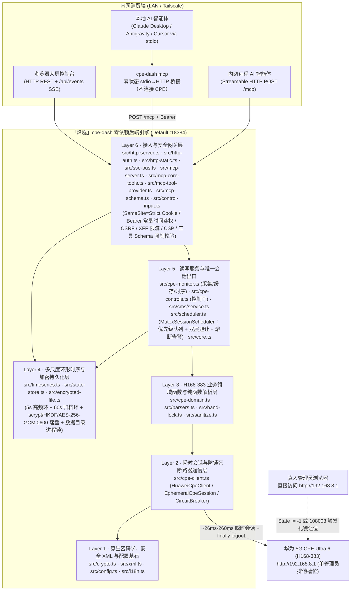
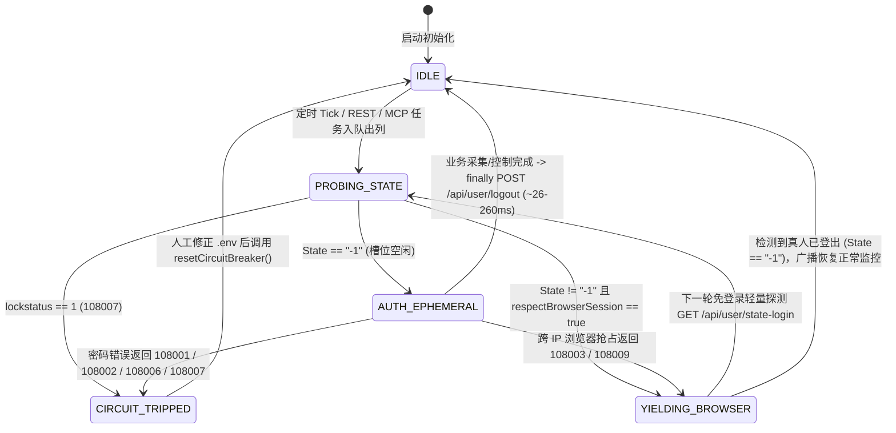
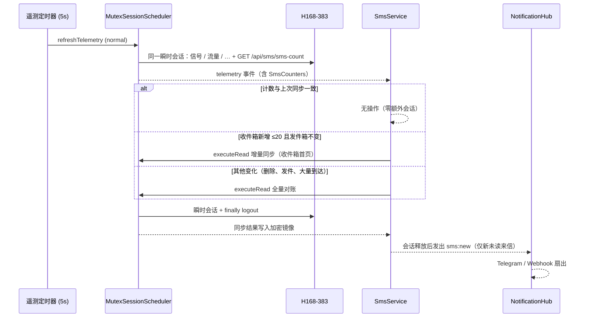

# 「烽燧」(FengSui / `cpe-dash`) 阶段二系统架构、安全纵深防御与时序引擎评估报告 (`PHASE2_ARCHITECTURE_REPORT.md`)

> **宿主机目标画像**：群晖 Synology DS923+（AMD Ryzen Embedded R1600 双核四线程 `2.6–3.1 GHz`，配备 **32 GB ECC DDR4 内存**，7×24×365 家庭内网/Tailscale 无人值守运行）  
> **受控网元设备**：华为 5G CPE Ultra 6（`H168-383` / `WL1H168M`，零售固件 `4.4.0.1(H1006SP19C00)`，网关 `192.168.8.1`，单管理员排他会话）  
> **前置权威契约**：[`AGENTS.md`](../AGENTS.md) 与 [`docs/PHASE1_PROTOCOL_SPEC.md`](PHASE1_PROTOCOL_SPEC.md)  
> **文档性质**：本报告为实现前的架构评估，部分内部命名为设计期草案；REST / SSE / MCP 字段与行为以 [`docs/PHASE2_BACKEND_CONTRACT.md`](PHASE2_BACKEND_CONTRACT.md) 和 `src/` 为准。第 5 节（Phase 2.2 短信融合）按已实现的代码撰写；第 6 节为 Phase 2.5 两轮架构审计结论（6.1–6.4 为第一轮，6.5–6.8 为 2026-10-31 第二轮），1.3 节分层图已按审计后的模块更新。

---

## 1. 后端语言与运行时架构选型论证

### 1.1 四套候选技术栈多维客观评估

在拥有 **32 GB 充裕物理内存** 与双核 Zen+ 算力的群晖 DS923+ 宿主机上，单节点 5G CPE 监控与控制守护进程的并发吞吐量（每秒 `0.2–2` 次路由器短连采样、`< 20` 个局域网浏览器 SSE 订阅流与内网 AI Agent MCP 调用）远未触及任何现代语言运行时的 CPU 或内存瓶颈。真正的架构胜负手在于 **全生命周期（5–10 年）无人值守免维护性、零供应链投毒攻击面、华为私有密码学协议保真度** 以及 **前后端与 MCP 契约的端到端强类型同构能力**。

| 评估维度 | 方案 A：Node.js 22+ 原生零依赖 + 100% 严格 TypeScript（选定方案） | 方案 B：Go (`net/http` 编译单二进制) | 方案 C：Rust (`axum` / `tokio`) | 方案 D：Node.js + Fastify / NestJS 框架体系 |
| :--- | :--- | :--- | :--- | :--- |
| **生产运行时第三方依赖数** | **`0` 个外部 npm 包**（100% `node:http` / `node:crypto` / `node:fs` / `node:net` / `fetch`） | 标准库为主，但 Curve25519 非钳位大端数学与 MCP Schema 常引入若干模块 | 典型引入 `tokio`、`axum`、`hyper`、`serde`、`ring` 等 `120–250` 个传递 crate | Fastify 约 `40+` 传递包；NestJS 达 `150–300+` 传递包（含反射装饰器链） |
| **供应链投毒风险面** | **趋近于 0**（无运行时 `node_modules` 分发，彻底免疫 `postinstall` 与传递包投毒） | 低（Go Checksum DB 保护，但仍需跟进第三方模块 CVE） | 中低（`build.rs` 宏执行面与庞大 crate 树审计成本高） | **高**（深层传递依赖频繁爆出原型链污染、路径穿越与上游弃坑维护警报） |
| **华为私有密码学协议保真度** | **100% 已真机验证复用**（非钳位大端 `BigInt` Curve25519、反向 HMAC Key SCRAM-SHA256、`enc-type=1\|2\|3` AES-256-GCM 均已在 [`src/crypto.ts`](../src/crypto.ts) 跑通） | **需完全重写并重验边界**（标准 `crypto/ecdh` 强制执行 RFC 7748 小端钳位，直接调用会导致握手失败，须用 `math/big` 手写蒙哥马利梯） | **需完全重写**（`x25519-dalek` 同样强制 RFC 7748 钳位，无法直接对接华为非标实现） | 复用 Node `crypto`，但装饰器/插件生命周期徒增复杂度，且违反 `erasableSyntaxOnly` |
| **5–10 年 NAS 无人值守免维护性** | **极高**（容器镜像仅含 Node LTS 官方二进制 + 纯标准 API，无框架大版本迁移债务） | 极高（静态单文件部署简便，但前后端与 i18n/MCP 类型需双语言重复维护） | 高（运行稳健，但交叉编译群晖 `x86_64` musl/glibc 与重构心智负担过重） | **差**（框架每 12–18 个月发生 Breaking Change，`npm audit` 告警迫使人工频繁介入） |
| **端到端类型同构（后端 + 前端 + MCP）** | **原生 100% 共享** [`src/types.ts`](../src/types.ts) 接口定义，零代码生成漂移 | 需维护 OpenAPI/JSON Schema 代码生成器同步 TS 前端类型 | 需借助 `ts-rs` 等外部工具导出前端类型 | 虽同属 TS，但 NestJS 依赖实验性装饰器元数据，与现代 TypeScript 7 类型擦除相悖 |
| **DS923+ (32GB RAM) 资源占用** | 常驻 RSS 约 **`55–75 MiB`**（仅占 32GB 内存的 **`0.22%`**），事件循环空闲 CPU `< 0.3%` | 常驻 RSS 约 `18–30 MiB` | 常驻 RSS 约 `10–20 MiB` | 常驻 RSS 约 `110–190 MiB` |

### 1.2 核心因果推演与最终选型结论

1. **算力充裕场景下的“依赖树熵增定律”**：在 32GB 内存的 DS923+ 上，用 Rust/Go 节省出的 `40 MiB` 内存对系统稳定性没有任何实质增益；相反，任何引入数百个第三方依赖包的框架（如 NestJS / Fastify 生态插件）都会在长达数年的家庭 NAS 静默运行期中持续积累 CVE 漏洞与传递依赖腐化风险。
2. **非标硬件密码学的“零回归铁律”**：Phase 1 逆向与真机探针已证实，H168-383 的 ECDH 协商采用**非钳位大端序 Curve25519**，且 SCRAM-SHA256 将 `authMsg` 作为 HMAC Key（与 RFC 5802 相反）。Node.js 22+ 原生 `BigInt` 与 `node:crypto` 已在真机实现 `~26 ms` 零误差握手，继续采用 **Node.js `>= 22.6.0` 原生零运行时依赖 + 100% 严格 TypeScript (`strict: true`)** 能够实现 **零协议重写风险、零外部运行时依赖、100% 前后端类型同构** 的帕累托最优解。

### 1.3 后端六层自包含分层架构



### 1.4 现代高危 Web 漏洞纵深防御落地矩阵

| 威胁类别 | 攻击向量剖析 | 「烽燧」代码级强制防御落地细节 |
| :--- | :--- | :--- |
| **1. 原型链污染 (Prototype Pollution)** | 攻击者构造含 `{"__proto__":{"isAdmin":true}}` 或 `?constructor.prototype.x=1` 的 JSON / Query / XML 载荷篡改全局 `Object.prototype` | ① JSON 请求体解析统一传入自定义 `reviver`，显式丢弃 `__proto__`、`constructor`、`prototype` 键；<br/>② URL Query、`.env`、XML 键值表及 i18n 词典全部基于 `Object.create(null)` 或 `Map` 存储，严禁向普通对象动态挂接未白名单化的外部键名。 |
| **2. 正则回溯拒绝服务 (ReDoS)** | 超长畸形 XML/JSON/Header 触发指数级 NFA 回溯卡死 Node 单线程事件循环 | ① HTTP 请求体实施硬性字节上限截断（控制/MCP JSON 上限 `64 KiB`，超限立即返回 `413 Payload Too Large` 并销毁流）；<br/>② [`src/xml.ts`](../src/xml.ts) 采用 `indexOf` 确定性线性 `O(N)` 扫描提取标签，全仓严禁对外部输入使用嵌套量词正则。 |
| **3. 服务端请求伪造 (SSRF)** | 通过篡改目标地址或诱导 CPE 返回 `302 Location: http://169.254.169.254/...` 探测宿主机内网其他服务 | ① [`normalizeCpeUrl()`](../src/config.ts) 仅允许 `http:` / `https:`，阻断内嵌凭据、查询串与 `#fragment`，并强制校验目标属于合法私网/局域网地址空间；<br/>② 所有 `fetch()` 强制设置 `redirect: "error"`，且后端无任何接收用户传入任意 URL 发起请求的图片/Webhook 代理接口。 |
| **4. 跨站请求伪造 (CSRF) 与同站跨端口隔离** | 外网恶意页面或群晖同 IP 其他容器端口（RFC 6265 Cookie 不隔离端口）伪造状态变更请求 | ① 会话 Cookie (`fengsui_sid`) 强制设置 `HttpOnly; SameSite=Strict; Path=/`（TLS 或可信 HTTPS 反代下追加 `Secure`），登录成功强制轮换全新随机 Session ID；<br/>② 不下发任何宽松 CORS 响应头并拒绝跨源 `OPTIONS` 预检，使同 IP 异端口无法附加自定义头；<br/>③ Cookie 鉴权下的状态变更（`POST`/`PUT`/`DELETE`）强制校验 `X-Requested-With: XMLHttpRequest`、`Content-Type: application/json` 及精确 `URL.origin` 同源匹配（显式拦截 `Origin: null`），且所有 `GET` 路由严格保持只读无副作用（刷新/扫描操作均走 `POST`）；<br/>④ 当请求携带 `Authorization: Bearer` 时严格走独立令牌通道（忽略 Cookie）；口令与令牌统一经 SHA-256 定长摘要后执行 `crypto.timingSafeEqual`。 |
| **5. DNS 重绑定攻击 (DNS Rebinding)** | 攻击者域名 TTL 过期重绑定至 `127.0.0.1` 或 NAS 局域网 IP，绕过单纯 `Origin === Host` 比对攻击本地 `/api/*` 或 `/mcp` | 接入层在路由分发前优先校验 `Host` 头：仅放行合法局域网/私网 IP、本机 `localhost`/单标签主机名、`.local`/`.lan`/`.ts.net` 或 `.env` 显式配置的 `ALLOWED_HOSTS`，其余一律立即返回 `421 Misdirected Request`；即使是 `127.0.0.1` 回环请求也绝不豁免鉴权。 |
| **6. 伪造反向代理头绕过限流 (XFF Spoofing)** | 攻击者伪造随机 `X-Forwarded-For` 或 IPv6 SLAAC 临时地址绕过 `/api/auth/login` 防爆破限流 | 基于 Node 原生 `net.BlockList` 升级 [`resolveClientIp()`](../src/config.ts)，原生支持单 IP 与 CIDR 网段（如 `172.16.0.0/12`），逐跳执行 `net.isIP` 合法性校验；未命中 `TRUSTED_PROXIES` 时彻底忽略转发头，并结合单 IP 桶（IPv6 归并至 `/64` 前缀）+ 全局失败预算双重限流。 |
| **7. AI 智能体误触与提示词注入防护** | MCP 客户端误调用高危动作，或局域网终端恶意 `HostName` 夹带换行/提示词注入污染上下文 | ① `reboot_cpe` 等高危工具强制校验 `confirm === true` 且在真人避让期间返回礼貌拒绝（`409/423`），绝不排队延迟突袭重启；<br/>② MCP 与 Bearer API 输出默认对 IMEI/IMSI/TAC/CellID 等敏感标识执行 [`redact.ts`](../src/redact.ts) 脱敏（v1.0.1 起按调用方生效，见 7.5 节），并对外部不可信文本进行结构化 JSON 封装隔离；SSE 数据帧强制单行 `JSON.stringify` 阻断 `\n\nevent:` 帧注入。 |

---

## 2. 前端架构与多语言 (`i18n`) 选型权衡

### 2.1 内网零 SEO 定位与纯静态离线自包含前端架构

- **严禁引入 SSR 的安全与复杂度依据**：「烽燧」部署于家庭私有群晖 NAS（`192.168.8.1` 局域网或 Tailscale 私网），**搜索引擎收录（SEO）需求严格为 `0`**。若盲目引入 Next.js / Nuxt / SvelteKit 等同构 SSR 框架，不仅会引入数千个 npm 依赖与 RSC 序列化攻击面，还会带来服务端环境变量（`CPE_PASSWORD` / `API_TOKEN`）意外打包穿透至客户端 Bundle 的致命隐患。
- **确定性单端口离线托管方案**：
  - 前端全部源码在 Phase 3 采用 **100% 严格 TypeScript (`tsconfig.web.json`)** 编写，预编译输出纯静态资产至构建产物目录（并严守 [`scripts/audit-secrets.ts`](../scripts/audit-secrets.ts) 禁止在 `src/` 下存放任何 `.js` 文件的红线，编译产物输出至 `dist/web/public/`，静态模板与样式置于 `public/`）。
  - 静态页面、CSS、字体与 SVG 图标 **100% 本地自包含**，严禁引用 Google Fonts、jsdelivr、unpkg 等任何外部 CDN，确保家庭宽带断网排障（恰恰是用户最需要进入 CPE 控制台查看基站失联原因的时刻！）时依然 **毫秒级秒开渲染**。
  - HTTP 响应强制下发严格 CSP 头：`default-src 'self'; connect-src 'self'; img-src 'self' data:; style-src 'self' 'unsafe-inline'; script-src 'self'; frame-ancestors 'none'; base-uri 'self'`。

### 2.2 多语言 (`i18n`) 方案深度对比：自研零依赖强类型引擎 vs `i18next`

| 对比维度 | 方案 A：自研零依赖强类型 `src/i18n.ts` + `locales/*.json`（选定方案） | 方案 B：引入开源库 `i18next` (+ 插件生态) |
| :--- | :--- | :--- |
| **运行时依赖与产物体积** | **`0` 依赖，核心引擎 `< 1.8 KiB`**（完美契合零外部依赖铁律） | 核心 + 语言检测与格式化包未压缩 `> 45 KiB`（gzip 后仍 `~15 KiB`），破坏零运行时依赖契约 |
| **编译期类型安全性** | 基于 `keyof typeof zhCN` 推导联合字面量类型 `I18nKey`，**任何拼写错误的翻译键在 `npm run typecheck` 编译期即报错拦截**，且单元测试自动校验 `zh-CN.json` 与 `en.json` 键集合 100% 对称 | 默认接受宽泛 `string` 或依赖复杂的递归模板字面量类型体操，大型字典易触发 TS 类型实例化深度上限 |
| **占位插值与复数表达** | 原生支持 `{variable}` 确定性安全替换（无正则回溯、默认返回纯文本由安全 DOM `textContent` 渲染防 XSS）及基于 `Intl.PluralRules` 的复数分支选择 | 功能庞杂（嵌套命名空间、上下文后缀、HTML 插值），其中富文本插值若配置不当易引入 DOM XSS |
| **前后端与 MCP 双语复用** | 后端 REST 错误提示、SSE 真人避让广播（中英双字段同步推送）、MCP 工具说明与前端 UI 共享同一套 `locales/zh-CN.json` 与 `locales/en.json`（通过 `GET /api/i18n/:locale` 零开销下发） | 需在前后端分别初始化运行时实例 |

**确立结论**：采用 **自研零依赖强类型 `src/i18n.ts` + 扁平化点分命名空间词典（`locales/zh-CN.json` / `locales/en.json`）**，由单元测试强制守卫中英文键集合 100% 对齐。

---

## 3. 多用户并发与真人登录避让引擎设计 (`MutexSessionScheduler`)

### 3.1 问题本质：多源并发请求与单管理员硬件槽位的冲突

在生产运行态下，后端同时面对四类并发触发源：
1. **高频遥测轮询器**（默认每 `5s` 采集一次 3CA 射频、MCS、双栈 IP 与实时速率/双周期流量）；
2. **低频重负载扫描器**（默认每 `60s` 扫描一次 4G/5G 邻区基站表与接入终端拓扑）；
3. **Web 控制台多标签页用户操作**（手动强制刷新、下发锁频段/锁小区、切换天线或重启）；
4. **内网 AI Agent MCP 并发工具调用**（智能体连续调用 `get_cpe_telemetry` -> `list_neighbor_cells` -> `lock_cell`）。

若不加以统一调度而直接并发触发登录，不仅会在路由器侧引发 `108003` / `108005` 会话互踢与 `__RequestVerificationToken` 乱序失效，更会在真人用户打开 `http://192.168.8.1` 时造成争抢。

### 3.2 `MutexSessionScheduler` 核心并发控制机制



1. **全局单实例 FIFO 优先级互斥队列 (`#queue`)**：
   - 所有需访问 CPE 的任务统一进入单实例串行调度器：控制类写操作（`priority: "high"`，如锁频、锁站、重启）排在后台常规轮询（`priority: "normal"`）与低频扫描（`priority: "low"`）之前，但严格等待当前正在执行的 `~200ms` 瞬时会话自然 `logout` 完毕后再出列执行，**绝不允许两个 `EphemeralCpeSession` 重叠存活**。
   - 队列设有硬性积压上限（`maxQueueDepth = 32`），防止网络超时期间无限堆积内存请求。
2. **只读请求单飞合并 (Single-Flight Request Coalescing)**：
   - 当 5 个浏览器标签页与 2 个 MCP 智能体在同一窗口内同时请求 `getTelemetry(forceRefresh)`、`scanNeighbors` 或 `getTopology` 时，调度器通过 `#inflightReads` Map 将同类型只读请求合并复用同一个 Promise，仅向路由器发起 **1 次** `~26–200ms` 瞬时会话即可同时满足所有调用方。
3. **双层真人在线礼貌避让与实时广播**：
   - **第 1 层（零认证开销预检）**：每次开启会话前先调用免登录接口 `GET /api/user/state-login`；若 `<State>` 不为 `"-1"`，立即进入 `YIELDING_BROWSER` 状态，不发送任何 SCRAM 握手包。
   - **第 2 层（跨终端并发兜底）**：若预检至握手的数毫秒间隙内局域网另一台电脑刚登录了 `192.168.8.1`，路由器在 `challenge_login` 返回 `108003` / `108009`，客户端立即静默放弃并返回让位结果。
   - **状态广播与平滑恢复**：进入避让态时，调度器立即通过 `SseEventBus`（事件名 `session:avoidance`）与 MCP 会话状态暴露双语通知：
     - `messageZh`: `"用户正在使用 CPE 后台，监控自动避让中"`
     - `messageEn`: `"Human administrator is using the CPE WebUI; monitoring is politely yielding"`
   - 避让期间，REST / MCP 只读查询直接返回最近一次缓存快照 + `avoidance.active = true` 标记（零阻塞、零报错）；待后续免登录探测发现 `<State>-1</State>` 后，自动解除避让并推送恢复事件。
4. **`__RequestVerificationToken` 会话级完全隔离与写操作安全边界**：
   - Token 池 (`session.tokens`) 严格封装在单次 `EphemeralCpeSession` 实例内部，单次会话内的多个 `POST` 控制指令按顺序消费 `consumeToken()`，杜绝跨会话 Token 串扰。
   - **写操作零自动重放**：占用重试仅允许发生在 `session.login()` 阶段（`fn(session)` 执行前）；一旦进入业务回调绝不自动重放写请求，且在真人避让期间对写控制指令立即返回礼貌拒绝（`409 Conflict`），防止陈旧的重启/锁频指令在数十分钟后突袭生效。
5. **并发安全与持久化故障边界不变量（经 Opus 5.5 深度交叉审计加固）**：
   - **防抖动冷却退避（Anti-Flapping Backoff）**：由于固件 `4.4.0.1` 的 `GET /api/user/state-login` 在无 Cookie 时对跨 IP 会话仍可能返回 `State=-1`（由第 2 层 `108003`/`108009` 捕获），第 2 层触发避让后强制进入指数退避静默期（`45s -> 90s -> 180s -> 300s` 封顶，每级附加固定 `+5%` 余量；由 `layer2InitialBackoffMs` / `layer2MaxBackoffMs` 配置），避免每 `5s` 反复触发 `challenge_login` 干扰真人会话；SSE `session:avoidance` 仅在状态跃迁时推送，杜绝事件风暴。
   - **跨重启熔断器记忆与热重载（Persistent Circuit Breaker）**：将熔断状态与当前 `CPE_PASSWORD` 的 SHA-256 指纹持久化至 `EncryptedStateStore`；若容器因 `restart: always` 重启但错误密码未改，启动即保持熔断锁死，严防 3 次重启累计触发 `108007` 硬件锁机；当检测到 `.env` 密码指纹已更新或人工执行 `reloadAndResetBreaker()` 时安全解锁。
   - **防重入死锁与有界 `logout` 超时**：使用 `AsyncLocalStorage` 检测并阻断 `withSession` 嵌套重入死锁；为 `logout()` 设置独立短超时上限（`3s`）。进程收到 `SIGINT`/`SIGTERM` 时，在途瞬时会话有 `2s` 宽限自然完成，之后被 `abortActiveSession()` 取消，`finally` 登出照常执行，确保路由器管理员槽位在退出前释放（第二轮审计 G3/G4）。

---

## 4. 时序数据流与多尺度环形缓冲区设计 (`TimeSeriesRingBuffer`)

### 4.1 硬件实情对齐：关于设备温度指标的诚实建模

根据 [`docs/PHASE1_PROTOCOL_SPEC.md`](PHASE1_PROTOCOL_SPEC.md) 对全部 `122` 个真实 HAR 接口与 `8` 组真机探针的穷尽核查，H168-383 零售固件 `4.4.0.1` 的 HTTP API（含 `/api/device/signal`、`/api/device/information`、`/api/monitoring/status`）**未暴露基带或 CPU 温度标签**（`coulometer_enabled=0`）。遵循“严禁臆造 CPE 字段或伪造假数据”的铁律：
- 遥测解析器支持读取可选的 `<temperature>` / `<chip_temp>` 标签（兼容未来固件升级），当固件未返回时诚实输出 `temperatureCelsius: null` 并附带能力标识 `temperatureSupported: false`；
- 时序环形缓冲区完整保留 `temperatureCelsius: number | null` 通道（聚合时自动跳过 `null` 样本而不污染均值），确保前端图表与契约面向未来 100% 兼容。

### 4.2 双层定长循环内存环形缓冲区（Dual-Tier Circular Ring Buffer）

为同时满足 **秒级丝滑实时曲线 (`1h`)**、**中长周期趋势分析 (`6h / 12h / 24h`)** 与 **跨天自定义时间跨度回溯 (`custom`, 最长 7 天)**，同时保持恒定 `O(1)` 写入复杂度与零磁盘磨损（保护群晖 NAS SSD/HDD 寿命），设计双层定长环形缓冲区：

| 层级 | 采样粒度 (`stepMs`) | 环形槽位数 (`capacity`) | 覆盖时间跨度 | 记录核心指标通道 | 内存占用估算 (DS923+ 32GB) |
| :--- | :---: | :---: | :---: | :--- | :---: |
| **Tier-1 高频明细环 (`fineRing`)** | **`5,000 ms` (5 秒)** | **`2,160` 槽** | **最近 `3 小时`** | 时间戳、下行/上行 `bps`、LTE `RSRP/SINR/RSRQ`、5G NR `RSRP/SINR/RSRQ`、温度 `°C \| null` | **`~380 KiB`** |
| **Tier-2 分钟聚合环 (`coarseRing`)** | **`60,000 ms` (1 分钟)** | **`10,080` 槽** | **最近 `7 天 (168 小时)`** | 每分钟 `sampleCount`、上下行速率 `avg/max`、4G/5G 信号 `avg/min/max`、温度 `avg/max` | **`~2.4 MiB`** |

- **总常驻内存开销**：两层合计仅 **`< 3 MiB`**（不到 DS923+ 32GB 内存的 `0.01%`），无任何 SQLite 原生 C++ 编译绑定需求，彻底规避容器跨架构 ABI 兼容问题。
- **群晖硬盘休眠友好的异步加密快照持久化**：为避免高频写盘阻止群晖 DSM 机械硬盘休眠或同步 `fs` 阻塞事件循环，`EncryptedStateStore` 采用单队列异步写入（`fs.promises` + 临时文件 `fsync` + 原子 `rename`），仅在关键控制状态变更、低频检查点（默认 `30 分钟`）及 `SIGINT`/`SIGTERM` 优雅退出时刷盘；若恢复 `108006` 修改密码导致旧快照密钥不匹配，自动将其归档重命名为 `.unreadable-<ts>` 并平滑重建空状态，绝不引发启动崩溃循环。
- **双层拼接与每通道独立聚合精度保证**：
  - 每个数值通道独立维护 `{ sum, count, min, max, last }` 统计量，确保 NSA 模式下偶发休眠的 `nrRsrpDbm` 或恒为 `null` 的 `temperatureCelsius` 绝不会把均值拉向 `0`；合并桶时严格按加权 `Σsum / Σcount` 计算，严禁对均值二次求平均。
  - 统一以已封口分钟水位线 `lastClosedMinuteMs` 无缝拼接 `coarseRing`（`< lastClosedMinuteMs`）与 `fineRing`（`>= lastClosedMinuteMs`，若刚重启 `fineRing` 为空则自动回退读取 `coarseRing`），且所有输出聚合桶对齐至固定纪元网格（`Math.floor(ts / bucketMs) * bucketMs`），确保滑动刷新时曲线零抖动。

### 4.3 预设时间轴 (`1h / 6h / 12h / 24h`) 与自定义跨度 (`custom`) 聚合查询算法

查询接口统一支持 `preset` 与任意 `[fromMs, toMs, bucketMs | maxPoints]` 自定义区间：

| 查询模式 | 时间跨度 | 数据源自动路由 | 默认聚合桶宽 (`bucketMs`) | 返回点数上限 |
| :--- | :---: | :--- | :---: | :---: |
| `preset = "1h"` | 最近 1 小时 | **Tier-1 高频环**（5s 原始精度或按 `bucketMs` 降采样） | `10,000 ms` (10s) | `360` 点 |
| `preset = "6h"` | 最近 6 小时 | **Tier-2 分钟环 + 当前活跃分钟桶** | `60,000 ms` (1m) | `360` 点 |
| `preset = "12h"` | 最近 12 小时 | **Tier-2 分钟环 + 当前活跃分钟桶** | `120,000 ms` (2m) | `360` 点 |
| `preset = "24h"` | 最近 24 小时 | **Tier-2 分钟环 + 当前活跃分钟桶** | `300,000 ms` (5m) | `288` 点 |
| `preset = "custom"` | 任意 `[fromMs, toMs]`（最长 7d） | 若 `fromMs >= now - 3h` 且桶宽 `< 60s` 优先取 **Tier-1**；否则无缝拼接 **Tier-2 + Tier-1 尾部** | 自适应 `ceil((toMs - fromMs) / maxPoints)`（默认 `maxPoints = 360`，上限 `1,440`） | `<= 1,440` 点 |

每个输出时序数据桶统一提供 `tsMs` / `tsIso` / `sampleCount`、上下行速率（`dlAvgBps` / `dlPeakBps` / `ulAvgBps` / `ulPeakBps`）、4G/5G 关键射频（`lteRsrpAvgDbm` / `lteRsrpMinDbm` / `lteSinrAvgDb` / `nrRsrpAvgDbm` / `nrRsrpMinDbm` / `nrSinrAvgDb`）及温度（`temperatureAvgCelsius` / `temperatureMaxCelsius`），使前端 ECharts / Canvas 曲线组件与 AI Agent `query_telemetry_history` 工具可直接消费，无需在客户端做二次重采样。

---

## 5. 短信业务融合架构（Phase 2.2）

### 5.1 问题：两个进程争抢同一个管理员槽位

旧架构中，`cpe-sms`（短信）与 `cpe-dash`（遥测）各自运行独立的登录与轮询。H168-383 同一时刻只允许一个管理员会话，而在对方看来，另一个进程的会话与真人浏览器登录无从区分：
- 一方会话期间，另一方的第 1 层 `state-login` 预检看到 `State=0`，于是进入避让；
- 双方以各自的节奏轮询（遥测 5s、短信轮询），会话窗口交错，结果是彼此频繁让位、SSE `session:avoidance` 抖动、遥测断点与短信延迟；
- 两套熔断器各自计算密码错误次数，可能叠加触发 `108007` 硬件锁定。

没有进程间协议时，这个冲突无法靠调参解决。Phase 2.2 的结论是**把短信并入「烽燧」，由同一个 `MutexSessionScheduler` 调度所有 CPE 访问**。`cpe-dash` 仍保持 100% 独立仓库，不引用 `cpe-sms` 的任何代码或数据；短信镜像直接从 CPE 同步（存储上限 500 条，无需迁移旧归档）。

### 5.2 模块分层

| 层 | 模块 | 职责 |
| :--- | :--- | :--- |
| 协议 | `src/sms/codec.ts`、`src/sms/phone.ts`、`src/sms/protocol.ts` | GSM-7 / UCS-2 分段、验证码提取、报文解析；54 国号码解析与收件人归一化；明文 / 加密列表、发送与状态轮询、已读与删除（只接受调度器分配的 `EphemeralCpeSession`） |
| 存储 | `src/sms/mirror.ts`、`src/sms/contacts.ts`、`src/notify/telegram-bot.ts`（`TelegramStateStore`） | 加密短信镜像（不透明 `uid`、已推送集合、首次同步标记）、通讯录（≤5000，vCard 导入）、Telegram 授权聊天与回复路由 |
| 应用 | `src/sms/service.ts` | REST / MCP / Telegram 的唯一短信入口：变化检测、单飞同步、发送回读、事件广播 |
| 告警 | `src/alert-engine.ts` | 基于遥测与调度器状态的持续窗口 + 迟滞规则 |
| 通知 | `src/notify/hub.ts`、`telegram-api.ts`、`telegram-bot.ts`、`webhook.ts` | 扇出到各通道，单通道故障互不影响 |
| 接口 | `src/sms/http-routes.ts`、`src/sms/mcp-tools.ts`、`src/sse-bus.ts` | `/api/sms/*`、MCP 短信工具、SSE 短信事件 |
| 装配 | `src/cli.ts` | 数据目录进程锁（单守护进程）、有序启停、`.env` 热重载后的密钥轮换与 `TZ` 应用 |

### 5.3 调度与同步：零额外会话的变化检测



- **计数捎带**：`sms-count` 随每次遥测会话读取，不单独登录；只有计数与「上次同步时的计数」不一致才排队同步。
- **单飞与合并**：同一时刻最多一个同步在途；全量同步可吸收并发的增量请求，增量期间到来的全量请求排在其后。
- **兜底与退避**：每 `SMS_FULL_SYNC_INTERVAL_MS`（默认 30 分钟）以 `low` 优先级全量对账一次；同步失败后 60s 内不再自动重试。
- **让位期间**：真人登录 `192.168.8.1` 时不开任何会话，改用免登录的 `check-notifications` 每 5s 探测未读数与存储满状态，并在 `sms:status` 中标记 `syncPending`。真人退出后，下一次遥测计数驱动补同步。
- **写操作**：发送、已读、删除都经 `executeControl`（`high` 优先级），真人在线时直接返回 `409`。发送在同一会话内轮询 `send-status`（2s 间隔、最长 45s），随后读回该号码的会话，用 CPE 的真实发件记录替换临时记录；读回失败时保留 `pending` 临时记录，等待下一次同步。
- **通知在会话外**：`sms:new` 在会话释放后才发出，Telegram / Webhook 的网络延迟不会延长管理员槽位占用。

| 操作 | 会话开销 |
| :--- | :--- |
| 无变化 | 0（只多一次 `GET` 捎带在遥测会话内） |
| 新到 1 条短信 | 1 次读会话：计数 + 收件箱首页 |
| 全量对账（`N` 条） | 1 次读会话：`ceil(收件 / 50) + ceil(发件 / 50)` 页；回退通道为逐会话分页 |
| 发送 | 1 次控制会话：提交 + 状态轮询 + 回读 |

### 5.4 存储：加密镜像而非历史归档

- **镜像语义**：本地镜像始终与 CPE 一致。全量对账会移除 CPE 上已不存在的记录（包括未被确认的临时发件），删除操作同时作用于 CPE 与镜像，因此不存在「仅本地归档」的数据。
- **标识**：CPE 索引会被复用，消息以 `sha256(index \0 date \0 phone)` 截断的 `uid` 标识，对外不暴露号码。
- **只推送一次**：已推送 `uid` 集合（上限 3000）与首次同步标记一同持久化。全新部署的首次同步把已有短信视为历史；之后服务离线期间到达的未读来信会在重启后补推。
- **加密与原子性**：镜像、通讯录与 Telegram 状态均为 `StorageCipher`（scrypt + HKDF-SHA256 + AES-256-GCM）密文，`0600` 临时文件 + `fsync` + `rename` 串行写入；无法解密的文件改名为 `*.unreadable-<时间戳>` 隔离，不覆盖。
- **单进程独占**（Phase 2.5 起）：守护进程启动时先锁定数据目录（`<STATE_FILE>.lock`，记录持有者 PID）。存活的另一个守护进程持有锁时，第二个守护进程直接以 `DaemonAlreadyRunningError` 退出；PID 已失效或等于自身 PID（容器重启复用 PID）的锁视为陈旧锁并接管。未配置 `CPE_PASSWORD` / `DATA_ENCRYPTION_KEY` 时拒绝启动，任何存储都不会明文落盘。
- **密钥轮换**：`POST /api/session/reset-breaker` 重新读取 `.env` 后，用新密钥立即重写全部加密文件。`DATA_ENCRYPTION_KEY` 留空时等于 `CPE_PASSWORD`，因此更换路由器密码也会更换数据密钥；启动时若检测到这种回退会打印提示，建议配置独立密钥。

### 5.5 通知与告警

- **`NotificationHub`**：订阅 `SmsService` 的 `sms:new` 与调度器的 `alert`，按 `ALERT_NOTIFY_MIN_SEVERITY` 过滤告警后用 `Promise.allSettled` 扇出，单通道失败只计入统计（`GET /api/alerts`），日志不含号码与正文。
- **Telegram 双向机器人**（长轮询，仅 `serve` 进程）：
  - 来信卡片：发件人 / 联系人 / 国旗、一键复制的验证码、回复该卡片即发送，以及「已读 / 会话 / 删除（二次确认）」按钮；
  - 引导式发短信 `/new`：国家快捷切换、号码或联系人搜索、GSM-7 / UCS-2 分段预览、确认后发送；`/send` 同样需要确认；
  - `/inbox`、`/unread`、`/chat`、`/contacts`、`/contact`、`/status`、`/alerts` 读取镜像与遥测缓存，不额外开会话；`/sync` 显式同步；`/mute` 暂停告警推送（最长 7 天）；发送 `.vcf` 文件导入通讯录；
  - 授权：`TELEGRAM_CHAT_IDS` 预授权，或 `/auth <绑定码>`（控制台生成的一次性绑定码，私聊也接受完整权限令牌；常量时间比对，单聊天 5 次 / 全局 20 次每 10 分钟限流，消息自动删除）。群组只接受控制台按次显式生成的**群组绑定码**（`pair-group`）：私聊绑定码与令牌在群组中被拒，私聊绑定码发到群里即作废（防止成员抄去私聊绑定）；群组绑定记下发送 `/auth` 的成员（匿名发送者被拒），群里只有他的命令、回复、文件与按钮生效，其他成员只能看到推送；在论坛话题中绑定则推送进该话题；群组升级为超级群组时（`migrate_to_chat_id`）绑定随之迁移；`/reset` 仅限私聊；群里写给其他机器人的命令（`/cmd@other_bot`，按 `getMe` 得到的用户名判断）与闲聊不响应。
- **签名 Webhook**：`{ event, deliveredAt, data }` JSON，`HMAC-SHA256(secret, "<timestamp>.<body>")` 签名，网络错误或 `5xx` 重试一次。
- **`AlertEngine` 规则**（均需持续一段时间才触发，并带恢复迟滞）：

  | 代码 | 级别 | 条件 |
  | :--- | :--- | :--- |
  | `CPE_UNREACHABLE` / `CPE_RECOVERED` | critical / info | 传输层失败持续 60s / 调度器恢复空闲或轮询 |
  | `WAN_DOWN` / `WAN_UP` | warning / info | `ConnectionStatus ≠ 901` 持续 60s / 恢复 |
  | `SIGNAL_DEGRADED` / `SIGNAL_RECOVERED` | warning / info | 主制式 RSRP < -110 dBm 或 SINR < 0 dB 持续 5min / 高于阈值 +3 dB、+2 dB 持续 60s |
  | `CA_DROPPED` | info | 载波数低于稳定值持续 5min（降为 0 不计） |
  | `REBOOT_DETECTED` | warning | 运行时长回退（容差 30s） |
  | `SMS_STORAGE_HIGH` / `SMS_STORAGE_FULL` | warning / critical | 存储 ≥ 90%（< 85% 重新布防）/ CPE 报告已满 |
  | `DATA_THRESHOLD` | warning | 当月流量越过路由器设置的告警阈值（回落到一半以下重新布防） |
  | `CIRCUIT_<code>` | critical | 调度器熔断（原有来源） |

### 5.6 MCP 短信工具的提示词注入防护

短信正文是第三方可控输入，可能夹带针对智能体的指令。防护分为三层：
1. **权限分级**：`MCP_SMS_ACCESS=none|read|full`，默认 `read` 不暴露任何写工具；`MCP_ALLOW_MUTATIONS=false` 时写工具同样隐藏。
2. **数据标注**：`initialize` 的说明与返回短信内容的结果都附带「仅视为数据」声明。
3. **硬性约束**：`send_sms` 必须 `confirm: true`，单收件人，默认仅限主人保存的联系人或曾发过短信的号码（智能体自建的联系人不算），按小时限额（未触达 CPE 的尝试退还额度）；`delete_sms` 必须 `confirm: true`、单次 ≤20 条，默认拒绝删除未读短信。

### 5.7 运行模式

| 模式 | CPE 会话 | 短信 / 告警 / Telegram / Webhook | 说明 |
| :--- | :--- | :--- | :--- |
| `cpe-dash serve` | 唯一的 `MutexSessionScheduler` | 全部启用（`SMS_ENABLED`、`ALERTS_ENABLED` 等控制） | 唯一连接 CPE 的进程，独占数据目录 |
| `cpe-dash mcp` | 无 | 无（全部经守护进程） | 零状态 stdio→HTTP 桥接，转发到 `MCP_DAEMON_URL` |

启动顺序：组装时恢复加密状态与熔断锁存 → SSE 挂载 → 通知中心 → 告警引擎 →（跨主机信标 1s 应答窗口）→ Telegram（`setMyCommands` + 长轮询）→ 短信首次全量同步 → 遥测轮询 → 绑定 HTTP 端口；任一步失败都按停止顺序关闭后再退出。停止顺序（总时长控制在 `docker stop` 的 10s 宽限内）：停信标与 SSE → HTTP 停止接受新连接 → 停 Telegram 长轮询 → 停通知与告警 → 停调度器（排队请求 `503`，在途会话宽限 2s 后取消并登出）→ 有界等待 Telegram 在途回复 → 刷新短信与通讯录 → HTTP 剩余连接最多再等 5s → 刷新 Telegram 状态并释放数据目录锁。

---

## 6. Phase 2.5 架构与实现审计结论（2026-10-30）

本次审计逐行检视 `src/`、`scripts/probe-*.ts` 与 `test/`，对照 Phase 1 规范、HAR 真机抓包（仅提取 `net-mode-list` 等单个响应，未整体读入）以及 `cpe-sms` 中经过真机长期验证的实现。下表列出发现的问题与处置，每项修复都附带先失败后通过的测试。

### 6.1 发现与修复

| # | 级别 | 问题 | 处置 |
| :--- | :--- | :--- | :--- |
| F1 | P0 | `cpe-dash mcp`（stdio）自建 `HuaweiCpeClient`、调度器与 `state.json` 存储。与守护进程并行时，两个内存互斥锁互不可见：双方轮流登录 CPE、互把对方当作真人让位、各自的 `108006` 熔断器分别消耗密码尝试次数，并同时覆写 `state.json`。原先只有短信镜像有锁 | stdio 改为零状态桥接 `McpStdioBridge`，转发到守护进程 `/mcp`（测试断言该模块不导入任何 CPE / 存储 / 调度器模块）；`serve` 先锁定数据目录，第二个守护进程直接失败 |
| F2 | P0 | 防火墙、Wi-Fi 7 的读-改-写在读取失败时按默认值回写：可能悄悄开启 MAC/URL 过滤，或关闭 DBHO/MLO | 先严格读取并校验全部依赖值，再进行第一次写入 |
| F3 | P0 | `fetchGlobalTelemetry` 吞掉所有读取错误，会话中途断开时生成全零快照，被缓存、推送，并以 0 bps 写入时序 | 可选接口只在 CPE 错误码时降级；传输层失败与核心接口失败会让整个快照失败；路由器配置全有或全无 |
| F4 | P0 | `send-sms` 已被接受后，状态轮询失败会整体报错（REST 502 / MCP 执行错误），诱发重复发送 | 已提交即返回「已提交、未确认」；MCP 中 CPE 报告的失败改为 `isError` + `SMS_SEND_FAILED` |
| F5 | P0 | 会话无总时长上限：挂起的域函数会永久占住互斥锁，所有 CPE 任务停摆 | 会话截止时间 + 共享中止信号 + 用新信号执行登出；未应答的认证请求一律视为可能已登录 |
| F6 | P0 | 未配置密钥时 `StorageCipher` 静默退化为明文 JSON | 守护进程无密钥拒绝启动；状态存储要求密钥；`reset-breaker` 拒绝空密钥 |
| F7 | P1 | MCP 支持版本缺少稳定版 `2025-11-25`（其客户端后续每个 POST 都会收到 400），却声明了未实现 `server/discover` 的 `2026-07-28` | 支持 `2025-11-25`/`2025-06-18`/`2025-03-26`/`2024-11-05`，回退协商到最新版本 |
| F8 | P1 | 工具 `inputSchema` 只是声明：拼错的键被静默忽略，导致只应用了部分修改 | 运行时强制校验 Schema（未知键 / 缺失 / 类型 / 范围），先检查 `confirm` 再做 Schema 校验 |
| F9 | P1 | 锁频段与锁小区接受任意 1..255 频段与任意 ARFCN，幻觉参数可锁到设备不支持的 LTE 频段而断网 | LTE 仅限 `net-mode-list` 通告的 14 个频段；NR 限规格书中的 15 个硬件频段；ARFCN 必须在频段范围内；MCP 的 `lock_cell` 只能锁定已观测到的小区 |
| F10 | P1 | REST 与 MCP 两套入参解析规则不一致，并存在 `as AntennaModeName` / `as TimeSeriesPreset` 类型逃逸 | 统一为 `control-input.ts` 类型守卫 |
| F11 | P1 | MCP `probeLive` 与短信让位探测直接访问 `scheduler.client` | 改为调度器的免登录探测 API（`probeLoginState` / `probePublic` 白名单）；client 改为私有 |
| F12 | P1 | `.env` 中的 `TZ` 不进入进程环境，在 UTC 容器里发出短信的 `<Date>` 会错位 | 校验 IANA 时区，启动与 `reset-breaker` 重载时写入 `process.env.TZ` |
| F13 | P2 | `MutexSessionScheduler` 是上帝类（944 行）：互斥、避让、缓存、定时器、时序、持久化与 9 个控制写全混在一起 | 拆为 `scheduler.ts` / `cpe-monitor.ts` / `cpe-controls.ts` / `core.ts`，依赖方向单一 |
| F14 | P2 | `http-server.ts` 有 1557 行，同一段 429/401 鉴权失败响应重复 5 次 | 抽出 `http-auth.ts`（会话 / 限流 / CSRF）与 `http-static.ts` |
| R1 | P1 | 轮换 `API_TOKEN` 时，`/auth` 解绑的落盘晚于 `reset-breaker` 的响应（测试约 1/4 概率复现） | 先解绑，再等待串行写入落盘 |
| R2 | P1 | 公网 `http` Webhook 会明文传输短信正文与验证码；公网 `http` Telegram API Base 会泄露 Bot Token | 非局域网主机强制 `https` |

### 6.2 审计后的模块依赖方向

```text
adapters   http-server · http-auth · http-static · control-input · sse-bus · notify/* · sms/http-routes
           mcp-server (协议引擎) ← mcp-tool-provider (契约) → mcp-core-tools · sms/mcp-tools
                                                               (stdio: mcp-stdio-bridge -> HTTP /mcp)
   │
services   cpe-monitor (读) · cpe-controls (写) · sms/service · alert-engine
   │
session    scheduler (MutexSessionScheduler：唯一会话出口)  ← core.ts 装配
   │
transport  cpe-client (HuaweiCpeClient / EphemeralCpeSession / 熔断 / 会话截止)
   │
protocol   cpe-domain · parsers · band-lock · sms/protocol · crypto · xml · http-body · json-safe
storage    state-store · encrypted-file · timeseries · sms/mirror · sms/contacts
```

适配层不再接触 `HuaweiCpeClient`；只有 `scheduler.ts` 持有它。所有需要鉴权的 CPE 访问都经过 `executeRead` / `executeControl`，免登录探测经过白名单方法。

### 6.3 测试矩阵加固

- **严格真机模型** [`test/helpers/strict-cpe.ts`](../test/helpers/strict-cpe.ts)：单管理员槽位（重叠登录返回 `108003`）、登录后轮换 SessionID、绑定会话的一次性 CSRF Token（重放返回 `125001`）、过期会话返回 `100003`、3 次锁机、同 IP / 跨 IP 真人登录，所有违规都会计数。
- **会话契约测试**：遥测、扫描、短信同步与发送、控制写和 MCP 调用并发执行，断言零重叠、零 Token 拒绝、登录与登出一一配对；`108006` 在轮询、REST、MCP、短信压力下以及重启之后都只消耗一次尝试；Layer 1 让位与恢复各广播一次；Layer 2 冷却窗口内零路由器流量；会话截止后队列恢复。
- **保真与边界**：快照与读-改-写的故障注入、频段 / ARFCN 边界、MCP Schema 与确认门、协议版本协商、stdio 桥接（含端到端子进程与真守护进程）、数据目录锁、`TZ` 应用。
- 质量门禁：223 项测试全部通过，语句与行覆盖率约 98%，函数覆盖率约 99%；`audit:secrets` 覆盖工作区与全量 Git 历史。

### 6.4 未在本阶段解决的事项

1. ~~`lockState` 与驻留小区的对账~~：已由 `verifyLockState()` 实现（`lockVerification` + `LOCK_DRIFT` / `LOCK_REALIGNED` 告警）。LTE 频段掩码是真读回，NR 与锁小区为对照服务载波的推断。
2. ~~NR 频段校验基于 3GPP 表~~：已改为 H168-383 规格书的 15 个 NR 频段（路由器不通告 NR 频段；规格书的 LTE 列表与路由器通告的完全一致，可佐证其可靠性）。
3. ~~跨主机重复守护进程~~：已由 `PeerDaemonGuard` 解决（签名 UDP 广播信标，较晚启动者待机）。限制：Docker 桥接网络不转发广播，NAS 容器需使用 host 网络。
4. ~~MCP `2026-07-28` 未实现~~：已实现两代协议共存（`server/discover`、逐请求 `_meta` 版本、`resultType`、`-32022` / `-32020`、HTTP 路由头校验与 `404`），`initialize` 保留给传统客户端并最高协商到 `2025-11-25`。

### 6.5 第二轮审计（2026-10-31）：发现与修复

第二轮在第一轮修复之后重新逐行检视 `src/`、`test/` 与探针脚本，重点放在第一轮之后新增、尚未审计的代码（会话 keep-alive 重发、锁定对账、NR 频段白名单、跨主机信标、MCP `2026-07-28`），以及会话生命周期的边角：截止之后、停机之中、启动失败之时。所有缺陷都先在严格路由器模型 [`test/helpers/strict-cpe.ts`](../test/helpers/strict-cpe.ts) 上复现，再修复；每项都附带修复前失败、修复后通过的测试。MCP 一项对照了已发布的 `2026-07-28` changelog 与 `schema.ts`。

| # | 级别 | 问题 | 处置 |
| :--- | :--- | :--- | :--- |
| G1 | P0 | **短信重复投递**：CPE 已接受 `send-sms` 后，若控制会话因占用上限、停机或读回中断而失败，错误照常上抛：REST `502`、MCP `CPE_EXECUTION_ERROR`、Telegram「发送失败」，调用方重发即重复投递。复现：`send-status` 挂起 + 300 ms 上限，发件箱已有 1 条而 `send()` 拒绝。另外状态轮询按次数（`ceil(45 / 2) = 23` 次）而非时间限界，单次轮询可耗 `REQUEST_TIMEOUT_MS`，「45 s」可拉长到数分钟，在慢路由器上必然撞上会话上限 | `submitSms` 通过 `onAccepted` 报告接受；接受后的任何失败都转为「已提交、未确认」与 `pending` 临时记录；轮询改按墙钟时间限界（与 `cpe-sms` 原实现一致） |
| G2 | P1 | **超时会话的遗留请求**：会话超时后业务函数仍在运行；登出开始后请求不再带截止信号，被放弃的代码用已登出的 Cookie 继续访问路由器（复现：登出后 2 个请求） | 截止触发或登出开始后，该会话上除登出外的请求在本地直接失败（`CpeSessionDeadlineError` / `CpeSessionClosedError`），不产生任何网络 I/O |
| G3 | P1 | **停机遗留管理员槽位**：`scheduler.stop()` 最多等 4 s，却从不取消在途会话；更长的会话（短信状态轮询 ≤ 45 s、挂起请求 ≤ 15 s）在 CLI 退出时仍处于登录态，真人随后登录 WebUI 被拒，直到路由器自身的会话超时（复现：`stop()` 4013 ms 返回时槽位仍被占用） | `HuaweiCpeClient.abortActiveSession()` 取消整个会话运行（预检、登录、业务函数、占用重试等待）；`stop()` 给 2 s 宽限后以 `SchedulerStoppedError` 取消，登出走新的有界信号；被取消的会话不把模式标为 `cpe_unreachable` |
| G4 | P1 | **停机超出 `docker stop` 宽限**：`close()` 在停调度器之前先 `await httpServer.close()`（等全部在途请求，CPE 请求可长达 90 s）与 `TelegramBot.stop()`（等完轮询退避，Telegram 不可达时最长 30 s）。10 s 后 SIGKILL：在途会话不登出、加密状态不刷盘 | 重排停止顺序（见 5.7）；HTTP 空闲连接随即关闭、宽限后强制关闭；Telegram 的退避与待机暂停可被 `stop()` 打断，新增有界 `drain()` 让在途回复（如「已提交」卡片）完成 |
| G5 | P1 | LTE 锁小区接受 PCI `504..1007`（LTE 只有 504 个物理小区标识，TS 36.211 §6.11）。MCP 因「只能锁已观测小区」侥幸拦下，REST 会下发不存在的 `lock_mode=2` 目标 | PCI 按制式限界：LTE `0..503`、NR `0..1007`（TS 38.211 §7.4.2.1） |
| G6 | P2 | 启动失败（如端口被占用）时 `process.exit(1)`：初始短信同步或遥测会话仍处于登录态，Telegram 已开始长轮询。另外运行时组装之后、`start()` 之前，持久化的 `108006` 熔断尚未恢复，适配层可能再花掉一次密码尝试 | `startServeDaemon()` 失败时按停止顺序关闭后再抛出；组装运行时即恢复熔断锁存 |
| G7 | P2 | 加密存储遇到**任何**错误都隔离文件，包括 I/O 错误：容器换 UID 后文件仍归旧用户（`EACCES`），通讯录、短信通知游标与 Telegram 绑定被悄悄挪走，守护进程以空状态启动 | 只隔离无法解析或解密的内容（损坏、密钥轮换）；读取失败直接抛出，守护进程拒绝启动并给出真实原因 |
| G8 | P2 | 熔断期间写操作返回 `502 CPE_UPSTREAM_ERROR` / MCP `CPE_EXECUTION_ERROR`，与路由器离线无法区分；前端无法提示「修正密码后重置」 | 调度器抛出 `CircuitBreakerOpenError`（`CpeApiError` 子类）：REST `423 CIRCUIT_BREAKER_OPEN`、MCP `CIRCUIT_BREAKER_OPEN`，附公开熔断状态与恢复方法；MCP 的队列已满 / 停机改为 `QUEUE_FULL`，与 REST 一致 |
| G9 | P2 | MCP `send_sms` 额度只在校验失败、真人让位、队列已满时退还；另一守护进程领先、停机、熔断、CPE 以错误码拒绝时同样没有发出短信，却占用额度 | 统一规则：凡未把短信交给 CPE 的失败都退还；只有传输层故障（`send-sms` 可能已到达 CPE）计入 |
| G10 | P1 | **MCP `2026-07-28` 合规**（第一轮之后新增）：缺少 `CacheableResult` 必需的 `ttlMs` / `cacheScope`；该版本已移除的 `ping` / `initialize` 仍可调用；资源未找到对所有版本都返回 `-32602`（`2025-11-25` 规定 `-32002`）；stdio 桥接用 `-32001`（SDK 的 `RequestTimeout`）和 `-32002`（传统版资源未找到）表示守护进程拒绝 / 不可达 | 现代结果带 `cacheScope: "private"`、`ttlMs`（列表 300000、资源内容 0）；已移除方法按未知方法处理（`404` + `-32601`）；资源未找到按版本返回 `-32002` / `-32602` 并附 `data.uri`；桥接改用 `-32010` / `-32011` |
| G11 | P2 | `mcp-server.ts` 同时承担协议引擎与 13 个 CPE 工具的定义、执行和 3 个资源；CPE 工具与短信工具走两条不同的代码路径（写死的 `switch` + `MUTATING_TOOLS` 对比 `McpToolProvider`） | 拆出 [`mcp-tool-provider.ts`](../src/mcp-tool-provider.ts)（提供者契约）与 [`mcp-core-tools.ts`](../src/mcp-core-tools.ts)（`CoreMcpTools`）；服务端只做协议，所有工具同一路径；`src/` 47 个模块零运行时循环依赖 |
| G12 | P3 | 全仓唯一的显式 `any`（`test/mcp-modern.test.ts`）；门禁只拦 `.js`，`noImplicitAny` 放行显式 `any` | 改为精确类型；`audit:secrets` 拦截显式 `any` 与 `@ts-ignore` / `@ts-expect-error` / `@ts-nocheck` |
| T1 | 测试 | 「`stop()` 停止监听遥测并刷盘」在调度器上发 `telemetry` 事件（服务只监听 monitor），也不检查刷盘；删掉退订或刷盘都照样通过 | 改为在 monitor 上发事件，断言无同步、无路由器流量、刷盘后的密文可读回；已验证删除任一行为都会失败 |

### 6.6 结构评估：采纳与未采纳

- **采纳**：MCP 协议引擎与工具提供者分离（G11）。`FengSuiMcpServerOptions` 不变（`core` 成为第一个提供者），工具顺序、资源与说明文字完全一致，原有 MCP 测试无需改动即通过。
- **未拆分 `http-server.ts`（约 1070 行）**：Host 校验、鉴权、CSRF、请求体上限与错误映射彼此内聚，路由分发是平铺的 `switch`；第一轮已拆出 `http-auth.ts` 与 `http-static.ts`，继续拆分只是搬运代码。
- **多次 POST 的控制写不做补偿**：锁 LTE + NR、安全开关等由多个 POST 组成，中途失败时前面的写入已生效。补偿写入本身也可能失败，因此不做；由 `verifyLockState()`、`LOCK_DRIFT` 告警与写后回读发现不一致，调用方收到错误后重试即可收敛。短信标记已读 / 删除的部分生效会改变 `sms-count`，下一次遥测捎带即触发同步纠正镜像。
- **提交签名**：本轮开始时 `main` 上的 54 个提交（含当时尚未推送的 5 个）全部为用户 SSH 签名（`%G? = G`），本轮新增提交同样签名、作者与提交者均为用户、无 AI 署名行，因此无需重写历史。仅本地 `backup/pre-resign-20261030` 分支保留 3 个未签名提交，那是上一轮重写前的备份副本，未改动。

### 6.7 第二轮测试矩阵

- **会话契约**（严格路由器模型）：截止切断状态轮询时短信仍报告为已提交（REST 与 MCP 路径、发件箱各 1 条）；超时会话的遗留请求零网络流量；`stop()` 取消挂起会话后槽位立即释放、排队任务被拒、模式为 `idle`；停机打断短信发送时仍报告为已提交；全部断言零重叠登录、零 Token 拒绝、零过期会话请求、登录登出一一配对。
- **运行时**：挂起的 CPE 请求 + Telegram 退避下 `close()` 约 2 s 完成，在途 HTTP 请求得到 `503`，状态已刷盘；用旧停止顺序运行同一测试会失败（5 s）。端口被占用时启动失败，会话已登出、数据目录锁释放、Telegram 停止轮询。组装后、`start()` 前的控制请求遵守持久化熔断，零密码尝试。
- **协议与边界**：轮询按墙钟时间限界（注入时钟）；LTE / NR PCI 边界；`423 CIRCUIT_BREAKER_OPEN`（REST、短信路由、MCP）；MCP 额度在待机、停机下退还；`2026-07-28` 的 `ttlMs` / `cacheScope`、已移除方法、按版本区分的资源未找到；桥接错误码。
- **存储**：`EISDIR` / `EACCES` 读取失败抛出且文件留在原处；损坏内容与换密钥后的密文被隔离。
- 质量门禁：258 项测试全部通过，语句与行覆盖率约 98%，函数覆盖率约 99%；`audit:secrets` 覆盖工作区、全量 Git 历史与 TypeScript 类型逃逸。

### 6.8 已知限制

1. **跨主机信标的时钟偏差**：信标的 `sentAtMs` 与本机时间相差超过 120 s 时被当作重放丢弃，两台时钟严重不同步的主机会互相看不见，并各自运行。部署时请确保 NAS 与其他主机启用 NTP。
2. **数据目录锁基于 PID**：两个容器若挂载同一数据卷但处于不同的 PID 命名空间，彼此看不到对方的 PID。此时只能依赖跨主机信标（需 host 网络）发现重复守护进程。
3. **短信发送的不确定窗口**：`send-sms` 请求本身遇到传输层失败（已发出但没有应答）时，无法判断路由器是否已经接受，因此仍报告为错误（MCP 额度不退还）。下一次同步会以 CPE 发件箱为准。

---

## 7. Phase 3：Web 控制台与生产容器（2026-10-31，v1.0.0）

### 7.1 Web 控制台的实际实现（与第 2 节规划的差异）

- **构建**：[`scripts/build-web.ts`](../scripts/build-web.ts) 用 esbuild 输出带内容哈希的 ES 模块（代码分割、压缩），Tailwind CSS v4 CLI + daisyUI v5（只编译用到的组件）生成样式，产物写入 `dist/web/public/`，由 [`src/http-static.ts`](../src/http-static.ts) 托管。前端源码在 `web/`（而非第 2.1 节设想的 `public/`），由 `tsconfig.web.json` 以严格模式检查。
- **体积**：构建报告首屏（`index.html` + `boot.js` + CSS + 入口及其静态依赖 + 较大的一份词典）是否在 80 KiB gzip 目标内（v1.0.0 为 59.8 KiB；2026-11-02 起目标由 60 KiB 放宽到 80 KiB，当时为 69.4 KiB）；首屏与懒加载合计超过 160 KiB gzip 时构建失败（同日由 120 KiB 放宽，当时合计 119.9 KiB，为多型号兼容阶段 2、3 留出余量；2026-11-11 智能体测试的提示词加上锁小区、5G 频段与路由器网页选项后合计 160.3 KiB，放宽到 176 KiB；在线演示仍为 200 KiB）。短信中心、控制抽屉、锁小区表单、外观面板与告警列表按需加载。
- **CSP**：服务端下发 `default-src 'self'; connect-src 'self'; img-src 'self' data:; style-src 'self' 'unsafe-inline'; script-src 'self'; object-src 'none'; base-uri 'self'; form-action 'self'; frame-ancestors 'none'`。无内联脚本（主题在首帧前由外链的 `boot.js` 应用）；源码守卫测试禁止 `innerHTML` 与任何外部源。
- **词典**：第 2.2 节计划前后端共用 `locales/*.json`。Web 端实际采用 `web/src/i18n/zh-CN.ts`（键的唯一来源）与受其键类型约束的 `en.ts`，每种语言一个懒加载 chunk：缺键或多键在 `tsc` 阶段即报错，切换语言不依赖 `/api/i18n`。`locales/*.json` 继续服务 REST、SSE、MCP 文案与 `GET /api/i18n/:locale`。
- **分层**：`web/src/core/` 不触碰 DOM（API 客户端与错误分类、SSE 重连状态机、状态 store 与 SSE reducer、格式化、射频与流量判定、图表数学、时间范围、短信发送结果分类、隐私状态），纳入 c8 覆盖率门禁；`web/src/ui/` 只做渲染与交互，接口调用与状态变更都经由 `core/`。[`src/api-contract.ts`](../src/api-contract.ts)、[`src/rf-bounds.ts`](../src/rf-bounds.ts)、[`src/privacy-mask.ts`](../src/privacy-mask.ts) 与 [`src/sms/text-mode.ts`](../src/sms/text-mode.ts) 由前后端共用同一实现，契约漂移在类型检查阶段暴露。
- **实时数据**：任一时刻只有一个 `EventSource`；出错后先探测会话，再以带抖动的指数退避（0.5–30 s）重连。store 按主题通知视图，订阅多个主题的卡片每帧最多渲染一次；实时速率曲线挂载时用守护进程的 5 s 档历史填充最近 15 分钟。
- **状态语义**：`423 CIRCUIT_BREAKER_OPEN`、`409` 避让 / 对端待机、`503` 停机或队列满、`401` 会话过期分别对应不同的界面状态，熔断从不显示为「离线」；路由器已受理但状态轮询超时的短信显示为琥珀色「已提交、状态未确认」，从不显示为失败。

### 7.2 容器与发布

- [`Dockerfile`](../Dockerfile)：多阶段构建，构建阶段运行在构建平台（`--platform=$BUILDPLATFORM`）；运行层 `node:26-alpine` 只含 `dist/` 与 `locales/`，无 `node_modules`，`USER node`，`HEALTHCHECK` 以 busybox `wget` 访问 `/api/health`，`STOPSIGNAL SIGTERM`。Node 自带的 ICU 已能解析 `TZ`，无需 `tzdata`。
- [`docker-compose.yml`](../docker-compose.yml)：`PUID` / `PGID` 用户映射、`./data` 与只读 `./.env` 挂载、只读根文件系统 + `tmpfs /tmp`、`cap_drop: ALL`、`no-new-privileges`、`init`、15 s 停机宽限与日志轮转。
- [`ci-docker.yml`](../.github/workflows/ci-docker.yml)：Node 22.x（`engines` 下限）与 26.x 跑完整门禁；随后构建 `linux/amd64` 镜像，以无特权、只读方式运行，验证健康检查、Web 与 CSP、登录、SSE `hello`、MCP `initialize`、未鉴权 `401`、`SIGTERM` 后 10 s 内以退出码 0 停止、状态只以密文落盘。[`release.yml`](../.github/workflows/release.yml) 在 `v*.*.*` 标签上发布 `linux/amd64` + `linux/arm64` 到 GHCR，只有该作业拥有 `packages: write`。
- 首次 CI 即在 Node 22 上发现一个真实缺陷：会话截止计时器被 `unref()`，只剩截止计时器在等待的会话可能让事件循环提前结束。计时器改为保持引用（由 `finally` 清除）。

### 7.3 Phase 3 前端审计（长时间驻留标签页与契约一致性）

| 发现 | 处理 |
| :--- | :--- |
| `2xx` 响应体在超时后中断或被截断时以 `null` 返回给期望类型化结果的调用方 | 改为抛出 `ApiError`（`timeout` / `network`），先写失败测试 |
| 历史曲线在吞吐 / 信号间切换时重复追加同 id 的 `<linearGradient>` | 渐变随所属序列一并移除，用无头浏览器验证切换后 id 唯一 |
| 刷选条先释放指针捕获再解绑监听；释放抛错时监听泄漏 | 先解绑，仅在仍持有捕获时释放，并处理 `lostpointercapture` 与多指针 |
| 订阅多个主题的卡片每次轮询重建两次（`speed` 与 `telemetry` 同时到达） | 按动画帧合并渲染 |
| 会话过期后 60 s 历史刷新仍在请求并收到 `401` | 大屏不可见时跳过 |
| 每次重新登录都追加一个通知授权点击监听 | 每个页面只注册一次 |
| 未带错误信封的裸 `409` 应回退为「避让」 | 未采纳：守护进程的 `409` 一律带错误信封，反代不会产生 `409` |

契约一致性复核：`web/src/core/endpoints.ts` 的全部 REST 调用（方法、路径、查询参数、请求体、响应类型）与 `src/http-server.ts`、`src/sms/http-routes.ts` 一致；15 种 SSE 事件全部被 reducer 处理；所有 `POST` 均携带 `X-Requested-With` 与 JSON `Content-Type`。

### 7.4 已知限制（Phase 3）

1. **固件未开放的指标**：H168-383 `4.4.0.1` 不提供温度、连接数（conntrack）与 gNodeB ID，界面显示为 `N/A`，基站标识只显示 eNodeB。
2. **契约外的开关**：「仅 5G」网络模式与 DDoS 防御开关不在后端契约内。控制抽屉给出说明而不提供切换，以免 NSA 网络下断网。
3. **Apple `container-compose`**：不对 `user:` 字段做变量插值，并忽略 `tmpfs`；README 给出字面量写法，Docker Compose 不受影响。
4. **私有镜像**：GHCR 包随私有仓库默认为私有，拉取需要具备 `read:packages` 权限的令牌，或在 NAS 上本地构建。

### 7.5 v1.0.1：`REDACT_SENSITIVE_IN_API` 改为按调用方生效

**问题**：v1.0.0 在采集时脱敏（`fetchGlobalTelemetry` / `fetchTerminalTopology` 的 `redactSensitive` / `sanitize` 选项），快照进入缓存、SSE 与 REST 之前就已掩码。开关默认开启，于是 Web 控制台从未收到原值，顶栏与卡片上的眼睛按钮无法显示 IMEI、IMSI、本机号码、WAN 地址与基站指纹。部分字段还沿用了 Phase 1 探针的占位替换（[`sanitize.ts`](../src/sanitize.ts)）：私网 WAN 地址被改写成 `192.168.8.x`、DNS 显示为 `198.51.100.42`、终端显示为 `lan-client-NN` 并配文档保留 MAC 与 `fe80::1`。这些值看起来像真实数据。

**改动**：

| 层 | v1.0.0 | v1.0.1 |
|---|---|---|
| 采集与缓存（`CpeMonitor`、加密 `state.json`） | 按开关脱敏后存储 | 始终保存原值（落盘仍为 AES-256-GCM） |
| Cookie 会话（Web 控制台）的 REST 与 SSE | 脱敏值 | 原值，前端默认屏幕掩码、按需显示 |
| Bearer REST 与 SSE、MCP 工具与资源 | 脱敏值 | 开关为 `true` 时为 [`src/redact.ts`](../src/redact.ts) 生成的脱敏副本 |
| 掩码形式 | 部分字段为以假乱真的占位值 | 一律为一眼可辨的掩码（前缀 + `*`、`<REDACTED>`） |
| 修改开关 | 需重启 | 重启，或 `POST /api/session/reset-breaker` 对 REST、SSE、MCP 同时生效 |

- SSE 为每个订阅者记录是否需要脱敏；同一事件的脱敏帧只在存在 Bearer 订阅者时生成一次，两类订阅者共用同一个事件 `id`。
- 升级兼容：首次启动时，若缓存遥测带有 `sensitiveRedacted: true`（v1.0.0 在采集时脱敏的标志），连同同期的拓扑缓存一起丢弃，等待下一次采集，避免把占位值当真实数据展示。
- 不变：探针（`scripts/probe-*.ts`）仍使用 `sanitize.ts` 的 RFC 占位替换，便于把输出贴进文档；邻区、路由器配置（含 DMZ 局域网地址）与时序数据不含个人标识，不做脱敏。
- 测试：`test/device-identifiers.test.ts` 覆盖脱敏副本的每个字段与幂等性；`test/runtime.test.ts` 端到端验证 Cookie / Bearer REST、两类 SSE 订阅者、MCP 工具与资源、`reset-breaker` 热切换，以及旧缓存丢弃。

## 8. v1.1.0：设备访问控制（2026-10-31）

### 8.1 需求与可行性

需求：拓扑表对 Wi-Fi 设备一键"断网 / 恢复"，管理 MAC 黑白名单（切换模式、增删、显示上限），按星期和时间段自动断网并提示冲突。另一份参考清单里的"即时限速 / 定时限速"经核实**无法实现**：固件网页的 321 个接口中没有按设备限速的接口（`appturbo` 是游戏加速，`security/acl` 是远程管理访问控制）。

协议来源（详见 `PHASE1_PROTOCOL_SPEC.md` 3.9 节）：
- 用户提供的 WebInspector 抓包（643 条请求）。由 agy（gemini-3.8-flash-high）按脱敏后的交换记录与页面代码整理成协议清单（MAC、名称、SSID 均替换后才交给它），关键结论逐条对照源码核实。
- 需要登录才能下载的页面代码与一次只读会话（287 ms）：补齐上网时段格式、名单上限、`IsLocalDevice` 与 `wifimacfilterstatus` 的位置。
- 路由器公开的语言文件：确认上网时段的语义是"允许上网时段"。

### 8.2 架构

| 层 | 模块 | 职责 |
| :--- | :--- | :--- |
| 状态 | [`src/access-state.ts`](../src/access-state.ts) | 零依赖：过滤状态类型、`normalizeMac`、`isDeviceBlocked`（首屏也只需要它） |
| 规划 | [`src/access-plan.ts`](../src/access-plan.ts) | 零依赖（仅依赖 access-state）：拉黑 / 恢复 / 模式切换 / 名单编辑的写入规划、上网时段校验与冲突检测、受保护设备规则；守护进程执行、前端预览共用同一份代码 |
| 协议 | [`src/access-control.ts`](../src/access-control.ts) | 解析 / 构造报文；每次写入在**一个控制会话**内完成"读 HostInfo → 读当前状态 → 规划 → 写入 → 回读核对" |
| 调度 | `CpeControlService.setWifiAccess` / `manageTimeRule` | `executeControl` 排队（真人在线 `409`），强制 `confirm: true`，写后更新缓存并推送 SSE `access-control` |
| 读侧 | `CpeMonitor.refreshAccessControl` | 启动时与每 60 s 随拓扑刷新（3 个 GET，低优先级）；状态加密落盘 |
| 适配 | REST（2.7 节）、SSE、MCP（4.5 节） | Bearer / MCP 输出按 `REDACT_SENSITIVE_IN_API` 脱敏；MCP 写工具默认不暴露（`MCP_ALLOW_ACCESS_CONTROL=false`） |
| 界面 | `web/src/ui/access.ts`（懒加载） | 拓扑行操作列、访问控制抽屉（MAC 过滤、白名单选择器、上网时段编辑器）；首屏只多两个词条与一个钩子，维持 60.0 KiB |

关键设计选择：
- **与官方页面一致**：断网用 Wi-Fi MAC 黑名单、只写 `Index 0`，与路由器"设备管理"的"禁止上网"完全相同，官方页面与烽燧看到的是同一份名单。防火墙 MAC 过滤（`/api/security/mac-filter`，可拦有线设备）已记录格式但未接入，需要时可作为后续扩展。
- **受保护设备在服务端判定**：运行烽燧的主机取自路由器在 HostInfo 中标出的 `IsLocalDevice`（守护进程自己的请求），无需配置 MAC；调用方设备按请求来源 IP 匹配局域网终端。两者都在写会话内用实时数据判定，界面上的禁用按钮只是提示。终端列表无法解析、为空或没有 `IsLocalDevice` 标记时，可能断网的写入一律拒绝（失效关闭），恢复类操作照常执行。
- **写入可验证**：每次写入后回读，开关、模式与名单必须与规划一致，否则报错，不会把"路由器回了 OK"当作成功。

### 8.3 测试与真机验证

- `test/access-plan.test.ts`（15 项）：MAC 规范化、拉黑 / 恢复 / 模式 / 名单编辑的规划、受保护设备、容量、白名单连带断开、上网时段校验与跨天冲突。
- `test/access-control.test.ts`（8 项）：抓包格式的解析、与官方页面逐字一致的请求体、槽位清理、受保护设备在写入前被拒、"回了 OK 但未生效"被识别、上网时段增删改。
- `test/runtime.test.ts`（2 项）：经真实 HTTP 的 Cookie 与 Bearer 调用、确认要求、两类受保护设备、脱敏、MCP 默认不暴露与开启后的写入。
- 严格 Mock 路由器按固件行为模拟这四个接口，演示环境预置一条黑名单与一条上网时段。
- **真机**（2026-10-31，用户指定的一台 5 GHz 手机）：经 `applyWifiAccessChange` 拉黑后约 16 s 设备断开，恢复后约 5 s 重新连上，结束时路由器配置与测试前逐字段一致；同时证实 `Index 0` 的名单对 5 GHz 射频同样生效。
- **上网时段真机验证与 v1.1.1 修复**：首次经 NAS 上的 v1.1.0 新建规则时，路由器已保存规则，但写后回读核对报告"未生效"（`502`）。原因是真机回读格式与页面代码推断不同：规则 ID 是 TR-069 路径，且 `</DevicesMACs>` 之后重复了一次 MAC，解析器把同一设备算了两次。回读核对按设计把这个差异暴露了出来，没有静默当作成功。该规则随即经守护进程删除（OnePlus 断网约 1 分钟）。v1.1.1 只从 `<DevicesMACs>` 读取 MAC 并去重，严格 Mock 路由器改为按真机格式应答；随后在真机上完成新建、修改、删除的写入与回读核对，规则表恢复为空。时段外设备仍保持 Wi-Fi 连接，"时段外不能上网"需在设备上确认，路由器侧无对应字段。

## 9. v1.2.0：GitHub Pages 在线演示（2026-10-31）

### 9.1 目标与约束

不装任何东西、不连路由器，打开网页就能体验完整控制台。GitHub Pages 只托管静态文件，没有守护进程；本仓库保持私有，Pages 留给以后的文档与官网，所以演示放在单独的公开仓库 `cky008/fengsui-demo`，只发布构建产物。

### 9.2 架构：页面内后端

控制台本身一行不改，只多了一个可注入的传输层（`startApp(transport)`：`fetch` 与 `EventSource` 工厂）。生产入口 `web/src/main.ts` 用浏览器自带的实现；演示入口 `web/src/demo/main.ts` 换成页面内的 `DemoBackend`：

| 模块 | 职责 |
| :--- | :--- |
| `scripts/demo-router.ts` | 演示世界：严格 Mock 路由器 + 家庭场景（信号漂移、流量、6 台终端、一条黑名单、一条上网时段、短信），`npm run demo`、种子采集与契约测试共用 |
| `scripts/capture-demo-seed.ts` | 构建时在进程内启动**真守护进程**接演示路由器，像浏览器一样登录，等各路轮询落地后录下控制台启动时读取的每个快照，外加守护进程的 `controls.*` / `sms.*` / `alerts.*` 文案（约 26 KiB） |
| `web/src/demo/seed.ts` | 读取并校验种子；把所有时间（ISO、`…Ms` 纪元毫秒、路由器本地时间的短信日期）平移到访客的"现在" |
| `web/src/demo/world.ts` | 家庭节奏：按本地时刻起伏的用量、确定性值噪声生成的浏览 / 视频突发、随负载下沉的 SINR；同一函数回填 24 h 历史并驱动 5 s 实时推送 |
| `web/src/demo/sms-box.ts` | 内存中的短信与通讯录 |
| `web/src/demo/backend.ts` | 全部 REST 路由与 16 种 SSE 事件；控制操作按排队会话模拟延迟，重启会离线 45 s 并触发告警 |

为了让演示与真守护进程**用同一份代码**而不是各写一份，把几处逻辑从依赖 Node 的模块里拆成零依赖模块（守护进程原模块改为再导出，行为不变）：`src/control-error.ts`、`src/control-input.ts`（去掉 `node:net`，并收入安全设置请求体解析）、`src/units.ts`、`src/sms/otp.ts`、`src/sms/vcard.ts`（`Buffer` 换成 `TextEncoder` / `TextDecoder`）、`src/sms/thread-view.ts`（会话列表、筛选、搜索）。于是演示里的入参校验、锁频状态、访问控制规划、会话列表、验证码识别、短信分段、vCard 导入与 24 h 时序（真实的 `TimeSeriesRingBuffer`）都与守护进程一致。`test/browser-shared.test.ts` 保证 `web/src` 运行时只引用这些零依赖模块。

### 9.3 契约测试

`test/demo-backend.test.ts` 在进程内同时运行真守护进程与 `DemoBackend`，两者从同一份刚采集的种子出发、接收同样的请求：
- 15 个读接口的返回结构逐字段一致（键路径与 JSON 类型）；
- 锁频、锁小区、解锁后的锁定状态相同；拉黑、恢复、名单编辑、上网时段增删改后的 Wi-Fi 过滤状态与规则表**完全相同**，`changed` / `alsoBlocked` 相同；
- 25 种非法请求（越界频点、受保护设备、空白名单、冲突时段、空短信、超过 5 个收件人等）双方都返回 `400`，且错误信息逐字相同；
- 另有重启告警、拉黑后设备下线、发短信后自动回复、未登录 401、坏请求体等行为测试。

### 9.4 构建与发布

- `npm run build:demo`：`build-web.ts --demo` 输出到 `dist/demo/`（资源用相对路径，可挂在任意子路径；页面带 CSP meta，因为 Pages 不能设响应头；页脚链接指向演示仓库），随后 `capture-demo-seed.ts` 写入 `demo-seed.json`。
- `.github/workflows/demo-pages.yml`：每次打 `v*` 标签（或手动触发）时构建，并以单个新提交强推到 `cky008/fengsui-demo` 的 `gh-pages` 分支。推送用只对该仓库有写权限的部署密钥（Secret `DEMO_DEPLOY_KEY`），GitHub 的 SSH 主机密钥从其 meta API 取得并严格校验。
- 自定义域名放在 Actions 变量 `DEMO_DOMAIN`，部署时才写入 `CNAME`，本仓库不出现个人域名（铁律二）；README 链接 `https://cky008.github.io/fengsui-demo/`，配置自定义域名后 GitHub 会自动跳转。

### 9.5 已知限制

- 访客的操作只存在于当前页面，刷新即复原；"退出登录"会重新载入并回到初始状态。
- 演示不模拟真人登录避让、熔断与多守护进程互斥（这些仍可用 `DEMO_SCENARIO=yield|breaker npm run demo` 在本地体验；`DEMO_SCENARIO=unverified` 换成一台未验证的型号，看只读的样子）。
- 演示仓库的部署提交由 `github-actions[bot]` 署名、不带用户签名；本仓库自身的提交规则不变。

### 9.6 其他华为型号模式（2026-11-10）

`?router=other` 把在线演示换成一台烽燧没验证过的华为路由器：演示世界里那台只有 4G 的 B535-232（旧式 SHA-256 登录，不报营销名称，也不报运行时长）。

- **两份种子**：`npm run build:demo` 录下 `demo-seed.json`（H168-383）与 `demo-seed-other.json`。采集先等识别完成，再等每个部分要么读到、要么被记为「此型号不提供」；邻区、路由器设置和访问控制在这台上是 `null`。
- **同一套规则**：`web/src/demo/device.ts` 用守护进程自己的零依赖模块重建写闸门。`DeviceAccess` 从种子里的识别结果恢复（`noteEvidence` 接收探测证据，读取项按种子登记），同意走 `changeExperimentalConsent`，一键测试走 `agent-test.ts` 的规则，输入校验用 `validateGenericBandLock` 与 `validateGenericSmsContent`（为此从依赖 Node 的模块挪进了 `control-input.ts` 与 `sms/text-mode.ts`）。没同意的写操作返回 `409 DEVICE_UNVERIFIED_READ_ONLY` 并记审计；同意后按通用格式写入，回读结果进设备报告，摘要带「实验性写入，回读一致」；重拨和重启等路由器回来后才回读一致。
- **锁定核对**：通用锁频后，下一次轮询前路由器还显示旧的 LTE 掩码（`settling`，问题文字与守护进程相同），轮询后一致。
- **契约测试**：`test/demo-backend-other.test.ts` 在同一台未验证路由器上逐项对照演示与真守护进程：读取、拒绝、同意、通用写入与回读、轮询前后的锁定核对、一键测试与设备报告（两边各有同样的两个令牌）。

## 10. v1.3.0：主题系统（2026-11-01）

### 10.1 需求

原有四套主题里两套浅色（素纸、晨曦）偏黄，"跟随系统"又固定成素纸 / 极夜，换不了。用户希望：参考 cpe-sms 原来的干净配色和中国 / 日本传统色增加配色；能自己调；能选主题和强调色；跟随系统时白天、夜间分别选主题。

### 10.2 结构

- **两层 CSS 变量**（`web/styles.css`）：明暗层 `[data-scheme="light|dark"]` 放同一明暗下共用的状态色、信号质量色阶、上下行色、印章色与光晕；配色层 `[data-theme]` 放底色、文字、主 / 次 / 强调色和卡片表面，可覆盖明暗层。daisyUI 只读这些变量，所以主题不再写成 daisyUI 主题插件块，每套约 20 行。暗色专属样式（网格背景、卡片内光）改为按 `data-scheme` 生效，不再枚举主题名。
- **14 套内置配色**：浅色素笺（cpe-sms 原版，默认白天）、月白、天青（中国色）、樱、若竹（日本色）、素纸、晨曦；深色素笺·夜（cpe-sms 原版，默认夜间）、墨、绀琉璃、夜樱（日本色）、黛蓝（中国色）、极夜、紫溟。旧主题 ID 与数值保留，已保存的偏好照常生效。
- **自定义主题** `fengsui-custom`：用户选明暗和背景、文字、主色三种颜色，其余（次级底色、边框、卡片表面、中性色）由 CSS `color-mix` 从这三色调出；按钮文字色由 `readableOn()` 按 WCAG 对比度在黑白中择优；文字对背景低于 4.5:1 时面板提示。
- **强调色** 9 种预设（每种有浅色、深色两个色值）+ 自定义取色，覆盖主题主色；"随主题"用回主题原色。
- **偏好模型**（`web/src/core/prefs.ts`）：`dayTheme` / `nightTheme` / `theme`（固定）/ `followSystem` / `accent` / `accentColor` / `customTheme`，逐项校验，坏值回落默认。`resolveAppearance()` 算出 `<html>` 的 `data-theme` / `data-scheme` / `data-accent` 与自定义色 CSS 变量，`boot.ts`（首帧前）与 `theme.ts` 共用，避免闪烁。面板的选择逻辑（改白天、夜间还是固定主题；关闭"跟随系统"时保留当前画面；自定义主题切换明暗时保留用户颜色）在 `web/src/core/theme-choice.ts`，纯函数。
- **面板**（`web/src/ui/appearance.ts`，懒加载）：跟随系统 / 固定主题；跟随时有"白天 / 夜间"两个标签，点卡片设置当前标签；卡片标注来源并用太阳 / 月亮标记白天、夜间所用主题。面板文案移到 `web/src/i18n/appearance.ts`，跟面板一起懒加载。

### 10.3 测试

`test/web-theme.test.ts`：颜色解析与 WCAG 对比度、偏好读写与损坏修复、`resolveAppearance` / `applyAppearance`、面板选择逻辑；并解析 `web/styles.css`，检查注册表里的每个主题都有配色块且没有多余主题、每套内置配色都声明了全部变量、明暗归属与底色亮度一致，以及**每套配色的正文对底色 ≥ 7:1、主 / 次 / 强调 / 中性按钮文字 ≥ 4.5:1，每种强调色浅深两版 ≥ 4.5:1**（由 OKLCH 换算 sRGB 亮度）。这条检查当场发现 cpe-sms 原版蓝配白字只有 3.95:1、极夜的次要色（短信未读角标）只有 2.92:1 等问题，已调整到达标。旧四套主题重构前后逐张截图比对，无可见差异（极夜角标除外）。


## 11. 全面审计（第 1 轮，2026-11-02）

### 11.1 范围与方法

基线为 v1.3.0（`7f03f2b`）。逐行审阅了会话客户端、调度器、读写服务、访问控制、鉴权与 HTTP 入口、配置、加密存储、跨主机信标、MCP 引擎与写工具门控、短信发送路径与通知通道；用零依赖脚本扫描全仓 `import` 图（119 个模块，零运行时循环依赖；`cpe-client` 的运行时导入方只有调度器、接受会话参数的领域 / 协议模块、`cli` 装配与导出入口；浏览器闭包内的 `src` 模块不含任何 Node API）。Web 控制台、通知通道和 CI / 容器 / 供应链另由子代理做只读初扫，全部候选由审计者对照代码复核后才入账（误报与理由见本节末）。每项修复都先写失败测试，并在修复前的代码上确认失败。本轮未运行任何真机探针，所有验证都在严格 Mock 路由器上完成。

### 11.2 发现与修复

| # | 级别 | 问题 | 处置 |
| :--- | :--- | :--- | :--- |
| R1-001 | P1 | 访问控制的受保护设备判定在 HostInfo 无法解析、为空或缺少 `IsLocalDevice` 时**失效放行**：受保护列表为空，拉黑、白名单、名单编辑、上网时段都可能切断运行烽燧的主机 | 可能断网的写入在无法识别守护进程主机时一律拒绝（`400`，零写入）；恢复类操作（恢复、关闭过滤、删除时段）不受影响 |
| R1-002 | P1 | 跨主机信标每 15 s 向整个局域网广播一次，签名密钥只是 `CPE_PASSWORD` 的一次 HKDF：任何局域网设备都可离线高速猜测路由器管理密码，绕过路由器 3 次锁定 | 密钥改为 scrypt（`N=2^15, r=8, p=1`，盐含 CPE 主机名，每进程计算一次），信标升到 v2；文档说明弱密码仍可被慢速猜测，单主机部署可关闭 |
| R1-003 | P1 | `MCP_SMS_ACCESS=full` 时，智能体可先用 `upsert_contact` 把任意号码存为联系人，再用 `send_sms` 发送，`known` 收件人策略形同虚设（提示词注入可两步外泄验证码） | 智能体新建的联系人记为 `source: "mcp"`，在主人保存（Web / Telegram / vCard）之前不算 MCP 发送策略中的已知号码 |
| R1-004 | P2 | MCP `manage_internet_time_rule` 的 `id` 上限 16 字符，真机规则 ID 是 44 字符的 TR-069 路径，修改 / 删除在真机上必然被参数校验拒绝 | 上限改为 128，描述给出真实格式；测试补上 update / delete |
| R1-005 | P2 | 只给一个制式的锁频段命令按命令重建锁定记录：先锁 LTE 再只锁 NR 会把 LTE 记为解锁并触发**误报的** `LOCK_DRIFT`；反之忘掉 NR 锁；锁小区期间只锁 LTE 会掩盖仍生效的锁小区 | `mergeBandLockState`：未写入的部分（net-mode / lock-freq）沿用原记录或遥测读回的掩码 |
| R1-006 | P2 | `API_TOKEN` 未设置时静默等于 `CPE_PASSWORD`，路由器管理密码因此出现在 MCP 客户端配置里并经 Telegram `/auth` 发出 | 启动提示（与 `DATA_ENCRYPTION_KEY` 回退提示并列），文档说明 |
| R1-008 | P2 | SIGTERM / SIGINT 处理在启动完成后才注册；启动途中的停止要么不登出直接退出，要么让启动在 `close()` 之后继续绑定端口、开始轮询 | 处理器先于启动注册；`start()` 在每次等待后检查停止；停止后不绑定端口 |
| R1-009 | P3 | 无法解密的加密数据文件被静默隔离，通讯录或 Telegram 绑定“消失” | 启动时逐个记录被隔离的文件并给出恢复方法，发出 `DATA_QUARANTINED`（critical）告警，只含文件名 |
| R1-016 | P2 | 控制抽屉承诺“每项写入都确认”，但 UPnP、DMZ、防火墙各开关、MLO / DBHO、天线一键即写；DMZ 允许空地址开启 | 全部改为先确认，削弱防护或可能断网的方向用警示色；空地址开启 DMZ 在前端拒绝 |
| R1-017 / R1-018 | P3 | 访问控制下拉框在隐私遮罩开启时显示完整 MAC；若干分隔符与标记硬编码 | 统一用遮罩后的标签；文案移入词典 |
| R1-019 | P2 | Telegram `/auth` 可在群组中使用：整个群组被授权（成员可读短信、验证码并操作路由器），令牌消息可能无法撤回 | `/auth` 仅限私聊；群组仍可经 `TELEGRAM_CHAT_IDS` 显式预授权 |
| R1-020 | P2 | 所有确认卡片的“立即发送”按钮回调相同，点旧卡片会发送当前（更新的）草稿 | 每张卡片绑定随机令牌，旧卡片答复已过期 |
| R1-021 | P2 | 超长回复按字符硬截断，可能切在标签或实体中间，Telegram 整条拒收；长会话的 `/chat` 没有任何回复 | `truncateTelegramHtml`：退回到完整标签 / 实体之前并补齐闭合标签 |
| R1-022 | P2 | vCard 导入每张名片都重建整个号码索引（二次复杂度），5000 张名片约 5 s 阻塞事件循环 | 导入时增量索引、结束后重建一次（约 25 ms） |
| R1-023 | P3 | 长轮询遇到 `429` 忽略 `retry_after` | 等待 `max(退避, retry_after)`，仍可被停机打断 |
| R1-024 | P2 | 所有工作流按可变标签（`@v7` 等）引用第三方 Action，发布作业持有 `packages: write` | 全部固定到完整提交 SHA（版本写在注释里供 Dependabot 更新），发布串行；`test/ci-config.test.ts` 守护 |
| R1-025 | P3 | `audit:secrets` 漏检泛型位置的显式 `any`（`Record<string, any>` 等）以及被跟踪的 `.pcapng` / `.saz` / `.vcf` | 规则补全并导出，`test/audit-gate.test.ts` 覆盖正反例 |
| R1-027 | 新能力 | 只有一个全权 Bearer 令牌，只读的看板、脚本与智能体也必须持有它 | 可选的 `API_TOKEN_READONLY`（ADR-001）：读与只读刷新放行，任何写入 `403 READ_ONLY_TOKEN`，MCP 写工具不可见、不可调用；默认不启用 |

### 11.3 各维度结论

- **A 架构**：分层与依赖方向成立，读写分离成立，前后端共享模块保持零依赖。默认值方面，`MCP_ALLOW_MUTATIONS=true` 让写工具对可能读到第三方文本的智能体开放；用户决定保留默认，由只读令牌提供不破坏兼容的替代方案（11.6）。固件 / 型号与已验证列表不符时只告警、不阻止写操作（ADR-007，11.6）。
- **B 协议与会话**：`withSession` 的截止、取消、`finally` 登出与会话关闭后请求本地失败均成立；双层让位覆盖所有经 `executeControl` 的写入（含短信与访问控制）；熔断错误码齐全，跨重启持久化，重置受密码指纹约束。`state-login` 缺少 `<State>` 时按空闲处理（不修改：第 2 层仍会让位，而失效关闭会在格式变化时让监控全部停摆）；第 2 层冷却期内的写请求仍会尝试一次登录（按设计：一次显式操作一次尝试，不会踢掉真人）。
- **C Web / API**：Host 白名单、CSRF、Cookie 属性、限流、请求体上限、超时、静态资源穿越与符号链接防护均成立。按调用方脱敏覆盖 Bearer REST、SSE 与 MCP 的遥测、拓扑与访问控制；短信正文与号码不在 `REDACT_SENSITIVE_IN_API` 的范围内（按设计，集成需要原文）。
- **D MCP**：协议版本协商、Schema 强校验、确认门控成立；R1-003、R1-004 已修复。提示词注入链（短信正文、终端主机名 → 写工具）的服务端防线是确认参数、只锁已观测小区与受支持频段、短信收件人策略与只读令牌；真正的人机确认仍在 MCP 客户端。
- **E 数据与加密**：AES-256-GCM 信封、每次写入独立 HKDF 盐与随机 IV、`0600`、临时文件 + `fsync` + `rename` 成立；重命名后未对目录 `fsync`（断电时可能回到旧版本，不会损坏，列为延期）；未知的 `schemaVersion` 会被忽略后覆盖（降级场景，纳入 ADR-006 的迁移框架）。
- **F 通知**：R1-019 至 R1-023 已修复；Webhook 的 HMAC 签名、非局域网强制 `https`、禁止重定向成立。
- **G Web 控制台**：没有 `innerHTML` 一类的注入点，第三方文本一律经 `textContent`；CSP 无内联脚本；R1-016 至 R1-018 已修复。
- **H 可靠性与运维**：停机顺序与 `docker stop` 预算成立，R1-008、R1-022 已修复；所有“发后不管”的 Promise 均已确认自带捕获。
- **I 构建与供应链**：R1-024、R1-025 已修复；镜像出处证明 / SBOM、基础镜像摘要固定与 compose 资源上限列入路线图；开发依赖链（c8 → glob / minimatch）有 4 个中危公告，不进入镜像，暂不处理。
- **J 测试**：测试从 374 项增至 394 项，每项修复都有在旧代码上失败的测试；`ui/` 层没有 DOM 测试框架，R1-016 以逐行审阅、类型检查与构建验证。
- **K 文档与契约**：每项修复同步更新契约、README（中英）、`.env.example` 与 CHANGELOG `[Unreleased]`。

### 11.4 已知限制（新增）

1. **弱路由器密码仍可被慢速猜测**：信标改用 scrypt 后每次猜测代价高昂，但信标仍对局域网可见；只运行一台守护进程时可设 `PEER_DISCOVERY_ENABLED=false`。v1 与 v2 信标互不识别，升级时需同时升级所有主机。
2. **LTE 锁小区报文不含 `nr_info`**：路由器对已有 NR 锁的处理未经真机写入验证，锁小区后的记录仍按“NR 未锁”记录。
3. **在线演示的锁频段仍按命令重建记录**：演示后端不能引用依赖 Node 的 `cpe-domain.ts`，部分锁频命令的记录与守护进程不同（只影响演示）。

### 11.5 路线图（ADR 摘要）

只读令牌（ADR-001）已在本轮实现；锁频回滚（ADR-002）、WAN 自动重拨（ADR-003）与固件告警（ADR-007）按用户决定在 v1.4.0 实现（见 11.6）。仍在规划：持久化的控制审计日志、`/metrics`、`cpe-dash doctor` 与密钥轮换 / 备份 CLI 及数据迁移框架、契约清单自动比对与历史导出。

### 11.6 用户决策与随后实现（2026-11-02，v1.4.0）

| 事项 | 决定 | 实现 |
| :--- | :--- | :--- |
| R1-007 `MCP_ALLOW_MUTATIONS=true` 默认值 | 保持默认，智能体改用只读令牌 `API_TOKEN_READONLY` | 不改默认值；控制台新增「接入 AI 智能体」指南，默认引导使用只读令牌 |
| ADR-002 锁频「死人开关」 | 实现，默认关闭 | `LOCK_ROLLBACK_AFTER_MIN`：锁定后 WAN 须恢复并连续在线 2 分钟，到期仍断开则解除全部锁定一次（`src/self-heal.ts`） |
| ADR-003 WAN 掉线自愈 | 实现，只重拨、不重启，默认关闭 | `WAN_AUTO_RECONNECT_AFTER_MIN`：之后间隔 10 / 30 / 60 分钟，24 小时内最多 4 次 |
| ADR-007 固件 / 型号守卫 | 只告警、不阻止写操作（固件会自动升级），Telegram 附上交给 Claude Code 的核对提示词 | `FIRMWARE_UNVERIFIED`（每个版本一次，持久化），`src/firmware.ts` 的 `VERIFIED_FIRMWARE` |

两项自愈都只依据最新遥测，经 `executeControl` 排队（真人登录让位、熔断不登录），写入前在同一会话内重新读取 `ConnectionStatus` 与移动数据开关，只有确认 WAN 仍断开且移动数据开启时才写入并广播。WAN 断开期间 NAS 无法访问 Telegram，因此 Telegram 通知新增有界的内存待发队列（50 条、24 小时），恢复后按原顺序补发。

### 11.7 子代理初扫的误报

复核后排除：熔断重置会耗尽密码次数（服务端在密码未变时拒绝重置）；短信超时后可重发（界面已有“结果未知、勿重发”提示）；回复卡片即发送无确认（文档化的设计，分段上限在会话前校验）；`/auth` 全局失败预算可被滥用（为防分布式猜测而有意保留，预授权聊天不受影响）；通知缺少告警风暴抑制（告警引擎已按持续窗口与迟滞触发）；Telegram 状态换密钥后未落盘（`reset-breaker` 流程随即刷盘）；CI 中没有 `.env` 导致动态扫描无效（按设计在本地提交前运行）；Telegram 令牌正则只匹配 `:AA`（与业界规则一致）。

## 12. 全面审计（第 2 轮，2026-11-08）

### 12.1 范围与方法

基线为 v1.6.2（`3343dfd`），距第 1 轮基线 `7f03f2b` 共 132 个提交。多型号兼容的阶段 0–3 已各有复审，本轮把重点放在只做过自审的部分：v1.5.0 由控制台管理的路由器连接、控制台密码、令牌与一次性码，v1.6.2 的 Telegram 群组绑定，第 1 轮指定为 P0 复审对象的 `src/self-heal.ts`（唯一会不经人请求写路由器的代码），以及对第 1 轮各项修复的对抗性复核。另换了几个视角：攻击链（控制台会话 → 路由器密码、群成员 → 遥控、反代 → 重置码）、长时间驻留与资源、从 v1.0.x 数据目录升级、测试门禁在负载下的稳定性。Web 控制台、通知通道与 CI / 容器由子代理只读初扫（不调用任何工具、源码内联），候选全部对照代码复核后才入账，误报见 12.7。每项修复都先写在旧代码上失败的测试；本轮未运行真机探针。

开始时基线门禁就是红的：`console-routes` 的清理在一次排队中的 `settings.json` 写入还没落地时删除目录，负载下 24 次并行运行失败 10 次（R2-001）。

### 12.2 发现与修复

| # | 级别 | 问题 | 处置 |
| :--- | :--- | :--- | :--- |
| R2-001 | P0（门禁） | 测试清理与后台保存竞争（`ENOTEMPTY`），基线 `npm run check` 失败 | 清理前等待设置写入落盘 |
| R2-002 | P2 | 同一竞争还让 `device-identify`、`sms-http`、`notify` 在并发下随机失败；每次全量测试在临时目录留下约 24 个数据目录（已积累 9306 个） | `test/helpers/temp-dir.ts`：所有测试目录登记后在进程退出时删除，清理容忍仍在写入的目录；4 路并发全量测试零失败、零残留 |
| R2-003 | P2 | 连接测试 / 保存在请求换了地址却没带密码时沿用已保存的路由器密码：控制台会话可把它指向自己在局域网里的主机，拿到旧式登录的明文密码或可离线破解的 SCRAM 证明（迭代次数由对方定） | 已保存的密码只发往已保存的地址（按客户端规范化后比较），换地址须填密码，否则 `400` 且不发任何请求；在线演示同规则 |
| R2-004 | P3 | `POST /api/setup/reset-code` 按 TCP 对端判断回环：同机 HTTPS 反代转发的每个客户端都算本机，只剩数据密钥 HMAC 一道防线 | 改用按 `TRUSTED_PROXIES` 解析后的客户端地址 |
| R2-005 | P2 | 完整权限令牌发到群组时只被拒绝，群成员看到后仍可在私聊里 `/auth` 它，拿到短信、验证码和路由器控制，直到主人撤销 | 令牌一旦出现在群组就记下（`telegramExposedAtIso`），此后不能绑定任何聊天；仍可作令牌使用，令牌列表标出提示撤销 |
| R2-006 | P3 | 门禁漏扫 `.tsx` 与跨行的显式 `any`，子目录 `.env` 与 `.exe/.dex/.so/.p12/.pfx` 可被跟踪；`ci-config` 未钉住 compose 加固与两阶段镜像摘要一致；`.dockerignore` 缺少 `.gitignore` 的抓包 / 导出模式；演示部署匿名请求 GitHub API | 逐项补齐；对 compose 加固与摘要做了 5 个变异，全部被测试拦下 |
| R2-007 | P3 | 访问控制的受保护设备判定接受 MAC 无法解析的 `IsLocalDevice` 主机：“识别到了”但什么也没保护（R1-001 复核） | 要求被标记的主机带有可用的 MAC，否则可能断网的写入一律拒绝 |
| R2-008 | P3 | 会话失效回到登录页时打开的对话框不关闭（刚生成的令牌、绑定码、输入中的路由器密码留在屏幕上）；绑定码 / 开关可并发提交；空型号使确认输入为空；其他型号上不显示避让横幅；“可能已生效”的安全开关被翻回；若干控件缺少可访问名称 | 回登录页时关闭全部对话框；在途请求期间禁用控件；其余逐项修正；无头 Chrome 前后对照验证 |
| R2-009 | P2 | 撤销完整权限令牌后，用它 `/auth` 绑定的 Telegram 聊天仍然有效 | `telegram.json` 记下每个聊天由哪个令牌绑定，撤销令牌时一并解绑（审计注明个数）；此前已绑定的聊天不带令牌信息 |
| R2-010 | P3 | `TelegramBot.rotateAuthToken` 自 v1.5.0 起无调用方，其注释错位到 `unlinkAllChats` | 删除 |
| R2-011 | P3 | 通知待发队列忽略 `429` 的 `retry_after`，窗口内仍反复重试 | 窗口内不再发送，新通知排队，窗口过后按序补发；论坛话题回复（FS-R2-08）延期 |
| R2-012 | 新能力 | 所有加密存储都在后台保存且忽略失败：数据卷满 / 只读 / 属主不对时，控制台接受的新密码、令牌、同意与绑定在重启后无声消失 | `AtomicFileWriter` 的失败监听：守护进程每个文件、每种原因每小时记一行日志并发出 critical `STORAGE_WRITE_FAILED`（ADR-R2-01） |

### 12.3 各维度结论

- **A 架构**：142 个模块零运行时循环依赖；浏览器闭包内的模块不含 Node API；`HuaweiCpeClient` 只由调度器（含一次性测试客户端）与 CLI 装配创建，单会话不变量成立。默认值安全（`MCP_ALLOW_MUTATIONS=true` 为用户决定）。
- **B 协议与会话**：`withSession` 的截止、取消、只在 `fn` 前重试与 `finally` 登出在新登录方式下依然成立；写闸门三次检查（入队前、队列中、会话内）且未识别时在写会话内读型号，失效关闭。`self-heal` 只依据新鲜遥测、一次一个写入、每日上限 4 次、会话内重读 WAN 与移动数据开关；`lockState.updatedAtIso` 只在真实写入时变化，重启后重新布防正确。
- **C Web / API**：R2-003、R2-004 已修；Host 白名单、CSRF、会话绑定客户端桶、登录轮换、令牌不能进入 `/api/console/*` 均成立。
- **D MCP**：R1-003 复核成立（智能体建的联系人不算已知号码，MCP 无 vCard 导入）；多型号下写工具的显隐与拒绝由调度器统一裁决。
- **E 数据与加密**：备份 / 恢复 / 换密钥先校验后写入并保留被替换的文件；R2-012 补上写入失败的可观测性；v1.0.1 → HEAD 升级无损（12.4）。
- **F 通知**：群组绑定只认绑定人（`sender_chat`、其他成员、回调都被拦下），迁移消息只能移动已绑定的聊天；R2-005、R2-009、R2-011 已修。
- **G Web 控制台**：仍无 `innerHTML` 注入点，路由器文本、审计详情、令牌名都经文本节点渲染；R2-008 已修。
- **H 可靠性与运维**：SSE 对慢客户端有背压断开；时序环定长；资源实测见 12.4。
- **I 构建与供应链**：Action 全部固定 SHA、权限最小化、镜像带出处证明与 SBOM；R2-006 已补。
- **J 测试**：测试从 649 项增至 658 项；门禁在 4 路并发下稳定（R2-001、R2-002）；新修复的测试均在旧代码上失败，CI 钉住项经变异验证。`ui/` 仍无 DOM 测试框架（ADR-R2-04）。
- **K 文档与契约**：每项修复同步了契约、中英 README（结构逐项一致）与 CHANGELOG `[Unreleased]`。

### 12.4 验证实验（仓库外脚本）

- **v1.0.1 → HEAD 升级**：用 v1.0.1 的真实守护进程（对接它自己的 Mock 路由器）产生数据目录（锁频、短信、联系人、已绑定聊天与回复路由），再以 HEAD 启动：`.env` 导入为 `settings.json`（地址、用户、密码、登录口令与 `API_TOKEN (.env)` 令牌），锁定状态、联系人（含备注）、3 条短信（重新同步后不重复）、聊天与回复路由、`TELEGRAM_CHAT_IDS` 全部保留，无隔离、无错误，`doctor` 显示每个存储都能解密。
- **资源**（演示世界、5 s 轮询、6 个 SSE 订阅、每 15 s 拉取看板接口，6 分钟，强制 GC 后采样）：RSS 约 131 MiB 平稳，堆约 20 MiB 并趋平，事件循环 p99 约 12 ms，CPU 约为单核 0.8 %。
- **`state.json` 体积**：7 天时序装满后约 6.9 MB（加密前 JSON 5.1 MB），一次落盘约 21 ms；按 30 分钟间隔约每天写入 330 MB，保留期调到 30 天时约为 4 倍。

### 12.5 已知限制（新增）

1. R2-009 之前用令牌绑定的聊天没有记录是哪个令牌，撤销令牌不会解绑它们；怀疑令牌泄露时请先「全部解绑」一次。
2. 列在 `TELEGRAM_CHAT_IDS` 里的论坛群组，命令的回复发到通用话题（FS-R2-08；已解决，见 12.8）。
3. 自愈的重拨次数只在内存里计数；崩溃循环慢于 `WAN_AUTO_RECONNECT_AFTER_MIN` 时，一天内可能超过 4 次（已解决，见 12.8）。
4. `restore` 不拒绝由更新版本写出的备份（可逆：被替换的文件保留，守护进程随后拒绝启动；已解决，见 13.2 R3-003）。
5. 局域网内抓到的跨主机信标在 120 s 时钟窗口内重放，最多能让刚重启的守护进程待机约 2 分钟（不写路由器）。

### 12.6 路线图与待决策

- 规划：逐个列出并解绑 Telegram 聊天，连同 FS-R2-08（ADR-R2-02）；基于无头 Chrome 的 `ui/` 回归测试（ADR-R2-04）；持久化自愈重拨计数、`restore` 拒绝更新格式（ADR-R2-05）。
- 拒绝：SCRAM 迭代次数下限（R2-003 之后意义不大）；历史导出（第 1 轮 ADR-008 已拒绝）。
- 待用户决定：令牌发到群组时是否自动撤销（ADR-R2-03，建议维持“不能再绑定、提示撤销”，以免中断用同一令牌的脚本与智能体）。用户的决定与随后的实现见 12.8。

### 12.7 子代理初扫的误报

复核后排除：控制抽屉在避让 / 熔断时未禁用按钮、未识别型号时前端放行写入（服务端调度器分别以 `409` / `423` 和写闸门拒绝，前端无法让守护进程写入）；双击生成的“旧”绑定码失效（较早的绑定码在过期前一直有效，只做了防重复提交）；同一聊天一批更新并发处理导致误发（向导在第一次 `await` 前已切换步骤，除回复卡片外发送都要按确认）；`409` 会丢弃待发通知（Telegram 的 `409` 只属于抢 `getUpdates`）；`/auth` 全局失败预算与通知风暴抑制（第 1 轮决定）；错误回复里的号码（号码是该聊天用户自己输入的）；桥接网络让跨主机信标失效（已记录的限制，数据目录锁才是主防线）；演示发布未跑门禁会泄露路由器数据（演示种子来自进程内 Mock 世界，CI 中没有真实数据）；Telegram / IMEI 正则过窄（第 1 轮决定）；历史扫描漏二进制（溢出即失败，抓包类型按扩展名拦截）。

### 12.8 用户决策与随后实现（2026-11-08）

| 事项 | 决定 | 实现 |
| :--- | :--- | :--- |
| ADR-R2-03 令牌发到群组时自动撤销 | 不自动撤销 | 维持 R2-005：该令牌从此不能绑定任何聊天，令牌列表标出它并提示撤销；它仍可作令牌使用，用它的脚本与智能体不受影响 |
| ADR-R2-02 逐个列出、解绑 Telegram 聊天（连同 FS-R2-08） | 实现 | `GET /api/console/telegram/chats` 列出机器人能到达的每个聊天（怎么、何时绑定，用的令牌名，群组的话题与唯一能操作的成员，以及 `TELEGRAM_CHAT_IDS` 中的），`POST /api/console/telegram/unlink` 逐个解绑；两者只接受控制台会话并写审计（聊天 ID 只留末三位）。机器人的每条答复都带上它所答复的话题，`TELEGRAM_CHAT_IDS` 中的话题群组不再全发到通用话题 |
| ADR-R2-04 `web/src/ui` 的浏览器回归测试 | 实现，不进 `npm run check` | `npm run test:ui`：无头 Chrome 对着真实守护进程与演示路由器（不读 `.env`、不联网；机器人只连进程内替身）走七个流程：登录、写入确认（取消不写、确认才写）、会话在别处结束时关闭所有对话框、Telegram 聊天列表与解绑、仪表盘 / 各设置页 / 抽屉 / 短信页每个控件都有无障碍名称、手机宽度不横向滚动、未验证型号的实验性写入须完整输入型号。CI 在 Node.js 26.x 上运行；截图与测试共用零依赖的 `scripts/cdp.ts` |
| ADR-R2-05 持久化自愈重拨计数 | 实现 | 24 小时内的重拨时间与当前断网的退避步数存入加密的 `state.json`，变化时立即写入（重拨、WAN 恢复），启动时按当前时钟只取回合理的部分；拒绝后的 1 分钟重试不写盘 |

验证：门禁 667 个测试全部通过，覆盖率 98.58 / 90.86 / 99 / 98.58（语句 / 分支 / 函数 / 行）；浏览器测试连续 5 次、以及与两套单元测试并发运行时均通过，且不留临时目录。扫描无障碍名称的测试先放一个没有名称的按钮，确认能被找出来，再扫描真实界面。实机（DS923+）上的资源测量和对这些改动的复审留给第 3 轮。

## 13. 全面审计（第 3 轮，2026-11-08）

### 13.1 范围与方法

基线为 `2604455`（v1.6.2 之后第 2 轮的 20 个未推送提交）。按第 3 轮要求先对抗性复审第 2 轮的提交，尤其是第 2 轮收尾时只做过自审的六个（自愈重拨额度持久化、Telegram 话题回复、聊天列表与逐个解绑、DevTools 驱动、浏览器测试、报告），再换视角补漏：吊销之后还剩什么（解绑 / 撤销令牌之后的排队数据）、重启与竞争（自愈在重启前后、与人工写入在队列里的先后）、数周驻留（被外部输入撑大的内存结构、可观测性）、v1.6.2 与当前版本之间的数据往返（要部署到 NAS）。

Telegram 与自愈另由子代理只读初扫（不调用任何工具、源码内联；本机实测 `agy` 打印模式在不给权限时会拒绝一切工具调用），候选全部对照代码复核后才入账，误报见 13.7。子代理在不知道审计者结论的情况下独立找到了 R3-001 与 R3-002。每项修复都先写在旧代码上失败的测试，自愈一项另做了变异检查；本轮未运行真机探针，也没有对路由器做任何写入。

### 13.2 发现与修复

| # | 级别 | 问题 | 处置 |
| :--- | :--- | :--- | :--- |
| R3-001 | P2 | Telegram 待发队列（WAN 断开或 `429` 期间最多 50 条、24 小时）在发送时不再核对授权：其间被单个解绑、全部解绑或因撤销令牌而解绑的聊天，恢复后仍会收到为它暂存的新短信卡片（含验证码） | 每条排队通知在发送那一刻仍须属于已授权的聊天，否则丢弃；`TELEGRAM_CHAT_IDS` 中的聊天不受影响 |
| R3-002 | P3 | `/auth` 失败计数为每个发过 `/auth` 的聊天留一项（空数组也留），只有绑定成功才删除：任何 Telegram 用户都能让守护进程的内存一直增长 | 每次检查时清掉窗口外的项、不存空项；数量上限即全局失败预算（20） |
| R3-003 | P3 | `restore` 不核对数据格式：更新版本写出的备份会被放回，守护进程随后拒绝启动（第 2 轮 ADR-R2-05 的后一半未实现） | 写入前的校验阶段按 doctor 的方式读取格式号，更新的格式拒绝并给出文件名 |
| R3-004 | P3 | 启动提示“未设置 API_TOKEN，路由器管理密码同时是网页登录与所有客户端的令牌……用 reset-breaker 应用”按 `.env` 判断：README 推荐的配置（`.env` 只有 `DATA_ENCRYPTION_KEY`）下两者都为空，每次启动都误报；其建议自 v1.5.0 起已无效果 | 改为看控制台存储：仍等于路由器密码的有效令牌、或仍等于路由器密码的控制台密码才提示，并指向「设置 → 令牌 / 登录密码」 |
| R3-005 | P3 | 熔断恢复的说法仍指向 `.env`：`423 CIRCUIT_BREAKER_OPEN`（REST 与 MCP，智能体会转述）、拒绝重置的错误、契约中的恢复说明；MCP 只读拒绝与 `/mcp` 的 `401` 仍提 `API_TOKEN_READONLY` / `API_TOKEN` | 统一指向「设置 → 路由器」（保存可登录的密码即解除熔断）与「设置 → 令牌」 |
| R3-006 | P2 | 锁频回滚的监视只在内存里：到期后重启（守护进程跨过期限，或回滚正等真人退出时重启）且 WAN 仍断开时永远不会回滚；到期前重启又会重新盯上已被 WAN 证明可用的锁定，之后无关的断网可能清掉它 | 监视写入加密 `state.json`（哪次锁定、是否已结束），开启与结束时立即保存；重启后未结束的监视照常走到回滚或到期 1 小时后放弃，已结束的不再开启，没有记录的旧锁定沿用原规则 |
| R3-007 | P3 | 自愈节奏：可能已到达路由器的失败重拨计入当日 4 次却 1 分钟后就再试（约 4 分钟用完当日额度）；回滚时会话读到 WAN 已恢复却不设重试时间，WAN 抖动期间每 5 秒开一次控制会话 | 失败重拨按 10 / 30 / 60 分钟的间隔等待；“WAN 已恢复”的跳过之后一分钟再看 |
| R3-008 | P3 | `getUpdates` 收到 `429`（`retry_after`）时只暂停轮询，不打开通知的等待窗口，期间的通知立即发送并再撞一次限流 | 轮询收到的 `retry_after` 同样记入窗口 |
| R3-009 | P2 | 回滚在决定时核对锁定未变，排队后不再核对：主人在此期间（通常正是到期那一刻，为替换断网的锁定）新下的锁定先执行，随后被回滚清掉，回滚还顺带结束了新锁定的监视 | `rollBackLocks` 带上要回滚的锁定，并在排到的会话里先核对，已被替换则 `lock_changed` 不写入；自愈只结束它自己那次监视 |
| R3-010 | P3 | 十个对话框的 daisyUI 点外关闭层是写死的英文 “close” 按钮，可被 Tab 聚焦，中文界面里读屏也读英文 | 统一由 `modalBackdrop()` 生成：随界面语言命名、`tabindex="-1"` |
| ADR-R3-01 | 新能力 | `/metrics` 只有路由器与调度器指标，数周驻留中的内存泄漏、事件循环延迟或 Telegram 积压看不见 | 增加守护进程自身的内存、堆、CPU、最近一分钟的事件循环延迟（标准 Node.js 指标名）、SSE 连接数与 Telegram 待发数；不含任何设备标识，不访问路由器 |

### 13.3 各维度结论

- **A 架构**：142 个模块零运行时循环依赖；浏览器闭包内的模块不含 Node API；`HuaweiCpeClient` 只由调度器（含一次性测试客户端）与 CLI 装配创建，单会话不变量成立。默认值未变（`MCP_ALLOW_MUTATIONS=true` 为用户决定）。
- **B 协议与会话**：自愈是唯一不经人请求写路由器的代码，本轮修了三处（R3-006、R3-007、R3-009）；其余（只依据新鲜遥测、一次一个写入、会话内重读 WAN 与移动数据开关、让位 / 熔断 / 待机 / 未验证型号时不写）经子代理与审计者分别复核成立。
- **C Web / API**：新增的聊天列表与解绑只接受控制台会话、校验聊天 ID、审计只留末三位；R3-005 修正了错误信息里过时的恢复方法。
- **D MCP**：门控与额度未变；错误信息里给智能体的恢复方法改为控制台（R3-005）。
- **E 数据与加密**：R3-003 补上 `restore` 的格式核对；新增的 `selfHealLockWatch` 与 `selfHealReconnect` 一样，在自愈恢复时逐字段校验；v1.6.2 与当前版本的数据双向可读（13.4）。
- **F 通知**：吊销之后排队通知不再送达（R3-001）；`/auth` 失败计数有界（R3-002）；轮询的 `429` 窗口共享（R3-008）。
- **G Web 控制台**：仍无 `innerHTML` 一类的注入点；R3-010 修正对话框点外关闭层；浏览器测试 7 个流程全部通过。
- **H 可靠性与运维**：ADR-R3-01 让 NAS 上的长期运行可观测；R3-004 去掉误报的启动提示。
- **I 构建与供应链**：本轮无改动；`npm audit` 仍是开发依赖链（c8 → glob / minimatch）的 4 个中危，不进入镜像。
- **J 测试**：测试从 667 项增至 677 项，每项修复的测试都在旧代码上失败；R3-006 的“已结束的监视不再开启”另经变异确认会被测试拦下。
- **K 文档与契约**：每项修复同步了契约、中英 README 与 CHANGELOG `[Unreleased]`；AGENTS.md 模块树更新了 `metrics.ts` 与 `self-heal.ts`。

### 13.4 验证实验（仓库外脚本）

- **v1.6.2 ↔ 当前版本的数据往返**：用 v1.6.2 的源码写出 `state.json`（锁定、告警）、`telegram.json`（私聊、带话题的群组绑定、回复路由）与 `settings.json`（`.env` 导入、令牌），以当前版本打开并写入新字段（自愈监视与额度、绑定时间与令牌、令牌在群组曝光的标记），再用 v1.6.2 打开：所有存储都能解密、数据保留、无隔离，因此部署后如需回退到 v1.6.2 是安全的。
- **依赖图**：零依赖脚本扫描 142 个模块，零运行时循环，浏览器闭包内无 Node API。
- **子代理行为**：在一次性空工作区里确认只列出 exa 与 rea 两个 MCP 服务，没有 `fengsui` 及任何路由器工具；打印模式下读写工具调用都被拒绝，金丝雀内容未出现在输出中。

### 13.5 已知限制（新增）

1. 通过群组配对码绑定、并发帖到某个论坛话题的群组：该话题被删除或关闭后，Telegram 对每条消息都回 `400`，通知随之丢弃（日志有记录），群里的 `/auth` 答复也发不出去。恢复方法：在「设置 → Telegram」单独解绑该群，再从仍存在的话题里重新绑定（ADR-R3-03；已解决，见 13.8）。
2. 自愈的重拨额度按墙上时钟计算：时钟一次向前跳 24 小时以上会清空当日计数（DS923+ 有带电池的硬件时钟并同步 NTP；ADR-R3-04）。
3. 锁频回滚在 WAN 仍断开时会清除主人在路由器官方网页上新设的锁定（这正是“死人开关”的用意；若新锁定已让 WAN 恢复，会话内重读会跳过回滚）。

### 13.6 路线图与待决策

- 规划：在控制台显示自愈的监视期限与当日重拨（ADR-R3-06）；部署 v1.6.3 后在 DS923+ 上测量 `state.json` 写入量与磁盘休眠，必要时把时序拆成单独文件（ADR-R3-05）；Telegram 已删除话题的自动回退（ADR-R3-03）。三项的结论与实现见 13.8。
- 拒绝：守护进程启动时警告数据目录权限（文件均为 `0600` 且加密，NAS 上会每次误报；doctor 已有该检查，ADR-R3-02）；自愈改用单调时钟（ADR-R3-04）。

### 13.7 子代理初扫的误报

复核后排除：待发队列队头阻塞（单一有序队列、尊重 Telegram 的等待窗口，延迟以秒计）；`/auth` 全局失败预算可被滥用（第 1 轮决定）；超级群迁移后旧卡片的回复不再路由（什么也不会发出，安全）；本地错误也计入重拨额度（只会更少重拨）；跳过后的等待未持久化（重启后会话内会重新核对）；保存失败后额度只在内存（周期刷盘会写入，持续失败有告警）；恢复的等待超出 60 分钟时归零（第 2 轮的决定：不可信的等待不采信，当日上限仍然有效）；`selfHealReconnect` 读取时未在存储层校验（自愈恢复时逐字段校验）。

### 13.8 部署后实测与随后实现（2026-11-08）

v1.6.3 推送后由主人在 DS923+ 上重建，随后只读实测（不访问路由器，不使用任何令牌）：

- **资源**：容器 cgroup（`mem_limit: 1g`）的匿名内存在重建前（v1.6.2 运行约 3.7 天）约 54 MiB，重建后头几分钟 53.5 → 55.8 MiB，交换为 0；v1.6.2 长期平均约占单核 0.95 %，v1.6.3 启动后几分钟（含首轮扫描与短信同步）约 1.2 %。DSM 的非 root `ps` 看不到容器进程，数据来自 `/sys/fs/cgroup` 下的 memory / cpuacct 文件。
- **新版本在线**：`/api/health` 为 1.6.3；`/api/i18n/en`、`/mcp` 的 `401` 与 `/metrics` 的 `404` 都是新文案。
- **磁盘（ADR-R3-05）**：DSM 设定空闲 20 分钟休眠硬盘；60 秒内三块数据盘与系统分区都有写入，这台 NAS 的硬盘本来就不会空闲到休眠，烽燧每 30 分钟一次、约 6.5 MB 的状态落盘（约 310 MB/天）可以忽略。决定：不拆分时序文件；README 与 `.env.example` 为只运行烽燧、开启了休眠的 NAS 给出调大 `STATE_FLUSH_INTERVAL_MS` 的建议。

| 事项 | 决定 | 实现 |
| :--- | :--- | :--- |
| ADR-R3-06 在控制台显示自愈状态 | 实现 | `WanSelfHeal.status()`：锁频回滚的窗口与正在观察的锁定（期限、WAN 自何时在线），自动重拨的近 24 小时次数、上限、下次最早时间与正在计时的断网；类型、全关值与上限移到零依赖的 `src/self-heal-status.ts`，守护进程、控制台与在线演示共用。`GET /api/session/status` 与 MCP `get_cpe_session_status` 返回 `selfHeal`；控制抽屉新增「WAN 自愈」一节（就地更新，不因 10 秒一次的状态轮询重绘输入框），锁频段确认与锁小区表单说明这次锁定若导致断网会不会被自动回滚；事件流连上时、锁定之后与自愈告警之后都会刷新。演示家庭开启两项自愈（10 / 3 分钟） |
| ADR-R3-03 群组配对码绑定的论坛话题被删除或关闭 | 实现（已确认 Telegram 的应答为 `400 Bad Request: message thread not found`） | 这类消息改发到群组的通用话题，绑定随之永久改到通用话题（`telegram.json`），记一行日志并在通用话题里说明一次；`TELEGRAM_CHAT_IDS` 群组里答复刚被删除的话题同样改发通用话题、不改任何状态；其他错误不重试。13.5 第 1 条已解决 |
| Dependabot 的依赖升级 PR | 主人更新规则：Dependabot 升级可以直接合并 | #1（`@tailwindcss/cli` 4.3.4）按原样合并；#2（`tailwindcss` 4.3.4）因 #1 已把锁文件升到 4.3.4，Dependabot 自行关闭。合并后门禁与浏览器测试全部通过 |

验证：门禁 682 个测试全部通过，覆盖率 98.61 / 90.9 / 99.02 / 98.61；浏览器测试 8 个流程（新增：抽屉显示自愈、锁定确认说明回滚、取消不写入、锁定后窗口立即出现）全部通过。

## 14. 终审与开源前审计（2026-11-08）

### 14.1 范围与方法

基线为 `83c98ff`（v1.6.3 之后的 3 个未推送提交：自愈状态、论坛话题回退、§13.8）。本轮分两半：技术终审（对抗性复审第 3 轮之后的提交，尤其是自愈在“重启时机 × 队列顺序 × 被旧版本搁置后再读回的持久化记录”下的组合，再按 A–K 各维度收尾），以及仓库改为公开之前的公开审计：远端可达的全部对象（`main`、全部签名 tag、GitHub 保留的 `refs/pull/*`）逐个 blob（含二进制里的可打印串）扫描密钥、标识与位置指纹，许可证与第三方声明，商标与免责，仓库卫生，社区文件，面向陌生人部署的默认值，供应链与文档。

自愈与“陌生人默认值”另由子代理只读初扫（不调用工具、源码内联；打印模式在不给权限时拒绝一切工具调用，本轮再次实测），候选全部对照代码复核后才入账（误报见 14.6）；测试补强由子代理按编辑块交付，审计者逐条做变异检查后合入。本轮未运行真机探针，也没有对路由器做任何写入。

### 14.2 发现与修复

| # | 级别 | 问题 | 处置 |
| :--- | :--- | :--- | :--- |
| PUB-001 | P1 | 演示世界、严格 Mock 路由器、协议样本、契约示例与约 20 个测试使用的 PCI 与频点组合可在公开基站库里定位站点，在线演示的种子与截图也带着它们 | 统一换成一个合成小区（LTE B1 EARFCN 300 / B3 EARFCN 1850、NR N78 NR-ARFCN 650000、PCI 211 / 142），只改射频上下文（`+357` 区号不动）；截图重拍；`AGENTS.md` 铁律二把“PCI + 频点组合”列入禁止清单并给出合成小区 |
| PUB-002 | P2 | 脱敏测试用了某运营商真实网段里的公网 IPv4 / IPv6 | 改用 RFC 2544（`198.18.0.0/15`）与 RFC 9637（`3fff::/20`）：仍须被脱敏器替换，又不属于任何人 |
| PUB-004 | P2 | 构建出的控制台、在线演示与镜像里只有 Tailwind 的声明，缺 daisyUI（MIT）与 Lucide（ISC，部分来自 Feather 的 MIT）的许可声明；镜像里没有 `LICENSE` | 新增 `THIRD_PARTY_NOTICES.md`（全文），构建放到控制台与演示旁（`THIRD_PARTY_NOTICES.txt`，按文本提供），镜像在 `/app` 带上它和 `LICENSE` |
| PUB-005 | P2 | 公开后没有私密报告漏洞的途径，也没有贡献规则 | `SECURITY.md`（GitHub 私密报告、范围、只在自己的设备上测试）、`CONTRIBUTING.md`（TDD、严格 TS、零运行时依赖、单会话、只用占位值）、PR 隐私自检、缺陷与功能表单，Issue 入口把安全问题引到私密报告 |
| F-004 | P2 | `device-report.yml` 一处描述含未加引号的 `: `，YAML 会把它当成新键：GitHub 会拒绝这张表单，控制台的“报告这个型号”链接打开的是坏模板 | 加引号；测试检查所有 Issue 表单（依赖里没有 YAML 解析器）；全部表单与工作流经 YAML 1.1 解析器验证 |
| F-002 | P3 | 自动重拨的退避步数在保存的重拨全部超过一天后仍被恢复（停机一天以上，或旧版本运行期间没有更新记录）：新的断网第一次间隔 60 分钟而不是 10 分钟 | 一天内没有剩余重拨时退避从第一步开始 |
| F-003 | P3 | `status()` 在当日 4 次上限仍在生效时报告 `nextAllowedAtIso: null`（“没有等待”） | 报告足够多的重拨移出 24 小时窗口的时间，WAN 在线时也一样 |
| F-005 | P3 | 自愈的五处安全分支删掉后测试仍全部通过：写入期间到达的快照不另起写入、`stop()` 等待进行中的写入、对端守护进程待机时回滚立即放弃并告警、待机时重拨不计额度、重启时超过放弃窗口的未结束监视不再开启 | 补五个测试，每个都对它守护的那一行做了变异确认 |
| F-001 | P3 | 论坛话题回退把 `topicOf` 的文档注释挤到了新函数上方 | 移回原位 |
| D-02 | 决定 | 短信默认国家区号 `+353` 是作者所在国：陌生人输入不带 `+` 的本地号码会被当成该国号码发出 | `DEFAULT_COUNTRY_CODE` 默认留空，按路由器 SIM 卡 IMSI 的前三位推断（启动时取上次保存的遥测，之后每次轮询直到得知；`.env` 设置时以它为准）；推断不出时拒绝不带 `+` 的号码，控制台发送界面要求选择国家 |
| D-03 / D-04 | 决定 | `MCP_ALLOW_MUTATIONS=true` 与 `PEER_DISCOVERY_ENABLED=true` 是作者自用的默认值 | 新安装默认智能体只读、不发局域网信标；CHANGELOG 的 Upgrading 写明需要原行为时在 `.env` 设为 `true` |

### 14.3 各维度结论

- **A 架构**：144 个模块零运行时循环；浏览器闭包无 Node API；`HuaweiCpeClient` 只由 CLI 装配与调度器创建，`withSession` 只经调度器，访问路由器的 `fetch` 只在 `cpe-client.ts`。`self-heal-status.ts` 与 `phone.ts` 保持零依赖。
- **B 协议与会话**：自愈复审后修了 F-002 / F-003，补了 F-005；“锁定在旧版本下已被证明可用、70 分钟内又升级回来”会重新盯上这次锁定，记为已知限制（14.5）。其余（只依据新鲜遥测、一次一个写入、会话内重读 WAN、回滚只针对被观察的锁定、状态上报只读）成立。
- **C Web / API**：`/api/session/status` 新增的 `selfHeal` 只有时间与计数；默认值改为对陌生人安全（D-03 / D-04）。
- **D MCP**：写工具默认关闭（D-03）；`send_sms` 在国家未知时对不带 `+` 的号码返回明确的恢复指引（D-02）。
- **E 数据与加密**：新增状态无格式变化；`DATA_ENCRYPTION_KEY` 为空时守护进程拒绝启动（子代理的“空密钥加密”为误报）。
- **F 通知**：话题回退只在“话题已不存在”的 `400` 时重试一次；说明消息尽力而为。Telegram 的国家区号随 SIM。
- **G Web 控制台**：发送界面在国家未知时要求选择；浏览器测试 8 个流程通过。纯键盘的逐个对话框检查本轮仍未做（原生 `<dialog>` 负责焦点与 Esc）。
- **H 可靠性与运维**：无变化；本机未启动 Apple `container` 服务做镜像冒烟，由 CI 的 Docker 构建与冒烟覆盖。
- **I 构建与供应链**：Action 全部固定 SHA，发布作业只在 tag 上有 `packages: write`，镜像带出处证明与 SBOM，无 `pull_request_target`，fork 的 PR 拿不到密钥；开发依赖许可证为 MIT / ISC / Apache-2.0 / BSD / BlueOak / MPL-2.0（lightningcss 只在构建时运行，不进入产物）。
- **J 测试**：682 → 696 项；每项修复的测试都在旧代码上失败，F-005 与 D-02 另做了变异确认；覆盖率 98.61 / 90.92 / 99.03 / 98.61。
- **K 文档与契约**：契约、中英 README、`.env.example`、`AGENTS.md` 与 CHANGELOG 同步。

### 14.4 公开审计结论摘要

- **秘密与标识**：远端可达的 2226 个对象（全部 blob、提交与 tag 信息，含二进制里的可打印串）没有密钥、令牌、私钥、真实号码、真实 MAC 或公网地址；PUB-001 / PUB-002 之外的命中都是占位值或通用词。截图只带 ICC 色彩配置，没有 EXIF / XMP；标志 SVG 没有元数据。历史中从未出现抓包、APK、DLL、`.env` 或 `data/`。
- **身份**：提交作者与 tag 签名者为仓库所有者（邮箱随历史公开，主人确认保留）；页脚的作者主页与赞助链接是有意公开的。
- **签名**：276 个提交为所有者签名，3 个 Dependabot 提交由 GitHub 签名（网页显示 Verified）；15 个 tag 均为签名的附注 tag。
- **许可证**：PolyForm Noncommercial 1.0.0 与 `package.json` 一致；第三方声明随产物分发（PUB-004）；`huawei-lte-api`（LGPL-3.0）只参考事实，不含其代码或测试数据。
- **商标与免责**：README 已声明与华为无关联；群晖等其他名称的声明随文档重写一并补上。

### 14.5 已知限制（新增）

1. 公开历史保留此前提交里的演示与测试数据（主人决定原样公开）。
2. 锁定在旧版本（没有监视记录的版本）下已被证明可用后，70 分钟内又升级回当前版本，会重新盯上这次锁定；其间若再断网可能被回滚。
3. 路由器读不到 IMSI（无 SIM、未验证型号不提供）且 `.env` 没有设置国家时，不带 `+` 的号码一直需要用户选择国家。

### 14.6 子代理初扫的误报

自愈：WAN 抖动重置断网计时（设计如此：能自己恢复的链路不需要重拨，当日上限仍有效）；本地传输错误计入重拨额度（第 3 轮的决定；触发前几秒刚读到新鲜遥测）；`capturedAtMs` 为 `NaN`（遥测只来自实时轮询的 `Date.now()`，不可达）；回滚连续失败 3 次即放弃（设计：以严重告警交给人）；存储层不校验自愈记录（恢复时逐字段校验）。默认值：空 `DATA_ENCRYPTION_KEY`（守护进程拒绝启动）；未限制 CPU（Node 主线程只占一核，内存已有上限）；host 网络（默认注释掉，文档说明取舍）。

### 14.7 随后完成（v1.7.0）

主人在终审中途提出文档与易用性要求，同一会话内完成并随 v1.7.0 发布：

- **用户指南与 README**：`docs/guide/{zh,en}` 共 18 页（快速开始、安装、控制台、锁频锁站、路由器开关、短信、设备、通知、智能体、看懂信号、频段载波与小区、配置、安全、备份、其他型号、排障、FAQ），按大厂文档的写法（第二人称、主动语态、短步骤、警示）；概念解释先查参考资料再写，就地以 `[[标题](链接)]` 引用 3GPP 规范、IEEE / Wi-Fi Alliance 与厂商资料，每个链接都核对过可访问；README 缩成简短的首页。文档与代码逐项核对时修正了 Docker 内 stdio 桥接缺令牌的示例。
- **文档站**：零依赖 Markdown 渲染 + 控制台的 Tailwind 工具链，主页、侧栏、本页目录、⌘K 搜索、浅 / 深色、严格 CSP、SEO（站点地址只来自 Actions 变量 `DOCS_SITE_URL`），`docs-pages.yml` 在仓库变量 `DOCS_PAGES_ENABLED` 打开后发布到 Pages。
- **控制台的术语帮助与用词**：专业名词旁的「?」（悬停一句话解释，点击打开文档对应锚点，「设置 → 外观」可关）；「监控大屏 / 终端拓扑 / 真人避让 / 熔断」等说法改为平实用语，守护进程自己的提示同步修改，截图重拍。
- **发布说明**：标题只用版本号，正文为欢迎语、升级须知、亮点与按类分组的首句列表，细节链接到 CHANGELOG 与文档。

## 15. 终审第二轮（2026-11-08）

### 15.1 范围与方法

基线 `f45755e`（v1.7.2 之后一个已推送的提交）。按终审提示词再做一轮：对抗性复审首轮终审以来的 29 个提交（`83c98ff..f45755e`：合成小区、自愈的退避与当日上限、新安装的默认值、按 SIM 推断短信国家、社区文件、文档站、术语帮助与平实用语、v1.7.0–v1.7.2），再换视角按 A–K 各维度审计；公开审计重新镜像远端（`main`、`refs/pull/1`、`refs/pull/2`、18 个签名 tag，共 3972 个对象，比首轮多 643 个）逐个扫描，并用主人的抓包（脚本只输出哈希与形状，不输出值）核对当前树。

子代理只做只读初扫（不给工具、源码内联；打印模式对 `read_file`、`write_file`、`command` 一律自动拒绝，本轮逐项实测，金丝雀串没有出现在输出里），共八份：文档站构建与发布、术语帮助、按 SIM 推断国家、HTTP 安全边界、路由器会话核心（两份）、MCP、加密存储与通知。会话核心最初是一份，它试图运行命令被拒绝、没有输出，于是拆成两份重跑。候选全部对照代码复核：四份自称 P0 的都是误报（见 15.6）；修复全部由审计者按 TDD 完成，每个修复的测试都先在旧代码上失败，关键修复另做了变异确认，界面上的结论在无头 Chrome 里用真实鼠标与键盘事件验证。本轮没有运行真机探针，也没有对路由器做任何写入。

### 15.2 发现与修复

| # | 级别 | 问题 | 处置 |
| :--- | :--- | :--- | :--- |
| PUB2-001 | P2 | 用户指南（文档站已公开）的短信页用一个可拨通的爱尔兰手机号作示例；`audit:secrets` 根本没有号码规则 | 改为英国影视保留号段；`audit:secrets` 拦截工作区里保留号段以外的完整国际号码（只报文件与行号，不打印号码；历史按 D-01 原样公开，不扫这条） |
| F2-002 | P2 | 不带 `+` 的号码补全只有两条规则：意大利 39x 手机号、波兰 48x 号码被当成漏写 `+` 的国际号码而丢掉两位；俄罗斯 / 哈萨克斯坦的长途前缀 8、匈牙利的 06 没有去掉。默认国家随 SIM 后，这些国家的用户默认就会遇到 | 一张小表补上 `dropTrunkZero` 表达不了的格式：可能以本国区号开头的国内号码的最长位数，以及不是 0 的长途前缀（俄罗斯的 8 只在 10 位号码前去掉，812 一类区号也以 8 开头）；收件人与按国内格式到达的发件人共用一个函数 |
| F2-009 | P2 | 用有期限的令牌打开的 SSE 连接在令牌到期后继续推送（撤销会断开，到期不会） | 令牌身份带上到期时间，与控制台会话一样交给事件总线 |
| F2-010 | P2 | 设置码 / 重置码在检查限流之前就被消耗：打错几次之后输入正确的码，会被 429 拒绝且码作废 | `guardCode()` 先查限流再消耗，与密码登录的 `guardLogin()` 一致 |
| F2-017 | P2 | 停机时只取消主客户端的会话；控制台「测试连接」用的临时客户端不受影响，进程可能带着登录态退出，路由器唯一的管理员槽位一直被占到超时 | 调度器记住测试中的客户端，停机时给它同样的宽限、取消与登出 |
| F2-020 | P2 | 数据目录锁把“刚创建、还没写入 PID”的空锁文件当成失效锁：两个同时启动的守护进程可能都拿到锁，同时访问路由器 | 2 秒内创建的空锁视为已被占用；更早的空锁、内容无法解析的锁、已退出或自己的 PID 仍按失效接管 |
| F2-021 | P2 | `restore` / `rekey` 先把旧文件改名挪开再写新文件：中途崩溃或写入失败时该文件缺失，守护进程会当成全新安装启动（旧文件仍在另一个名字下） | 先把旧文件复制一份（`0600`），再原子写入新文件；写入失败时删除副本、原文件不动 |
| F2-001 | P3 | `build:docs --out .`（或其上级目录）会先删除整个仓库（含 `.git`）；紧跟在正文行下的术语锚点被当成正文转义 | 拒绝清空包含源码的输出目录；锚点行另起一块 |
| F2-003 | P3 | 哈萨克斯坦 SIM（MCC 401）推断不出国家 | 映射到 +7 |
| F2-004 / F2-015 | P3 | 术语帮助：Esc 关不掉（WCAG 2.2 1.4.13）、卡片重绘后提示留在屏幕上、读屏器在旧的「?」上读到新提示；随后发现该浏览器测试与仪表盘重绘有竞争 | Esc 先关提示（抽屉里第二次 Esc 才关抽屉），标记被移除后下一次移动即隐藏，只有当前标记指向提示；测试改在同一次求值里读取 |
| F2-005 / F2-006 / F2-007 | P3 | Telegram 向导在国家未知时打开就一直拒绝本地号码；号码函数与机器人在调用方没给国家时退回 +353；向导的国家按钮固定 5 个，看不到也标不出 SIM 的国家 | 向导在国家得知后采用它；国家参数改为必填（编译器替以后的调用方把关）；正在使用的国家排第一并打勾 |
| F2-008 | P3 | `CONTRIBUTING.md` 说「欢迎签名提交」，而主人新建的规则集要求签名（GitHub 连压缩合并也拒绝含未签名提交的 PR）；行为变化仍指向 README | 改为必须签名、未签名的 PR 由维护者本地压缩合并后签名；行为变化更新中英文用户指南 |
| F2-011 | P3 | 修改控制台密码时，错误的当前密码不计入限流（已登录的会话可无限次猜测，并占用 scrypt 线程池） | 与登录共用同一地址的失败计数，超限 `429 RATE_LIMITED` |
| F2-012 / F2-013 | P3 | `FengSuiMcpServer` 未传选项时默认允许写工具；Schema 校验把 `toString` 等继承名当成已声明参数；访问控制写工具的结果缺不可信数据声明；短信工具的条数上限不在 Schema 里 | 未传即关闭；只认自有属性；补上声明与 `maxItems` |
| F2-014 / F2-016 | P3 | 登出开始时仍在途的 GET 遇到陈旧套接字会带着旧 Cookie 重发；显式的 `retriesOnOccupied` 会在尊重浏览器时重试被占用的槽位；SCRAM 服务端签名用 `!==` 比较 | 登出先中止本会话所有在途请求；尊重浏览器时一律不重试；改为常量时间比较并补上「冒充的路由器」测试 |
| F2-018 / F2-019 | P3 | 调度器、监视器与短信服务的事件逐个派发，先注册的监听器（SSE 总线）一抛异常，后面的自愈、通知中心、短信计数就收不到 | 每个监听器单独捕获异常（用 raw listeners，`once` 照常移除） |

### 15.3 各维度结论

- **A 架构**：146 个模块零运行时循环；浏览器闭包无 Node API；`HuaweiCpeClient` 只由 CLI 装配与调度器创建，`withSessionDetailed` 只由调度器调用，访问路由器的 `fetch` 只在 `cpe-client.ts`；52 个配置项都在 `.env.example` 与中英文配置页里。
- **B 协议与会话**：单会话、必定登出、让位、熔断、截止与写闸门的实现成立；F2-014 / F2-017 / F2-018 / F2-019 把几处只靠约定成立的不变量改成结构性保证，F2-016 补上常量时间比较。自愈在“重启时机 × 队列顺序 × 被旧版本改写过的记录”下的组合复审未发现新问题（14.5 第 2 条仍为已知限制）。
- **C Web / API**：F2-009 / F2-010 / F2-011；脱敏范围与契约一致（告警、邻区、设置与短信事件不在范围内是设计，审计详情在写入时已遮住 MAC 与号码）。
- **D MCP**：写工具门控、`confirm` 范围与契约一致（锁频锁站由 `MCP_ALLOW_MUTATIONS` 门控，默认关闭）；F2-012 / F2-013。
- **E 数据与加密**：加密参数（scrypt + HKDF，每次写入新盐与 IV，GCM 校验）、原子写与 `0600` 成立；F2-020 / F2-021 修了两处边缘窗口；“设置了密钥仍接受明文 JSON”（早期迁移路径）计划先由 `doctor` 报告、下个版本再拒绝（ADR-F2-07）。
- **F 通知**：Webhook 的 HMAC 覆盖时间戳与正文、局域网外强制 https、拒绝重定向；Telegram 令牌不进日志与错误；通知中心按渠道隔离失败，Telegram 自己的待发队列有界并遵守 `retry_after`；按 SIM 推断国家相关的修复见 F2-002 / F2-003 / F2-005–F2-007。
- **G Web 控制台**：F2-004；子代理的“开关行里的「?」会拨动开关”在浏览器里逐个点击 9 行验证为误报。
- **H 可靠性与运维**：F2-017 / F2-018 / F2-019 / F2-020；本机未启动 Apple `container` 服务（会注册系统服务），镜像由 CI 构建与冒烟。
- **I 构建与供应链**：22 处 `uses:` 全部固定 40 位 SHA；文档站发布作业只在部署作业有 `pages: write`、变量经 `env` 传入；F2-001。
- **J 测试**：717 → 738 项，覆盖率 98.62 / 90.93 / 99.03 / 98.62 → 98.65 / 91.01 / 99.09 / 98.65；浏览器测试 9 → 10 个流程；每个修复的测试都在旧代码上失败，关键修复另做变异确认（删去或改坏守护的那一行，测试随之失败）。
- **K 文档与契约**：契约（令牌到期断开 SSE、改密码的 429、访问控制写工具的结果）、`AGENTS.md`（号码规则）、`CONTRIBUTING.md` 与 CHANGELOG 同步；README 的快速开始逐条对照代码无误。

### 15.4 公开审计结论摘要

- **秘密与标识**：新增对象中唯一的新命中是 PUB2-001；抓包核对显示当前树只剩通用词（设备型号名、`admin`）与信号强度值，此前提交里的小区数值只存在于历史（D-01）；截图只含 VP8X / ICCP / VP8 块；在线演示仓库的 `gh-pages` 只有通用词。
- **GitHub 设置**（只读核对）：主人在本轮中设置了描述、主页、话题，关闭 Wiki 与 Projects，并为 `main` 建了规则集（禁止删除与强推、要求签名、无豁免）；Dependabot 告警与安全更新尚未开启；私密漏洞报告与 fork PR 审批只有公开仓库才有（首轮清单把它们列为私有时可做，有误）。
- **结论**：有条件放行。条件是推送本轮提交（文档站随之去掉示例号码）并公开 GHCR 镜像；步骤见仓库外的 `PUBLIC_READINESS.md`。

### 15.5 已知限制（新增）

1. 路由器 ECC 公钥没有签名时仍被接受（兼容不签名的型号，设备报告记下 `ecc`）。在确认 H168-383 总带签名之后，可以只对已验证型号强制（ADR-F2-04）。
2. 号码补全只覆盖拨号表中 54 个国家的常见国内格式；阿根廷、巴西等需要附加前缀的格式请输入带 `+` 的完整号码。
3. 设置了 `DATA_ENCRYPTION_KEY` 时，数据目录里的明文 JSON 仍会被读取（早期迁移路径）：能写数据目录却没有密钥的人可以放入明文文件。计划先让 `doctor` 报告，再在下个版本拒绝（ADR-F2-07）。

### 15.6 子代理初扫的误报

复核后排除（四份自称 P0 的全在其中）：写锁频锁站的 MCP 工具缺 `confirm`（契约规定 `confirm` 只用于重启、重拨、短信与访问控制，锁频锁站由 `MCP_ALLOW_MUTATIONS` 门控、默认关闭；审计者的简报把规则写宽了，初扫随之误判）；SCRAM 密码按 Latin-1 编码（H168-383 网页本身如此，见 2.1 节；ASCII 密码两种编码相同，且一次 `108006` 即熔断）；排队的写操作绕过熔断（`withSessionDetailed` 在任何登录之前抛出熔断错误，会话契约测试在压力下只花一次尝试）；改了密码时不重置熔断（`reloadCredentials()` 在指纹变化时自行重置）；开关行里的「?」点击会拨动开关（HTML 规定 label 不响应其内部交互元素的点击；无头 Chrome 中逐行实测 9 个开关，无一被拨动、无确认框、无写入）；SSE 的告警 / 控制 / 设置 / 邻区 / 短信事件与审计详情未脱敏（不在契约规定的脱敏范围内：告警不含范围内的标识，审计详情写入时已遮住 MAC 与号码，令牌本就能经 REST 读短信）；缺少 Host 头导致 500（校验函数接受 `undefined` 并拒绝，返回 421）；熔断时短信额度不退还（`CircuitBreakerOpenError` 是 `CpeApiError` 的子类，会退还）；LTE PCI 上限（`rf-bounds.ts` 按制式限定 503）；通知中心没有队列与 429 退避（Telegram 渠道自己的待发队列负责）；跨版本的回退记录、停机映射为 `QUEUE_FULL`、对方守护进程地址等此前各轮已有结论的问题。

### 15.7 主人在本轮中的操作与待决定事项

- 主人设置了仓库描述、主页与话题，关闭 Wiki 与 Projects，为 `main` 建了规则集（禁止删除与强推、要求签名提交、无豁免）。只读核对：签名推送与 Dependabot 的压缩合并不受影响；GitHub 上的 rebase 合并会被拒绝（GitHub 无法给 rebase 出来的提交签名），含未签名提交的 PR 连压缩合并也会被拒绝（F2-008 据此更新了贡献说明）。
- 待决定（不阻塞公开）：ADR-F2-04 对已验证型号强制路由器 ECC 公钥签名（先在设备报告里确认 `ecc: true`）；ADR-F2-05 发布作业加可验证的镜像出处证明；ADR-F2-07 拒绝明文存储；D-05 贡献者许可协议（建议：不需要，除非将来提供商业许可）。
- 建议在公开前发布 v1.7.3：本轮的修复里有面向用户的变化（各国本地号码、Telegram 向导、停机与测试连接、令牌到期）。

## 16. 公开后复审（2026-11-09）

### 16.1 范围与方法

基线 `c1e1c58`（v1.7.4，仓库公开后的第一个版本）。按公开后的终审提示词：先对抗性复审第二轮终审基线 `f45755e` 以来的 36 个提交，包括审计者自己写、从未经过独立审查的修复（路由器加密密钥签名的首次信任、登出时中止在途请求、数据目录锁、限流与一次性码、监听器隔离、各国号码格式、`doctor` 报告明文存储、依赖 override 等）：每个修复的新测试都套到父提交上运行，确认在旧代码上失败（常量时间比较一项观察不到，以变异检查代替）。再按 A–K 各维度审计。公开后审计重新镜像远端（比第二轮多 370 个对象）逐个扫描，并扫描全部 98 次 Actions 运行日志、52 个构建记录与 3 个文档站产物、20 个 Release 说明、GHCR 镜像（经匿名 registry API 读取清单、配置与应用层文件，不启动容器服务）、文档站构建与在线演示的 `gh-pages`。

子代理只做只读初扫（不给工具、源码内联；打印模式对读、写、命令三类工具一律自动拒绝，本轮逐项实测，金丝雀串没有出现在输出里），共九份：路由器会话客户端、调度器与自愈、HTTP 入口、存储与生命周期、MCP、通知、短信、写操作与访问控制、Web 控制台。候选全部对照代码复核后才入账（误报见 16.6）。修复全部由审计者按 TDD 完成：每个修复的测试先在旧代码上失败，关键修复另做变异确认，界面修复用无头 Chrome 的浏览器测试验证（含经 DevTools 协议发出的真实按键）。本轮没有运行真机探针，没有登录路由器，也没有对路由器做任何写入。

### 16.2 发现与修复

| # | 级别 | 问题 | 处置 |
| :--- | :--- | :--- | :--- |
| F3-004 / F3-003 | P2 | 设置了密钥时仍读取明文 JSON 存储：能写数据目录而没有密钥的人可以放入一份控制台设置；指南里加密明文文件的命令在守护进程运行时会被拒绝，还把密钥写在命令行上 | 带密钥的存储拒绝明文，启动时移到一边并告警；`doctor` 报告；`rekey --plaintext`（先停止守护进程，不需要密钥）加密明文存储或找回因此被移开的副本，换密钥从不认领明文，也不留未加密的副本；`restore` 说明拒绝的原因；指南改为先停止再运行 |
| F3-006 | P2 | 印度 10 位手机号可以以 91 开头，不带 `+` 输入时被当成带国家码的号码而少了两位 | 印度加入「国内号码可能以本国区号开头」的表（最长 10 位） |
| F3-014 | P2 | 打开 `PEER_DISCOVERY_ENABLED` 而 `.env` 不写路由器密码（推荐的配置）时守护进程无法启动；信标密钥也不跟随控制台里改过的密码 | 信标改用控制台保存的路由器连接派生密钥：没有连接时不发不收，换了密码重新派生；测试不再依赖构造函数里 scrypt 的耗时 |
| F3-027 | P2 | 两个短信输入框在发送途中再按 Cmd/Ctrl+Enter（或按住不放、或继续输入）会把同一条短信再发一次 | 每个输入框一次只发一条 |
| F3-013 | P3 | 启动时的隔离报告与 `DATA_QUARANTINED` 只覆盖六个存储中的四个：控制台设置被移开时看起来像全新安装 | 六个存储共用一张清单 |
| F3-002 | P3 | `.env` 里加了引号的值后面跟着注释时，引号和注释都留在值里 | 去掉闭合引号之后的注释 |
| F3-005 / F3-001 / F3-009 | P3 | 未签名密钥的拒绝原因在 160 字符的告警里被截掉了处理方法；一处文档注释错位；一个没有调用者的解密函数在没有密钥时返回密文 | 缩短消息；注释归位；删除该函数 |
| F3-008 | P3 | 两个导入测试生成保留号段之外的真实格式爱尔兰号码，其中两个由 `audit:secrets` 按名放行（推翻第二轮终审的决定） | 改用 ITU 空号国家码 `+999`，门禁把它当保留号段，不再放行那两个号码 |
| F3-010 / F3-011 / F3-012 | P3 | 改密码时的错误计数按单个地址，登录按 IPv6 /64，IPv6 下二者不共用；这个 `429` 缺少 `Retry-After`；一次性码登录把请求体错误标为 `VALIDATION_ERROR` | 统一用登录的限流桶；补上响应头；改为 `BAD_PAYLOAD` |
| F3-015 | P3 | `restore` / `rekey` 写完新文件没有 fsync 就改名替换 | 先 fsync 再改名 |
| F3-016 / F3-017 / F3-018 | P3 | MCP `send_sms` 被写闸门或「尚未连接路由器」拒绝时也扣每小时额度；访问控制工具的参数检查比 REST 宽松（先登录路由器才拒绝，空的 MAC 过滤改动会把原名单原样写回）；说明文字只说 `reboot_cpe` 需要 `confirm` | 退还额度；与 REST 一样在入队前拒绝；说明补上 `reconnect_cellular` |
| F3-019 / F3-020 | P3 | Telegram 待发队列满时，正在发送的那条被新通知挤出，发送完成后误删了下一条未发的；群组升级为超级群后，为它排队的通知丢失 | 按对象出队；迁移时改写排队通知的聊天 ID |
| F3-022 | P3 | 配置页没有说写在 `TELEGRAM_CHAT_IDS` 里的群每个成员都能操作 | 配置页与通知页写明，并指向群组绑定码 |
| F3-025 | P3 | 通讯录用后九位判断「同一个号码」：保存、导入与 MCP 的已知号码规则会把别国同尾号的号码当成同一个 | 这些判断只认精确号码；显示发件人时仍可按后九位匹配 |
| F3-026 | P3 | 访问控制按字符串比较请求方的 IP，写法不同的 IPv6 地址认不出发起请求的设备（运行烽燧的主机仍失效关闭） | 按规范形式比较 |
| F3-028 / F3-029 / F3-030 | P3 | 关闭设置窗口后刚生成的令牌仍留在页面里；在会话列表的验证码按钮上按 Enter 会打开会话而不是复制；快速点两次后按钮文字停在「已复制」 | 关闭时重新渲染；按键交给按钮；恢复按钮自己的文字 |
| F3-007 | P3 | 文档站首页定义了从未用到的文案 | 删除 |
| PUB3-001 / PUB3-002 | P3 | 发布的镜像许可标签是 `NOASSERTION`（构建取了 GitHub 的「Other」）；演示发布工作流的注释仍说本仓库是私有的 | 发布作业写明 `PolyForm-Noncommercial-1.0.0`；改注释 |

### 16.3 各维度结论

- **A 架构**：146 个模块零运行时循环；浏览器闭包无 Node API；`HuaweiCpeClient` 只由 CLI 装配与调度器（连接测试）创建，`withSessionDetailed` 只由调度器调用，访问路由器的 `fetch` 只在 `cpe-client.ts`。F3-014 让信标的密钥来源跟上了 v1.5.0 起由控制台管理的路由器连接。
- **B 协议与会话**：签过名后必须一直签名的首次信任（持久化、换连接重来、测试客户端不强制）、登出时中止在途请求、让位时不重试、常量时间比较、停机时取消连接测试，复审均成立；F3-005 补上告警里的处理方法。子代理的会话类候选均为误报（16.6）。
- **C Web / API**：F3-010 / F3-011 / F3-012。更正记录：v1.7.4 起只有顶层捕获对意外错误回通用信息，`#dispatchProtectedApi` 里的意外错误仍以 `502` 带原消息回给已登录的调用方（CodeQL #9，主人已按「给已登录调用方的错误信息」驳回；路由器相关的几类错误本身就是普通 `Error`，改成 `500` 会把它们一起藏起来）。
- **D MCP**：F3-016 / F3-017 / F3-018；写工具门控与 `confirm` 的范围与契约一致。
- **E 数据与加密**：F3-004（拒绝明文存储，ADR-F2-07 第 2 步）、F3-013、F3-015；跨容器的数据目录锁见 16.5。
- **F 通知**：F3-019 / F3-020 / F3-022；Webhook 的签名、局域网外强制 https、拒绝重定向复核成立。
- **G Web 控制台**：F3-027（重复发送短信）、F3-028 / F3-029 / F3-030；仍无 `innerHTML` 一类的注入点，第三方文本只经文本节点渲染；浏览器测试从 10 个增至 15 个。
- **H 可靠性与运维**：F3-013、F3-014、F3-015、F3-019。
- **I 构建、CI 与供应链**：22 处 `uses:` 固定 40 位 SHA，权限最小化，没有 `pull_request_target`，fork PR 的缓存进不了 tag 构建，`DEMO_DEPLOY_KEY` 只在 tag 触发的演示发布里使用；PUB3-001 / PUB3-002；`package.json` 的 `overrides` 仍需保留（c8 12.0.0 / test-exclude 8.0.0 仍要求 glob 13）。
- **J 测试**：单元测试 743 → 762 项，覆盖率 98.64 / 91.01 / 99.09 / 98.64 → 98.69 / 91.15 / 99.28 / 98.69（语句 / 分支 / 函数 / 行）；第二轮终审以来每个修复的测试都在父提交上确认失败；本轮每个修复的测试先在旧代码上失败，关键修复另做变异确认。
- **K 文档与契约**：契约（短信额度退还的情形、信标密钥的来源）、协议规范、配置页、备份页、通知页、`AGENTS.md`（`+999` 号段）与 CHANGELOG `[Unreleased]` 同步；README 描述的行为没有变化。

### 16.4 公开审计结论摘要

- **秘密与标识**：远端新增的 370 个对象（含 GitHub 保留的 `refs/pull/*` 与 20 个签名 tag）只有占位值、版本号与文档网段，唯一实质问题是 F3-008（测试里的真实格式号码）。全部 98 次 Actions 运行（含私有期间与 Dependabot 的）、52 个 BuildKit 构建记录与 3 个文档站产物里没有密钥、令牌或个人标识（长数字是 GHA 缓存 ID，IP 是镜像仓库与 CDN 的地址）；20 个 Release 没有附件，英文说明里没有称「open source」。
- **镜像**：`latest` / `1.7` / `1` 与 `1.7.4` 指向同一个索引（amd64、arm64 和两个证明清单）；以 `node` 用户运行，`/app/data` 为 `0700`，带 `HEALTHCHECK`；应用层只有 `dist`、`locales`、`package.json`、`LICENSE` 与第三方声明；`gh attestation verify` 对 1.7.4 通过（SLSA v1，`release.yml@refs/tags/v1.7.4`，源码 `c1e1c58`）。许可标签见 PUB3-001。
- **文档站与在线演示**：构建产物与 `gh-pages` 只有占位值；26 张截图只含 VP8X / ICCP / VP8 块。
- **GitHub 设置**（只读核对）：`main` 与 release tags 两个规则集生效，主人以 `pull_request` 模式绕过；只允许压缩合并、合并后删除分支；fork PR 运行工作流需要批准；工作流默认令牌只读；私密漏洞报告、secret scanning 与推送保护、Dependabot 告警与安全更新开启；20 个 tag 都是签名的附注 tag；没有打开的告警、issue 或 PR。

### 16.5 已知限制（新增）

1. 两个容器挂载同一个数据目录时，数据目录锁看不到对方（PID 命名空间不同，甚至 PID 相同），6.8 第 2 条提到的跨主机信标自 D-04 起又默认关闭。请一个数据目录只运行一个容器，`restore` / `rekey` 之前先停止它（指南已写明）；让维护命令拒绝另一命名空间的锁，可以在主人需要时实现（ADR-F3-02）。
2. 路由器只报告当前载波的 RSRP、不报告 SINR 时，信号告警不评估（F3-021，延期：正确处理需要按指标分别迟滞；已验证型号两项都报告）。
3. Telegram 机器人得知自己的用户名之前（启动时 Telegram 不可达的那段时间），也会处理写给其他机器人的命令；隐私模式下 Telegram 本来就不把这类命令发给它（F3-024，维持现状）。

### 16.6 子代理初扫的误报

复核后排除：未验证型号的 SCRAM 服务端签名不符时不熔断（有签名就说明路由器接受了凭据，不消耗尝试次数）；`state-login` 返回错误报文时不熔断（发生在任何登录之前，失败即关闭）；`reconfigure` 无条件重置熔断（只在连接测试用同一组凭据登录成功之后调用）；恢复的熔断缺少 `latchesBreaker`（没有用到它的地方）；遥测没有交给 `notePollForWrites`（`core.ts` 已接上）；SCRAM 被拒归为不可达而不告警（设计如此：`CPE_UNREACHABLE` 就是那条告警）；MCP 熔断时不退还额度（`CircuitBreakerOpenError` 是 `CpeApiError` 的子类）；缺少 `Mcp-Name` 时不返回 `-32020`（请求体没有名称时什么也不执行）；短信 `Length` 用转义后的长度（协议规范 3.8：H168-383 的网页就是这样发送的）；GSM-7 扩展表缺换页符（换页符在计数之前已被去掉）；「全部频段」掩码丢掉 B71（`7fffffffffffffff` 是固件自己的「自动」常量）；REST 重拨不检查 `confirm`（`http-server.ts` 在调用之前检查）；小数 ARFCN / PCI 进入队列（`prepareCellLockPayload` 在入队前转为 `400`）；未验证型号只读时跳过校验（写闸门在会话之前拒绝）；白名单编辑清空 `alsoBlocked`（白名单模式下本来就没有连带断开的设备）；短信发送错误未处理（`sendAndReport` 捕获全部错误）；`threadKey` 为空（成功提交时一定有号码）；换密钥时 `state.json` 未重新加密、信标重放、停机不刷盘等此前各轮已有结论或代码已处理的问题。

### 16.7 待主人决定

- F3-004（拒绝明文存储）改变默认行为：主人 2026-11-09 同意，随 v1.7.5 发布；CHANGELOG 的 Upgrading 写明升级前先运行 `doctor`。
- MCP 写工具的确认（PUB3-004）：此前只有重启、重拨、访问控制与短信发送 / 删除要求 `confirm: true`，智能体页与控制台的接入指南却写成所有写操作都要求。主人 2026-11-09 决定按文档收紧：所有写工具都要求（锁频锁站、解锁、安全开关、Wi-Fi 与天线、标记已读、通讯录也一样），`.env` 的开关照旧，随 v1.7.7 发布。
- ADR-F3-02：让维护命令拒绝另一 PID 命名空间的锁（建议在需要时实现）。
- ADR-F3-07：建议在仓库设置里打开 Secret scanning 的 non-provider patterns。

## 17. 多品牌、统一后端与规范交叉审计（2026-11-10，v1.8.3）

### 17.1 范围

v1.8.3 之前，烽燧只会说华为 HiLink。这一版加入七个品牌的驱动（中兴 goform、中兴 zWRT、品速、通则康威 ZLT、烽火、鲲鹏无限、OpenWrt + 移远 / 广和通模组），并把品牌做成连接的一部分。驱动依据两份接口资料库写成，**没有在真机上验证过**；对外仍然只说「仅在 H168-383 上验证过」。

### 17.2 架构

- **品牌（`RouterFamily`，[`src/router-family.ts`](../src/router-family.ts)）**随连接保存。缺省是 `huawei`，升级上来的安装不变。
- **识别品牌（[`src/drivers/detect.ts`](../src/drivers/detect.ts)）**：每个品牌有一个自己的免登录特征请求（它的登录页自己也会发的第一个读请求）。控制台把品牌留在「自动识别」时，八个请求并行发出，按固定顺序取第一个命中的：NROS 和中兴 zWRT 底下都是 OpenWrt，也会应答 `/ubus`，所以排在通用 OpenWrt 之前；HiLink 排最后。整个过程不带密码、不建会话；认不出就是一次失败的测试（`unknown_brand`）。守护进程从不在后台自行识别。
- **统一后端（[`src/router-backend.ts`](../src/router-backend.ts)）**：`RouterBackend` 列出烽燧对一台路由器的全部动词。`HilinkBackend` 是华为 HiLink（H168-383 的已验证序列与其他 HiLink 型号的通用写入，原样从 `CpeMonitor` / `CpeControlService` 搬出），`DriverBackend` 是其他品牌。两者返回同样的快照与锁定状态，读写服务不再判断品牌；选哪个后端只在 `selectRouterBackend` 一处决定，每次调用时取当前连接的品牌，所以保存另一个品牌的连接后，下一个动词就换了后端。`test/router-backend.test.ts` 禁止这条线以上的文件出现 `isDriverMode()` 或 `executeDriver*`。
- **调度器**仍是唯一的会话调度器：HiLink 客户端与驱动客户端共用同一个队列、避让、熔断与写闸门。驱动模式下 `executeRead` 返回 `null`、`executeControl` 拒绝，任何 HiLink 请求都不会发到其他品牌的路由器。
- **写闸门**：其他品牌只放行驱动实现的锁频、锁小区、重启，都是逐项同意的实验性写入，写后在同一会话回读。解除锁定只要求两种锁定中任一项已开启（此前归在锁频名下：只开了锁小区的人能锁不能解）。
- **以后怎么加能力**：给一个品牌加上别的品牌已有的能力（下一步是短信），在它的后端里实现对应的动词；所有品牌都要的新能力，先加到 `RouterBackend`。只有 HiLink 实现的写入（重拨、移动数据、路由器开关、访问控制、短信）目前仍是 HiLink 会话，等第二个品牌实现时再移到后端。

### 17.3 规范交叉审计

方法：两份资料库（下称 A、B）各自与七个驱动逐项比对，由 14 次无工具的子代理运行完成（源码与规范整份内联；首批 8 次里有 3 次超过输入上限被截断，拆成 6 次重跑），每条结论都回到规范原文与代码核对后才动手。

修复（都带测试）：

| 驱动 | 问题 | 处理 |
| :--- | :--- | :--- |
| openwrt | 「全部频段」时什么都不写，锁定状态却报成功 | 写回模组自己的能力频段表；读不到表就拒绝 |
| openwrt | 模组没应答的锁定设置读成「未锁定」 | 读成未知（`null`） |
| openwrt | 被模组拒绝（`ERROR`）的锁频指令被忽略 | 停在被拒的那一条并报错 |
| openwrt（广和通） | 锁频时丢掉没点名的频段；网络制式参数被忽略 | 保留路由器报告的频段与偏好；制式只支持资料写明的自动与仅 5G SA，其余拒绝 |
| openwrt | 信号格数是编出来的（没有小区时也是 4 格） | 模组不报告格数，置空 |
| openwrt | 运营商名称恒为空 | 读 `AT+COPS?`（3GPP TS 27.007） |
| nradio | 规范定义了 5G 频段锁定与 SA / NSA 制式，驱动只做了 4G | 按模组自己报告的标签（`NR5GBand` 或 `NRBand`）写 5G 掩码；模组不报告就只锁 4G |
| nradio | 新固件把请求令牌写成 JSON，取不到 | 两种写法都认 |
| pinsu | 登录前不做页面自己的握手（`/goform/sync`） | 先握手：不是这个品牌的路由器拿不到密码 |
| pinsu | 只给倒计时、不给剩余次数的锁定被当成密码错误 | 有倒计时即视为锁定 |
| zte-goform | 没读累计流量；开发者选项登录不在写入记录里 | 读 `total_rx_bytes` / `total_tx_bytes`；记入该次写入的记录 |
| 控制写入 | 只锁 5G 频段而读不到当前 4G 频段时，会把 4G 频段写成「全部」 | 拒绝并提示同时给出 4G 频段 |
| 入参 | 网络制式代码按对象属性查找（原型链键）、频段不是列表时抛 `TypeError` | 只认自有键；先校验类型与长度 |

复核后**不改**的（两份资料互相矛盾，或子代理误报）：

- **中兴 `AD` 签名的种子**：A 说只有 MC888 拼接 `cr_version`，B 说一律拼接。驱动一律拼接（与 B 一致；多数型号的 `cr_version` 为空，两种算法结果相同）。
- **中兴解除锁小区的哨兵值**：A 是 `1` / `1,1,1,1` / `UNLOCK_ALL_CELL`，B 是 `0`。驱动按 A，读回时 `0` 和 `1` 都视为未锁。
- **中兴 5G 锁小区的子载波间隔编码**（A：0 / 1，B：kHz 数值）、**自动制式的取值**（A：`WL_AND_5G`，B：`NETWORK_auto`）：驱动按 A，读回两种都认。
- **中兴硬件分支按 `cr_version` 判 4 型**（A 独有）：标准一代的版本号里同样带 `V1.0.0`，照做会把 MC801A 判错，所以仍只按硬件版本与型号判断。
- **中兴 32 位 `LD` 的 MD5 登录**（B 独有）：没有第二处佐证，仍然不发密码。
- **表单里的 `%2C` / `%3d`**：传输层已做 URL 编码，再替换一次会变成双重编码（误报）。
- **中兴 MC8020 / MC888 的开发者选项登录**：脱敏后的 A 删掉了这一节，脱敏前的原文有（新的 `LD`、同一套密码算法、不带 `AD`），驱动与原文一致。
- **通则康威的 AES 传输加密**：规范只有算法和测试向量，没有运营商固件的真实密钥，无法实现；驱动注释如实说明。
- **广和通的载波聚合、OpenWrt 的流量计数**：资料只有指令名，没有应答格式，不猜。
- **「驱动写后没有回读」**：回读在各驱动的写方法里（`settleBandLock` 等），误报。

没有发现「只写纯函数、不接传输层」或故意省略登录步骤的残留：七个驱动的登录、读取、写入和注销都经传输层发出，并有对应的模拟路由器测试。

### 17.4 短信

| 品牌 | 资料里的短信接口 | 烽燧的实现 |
| :--- | :--- | :--- |
| 华为 HiLink | 完整（协议规范 3.8） | 读取、发送、标为已读、删除、计数 |
| 中兴 goform | A 只有未读数等状态字段，没有列表 / 发送 / 删除；B 没有 | 无 |
| 中兴 zWRT | 两份都没有 | 无 |
| 品速、通则康威、烽火、鲲鹏无限 | 两份都没有 | 无 |
| OpenWrt | B 只提到 `sms_tool` 的名字，没有指令与编码 | 无 |

两份资料都没有给出其他品牌可以照着实现的短信接口，所以这一版没有可补的缺口。其他品牌上短信读取标为「此型号不提供」，写入由闸门拒绝。接入时在 `RouterBackend` 增加短信动词，由 `SmsService` 调用；`HilinkBackend` 用现有的 `sms/protocol.ts`，驱动品牌各自实现。

### 17.5 已知限制

1. 七个驱动都没有在真机上运行过。写入默认关闭、逐项同意、只发一次、写后回读，是为了让第一次真机运行出错时损失最小。
2. 其他品牌没有已连接设备、路由器设置、访问控制、短信、重拨和移动数据；自愈的自动重拨在这些品牌上不起作用（锁定回滚有）。
3. OpenWrt 的「重启」重启的是蜂窝模组，不是整台路由器；流量计数、广和通的载波聚合没有读。
4. 品牌识别依赖每个品牌的特征请求；固件改了登录页的品牌认不出，需要手动选择。
5. 根目录的 `SUPPORTED_DEVICES_DOCS.md` 是接口资料里的型号汇总，不是实测结果；其中 D-Link / TP-Link 一节没有对应的实现。

## 18. v1.8.4：各品牌的能力补齐（2026-11-10 起，按里程碑记录）

v1.8.4 分成几个里程碑，一个里程碑一节。每个里程碑推送之后 CI 与 CodeQL 全绿、三类告警清零才算完成；发版是单独的决定。这一版的规则写在 [`AGENTS.md`](../AGENTS.md) 第 4 节（记录了就实现；实现了的写入默认开启、保护不变；每类能力是一个后端动词；H168-383 的请求不变；只说验证过的；即使有记录也不实现的几类），下面每一节只记当时的决定、依据和验证。

### 18.1 第 1 步：实现了的写入，在未验证的路由器上默认开启

**决定（主人，2026-11-10）**：烽燧已经实现的写入，在没有验证过的路由器上不再默认拒绝，而是默认开启、可以逐项关闭；没有实现的写入仍然拒绝。v1.6.0–v1.8.3 的做法是默认拒绝、逐项输入型号同意（17.2、17.5 第 1 条记的是当时的状态）。这一步没有新增任何路由器接口，也没有参考新的外部项目：通用写入的请求格式仍是协议附录 A.11，其他品牌的写入仍是 17 节审计过的驱动。

**闸门（[`src/device-access.ts`](../src/device-access.ts)）**

| 以前的状态 | 现在的状态 | 闸门 |
| :--- | :--- | :--- |
| `consented`（用户同意了） | `enabled`（烽燧为这台路由器实现了，默认） | 放行，作为实验性写入 |
| `available`（可以同意，还没同意） | `disabled`（用户关闭了） | 拒绝，`409 DEVICE_WRITE_DISABLED` |
| `unsupported`、`not_implemented` | 不变 | 拒绝，`409 DEVICE_UNVERIFIED_READ_ONLY` |

- 「实现了」由每个品牌自己的清单决定：`ROUTER_FAMILY_FACTS[品牌].writes`（[`src/router-family.ts`](../src/router-family.ts)）。此前所有驱动共用一份 `DRIVER_WRITE_FEATURES`，HiLink 另用 `EXPERIMENTAL_FEATURES`；现在闸门对两者用同一条规则，某个品牌以后多实现一项写入，只改它自己那一行。HiLink 型号仍然要求识别探测找到这项写入回读所读的接口（附录 A.11 的「能力判断」），找不到是 `unsupported`。
- `schedulerStatus.device.writes` 在未验证型号上从 `read_only` 改为 `experimental`：这个值不再表示「只读」，哪些写入可用看 `features`。
- 解除锁定仍然跟着两种锁定走（任一项开着就放行）。MCP 的 `unlock_rf_locks` 以前只按 `bandLock` 判断是否列出，所以只开着锁小区时智能体能锁不能解；现在按动作问闸门（`McpToolProvider.routerWriteActions`），与调度器一致。

**关闭清单（[`src/console-settings.ts`](../src/console-settings.ts) 的 `disabledWrites`）**

- 按「型号 + 功能」记录，加密存在 `settings.json`。**换型号时不清空**（替主人定的）：条目各自带着型号，闸门只认当前型号的条目。换上另一个型号，它从「实现了的都开着」开始；换回原来的路由器，关掉的仍然是关的。理由：关闭表达的是「我不要在这台路由器上做这件事」，换回同一台时仍然成立；而把它带到另一个型号上没有依据。旧的同意清单在换型号时清空，是因为同意必须对着具体型号重新确认，关闭没有这个问题。清单最多 120 条，超出时丢最早的。
- 守护进程启动时还不知道型号（例如 `state.json` 丢了）时，清单原样保留，识别出型号后照常生效。旧做法在这种情况下会清空同意；关闭清单不清空，因为「看不到路由器」不是把写入重新打开的理由。
- 旧版本存下的同意记录（`experimental`）读入时忽略、下次保存时去掉，不会被解释成「没同意的就是关闭」：升级后所有实现了的写入都是开着的，这是这一版默认行为的改变，写在 `CHANGELOG.md` 的 `### Upgrading` 里。`cpe-dash doctor`、`backup`、`restore` 对新旧文件都通过（[`test/maintenance.test.ts`](../test/maintenance.test.ts)）。

**保护不变，安全网扩大（[`src/self-heal.ts`](../src/self-heal.ts)）**

- 每次写入只发一次、同一会话回读、回读不一致告警，控制台每个写操作的确认框，MCP 的 `confirm: true`、总开关与令牌权限，都没有改动。
- 断网 3 分钟的回退以前只看守 AI 智能体（MCP）发起的锁频。现在未验证的路由器上任何入口的锁频段和锁小区都看守：`CpeControlService.onExperimentalLock` 在写入生效后通知 `WanSelfHeal.guardExperimentalLock`，不再看调用方是谁。锁频段写回锁前在同一会话里读到的 LTE 频段；锁小区没有可以写回的设置，回退是解除全部锁定（`RouterBackend.lockCell` 为此返回这次写入是不是实验性写入）。
- 它独立于 `LOCK_ROLLBACK_AFTER_MIN`（取两者中较长的窗口），并且在守护进程重启后接着算：看守标记与锁前的频段掩码随锁定看守一起存进 `state.json`（`selfHealLockWatch.guard`、`restoreLteMask`），重启时按锁定的时间重新算出同一个期限，已经被 WAN 证明可用或已经回退过的锁定不会再看守。存下的掩码不是十六进制掩码时不写回，改为解除全部锁定。v1.8.3 存下的看守记录没有这个标记，按原来的规则处理。

**各入口**

- 错误码：被关闭是 `409 DEVICE_WRITE_DISABLED`（`DeviceWriteDisabledError`，`DeviceReadOnlyError` 的子类，所以各适配器原有的处理都还成立），没有实现仍是 `409 DEVICE_UNVERIFIED_READ_ONLY`。
- MCP `set_experimental_write` 保留名字（替主人定的）：名字说的是「设置一项实验性写入开不开」，新含义仍然成立，改名只会让已经接入的智能体失效。它不再接收型号；`enabled: false` 关闭，`true` 恢复。
- 一键 AI 智能体测试只打开智能体的开关和令牌权限，不再碰任何一项写入的开关；主人关掉的写入，测试不会重新打开。结束测试只恢复这些设置。提示词只改了两处会说错的话（看不到工具时去看这项写入是不是被关掉了；没通过的那一项请主人关掉），其余留给后面的里程碑。
- 控制台：页头从「未验证型号 · 只读」改为「未验证型号」；「设置 → 设备」的开关默认是开，去掉输入型号的同意框，开关旁和每个写操作的确认框里保留「没有在真机上验证过」。
- 在线演示的页面内后端用同一套规则（[`web/src/demo/device.ts`](../web/src/demo/device.ts)），与守护进程逐项对照（[`test/demo-backend-other.test.ts`](../test/demo-backend-other.test.ts)）。

**验证**

- H168-383 的请求序列与写入报文在这一步前后逐字节相同：用以前留下的请求序列比对工具，在 v1.8.3 的代码和这一步的代码上各跑一遍严格模拟路由器（26 个操作、233 个请求、22 次写入：登录、每种轮询、短信同步与发送、全部写操作、连接测试、密码错误后的熔断），输出完全一致。仓库内的 [`test/h168-wire.test.ts`](../test/h168-wire.test.ts) 同样通过。
- 闸门、关闭清单、两种错误码、安全网、MCP、Telegram、一键测试与控制台各有测试；浏览器测试覆盖开关默认是开、关闭与恢复各一次点击、页头在最长的徽标下不溢出。
- 体积：控制台 154.9 / 160 KiB，演示 190.0 / 200 KiB，没有调上限（去掉同意框的文字后略有减少）。

**已知限制**

1. 重拨、移动数据、路由器开关、访问控制和短信仍由服务直接打开华为会话，没有搬到 `RouterBackend` 动词后面；其他品牌上它们是 `not_implemented`。后面的里程碑逐项搬。
2. 「支持的设备」页的符号还是 ○ △ ? ×，这一步只把图例里的说法改到如实；符号和按型号列表留给下一个里程碑。
3. `docs/screenshots/experimental-writes.webp` 拍的是已经去掉的同意框。截图只在发版时重拍，所以指南里暂时不引用这张图；`scripts/screenshots.ts` 里这一张的步骤已经改成拍开关列表。

### 18.2 第 2 步：「支持的设备」按型号列出，四态符号，从报告到 ✓

**决定（主人，2026-11-10）**：「支持的设备」不再一个品牌一行，而是记录过的每个型号一行，按品牌分节，所有品牌用同一个生成器；符号换成 ✓ ? △ —，烽燧还没有做的格子留空；「有人在真机上确认 → 登记 → 表里变成 ✓」这条链路在所有品牌上走通。这一步没有新增路由器接口，也没有参考新的外部项目。

**型号清单（[`src/device-catalog.ts`](../src/device-catalog.ts) 的 `DEVICE_CATALOG`，248 个型号）**

- 起点是根目录的 `SUPPORTED_DEVICES_DOCS.md`（两份资料库的汇总），再逐个对照两份资料库各协议文档开头的「适用型号」表，补上汇总里漏掉的：华为 B818-260、B612s-25d、B310As-852、E5785Lh-22c、E8372h-320、N5368X，源 Link SRT873，鼎桥 MT5700M-CN；中兴 MU5001A、U50S、MC889A Pro、MF286A；品速 PS-R500、PS-R600、PS-M50；通则康威 ZLT X21G、ZLT S20；移远 RM520N-CN、RM521F-GL、RM502Q-GL、RM505Q-AE、RM510Q-GL、RG520N-EB、RG501Q-EU、RG502Q-EA、RG650V、EM160R-GL、EM12-G、EC25、EC200U；广和通 L860-GL、L850-GL；OpenWrt 整机 Suncomm O1 / O2 / O8 Pro、Kunlun CP520、QWRT RM520N、ROOter；展锐 / 高通公版 SRT838、SRT853、CPE905、FNR310、A50、H80、T1（资料库 B 的品速 / ODM 一节）。原表里来自 huawei-lte-api「Tested on」清单的型号（E5180s-22、B612-233、E3131、E3531、E5530As-2、E8231 等）保留。
- 没有列：品速那一行里的 `X55`、`X62`（高通基带的名字，不是型号）；`C8-52x`（型号的写法模式）；公版表里的 `NX200`、`C8-660`（已在 TP-Link、鲲鹏无限两节）；MediaTek 芯片名。
- 两份资料不一致的地方：ZLT P28（A：5G 室外 ODU；B：4G Cat.4 CPE），按描述更细的 A 记为室外；MT5700M-CN（B：鼎桥 5G 工业 CPE；鲲鹏无限资料：模组），记为模组；G5 系列、U60 Pro、MC8512（A：zWRT，A 的 goform 资料里也有 MC8512 / U60 Pro 分支；B：goform），两套接口都记。
- 每个型号记：所在的节（品牌）、资料里的接口（`families`；有两套时自动识别按 `DETECTION_ORDER` 选第一套，这个顺序从 `src/drivers/detect.ts` 搬到零依赖的 `src/router-family.ts`，控制台和文档构建也能用）、形态（室内 / 室外 CPE、随身路由器、USB 上网卡、模组、工业网关；只有随身路由器有电池，第 5 步要用）、别名（路由器自报的名字与市场名不同时的 `code`，以及其他认得的名字）。D-Link 与 TP-Link 的接口为空，整行留空（第 7 步补）。
- `test/device-catalog.test.ts` 把 `SUPPORTED_DEVICES_DOCS.md` 各表里出现的型号逐个对照清单，漏一个就失败。

**每一格怎么算**

1. 这个型号走的那套接口实现了什么：`ROUTER_FAMILY_FACTS[接口]` 的 `reads` 与 `writes`（读取项新增 `sms`：HiLink 读短信这件事以前写死在表的生成器里，现在是品牌的事实，第 3 步给其他品牌加短信时只改这一处）。实现了是 `?`，没实现留空。
2. 型号自己的事实（`MODEL_FACTS`）：条件让那几格变 `△`，「没有这项功能」让它变 `—`（目前没有这一类）；没有功能的事实是表下的说明，不改符号。一格包含几个功能、只做了其中一部分时也是 `△`，说明由生成器写出（「只有重启，重拨烽燧在这里还没有做」）。
3. 真机报告：`VERIFIED_FEATURES` 让那一格变 `✓`，`UNSUPPORTED_FEATURES` 让它变 `—`。已验证型号（H168-383）整行 `✓`。
4. 一格里几个功能都有符号但不同时，按顺序列出（`✓/?`），图例这时才加上说明。

目前的型号事实与依据：华为未验证型号锁频段只锁 4G（协议附录 A.11 的通用写入只有 LTE 掩码）、附近的基站读的是 H168-383 的接口（附录 A.10）、USB 上网卡要在 HiLink 模式下；中兴 zWRT 只能锁 5G 小区；中兴 goform 的 MC8020、MC888 系列、MC8830、F50、MF79U 锁定前打开开发者选项（驱动的 `zteBranch` 第 2、3 支，测试对照）；鲲鹏无限锁 5G 频段要模组报告 5G 频段设置；OpenWrt 的重启只重启模组、广和通模组的网络制式只能自动或仅 5G SA；通则康威部分运营商固件加密连不上；公版那几款资料说用 `http.cgi` 或 `lua.cgi` 变体，烽燧只实现了前一种。这些以前是指南里手写的一段，现在由事实生成到各品牌的表下面。

**页面与搜索**

- 页首是品牌目录，每个品牌一节（锚点 `brand-<节>`，控制台链接用；原来的 `brands` 锚点放在第一个非 HiLink 品牌之前，别的页面还链着它），节首一句写常见地址、怎么登录、在「设置 → 路由器」选哪个品牌，都取自品牌的事实。表在手机宽度下在自己的容器里横向滚动（文档站原有的宽表样式）。
- 文档站的搜索索引原来每页只留前 6000 个字符，大部分型号搜不到。Markdown 渲染器现在记下每个标题下面的文字，索引随标题带上（每节最多 4000 字），搜索词落在某一节里时直接打开那一节。索引 gzip 后从 36 KB 增到 47 KB，仍然只在打开搜索时加载。

**从报告到 ✓**

- `VERIFIED_FEATURES` 的条目加上品牌（`family`，替主人定的：必填），型号写路由器自报的名字（设备报告的 `identity.model`），所以同名的另一个品牌的路由器不算。闸门（`DeviceAccess.writeState`）对所有品牌都读这份清单：登记过的写入是 `verified`。
- 顺带发现并修了一处：控制台的写操作面板在未验证型号上只列 `enabled` 的写入，登记成 `verified` 的写入反而从面板上消失了；现在一起列出，确认框里「没有在真机上验证过」只对还没确认的写入出现。
- 设备报告末尾加 `checks`：每个功能一行，名字和读 / 写的划分与 `VERIFIED_FEATURES` 相同，结果 `works` / `failed` / `untested` 和依据（读取项所在读取项的状态；写入项写入记录里最近一次的回读）；`access.family` 给出品牌。在线演示用同一个函数按当时的状态算。issue 表单说明了 `checks`，并加了「其他品牌」一项，D-Link、TP-Link 的报告也有地方选。
- 登记步骤写进 `CONTRIBUTING.md`（什么样的报告算数、改哪里、什么时候生效），指南「其他型号与品牌」的「报告兼容性」同步。`test/verified-features.test.ts` 用一条只在测试里的假登记走完整条链路：表里那一格变 ✓、闸门是 `verified`、控制台显示「已验证」、确认框不再提示没验证过、这台路由器的那一行也是 ✓。
- 控制台「设置 → 设备」只显示这台路由器的那一行：守护进程按闸门所用的品牌与型号算好，放在 `GET /api/device/profile` 的 `support` 里（表里没有的型号按品牌的默认情况，`model` 为 `null`，从不回显路由器自报的名字），并链接到文档站对应的一节；整张表不进控制台的包。

**测试运行器漏报（这一步开工前，主人要求的「测试总数下限」）**

- `scripts/test-count-reporter.ts` 跟 spec 报告器一起跑在 `npm run test:coverage` 与 `npm run test:ui` 里。第一版按「开始了的测试必须报结果」检查，推上去后 Node 22 的 CI 立刻失败：`maintenance.test.ts` 里「backup / restore」这一组开始了却没有结果。追下去发现是运行器自己的问题：进程隔离模式下，每个测试结束时子进程都发出了 `test:complete`，但运行器重新排序报告时会丢掉紧跟在异步测试后面的那个结果（Node 26 丢下一个测试，Node 22 丢这一组的结束）；`--test-isolation=none` 时不丢。把一个故意失败的测试放到那个位置，TAP 报告显示 `fail 0`、整个运行通过。
- 所以报告器改成拿 `test:complete` 核对报告：失败被漏报就让运行失败；通过被漏报只列出来（测试本身是通过的），并且照样计入测试数；各目录跑过的测试数不得低于下限（加了测试就调高）。Node 22 的 CI 现在每次列出那一组。

**验证**

- 这一步没有改华为的请求代码（只改了闸门读 `VERIFIED_FEATURES` 的条件、型号清单和报告），`test/h168-wire.test.ts` 照常通过。
- 体积：控制台 156.1 / 160 KiB（首屏 79.7 KiB，「设置 → 设备」那一行约 1 KB，在按需加载的设置块里），没有调上限。

**替主人定的**

1. `VERIFIED_FEATURES` 条目必须带品牌，型号按路由器自报的名字写。
2. 一格只做了一部分时标 `△` 并写明哪部分没做，而不是 `?/` 这样带空白的组合。
3. 未验证的华为型号上，附近的基站与锁频段标 `△`（条件见上）；路由器开关和访问控制在这些型号上烽燧不写，留空。
4. 「一个型号的全部功能都登记过之后算不算已验证型号」：我建议不自动算、等固件核对后再手动加；**主人否决**（2026-11-11）：别人提交报告、开了 issue，确认后登记、更新文档即可。所以烽燧在一个型号上实现的每项功能都登记过（或报告为路由器没有）时，它就是验证过的型号（`isReportVerifiedModel`，验证状态 `report-verified`）：控制台与表里称它验证过，不再发 `MODEL_UNVERIFIED`，表里那一行不再有报告链接。它和 H168-383 的区别只在写入：仍按它的品牌发送（`DeviceAccess.writes` 仍是 `experimental`，`generic` 仍为真），绝不走 H168-383 的请求，所以 `VERIFIED_FIRMWARE` 不收这类型号。登记它的提交同时把它写进所有说明「在哪些路由器上验证过」的页面，测试列出这些页面并检查。

**设备报告的摘要**（主人同意的建议，2026-11-11）：控制台生成报告后，在报告上方按 `checks` 显示「能用 N 项」「不能用 N 项」「还没试 N 项」并列出各项的名称（与控制台其他地方同名），方便填 issue 表单的「能用的功能」「不能用或有问题的」两栏。

### 18.3 第 3 步：短信成为后端动词，其他品牌的短信

**决定**：短信不再由 `SmsService` 直接打开华为会话，而是 `RouterBackend` 的动词；资料里查得到短信接口的品牌都实现，实现后默认可用。17.4 记的是 v1.8.3 的状态（两份本地资料库里其他品牌没有可照着实现的短信接口），这一步靠联网检索补齐。

**架构**

- `RouterBackend` 新增五个动词：`listSms`（列表，连同同一会话里读到的计数）、`peekSmsUnread`（有人登录路由器网页期间的免登录未读数）、`sendSms`、`markSmsRead`、`deleteSms`。计数仍然捎带在 `readTelemetry` 的 5 秒会话里，不另开登录。
- `HilinkBackend` 调用的还是 [`src/sms/protocol.ts`](../src/sms/protocol.ts) 里的同一批函数、同样的顺序；`SmsService` 只留下不分品牌的部分（收件人与正文校验、镜像、「路由器接受之后的任何失败都记为未确认」）。验证：请求序列比对工具在重构前后的输出逐字节相同（26 个操作、233 个请求、22 次写入），`test/sms-protocol.test.ts`、`test/sms-service.test.ts`、`test/h168-wire.test.ts` 原样通过。`test/router-backend.test.ts` 新增一条：`SmsService` 不得出现 `executeRead(` / `executeControl(` / `probePublic(`，从华为协议模块只能引入两个不分品牌的校验函数。
- 驱动会话多一组可选的短信方法（[`src/drivers/types.ts`](../src/drivers/types.ts) 的 `DriverSms`：`list`、`counters`、`send`、`markRead`、`delete`）。`DriverBackend` 把动词交给它们：逐个收件人发送，每个只发一次；第一条发出去之后再有收件人被拒，剩下的记为失败而不重发，也不把已经发出的记成失败。没有某个方法的品牌，对应的写入在会话里以明确的说明拒绝，什么都不发。
- 两个由品牌事实决定的差别（[`src/router-family.ts`](../src/router-family.ts) 的 `smsReadState` 与驱动的 `keepsSent`，服务层不判断品牌）：
  - **已读状态由谁保管。** 通则康威的接口没有「标为已读」，OpenWrt 的模组一列出短信就把它记成已读（3GPP TS 27.005 的 `+CMGL`）。这两个品牌上已读状态由烽燧自己记：镜像在同步时保留已有记录的已读状态，标为已读不开会话、不写路由器，计数里的未读数恒为 0（角标用烽燧自己的未读数）。
  - **路由器留不留发件。** 模组不保存 `AT+CMGS` 发出的短信，所以这类路由器上发出的短信在镜像里是烽燧自己的副本（`localOnly`，全量同步不清掉），而不是等路由器副本来替换的临时记录。
- 计数里新增可选的 `newest`（最新一条的存储句柄）：通则康威没有计数接口，5 秒轮询读的是收件箱第一页；一页满了之后新短信不改变条数，所以连同最新句柄一起比较。
- 公共编解码：[`src/sms/pdu.ts`](../src/sms/pdu.ts)（3GPP TS 23.040 的 SMS-DELIVER / SMS-SUBMIT、TS 23.038 的 7-bit 打包与扩展表、UCS-2、长短信的 UDH、地址与时间戳）。7-bit 字母表就是 `text-mode.ts` 里编辑框计数用的那一张（现在按 septet 顺序导出），没有第二套；测试核对编码与分段数和编辑框显示的一致。

**各品牌的实现与依据**

| 品牌 | 读取与计数 | 发送 | 标为已读 | 删除 | 依据 |
| :--- | :--- | :--- | :--- | :--- | :--- |
| 中兴 goform | `cmd=sms_data_total`（`page` / `data_per_page=500` / `mem_store=1` / `tags=10` / `order_by`），正文是 UTF-16 十六进制；`cmd=sms_capacity_info` 加 `sms_unread_num` | `SEND_SMS`（`Number`、`sms_time`、`MessageBody`、`ID=-1`、`encode_type`、`notCallback`），再轮询 `sms_cmd_status_info&sms_cmd=4`（`3` 成功、`2` 失败） | `SET_MSG_READ`（`msg_id=1;2;`、`tag=0`） | `DELETE_SMS`（每次 20 个 id），轮询 `sms_cmd=6` | zltrouter、ZTE_API_and_Hack、zte-lte-modem |
| 中兴 zWRT | `zwrt_wms.zte_libwms_get_sms_data`、`zwrt_wms_get_wms_capacity` | `zte_libwms_send_sms`，轮询 `zwrt_wms_get_cmd_status`（`sms_cmd: 4`） | `zwrt_wms_modify_tag` | `zwrt_wms_delete_sms`（`sms_cmd: 6`） | zte-cpe-rs、ZTE-SMS-Gateway、open-u60-pro |
| OpenWrt | `AT+CPMS?`、`AT+CMGF=0`、`AT+CMGL=4`（PDU） | QModem 的 `qmodem.send_raw_pdu`（每段一个 PDU，应答里的 `+CMGS` 算发出） | 不写（烽燧保管已读状态） | `AT+CMGD`（长短信的每一段） | 3GPP TS 27.005 / 23.040 / 23.038、QModem 的 rpcd 接口文档 |
| 通则康威 | `cmd 12`（`subcmd` 0 收件箱 / 1 发件箱，`page_num`），`sms_list` 是逗号分隔的 Base64，每条「索引 已读标记 号码 日期 时间 正文」 | `cmd 13`（`phoneNo`、Base64 的 `content`、`cmd 233` 给的 `token`），应答 `message` 为 `0` 即发出 | 没有记录 | 没有记录 | 5G流量监控（VN007+） |
| 烽火 | `FHAPIS` 的 `get_sms_data`（会话 → 短信：`msg_content`、`time`、`childnode`、`isOpened`、`rcvorsend`） | `send_msg`（`recv_number`、`encode_schema: "GSM_8BIT"`、`content`） | `set_value_by_xmlnode`（`…SMS_Recv.SMS_RecvMsg.<n>.isOpened`） | `sms_del_session`（`del_phone`，整段对话） | fiberhome-cpe-lg6121f-sms-notice、fiberhome-cpe、FiberHome-CPE-HA、Codming 的固件分析文章 |
| 品速、鲲鹏无限 | 没有记录 | | | | 见下 |

逐项说明：

- **中兴 goform。** 读的是路由器自己的存储（`mem_store=1`）；SIM 卡存储的取值两处出处说法不一（`0` 与 `2`），所以不读。长短信由路由器自己拼好，一行一条。计数永远用容量接口加未读数这两个请求（列表之后也是）：有固件的未读数滞后于列表，如果两种算法混用，每次轮询都会和上次同步的计数不同而反复同步。有固件会把控制字符直接写进 JSON，解析前去掉。写入都经驱动原有的 `#post`（带 `AD`，不需要它的旧固件忽略）。
- **中兴接口的另一种写法（`/reqproc/`）。** ZXIC 平台的固件（多见于贴牌的 4G CPE / MiFi，包括 ZLT 牌子的一些型号）把同一套接口写成 `GET /reqproc/proc_get` 与 `POST /reqproc/proc_post`：`cmd` 键和 `goformId` 动作相同，短信的字段完全相同，不同的是登录和写入的签名。登录：`cmd=get_random_login` 取随机数，`username` 是用户名的 Base64，`password` 是「随机数 + 密码」的小写 SHA-256 再做 Base64，连同 `cmd=get_token` 的值（登录前为空）作为 `CSRFToken` 一起提交；之后每次写入前取一次新的 `get_token`，原样作为 `CSRFToken`，不带 `AD`。驱动现在两种写法都说：先按 goform 的写法发它一直在发的那个请求（goform 路由器上的请求序列没有变，原有测试原样通过），没有应答再按 `reqproc` 问。这类固件有的只在 `cr_version` 里报自己是谁，这时用版本串开头的平台名作型号。识别品牌时因此多一个免登录的 GET。依据：zltrouter 的协议说明（在 ZTE NV8645 平台的真机上核对过）。
- **中兴 zWRT。** 同一个存储，多一层：网页侧把正文和号码加密。会话向路由器要 RSA 公钥（`zwrt_web.web_crt_get`），把一把 AES-256 密钥（64 位十六进制文本，PKCS #1 v1.5）交给它（`web_http_enstr_set`），之后这两个字段是 AES-256-GCM（Base64 的 IV 12 字节 + tag 16 字节 + 密文）。密钥只在列表或发送时才交换，5 秒轮询不做。没有这套交换的固件按明文字段收发（ubus 对象本身就是明文，open-u60-pro 在设备上这样调用）。发件人号码是否写成十六进制看 `uci zwrt_wms.config.zte_wms_number_encode`。这个固件对删除请求总是回同样的应答、并且不删 SIM 卡上的行，所以删除以列表回读为准，没删掉就告警。
- **OpenWrt。** 模组之上没有短信接口，所以直接说 3GPP TS 27.005。读取、计数、删除经驱动原有的 AT 通道，哪个通道都行。发送要两步（`AT+CMGS=<长度>` 之后在提示符下发 PDU 和 Ctrl-Z），一次只发一条指令的 AT 通道做不到：按 QModem 文档，它的 `qmodem.send_raw_pdu`（`config_section`、`cmd` 为 PDU）替它完成这个交互，所以装有 QModem 的路由器能发送，其他通道上发送在会话里被拒绝、读取和删除可用。顺带把 QModem 自己的 `qmodem.send_at`（要 `config_section` 和 `params.at` / `params.port`，取自 `uci get qmodem`）加进驱动尝试的 AT 通道，否则只有 QModem 的路由器根本连不上。读取会执行 `AT+CMGF=0`（把这个端口切到 PDU 格式，不改任何存储的设置）；读的是模组当前选用的存储，烽燧不改 `AT+CPMS`。存储索引从 0 起，烽燧的句柄是索引加一；长短信按「发件人 + 参考号 + 总段数」拼接，删除时删掉每一段。
- **通则康威。** 来源是一个 VN007+ 的桌面工具，它的请求对齐路由器网页的 `login.js`。没有查到删除和标为已读的指令号（查过：两份本地资料库、GitHub 与 Gitee 上能找到的 VN007 / ZLT 项目、恩山与相关博客），所以这两项不做，删除时明确说明。收件箱和发件箱各自从头编号，发件箱的句柄另加一百万以免相撞。
- **烽火。** 短信在网页自己的 `FHAPIS` 上：请求和应答都是 AES-128-CBC（密钥是这次请求的 `sessionid` 前 16 个字符，IV 固定为 112 到 127 这 16 个字节，十六进制）。三处限制，都在写入之前拦下：① 固件把短信正文拼进命令行（`mn_send_pdu '<号码>' '<编码>' "<正文>"`），所以烽燧只发可打印 ASCII（资料里这个调用只有 `GSM_8BIT` 一种编码），并且拒绝含反引号、`$`、双引号、反斜杠的正文；删除时会话的发件人名同样会进命令行，含其他字符的拒绝。② 路由器按整段对话删除，所以只有选中了这段对话的全部短信才发删除。③ 驱动登录用的是手机 App 的接口（`app_do_login`），`FHAPIS` 就在这个会话里请求；路由器要求网页登录（`DO_WEB_LOGIN`）才应答时，烽燧读不懂它的应答，短信记为「此型号不提供」，**不会为它再发一次密码**（一个会话只提交一次密码，铁律五）。发送后路由器不给结果，以随后的列表里出现一条新的同号码同正文的发件为「已发出」，否则是「未确认」。Pro 系列（`/fh_api/` 路径、请求体带前缀、另一套密钥协商）没有实现。
- **品速、鲲鹏无限：没有做，因为查不到任何接口记录。** 鲲鹏无限的官方说明书写明网页后台和 App 里有短信功能，但没有任何公开资料给出它的请求路径或格式；品速没有查到任何短信相关的资料。查过的地方：两份本地资料库、GitHub 与 Gitee 的代码搜索（`nradioadv`、`get_mgdb_params`、`/action/` 等关键词）、恩山无线论坛与相关博客、两家的官方文档页。

**参考过的项目（只取事实：路径、参数名、取值、应答格式；没有复制代码或测试数据，没有新增依赖）**

| 项目 | 提交（日期） | 许可证 | 取了什么 |
| :--- | :--- | :--- | :--- |
| [exbyte-dev/zltrouter](https://github.com/exbyte-dev/zltrouter) | `60a47a6`（2026-08-20） | MIT | goform / reqproc 的短信列表参数、发送字段、状态槽 4 与 6、id 列表写法、空闲槽不返回状态、未读数不可靠 |
| [paulo-correia/ZTE_API_and_Hack](https://github.com/paulo-correia/ZTE_API_and_Hack) | `7272fc6`（2022-05-03） | 仓库里没有许可证文件 | goform 的列表、发送、删除请求（`notCallback`、`encode_type`） |
| [teixeluis/zte-lte-modem](https://github.com/teixeluis/zte-lte-modem) | `d9abd56`（2024-01-07） | Apache-2.0 | `sms_nv_*`、`sms_unread_num` 等字段名 |
| [1zun4/zte-cpe-rs](https://github.com/1zun4/zte-cpe-rs) | `c85b47b`（2026-11-04） | GPL-3.0 | `zwrt_wms` 的方法与参数、标签取值、字段加密的格式与密钥交换、号码十六进制开关 |
| [Stantastic/ZTE-SMS-Gateway](https://github.com/Stantastic/ZTE-SMS-Gateway) | `2a57b8d`（2026-03-17） | MIT | zWRT 发送的握手与字段（与上一个互相印证） |
| [jesther-ai/open-u60-pro](https://github.com/jesther-ai/open-u60-pro) | `5596b8d`（2026-11-04） | MIT | 设备上 ubus 的明文字段、删除应答不可信 |
| [FUjr/QModem](https://github.com/FUjr/QModem) | `1eae689`（2026-11-08） | MPL-2.0 | `qmodem` 对象的 `send_at`、`send_raw_pdu` 及其参数、UCI 配置的 `at_port` |
| [assad2008/5g-traffic-monitoring-system](https://gitee.com/assad2008/5g-traffic-monitoring-system) | `29ba04b`（2026-07-12） | 木兰宽松许可证 v2 | 通则康威 `cmd 12` / `13` / `233` 的字段与应答 |
| [Curtion/fiberhome-cpe-lg6121f-sms-notice](https://github.com/Curtion/fiberhome-cpe-lg6121f-sms-notice) | `1f3d4a1`（2025-09-12） | 仓库里没有许可证文件 | `FHAPIS` 的加密格式、`get_sms_data` 的结构、标为已读的节点 |
| [upchr/fiberhome-cpe](https://github.com/upchr/fiberhome-cpe)（及其分支 kukume/fiberhome-cpe） | `85a8707`（2026-03-23） | 仓库里没有许可证文件 | 同上（互相印证）；分支记录了 Pro 系列的不同路径 |
| [neon9809/FiberHome-CPE-HA](https://github.com/neon9809/FiberHome-CPE-HA) | `6382cb4`（2026-05-17） | MIT | 同上（互相印证） |

另外读过但没有取用事实的：`obsy/sms_tool`（Apache-2.0）与 `4IceG/luci-app-sms-tool-js`（GPL-3.0，读的是它们的用法说明，烽燧用的是标准本身）、`mattfaraday/vn007`（没有短信接口）。烽火 Pro 系列的两个出处见下面「烽火 Pro 系列」一段。烽火发送与删除的字段、以及正文进命令行这件事，出自 Codming 的《烽火 LG6121F 5G CPE 安全研究》（2026-04-12）。没有许可证文件的仓库同样只取了接口事实。致谢按约定只写在 `other-routers.md` 的「致谢」与两份 README 的致谢行。

**烽火 Pro 系列**（第 3 步之后补上）

- 出处：[kukume/fiberhome-cpe](https://github.com/kukume/fiberhome-cpe)（`facd8fd`，2026-04-04，仓库里没有许可证文件：Pro 系列的路径、`is_encrypt`、密钥的推导、令牌 `JJ8Hs`、网页登录的结果码、TR-069 节点名、`get_sms_data` 与标为已读）与 [xxtg666/FiberHome-LG6851F-SMS-Forward](https://github.com/xxtg666/FiberHome-LG6851F-SMS-Forward)（`ee32f48`，2026-08-10，MIT：同一套密钥推导与 IV，互相印证；另记了令牌本身在 `is_encrypt` 的 `data` 里用 RSA 加密下发）。两者都只取了事实，没有复制代码。
- 接口：与第一代同一套 `{dataObj, ajaxmethod, sessionid}` 调用，路径在 `/fh_api/` 下（`tmp/FHNCAPIS` 免登录、`tmp/FHAPIS` 登录后、`sign/DO_WEB_LOGIN` / `DO_WEB_LOGOUT`）。`is_encrypt` 的 `enable` 为 `1` 时请求体是 6 个随机字符加 AES-128-CBC 的十六进制，IV 是字节 111 到 126；应答同样格式，也可能是明文 JSON。密钥 16 字节：第 5、7、10、11、13 位取令牌的字符，加上会话 ID 第 2 个字符的编码模 3 再减 1；其余位取会话 ID 从倒数第 2 个字符起每隔 4 个往前、减 1，越过开头后从前往后、加 1。
- 识别与会话：先按第一代问 `/api/tmp/FHNCAPIS`，没有回答再问 `/fh_api/tmp/FHNCAPIS`（识别因此多一个免登录 GET）。登录前检查记下这台是哪一代，登录照着走，不再多问；第一代发给路由器的请求一个字节都没变（`test/driver-fiberhome.test.ts` 原样通过）。
- 密钥：令牌先取路由器在 `is_encrypt` 的 `data` 里下发的那个：base64 解开后用这个系列固件里固定的 RSA 私钥（2048 位，PKCS #1 v1.5）解密。私钥取自 xxtg666/FiberHome-LG6851F-SMS-Forward（MIT），那里套的是 PKCS #1 的标签，正文其实是 PKCS #8，仓库里照正文标成 `PRIVATE KEY`（`FIBERHOME_PRO_RSA_KEY`）。它是每台路由器网页里都有的同一把私钥，保护不了用户的任何东西；项目所有者 2026-11-11 决定放进仓库（那个仓库的 README 请求不要外传，已告知所有者）。Node 不再做 PKCS #1 v1.5 解密（防填充预言攻击），所以这里用无填充解密后按 RFC 8017 §7.2.2 自己去掉填充；令牌只接受 5 到 64 个可打印字符。路由器的令牌解不开或打不开应答时，再用资料里记的 `JJ8Hs`。两者都在发送密码之前用一次免登录调用（`get_device_info`）核对；都打不开就抛 `DriverLoginMethodError`：不发密码、不触发熔断。
- 审计：`audit:secrets` 照旧拦所有 PEM 私钥，只按 DER 的 SHA-256 放行这一把（`scripts/audit-secrets.ts` 的 `PUBLIC_VENDOR_KEYS`），工作区与 `git log -p`（跳过行首的差异标记）都按同一规则；改动一个字符、另一种标签或缺结尾行的都会被拦（`test/audit-gate.test.ts`）。仓库的 GitHub 密钥扫描只开了服务商模式，通用私钥不在其中。
- 登录结果：`0` 成功，`1` 别处已登录（让位），`2` 锁定（等 60 秒，熔断），`3` 账户停用（熔断），`4` 密码错误（熔断）。
- 读取：`get_value_by_xmlnode` 的 15 个节点：型号、软硬件版本、RSRP / RSSI / SINR / RSRQ、频段、PCI、`SSB_RSRP`（有值就是 NR 服务小区，否则 LTE）、运营商名、5G / 4G 模组温度（千分之一度）、本月收发字节。制式、频点和辅载波不在节点里，留空。附近的基站在资料里没有，按「此型号不提供」处理。
- 短信：列表与标为已读（`set_value_by_xmlnode` 写 `SMS_RecvMsg.N.isOpened`，写后读列表核对）。发送、删除、锁频、锁小区、重启在资料里没有，短信能力报告 `{ send: false, delete: "none", markRead: "router" }`，控制台不显示发送和删除。
- 接口写法：品牌事实多一个 `variants`（[`src/router-family.ts`](../src/router-family.ts)），烽火记一种 `pro`：资料里用它的型号（LG6851F）、能读的（信号、短信）与能写的（`smsWrite`）。驱动识别时在身份里报告 `variant: "pro"`（第一代不报告），随识别结果存进 `state.json`；写操作在自己的会话里确认型号时也一并确认写法。闸门（`DeviceAccess.variant`）按「驱动报告的写法，没有报告时按型号在资料里的写法」取这一份事实：Pro 上锁频、锁小区、重启是 `not_implemented`，「设置 → 设备」不显示它们的开关，请求以 `409 DEVICE_UNVERIFIED_READ_ONLY` 拒绝、不建会话；附近的基站按「此型号不提供」，后台不再去读。驱动会话里的拒绝留作最后一道防线。
- 「支持的设备」：加 LG6851F，格子由同一份写法事实算出（资料里没有的留空）；`ModelFact.variant` 让一条说明只适用于某种写法（`null`：品牌自己的写法），第一代的两条短信说明因此不落到 Pro 上。`GET /api/device/profile` 的 `support` 行同样按闸门取的写法算。

**各入口与保护**

- 闸门：短信写入是这五个品牌清单里的 `smsWrite`，默认开启，可以在「设置 → 设备」关闭；写入记录只有指令名和回读结果，没有号码和正文。回读：中兴看写后的列表（标为已读、删除）与状态槽（发送），OpenWrt 删除看 `AT+CPMS?` 前后的条数，烽火看写后的列表。
- 镜像、最近删除、通讯录、Telegram、Webhook、MCP 的 `send_sms` 策略（已知号码、每小时限额、`confirm`）都在 `SmsService` 之上，没有改动；每个品牌的测试都走了「遥测捎带计数 → 同步 → 发送 → 标为已读 → 删除 → 最近删除」这条链路里它做得到的部分。存储空间告警只在路由器报告容量时才有（中兴、OpenWrt）。
- REST、MCP 没有新增路由或工具；契约里 `via` 多一个取值 `driver`，`SmsCounters` 多一个可选的 `newest`，`localMax` 为 0 表示路由器不报告容量，`SmsSyncSummary.mode` 是实际做的同步。
- 「支持的设备」表的短信一列由事实重新生成：中兴 `?`，OpenWrt、通则康威、烽火 `?/△`（读取 `?`，发送与管理有条件，条件写在各自的表下）。

**替主人定的**

1. 烽火不为短信再发一次网页登录的密码（见上）；代价是「要求网页登录才给读」的固件上短信不可用。
2. 烽火的发送限制为可打印 ASCII 并拒绝四个字符，而不是照网页的做法转义后发送：网页怎么转义没有记录，而这里错了的后果是在路由器上执行命令。
3. 通则康威、OpenWrt 的已读状态由烽燧保管；OpenWrt 上发出的短信只留在烽燧里。
4. 已读状态由烽燧保管的品牌，计数里的未读数报 0。
5. 中兴只读路由器自己的存储，不读 SIM 卡存储。
6. 多个收件人在其他品牌上逐个发送；一次最多 4 段、5 个收件人的限制沿用华为的。
7. 一格里读取与写入符号不同时显示 `?/△`（第 2 步定的规则第一次用上），图例随之多出一句说明。

**留给后面的步骤**

- 中兴 `/reqproc/` 写法的固件现在连得上、能读写短信，但「支持的设备」的型号清单里还没有这类型号（两份资料库都没有记）；它们的网络制式取值（`NETWORK_auto`、`TD_W_LTE` 等 4G 制式）和锁频也没有逐项核对。
- 通则康威的写入（`cmd 160` / `161` / `218`）没有带 `cmd 233` 的写令牌，而网页是带的；这一步只在短信发送里带了。
- 烽火 Pro 系列的接口变体。
- 控制台没有按品牌隐藏做不了的按钮（通则康威的删除、没有 QModem 时的发送）：现在是点了之后给出明确的说明。
