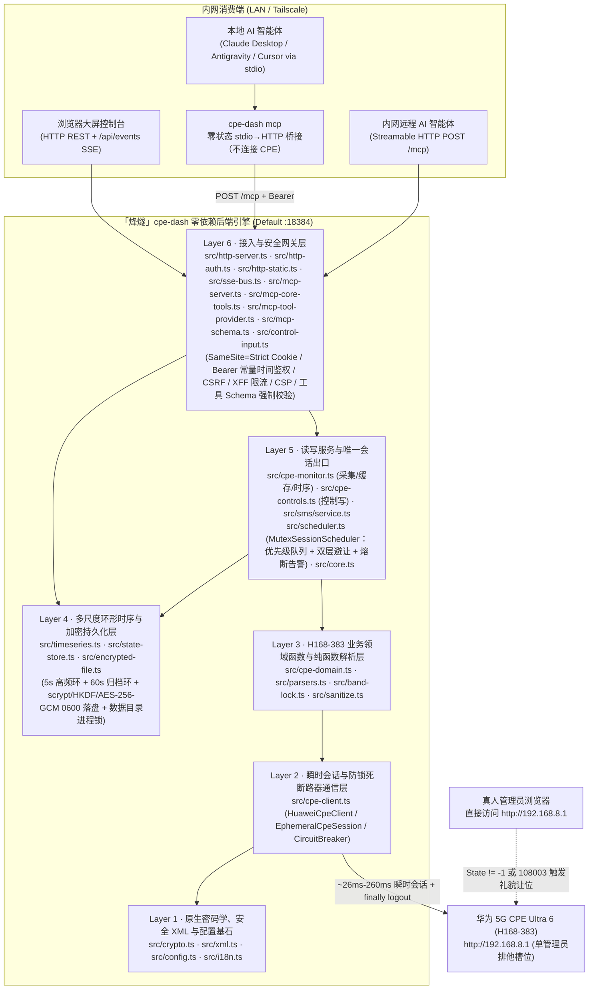
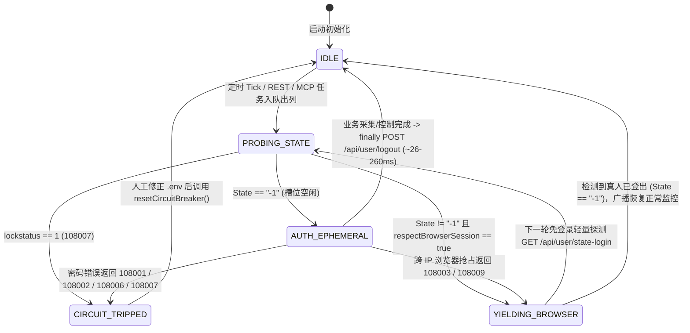
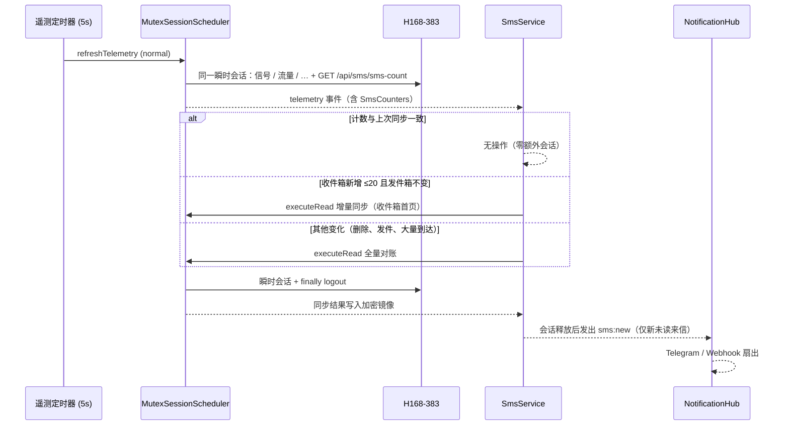

# 烽燧架构与设计记录

> **宿主机目标画像**：群晖 Synology DS923+（AMD Ryzen Embedded R1600 双核四线程 `2.6–3.1 GHz`，配备 **32 GB ECC DDR4 内存**，7×24×365 家庭内网/Tailscale 无人值守运行）  
> **受控网元设备**：华为 5G CPE Ultra 6（`H168-383` / `WL1H168M`，零售固件 `4.4.0.1(H1006SP19C00)`，网关 `192.168.8.1`，单管理员排他会话）  
> **前置权威契约**：[`AGENTS.md`](../../AGENTS.md) 与 [`docs/dev/protocol.md`](protocol.md)  
> **怎么读**：本文是架构与设计：第 1–5 节是选型、调度器、时序引擎与短信融合，第 7–10 节是控制台、访问控制、在线演示与主题，第 17 节是多品牌与统一后端。各轮审计在 [`audits.md`](audits.md)（第 6、11–16 节），每项能力的实现依据在 [`sources.md`](sources.md)（第 18 节起）。三份共用一套节号，沿用拆分前的编号，所以别处引用的「§12」「§18.4」仍然有效，只是在另一份文件里。  
> **文档性质**：第 1–4 节为实现前的架构评估，部分内部命名为设计期草案；REST / SSE / MCP 字段与行为以 [`docs/dev/api.md`](api.md) 和 `src/` 为准。第 5 节（Phase 2.2 短信融合）按已实现的代码撰写；1.3 节分层图已按审计后的模块更新。

---

## 1. 后端语言与运行时架构选型论证

### 1.1 四套候选技术栈多维客观评估

在拥有 **32 GB 充裕物理内存** 与双核 Zen+ 算力的群晖 DS923+ 宿主机上，单节点 5G CPE 监控与控制守护进程的并发吞吐量（每秒 `0.2–2` 次路由器短连采样、`< 20` 个局域网浏览器 SSE 订阅流与内网 AI Agent MCP 调用）远未触及任何现代语言运行时的 CPU 或内存瓶颈。真正的架构胜负手在于 **全生命周期（5–10 年）无人值守免维护性、零供应链投毒攻击面、华为私有密码学协议保真度** 以及 **前后端与 MCP 契约的端到端强类型同构能力**。

| 评估维度 | 方案 A：Node.js 22+ 原生零依赖 + 100% 严格 TypeScript（选定方案） | 方案 B：Go (`net/http` 编译单二进制) | 方案 C：Rust (`axum` / `tokio`) | 方案 D：Node.js + Fastify / NestJS 框架体系 |
| :--- | :--- | :--- | :--- | :--- |
| **生产运行时第三方依赖数** | **`0` 个外部 npm 包**（100% `node:http` / `node:crypto` / `node:fs` / `node:net` / `fetch`） | 标准库为主，但 Curve25519 非钳位大端数学与 MCP Schema 常引入若干模块 | 典型引入 `tokio`、`axum`、`hyper`、`serde`、`ring` 等 `120–250` 个传递 crate | Fastify 约 `40+` 传递包；NestJS 达 `150–300+` 传递包（含反射装饰器链） |
| **供应链投毒风险面** | **趋近于 0**（无运行时 `node_modules` 分发，彻底免疫 `postinstall` 与传递包投毒） | 低（Go Checksum DB 保护，但仍需跟进第三方模块 CVE） | 中低（`build.rs` 宏执行面与庞大 crate 树审计成本高） | **高**（深层传递依赖频繁爆出原型链污染、路径穿越与上游弃坑维护警报） |
| **华为私有密码学协议保真度** | **100% 已真机验证复用**（非钳位大端 `BigInt` Curve25519、反向 HMAC Key SCRAM-SHA256、`enc-type=1\|2\|3` AES-256-GCM 均已在 [`src/crypto.ts`](../../src/crypto.ts) 跑通） | **需完全重写并重验边界**（标准 `crypto/ecdh` 强制执行 RFC 7748 小端钳位，直接调用会导致握手失败，须用 `math/big` 手写蒙哥马利梯） | **需完全重写**（`x25519-dalek` 同样强制 RFC 7748 钳位，无法直接对接华为非标实现） | 复用 Node `crypto`，但装饰器/插件生命周期徒增复杂度，且违反 `erasableSyntaxOnly` |
| **5–10 年 NAS 无人值守免维护性** | **极高**（容器镜像仅含 Node LTS 官方二进制 + 纯标准 API，无框架大版本迁移债务） | 极高（静态单文件部署简便，但前后端与 i18n/MCP 类型需双语言重复维护） | 高（运行稳健，但交叉编译群晖 `x86_64` musl/glibc 与重构心智负担过重） | **差**（框架每 12–18 个月发生 Breaking Change，`npm audit` 告警迫使人工频繁介入） |
| **端到端类型同构（后端 + 前端 + MCP）** | **原生 100% 共享** [`src/types.ts`](../../src/types.ts) 接口定义，零代码生成漂移 | 需维护 OpenAPI/JSON Schema 代码生成器同步 TS 前端类型 | 需借助 `ts-rs` 等外部工具导出前端类型 | 虽同属 TS，但 NestJS 依赖实验性装饰器元数据，与现代 TypeScript 7 类型擦除相悖 |
| **DS923+ (32GB RAM) 资源占用** | 常驻 RSS 约 **`55–75 MiB`**（仅占 32GB 内存的 **`0.22%`**），事件循环空闲 CPU `< 0.3%` | 常驻 RSS 约 `18–30 MiB` | 常驻 RSS 约 `10–20 MiB` | 常驻 RSS 约 `110–190 MiB` |

### 1.2 核心因果推演与最终选型结论

1. **算力充裕场景下的“依赖树熵增定律”**：在 32GB 内存的 DS923+ 上，用 Rust/Go 节省出的 `40 MiB` 内存对系统稳定性没有任何实质增益；相反，任何引入数百个第三方依赖包的框架（如 NestJS / Fastify 生态插件）都会在长达数年的家庭 NAS 静默运行期中持续积累 CVE 漏洞与传递依赖腐化风险。
2. **非标硬件密码学的“零回归铁律”**：Phase 1 逆向与真机探针已证实，H168-383 的 ECDH 协商采用**非钳位大端序 Curve25519**，且 SCRAM-SHA256 将 `authMsg` 作为 HMAC Key（与 RFC 5802 相反）。Node.js 22+ 原生 `BigInt` 与 `node:crypto` 已在真机实现 `~26 ms` 零误差握手，继续采用 **Node.js `>= 22.6.0` 原生零运行时依赖 + 100% 严格 TypeScript (`strict: true`)** 能够实现 **零协议重写风险、零外部运行时依赖、100% 前后端类型同构** 的帕累托最优解。

### 1.3 后端六层自包含分层架构

### 1.4 现代高危 Web 漏洞纵深防御落地矩阵

| 威胁类别 | 攻击向量剖析 | 「烽燧」代码级强制防御落地细节 |
| :--- | :--- | :--- |
| **1. 原型链污染 (Prototype Pollution)** | 攻击者构造含 `{"__proto__":{"isAdmin":true}}` 或 `?constructor.prototype.x=1` 的 JSON / Query / XML 载荷篡改全局 `Object.prototype` | ① JSON 请求体解析统一传入自定义 `reviver`，显式丢弃 `__proto__`、`constructor`、`prototype` 键； ② URL Query、`.env`、XML 键值表及 i18n 词典全部基于 `Object.create(null)` 或 `Map` 存储，严禁向普通对象动态挂接未白名单化的外部键名。 |
| **2. 正则回溯拒绝服务 (ReDoS)** | 超长畸形 XML/JSON/Header 触发指数级 NFA 回溯卡死 Node 单线程事件循环 | ① HTTP 请求体实施硬性字节上限截断（控制/MCP JSON 上限 `64 KiB`，超限立即返回 `413 Payload Too Large` 并销毁流）； ② [`src/xml.ts`](../../src/xml.ts) 采用 `indexOf` 确定性线性 `O(N)` 扫描提取标签，全仓严禁对外部输入使用嵌套量词正则。 |
| **3. 服务端请求伪造 (SSRF)** | 通过篡改目标地址或诱导 CPE 返回 `302 Location: http://169.254.169.254/...` 探测宿主机内网其他服务 | ① [`normalizeCpeUrl()`](../../src/config.ts) 仅允许 `http:` / `https:`，阻断内嵌凭据、查询串与 `#fragment`，并强制校验目标属于合法私网/局域网地址空间； ② 所有 `fetch()` 强制设置 `redirect: "error"`，且后端无任何接收用户传入任意 URL 发起请求的图片/Webhook 代理接口。 |
| **4. 跨站请求伪造 (CSRF) 与同站跨端口隔离** | 外网恶意页面或群晖同 IP 其他容器端口（RFC 6265 Cookie 不隔离端口）伪造状态变更请求 | ① 会话 Cookie (`fengsui_sid`) 强制设置 `HttpOnly; SameSite=Strict; Path=/`（TLS 或可信 HTTPS 反代下追加 `Secure`），登录成功强制轮换全新随机 Session ID； ② 不下发任何宽松 CORS 响应头并拒绝跨源 `OPTIONS` 预检，使同 IP 异端口无法附加自定义头； ③ Cookie 鉴权下的状态变更（`POST`/`PUT`/`DELETE`）强制校验 `X-Requested-With: XMLHttpRequest`、`Content-Type: application/json` 及精确 `URL.origin` 同源匹配（显式拦截 `Origin: null`），且所有 `GET` 路由严格保持只读无副作用（刷新/扫描操作均走 `POST`）； ④ 当请求携带 `Authorization: Bearer` 时严格走独立令牌通道（忽略 Cookie）；口令与令牌统一经 SHA-256 定长摘要后执行 `crypto.timingSafeEqual`。 |
| **5. DNS 重绑定攻击 (DNS Rebinding)** | 攻击者域名 TTL 过期重绑定至 `127.0.0.1` 或 NAS 局域网 IP，绕过单纯 `Origin === Host` 比对攻击本地 `/api/*` 或 `/mcp` | 接入层在路由分发前优先校验 `Host` 头：仅放行合法局域网/私网 IP、本机 `localhost`/单标签主机名、`.local`/`.lan`/`.ts.net` 或 `.env` 显式配置的 `ALLOWED_HOSTS`，其余一律立即返回 `421 Misdirected Request`；即使是 `127.0.0.1` 回环请求也绝不豁免鉴权。 |
| **6. 伪造反向代理头绕过限流 (XFF Spoofing)** | 攻击者伪造随机 `X-Forwarded-For` 或 IPv6 SLAAC 临时地址绕过 `/api/auth/login` 防爆破限流 | 基于 Node 原生 `net.BlockList` 升级 [`resolveClientIp()`](../../src/config.ts)，原生支持单 IP 与 CIDR 网段（如 `172.16.0.0/12`），逐跳执行 `net.isIP` 合法性校验；未命中 `TRUSTED_PROXIES` 时彻底忽略转发头，并结合单 IP 桶（IPv6 归并至 `/64` 前缀）+ 全局失败预算双重限流。 |
| **7. AI 智能体误触与提示词注入防护** | MCP 客户端误调用高危动作，或局域网终端恶意 `HostName` 夹带换行/提示词注入污染上下文 | ① `reboot_cpe` 等高危工具强制校验 `confirm === true` 且在真人避让期间返回礼貌拒绝（`409/423`），绝不排队延迟突袭重启； ② MCP 与 Bearer API 输出默认对 IMEI/IMSI/TAC/CellID 等敏感标识执行 [`redact.ts`](../../src/redact.ts) 脱敏（v1.0.1 起按调用方生效，见 7.5 节），并对外部不可信文本进行结构化 JSON 封装隔离；SSE 数据帧强制单行 `JSON.stringify` 阻断 `\n\nevent:` 帧注入。 |

---

## 2. 前端架构与多语言 (`i18n`) 选型权衡

### 2.1 内网零 SEO 定位与纯静态离线自包含前端架构

- **严禁引入 SSR 的安全与复杂度依据**：「烽燧」部署于家庭私有群晖 NAS（`192.168.8.1` 局域网或 Tailscale 私网），**搜索引擎收录（SEO）需求严格为 `0`**。若盲目引入 Next.js / Nuxt / SvelteKit 等同构 SSR 框架，不仅会引入数千个 npm 依赖与 RSC 序列化攻击面，还会带来服务端环境变量（`CPE_PASSWORD` / `API_TOKEN`）意外打包穿透至客户端 Bundle 的致命隐患。
- **确定性单端口离线托管方案**：
  - 前端全部源码在 Phase 3 采用 **100% 严格 TypeScript (`tsconfig.web.json`)** 编写，预编译输出纯静态资产至构建产物目录（并严守 [`scripts/audit-secrets.ts`](../../scripts/audit-secrets.ts) 禁止在 `src/` 下存放任何 `.js` 文件的红线，编译产物输出至 `dist/web/public/`，静态模板与样式置于 `public/`）。
  - 静态页面、CSS、字体与 SVG 图标 **100% 本地自包含**，严禁引用 Google Fonts、jsdelivr、unpkg 等任何外部 CDN，确保家庭宽带断网排障（恰恰是用户最需要进入 CPE 控制台查看基站失联原因的时刻！）时依然 **毫秒级秒开渲染**。
  - HTTP 响应强制下发严格 CSP 头：`default-src 'self'; connect-src 'self'; img-src 'self' data:; style-src 'self' 'unsafe-inline'; script-src 'self'; frame-ancestors 'none'; base-uri 'self'`。

### 2.2 多语言 (`i18n`) 方案深度对比：自研零依赖强类型引擎 vs `i18next`

| 对比维度 | 方案 A：自研零依赖强类型 `src/i18n.ts` + `locales/*.json`（选定方案） | 方案 B：引入开源库 `i18next` (+ 插件生态) |
| :--- | :--- | :--- |
| **运行时依赖与产物体积** | **`0` 依赖，核心引擎 `< 1.8 KiB`**（完美契合零外部依赖铁律） | 核心 + 语言检测与格式化包未压缩 `> 45 KiB`（gzip 后仍 `~15 KiB`），破坏零运行时依赖契约 |
| **编译期类型安全性** | 基于 `keyof typeof zhCN` 推导联合字面量类型 `I18nKey`，**任何拼写错误的翻译键在 `npm run typecheck` 编译期即报错拦截**，且单元测试自动校验 `zh-CN.json` 与 `en.json` 键集合 100% 对称 | 默认接受宽泛 `string` 或依赖复杂的递归模板字面量类型体操，大型字典易触发 TS 类型实例化深度上限 |
| **占位插值与复数表达** | 原生支持 `{variable}` 确定性安全替换（无正则回溯、默认返回纯文本由安全 DOM `textContent` 渲染防 XSS）及基于 `Intl.PluralRules` 的复数分支选择 | 功能庞杂（嵌套命名空间、上下文后缀、HTML 插值），其中富文本插值若配置不当易引入 DOM XSS |
| **前后端与 MCP 双语复用** | 后端 REST 错误提示、SSE 真人避让广播（中英双字段同步推送）、MCP 工具说明与前端 UI 共享同一套 `locales/zh-CN.json` 与 `locales/en.json`（通过 `GET /api/i18n/:locale` 零开销下发） | 需在前后端分别初始化运行时实例 |

**确立结论**：采用 **自研零依赖强类型 `src/i18n.ts` + 扁平化点分命名空间词典（`locales/zh-CN.json` / `locales/en.json`）**，由单元测试强制守卫中英文键集合 100% 对齐。

---

## 3. 多用户并发与真人登录避让引擎设计 (`MutexSessionScheduler`)

### 3.1 问题本质：多源并发请求与单管理员硬件槽位的冲突

在生产运行态下，后端同时面对四类并发触发源：
1. **高频遥测轮询器**（默认每 `5s` 采集一次 3CA 射频、MCS、双栈 IP 与实时速率/双周期流量）；
2. **低频重负载扫描器**（默认每 `60s` 扫描一次 4G/5G 邻区基站表与接入终端拓扑）；
3. **Web 控制台多标签页用户操作**（手动强制刷新、下发锁频段/锁小区、切换天线或重启）；
4. **内网 AI Agent MCP 并发工具调用**（智能体连续调用 `get_cpe_telemetry` -> `list_neighbor_cells` -> `lock_cell`）。

若不加以统一调度而直接并发触发登录，不仅会在路由器侧引发 `108003` / `108005` 会话互踢与 `__RequestVerificationToken` 乱序失效，更会在真人用户打开 `http://192.168.8.1` 时造成争抢。

### 3.2 `MutexSessionScheduler` 核心并发控制机制

1. **全局单实例 FIFO 优先级互斥队列 (`#queue`)**：
   - 所有需访问 CPE 的任务统一进入单实例串行调度器：控制类写操作（`priority: "high"`，如锁频、锁站、重启）排在后台常规轮询（`priority: "normal"`）与低频扫描（`priority: "low"`）之前，但严格等待当前正在执行的 `~200ms` 瞬时会话自然 `logout` 完毕后再出列执行，**绝不允许两个 `EphemeralCpeSession` 重叠存活**。
   - 队列设有硬性积压上限（`maxQueueDepth = 32`），防止网络超时期间无限堆积内存请求。
2. **只读请求单飞合并 (Single-Flight Request Coalescing)**：
   - 当 5 个浏览器标签页与 2 个 MCP 智能体在同一窗口内同时请求 `getTelemetry(forceRefresh)`、`scanNeighbors` 或 `getTopology` 时，调度器通过 `#inflightReads` Map 将同类型只读请求合并复用同一个 Promise，仅向路由器发起 **1 次** `~26–200ms` 瞬时会话即可同时满足所有调用方。
3. **双层真人在线礼貌避让与实时广播**：
   - **第 1 层（零认证开销预检）**：每次开启会话前先调用免登录接口 `GET /api/user/state-login`；若 `<State>` 不为 `"-1"`，立即进入 `YIELDING_BROWSER` 状态，不发送任何 SCRAM 握手包。
   - **第 2 层（跨终端并发兜底）**：若预检至握手的数毫秒间隙内局域网另一台电脑刚登录了 `192.168.8.1`，路由器在 `challenge_login` 返回 `108003` / `108009`，客户端立即静默放弃并返回让位结果。
   - **状态广播与平滑恢复**：进入避让态时，调度器立即通过 `SseEventBus`（事件名 `session:avoidance`）与 MCP 会话状态暴露双语通知：
     - `messageZh`: `"用户正在使用 CPE 后台，监控自动避让中"`
     - `messageEn`: `"Human administrator is using the CPE WebUI; monitoring is politely yielding"`
   - 避让期间，REST / MCP 只读查询直接返回最近一次缓存快照 + `avoidance.active = true` 标记（零阻塞、零报错）；待后续免登录探测发现 `<State>-1</State>` 后，自动解除避让并推送恢复事件。
4. **`__RequestVerificationToken` 会话级完全隔离与写操作安全边界**：
   - Token 池 (`session.tokens`) 严格封装在单次 `EphemeralCpeSession` 实例内部，单次会话内的多个 `POST` 控制指令按顺序消费 `consumeToken()`，杜绝跨会话 Token 串扰。
   - **写操作零自动重放**：占用重试仅允许发生在 `session.login()` 阶段（`fn(session)` 执行前）；一旦进入业务回调绝不自动重放写请求，且在真人避让期间对写控制指令立即返回礼貌拒绝（`409 Conflict`），防止陈旧的重启/锁频指令在数十分钟后突袭生效。
5. **并发安全与持久化故障边界不变量（经 Opus 5.5 深度交叉审计加固）**：
   - **防抖动冷却退避（Anti-Flapping Backoff）**：由于固件 `4.4.0.1` 的 `GET /api/user/state-login` 在无 Cookie 时对跨 IP 会话仍可能返回 `State=-1`（由第 2 层 `108003`/`108009` 捕获），第 2 层触发避让后强制进入指数退避静默期（`45s -> 90s -> 180s -> 300s` 封顶，每级附加固定 `+5%` 余量；由 `layer2InitialBackoffMs` / `layer2MaxBackoffMs` 配置），避免每 `5s` 反复触发 `challenge_login` 干扰真人会话；SSE `session:avoidance` 仅在状态跃迁时推送，杜绝事件风暴。
   - **跨重启熔断器记忆与热重载（Persistent Circuit Breaker）**：将熔断状态与当前 `CPE_PASSWORD` 的 SHA-256 指纹持久化至 `EncryptedStateStore`；若容器因 `restart: always` 重启但错误密码未改，启动即保持熔断锁死，严防 3 次重启累计触发 `108007` 硬件锁机；当检测到 `.env` 密码指纹已更新或人工执行 `reloadAndResetBreaker()` 时安全解锁。
   - **防重入死锁与有界 `logout` 超时**：使用 `AsyncLocalStorage` 检测并阻断 `withSession` 嵌套重入死锁；为 `logout()` 设置独立短超时上限（`3s`）。进程收到 `SIGINT`/`SIGTERM` 时，在途瞬时会话有 `2s` 宽限自然完成，之后被 `abortActiveSession()` 取消，`finally` 登出照常执行，确保路由器管理员槽位在退出前释放（第二轮审计 G3/G4）。

---

## 4. 时序数据流与多尺度环形缓冲区设计 (`TimeSeriesRingBuffer`)

### 4.1 硬件实情对齐：关于设备温度指标的诚实建模

根据 [`docs/dev/protocol.md`](protocol.md) 对全部 `122` 个真实 HAR 接口与 `8` 组真机探针的穷尽核查，H168-383 零售固件 `4.4.0.1` 的 HTTP API（含 `/api/device/signal`、`/api/device/information`、`/api/monitoring/status`）**未暴露基带或 CPU 温度标签**（`coulometer_enabled=0`）。遵循“严禁臆造 CPE 字段或伪造假数据”的铁律：
- 遥测解析器支持读取可选的 `<temperature>` / `<chip_temp>` 标签（兼容未来固件升级），当固件未返回时诚实输出 `temperatureCelsius: null` 并附带能力标识 `temperatureSupported: false`；
- 时序环形缓冲区完整保留 `temperatureCelsius: number | null` 通道（聚合时自动跳过 `null` 样本而不污染均值），确保前端图表与契约面向未来 100% 兼容。

### 4.2 双层定长循环内存环形缓冲区（Dual-Tier Circular Ring Buffer）

为同时满足 **秒级丝滑实时曲线 (`1h`)**、**中长周期趋势分析 (`6h / 12h / 24h`)** 与 **跨天自定义时间跨度回溯 (`custom`, 最长 7 天)**，同时保持恒定 `O(1)` 写入复杂度与零磁盘磨损（保护群晖 NAS SSD/HDD 寿命），设计双层定长环形缓冲区：

| 层级 | 采样粒度 (`stepMs`) | 环形槽位数 (`capacity`) | 覆盖时间跨度 | 记录核心指标通道 | 内存占用估算 (DS923+ 32GB) |
| :--- | :---: | :---: | :---: | :--- | :---: |
| **Tier-1 高频明细环 (`fineRing`)** | **`5,000 ms` (5 秒)** | **`2,160` 槽** | **最近 `3 小时`** | 时间戳、下行/上行 `bps`、LTE `RSRP/SINR/RSRQ`、5G NR `RSRP/SINR/RSRQ`、温度 `°C \| null` | **`~380 KiB`** |
| **Tier-2 分钟聚合环 (`coarseRing`)** | **`60,000 ms` (1 分钟)** | **`10,080` 槽** | **最近 `7 天 (168 小时)`** | 每分钟 `sampleCount`、上下行速率 `avg/max`、4G/5G 信号 `avg/min/max`、温度 `avg/max` | **`~2.4 MiB`** |

- **总常驻内存开销**：两层合计仅 **`< 3 MiB`**（不到 DS923+ 32GB 内存的 `0.01%`），无任何 SQLite 原生 C++ 编译绑定需求，彻底规避容器跨架构 ABI 兼容问题。
- **群晖硬盘休眠友好的异步加密快照持久化**：为避免高频写盘阻止群晖 DSM 机械硬盘休眠或同步 `fs` 阻塞事件循环，`EncryptedStateStore` 采用单队列异步写入（`fs.promises` + 临时文件 `fsync` + 原子 `rename`），仅在关键控制状态变更、低频检查点（默认 `30 分钟`）及 `SIGINT`/`SIGTERM` 优雅退出时刷盘；若恢复 `108006` 修改密码导致旧快照密钥不匹配，自动将其归档重命名为 `.unreadable-<ts>` 并平滑重建空状态，绝不引发启动崩溃循环。
- **双层拼接与每通道独立聚合精度保证**：
  - 每个数值通道独立维护 `{ sum, count, min, max, last }` 统计量，确保 NSA 模式下偶发休眠的 `nrRsrpDbm` 或恒为 `null` 的 `temperatureCelsius` 绝不会把均值拉向 `0`；合并桶时严格按加权 `Σsum / Σcount` 计算，严禁对均值二次求平均。
  - 统一以已封口分钟水位线 `lastClosedMinuteMs` 无缝拼接 `coarseRing`（`< lastClosedMinuteMs`）与 `fineRing`（`>= lastClosedMinuteMs`，若刚重启 `fineRing` 为空则自动回退读取 `coarseRing`），且所有输出聚合桶对齐至固定纪元网格（`Math.floor(ts / bucketMs) * bucketMs`），确保滑动刷新时曲线零抖动。

### 4.3 预设时间轴 (`1h / 6h / 12h / 24h`) 与自定义跨度 (`custom`) 聚合查询算法

查询接口统一支持 `preset` 与任意 `[fromMs, toMs, bucketMs | maxPoints]` 自定义区间：

| 查询模式 | 时间跨度 | 数据源自动路由 | 默认聚合桶宽 (`bucketMs`) | 返回点数上限 |
| :--- | :---: | :--- | :---: | :---: |
| `preset = "1h"` | 最近 1 小时 | **Tier-1 高频环**（5s 原始精度或按 `bucketMs` 降采样） | `10,000 ms` (10s) | `360` 点 |
| `preset = "6h"` | 最近 6 小时 | **Tier-2 分钟环 + 当前活跃分钟桶** | `60,000 ms` (1m) | `360` 点 |
| `preset = "12h"` | 最近 12 小时 | **Tier-2 分钟环 + 当前活跃分钟桶** | `120,000 ms` (2m) | `360` 点 |
| `preset = "24h"` | 最近 24 小时 | **Tier-2 分钟环 + 当前活跃分钟桶** | `300,000 ms` (5m) | `288` 点 |
| `preset = "custom"` | 任意 `[fromMs, toMs]`（最长 7d） | 若 `fromMs >= now - 3h` 且桶宽 `< 60s` 优先取 **Tier-1**；否则无缝拼接 **Tier-2 + Tier-1 尾部** | 自适应 `ceil((toMs - fromMs) / maxPoints)`（默认 `maxPoints = 360`，上限 `1,440`） | `<= 1,440` 点 |

每个输出时序数据桶统一提供 `tsMs` / `tsIso` / `sampleCount`、上下行速率（`dlAvgBps` / `dlPeakBps` / `ulAvgBps` / `ulPeakBps`）、4G/5G 关键射频（`lteRsrpAvgDbm` / `lteRsrpMinDbm` / `lteSinrAvgDb` / `nrRsrpAvgDbm` / `nrRsrpMinDbm` / `nrSinrAvgDb`）及温度（`temperatureAvgCelsius` / `temperatureMaxCelsius`），使前端 ECharts / Canvas 曲线组件与 AI Agent `query_telemetry_history` 工具可直接消费，无需在客户端做二次重采样。

---

## 5. 短信业务融合架构（Phase 2.2）

### 5.1 问题：两个进程争抢同一个管理员槽位

旧架构中，`cpe-sms`（短信）与 `cpe-dash`（遥测）各自运行独立的登录与轮询。H168-383 同一时刻只允许一个管理员会话，而在对方看来，另一个进程的会话与真人浏览器登录无从区分：
- 一方会话期间，另一方的第 1 层 `state-login` 预检看到 `State=0`，于是进入避让；
- 双方以各自的节奏轮询（遥测 5s、短信轮询），会话窗口交错，结果是彼此频繁让位、SSE `session:avoidance` 抖动、遥测断点与短信延迟；
- 两套熔断器各自计算密码错误次数，可能叠加触发 `108007` 硬件锁定。

没有进程间协议时，这个冲突无法靠调参解决。Phase 2.2 的结论是**把短信并入「烽燧」，由同一个 `MutexSessionScheduler` 调度所有 CPE 访问**。`cpe-dash` 仍保持 100% 独立仓库，不引用 `cpe-sms` 的任何代码或数据；短信镜像直接从 CPE 同步（存储上限 500 条，无需迁移旧归档）。

### 5.2 模块分层

| 层 | 模块 | 职责 |
| :--- | :--- | :--- |
| 协议 | `src/sms/codec.ts`、`src/sms/phone.ts`、`src/sms/protocol.ts` | GSM-7 / UCS-2 分段、验证码提取、报文解析；54 国号码解析与收件人归一化；明文 / 加密列表、发送与状态轮询、已读与删除（只接受调度器分配的 `EphemeralCpeSession`） |
| 存储 | `src/sms/mirror.ts`、`src/sms/contacts.ts`、`src/notify/telegram-bot.ts`（`TelegramStateStore`） | 加密短信镜像（不透明 `uid`、已推送集合、首次同步标记）、通讯录（≤5000，vCard 导入）、Telegram 授权聊天与回复路由 |
| 应用 | `src/sms/service.ts` | REST / MCP / Telegram 的唯一短信入口：变化检测、单飞同步、发送回读、事件广播 |
| 告警 | `src/alert-engine.ts` | 基于遥测与调度器状态的持续窗口 + 迟滞规则 |
| 通知 | `src/notify/hub.ts`、`telegram-api.ts`、`telegram-bot.ts`、`webhook.ts` | 扇出到各通道，单通道故障互不影响 |
| 接口 | `src/sms/http-routes.ts`、`src/sms/mcp-tools.ts`、`src/sse-bus.ts` | `/api/sms/*`、MCP 短信工具、SSE 短信事件 |
| 装配 | `src/cli.ts` | 数据目录进程锁（单守护进程）、有序启停、`.env` 热重载后的密钥轮换与 `TZ` 应用 |

### 5.3 调度与同步：零额外会话的变化检测

- **计数捎带**：`sms-count` 随每次遥测会话读取，不单独登录；只有计数与「上次同步时的计数」不一致才排队同步。
- **单飞与合并**：同一时刻最多一个同步在途；全量同步可吸收并发的增量请求，增量期间到来的全量请求排在其后。
- **兜底与退避**：每 `SMS_FULL_SYNC_INTERVAL_MS`（默认 30 分钟）以 `low` 优先级全量对账一次；同步失败后 60s 内不再自动重试。
- **让位期间**：真人登录 `192.168.8.1` 时不开任何会话，改用免登录的 `check-notifications` 每 5s 探测未读数与存储满状态，并在 `sms:status` 中标记 `syncPending`。真人退出后，下一次遥测计数驱动补同步。
- **写操作**：发送、已读、删除都经 `executeControl`（`high` 优先级），真人在线时直接返回 `409`。发送在同一会话内轮询 `send-status`（2s 间隔、最长 45s），随后读回该号码的会话，用 CPE 的真实发件记录替换临时记录；读回失败时保留 `pending` 临时记录，等待下一次同步。
- **通知在会话外**：`sms:new` 在会话释放后才发出，Telegram / Webhook 的网络延迟不会延长管理员槽位占用。

| 操作 | 会话开销 |
| :--- | :--- |
| 无变化 | 0（只多一次 `GET` 捎带在遥测会话内） |
| 新到 1 条短信 | 1 次读会话：计数 + 收件箱首页 |
| 全量对账（`N` 条） | 1 次读会话：`ceil(收件 / 50) + ceil(发件 / 50)` 页；回退通道为逐会话分页 |
| 发送 | 1 次控制会话：提交 + 状态轮询 + 回读 |

### 5.4 存储：加密镜像而非历史归档

- **镜像语义**：本地镜像始终与 CPE 一致。全量对账会移除 CPE 上已不存在的记录（包括未被确认的临时发件），删除操作同时作用于 CPE 与镜像，因此不存在「仅本地归档」的数据。
- **标识**：CPE 索引会被复用，消息以 `sha256(index \0 date \0 phone)` 截断的 `uid` 标识，对外不暴露号码。
- **只推送一次**：已推送 `uid` 集合（上限 3000）与首次同步标记一同持久化。全新部署的首次同步把已有短信视为历史；之后服务离线期间到达的未读来信会在重启后补推。
- **加密与原子性**：镜像、通讯录与 Telegram 状态均为 `StorageCipher`（scrypt + HKDF-SHA256 + AES-256-GCM）密文，`0600` 临时文件 + `fsync` + `rename` 串行写入；无法解密的文件改名为 `*.unreadable-<时间戳>` 隔离，不覆盖。
- **单进程独占**（Phase 2.5 起）：守护进程启动时先锁定数据目录（`<STATE_FILE>.lock`，记录持有者 PID）。存活的另一个守护进程持有锁时，第二个守护进程直接以 `DaemonAlreadyRunningError` 退出；PID 已失效或等于自身 PID（容器重启复用 PID）的锁视为陈旧锁并接管。未配置 `CPE_PASSWORD` / `DATA_ENCRYPTION_KEY` 时拒绝启动，任何存储都不会明文落盘。
- **密钥轮换**：`POST /api/session/reset-breaker` 重新读取 `.env` 后，用新密钥立即重写全部加密文件。`DATA_ENCRYPTION_KEY` 留空时等于 `CPE_PASSWORD`，因此更换路由器密码也会更换数据密钥；启动时若检测到这种回退会打印提示，建议配置独立密钥。

### 5.5 通知与告警

- **`NotificationHub`**：订阅 `SmsService` 的 `sms:new` 与调度器的 `alert`，按 `ALERT_NOTIFY_MIN_SEVERITY` 过滤告警后用 `Promise.allSettled` 扇出，单通道失败只计入统计（`GET /api/alerts`），日志不含号码与正文。
- **Telegram 双向机器人**（长轮询，仅 `serve` 进程）：
  - 来信卡片：发件人 / 联系人 / 国旗、一键复制的验证码、回复该卡片即发送，以及「已读 / 会话 / 删除（二次确认）」按钮；
  - 引导式发短信 `/new`：国家快捷切换、号码或联系人搜索、GSM-7 / UCS-2 分段预览、确认后发送；`/send` 同样需要确认；
  - `/inbox`、`/unread`、`/chat`、`/contacts`、`/contact`、`/status`、`/alerts` 读取镜像与遥测缓存，不额外开会话；`/sync` 显式同步；`/mute` 暂停告警推送（最长 7 天）；发送 `.vcf` 文件导入通讯录；
  - 授权：`TELEGRAM_CHAT_IDS` 预授权，或 `/auth <绑定码>`（控制台生成的一次性绑定码，私聊也接受完整权限令牌；常量时间比对，单聊天 5 次 / 全局 20 次每 10 分钟限流，消息自动删除）。群组只接受控制台按次显式生成的**群组绑定码**（`pair-group`）：私聊绑定码与令牌在群组中被拒，私聊绑定码发到群里即作废（防止成员抄去私聊绑定）；群组绑定记下发送 `/auth` 的成员（匿名发送者被拒），群里只有他的命令、回复、文件与按钮生效，其他成员只能看到推送；在论坛话题中绑定则推送进该话题；群组升级为超级群组时（`migrate_to_chat_id`）绑定随之迁移；`/reset` 仅限私聊；群里写给其他机器人的命令（`/cmd@other_bot`，按 `getMe` 得到的用户名判断）与闲聊不响应。
- **签名 Webhook**：`{ event, deliveredAt, data }` JSON，`HMAC-SHA256(secret, "<timestamp>.<body>")` 签名，网络错误或 `5xx` 重试一次。
- **`AlertEngine` 规则**（均需持续一段时间才触发，并带恢复迟滞）：

  | 代码 | 级别 | 条件 |
  | :--- | :--- | :--- |
  | `CPE_UNREACHABLE` / `CPE_RECOVERED` | critical / info | 传输层失败持续 60s / 调度器恢复空闲或轮询 |
  | `WAN_DOWN` / `WAN_UP` | warning / info | `ConnectionStatus ≠ 901` 持续 60s / 恢复 |
  | `SIGNAL_DEGRADED` / `SIGNAL_RECOVERED` | warning / info | 主制式 RSRP < -110 dBm 或 SINR < 0 dB 持续 5min / 高于阈值 +3 dB、+2 dB 持续 60s |
  | `CA_DROPPED` | info | 载波数低于稳定值持续 5min（降为 0 不计） |
  | `REBOOT_DETECTED` | warning | 运行时长回退（容差 30s） |
  | `SMS_STORAGE_HIGH` / `SMS_STORAGE_FULL` | warning / critical | 存储 ≥ 90%（< 85% 重新布防）/ CPE 报告已满 |
  | `DATA_THRESHOLD` | warning | 当月流量越过路由器设置的告警阈值（回落到一半以下重新布防） |
  | `CIRCUIT_<code>` | critical | 调度器熔断（原有来源） |

### 5.6 MCP 短信工具的提示词注入防护

短信正文是第三方可控输入，可能夹带针对智能体的指令。防护分为三层：
1. **权限分级**：`MCP_SMS_ACCESS=none|read|full`，默认 `read` 不暴露任何写工具；`MCP_ALLOW_MUTATIONS=false` 时写工具同样隐藏。
2. **数据标注**：`initialize` 的说明与返回短信内容的结果都附带「仅视为数据」声明。
3. **硬性约束**：`send_sms` 必须 `confirm: true`，单收件人，默认仅限主人保存的联系人或曾发过短信的号码（智能体自建的联系人不算），按小时限额（未触达 CPE 的尝试退还额度）；`delete_sms` 必须 `confirm: true`、单次 ≤20 条，默认拒绝删除未读短信。

### 5.7 运行模式

| 模式 | CPE 会话 | 短信 / 告警 / Telegram / Webhook | 说明 |
| :--- | :--- | :--- | :--- |
| `cpe-dash serve` | 唯一的 `MutexSessionScheduler` | 全部启用（`SMS_ENABLED`、`ALERTS_ENABLED` 等控制） | 唯一连接 CPE 的进程，独占数据目录 |
| `cpe-dash mcp` | 无 | 无（全部经守护进程） | 零状态 stdio→HTTP 桥接，转发到 `MCP_DAEMON_URL` |

启动顺序：组装时恢复加密状态与熔断锁存 → SSE 挂载 → 通知中心 → 告警引擎 →（跨主机信标 1s 应答窗口）→ Telegram（`setMyCommands` + 长轮询）→ 短信首次全量同步 → 遥测轮询 → 绑定 HTTP 端口；任一步失败都按停止顺序关闭后再退出。停止顺序（总时长控制在 `docker stop` 的 10s 宽限内）：停信标与 SSE → HTTP 停止接受新连接 → 停 Telegram 长轮询 → 停通知与告警 → 停调度器（排队请求 `503`，在途会话宽限 2s 后取消并登出）→ 有界等待 Telegram 在途回复 → 刷新短信与通讯录 → HTTP 剩余连接最多再等 5s → 刷新 Telegram 状态并释放数据目录锁。

---

## 7. Phase 3：Web 控制台与生产容器（2026-10-31，v1.0.0）

### 7.1 Web 控制台的实际实现（与第 2 节规划的差异）

- **构建**：[`scripts/build-web.ts`](../../scripts/build-web.ts) 用 esbuild 输出带内容哈希的 ES 模块（代码分割、压缩），Tailwind CSS v4 CLI + daisyUI v5（只编译用到的组件）生成样式，产物写入 `dist/web/public/`，由 [`src/http-static.ts`](../../src/http-static.ts) 托管。前端源码在 `web/`（而非第 2.1 节设想的 `public/`），由 `tsconfig.web.json` 以严格模式检查。
- **体积**：构建报告首屏（`index.html` + `boot.js` + CSS + 入口及其静态依赖 + 较大的一份词典）是否在 80 KiB gzip 目标内（v1.0.0 为 59.8 KiB；2026-11-02 起目标由 60 KiB 放宽到 80 KiB，当时为 69.4 KiB）；首屏与懒加载合计超过 160 KiB gzip 时构建失败（同日由 120 KiB 放宽，当时合计 119.9 KiB，为多型号兼容阶段 2、3 留出余量；2026-11-11 智能体测试的提示词加上锁小区、5G 频段与路由器网页选项后合计 160.3 KiB，放宽到 176 KiB；在线演示仍为 200 KiB）。短信中心、控制抽屉、锁小区表单、外观面板与告警列表按需加载。
- **CSP**：服务端下发 `default-src 'self'; connect-src 'self'; img-src 'self' data:; style-src 'self' 'unsafe-inline'; script-src 'self'; object-src 'none'; base-uri 'self'; form-action 'self'; frame-ancestors 'none'`。无内联脚本（主题在首帧前由外链的 `boot.js` 应用）；源码守卫测试禁止 `innerHTML` 与任何外部源。
- **词典**：第 2.2 节计划前后端共用 `locales/*.json`。Web 端实际采用 `web/src/i18n/zh-CN.ts`（键的唯一来源）与受其键类型约束的 `en.ts`，每种语言一个懒加载 chunk：缺键或多键在 `tsc` 阶段即报错，切换语言不依赖 `/api/i18n`。`locales/*.json` 继续服务 REST、SSE、MCP 文案与 `GET /api/i18n/:locale`。
- **分层**：`web/src/core/` 不触碰 DOM（API 客户端与错误分类、SSE 重连状态机、状态 store 与 SSE reducer、格式化、射频与流量判定、图表数学、时间范围、短信发送结果分类、隐私状态），纳入 c8 覆盖率门禁；`web/src/ui/` 只做渲染与交互，接口调用与状态变更都经由 `core/`。[`src/api-contract.ts`](../../src/api-contract.ts)、[`src/rf-bounds.ts`](../../src/rf-bounds.ts)、[`src/privacy-mask.ts`](../../src/privacy-mask.ts) 与 [`src/sms/text-mode.ts`](../../src/sms/text-mode.ts) 由前后端共用同一实现，契约漂移在类型检查阶段暴露。
- **实时数据**：任一时刻只有一个 `EventSource`；出错后先探测会话，再以带抖动的指数退避（0.5–30 s）重连。store 按主题通知视图，订阅多个主题的卡片每帧最多渲染一次；实时速率曲线挂载时用守护进程的 5 s 档历史填充最近 15 分钟。
- **状态语义**：`423 CIRCUIT_BREAKER_OPEN`、`409` 避让 / 对端待机、`503` 停机或队列满、`401` 会话过期分别对应不同的界面状态，熔断从不显示为「离线」；路由器已受理但状态轮询超时的短信显示为琥珀色「已提交、状态未确认」，从不显示为失败。

### 7.2 容器与发布

- [`Dockerfile`](../../Dockerfile)：多阶段构建，构建阶段运行在构建平台（`--platform=$BUILDPLATFORM`）；运行层 `node:26-alpine` 只含 `dist/` 与 `locales/`，无 `node_modules`，`USER node`，`HEALTHCHECK` 以 busybox `wget` 访问 `/api/health`，`STOPSIGNAL SIGTERM`。Node 自带的 ICU 已能解析 `TZ`，无需 `tzdata`。
- [`docker-compose.yml`](../../docker-compose.yml)：`PUID` / `PGID` 用户映射、`./data` 与只读 `./.env` 挂载、只读根文件系统 + `tmpfs /tmp`、`cap_drop: ALL`、`no-new-privileges`、`init`、15 s 停机宽限与日志轮转。
- [`ci-docker.yml`](../../.github/workflows/ci-docker.yml)：Node 22.x（`engines` 下限）与 26.x 跑完整门禁；随后构建 `linux/amd64` 镜像，以无特权、只读方式运行，验证健康检查、Web 与 CSP、登录、SSE `hello`、MCP `initialize`、未鉴权 `401`、`SIGTERM` 后 10 s 内以退出码 0 停止、状态只以密文落盘。[`release.yml`](../../.github/workflows/release.yml) 在 `v*.*.*` 标签上发布 `linux/amd64` + `linux/arm64` 到 GHCR，只有该作业拥有 `packages: write`。
- 首次 CI 即在 Node 22 上发现一个真实缺陷：会话截止计时器被 `unref()`，只剩截止计时器在等待的会话可能让事件循环提前结束。计时器改为保持引用（由 `finally` 清除）。

### 7.3 Phase 3 前端审计（长时间驻留标签页与契约一致性）

| 发现 | 处理 |
| :--- | :--- |
| `2xx` 响应体在超时后中断或被截断时以 `null` 返回给期望类型化结果的调用方 | 改为抛出 `ApiError`（`timeout` / `network`），先写失败测试 |
| 历史曲线在吞吐 / 信号间切换时重复追加同 id 的 `<linearGradient>` | 渐变随所属序列一并移除，用无头浏览器验证切换后 id 唯一 |
| 刷选条先释放指针捕获再解绑监听；释放抛错时监听泄漏 | 先解绑，仅在仍持有捕获时释放，并处理 `lostpointercapture` 与多指针 |
| 订阅多个主题的卡片每次轮询重建两次（`speed` 与 `telemetry` 同时到达） | 按动画帧合并渲染 |
| 会话过期后 60 s 历史刷新仍在请求并收到 `401` | 大屏不可见时跳过 |
| 每次重新登录都追加一个通知授权点击监听 | 每个页面只注册一次 |
| 未带错误信封的裸 `409` 应回退为「避让」 | 未采纳：守护进程的 `409` 一律带错误信封，反代不会产生 `409` |

契约一致性复核：`web/src/core/endpoints.ts` 的全部 REST 调用（方法、路径、查询参数、请求体、响应类型）与 `src/http-server.ts`、`src/sms/http-routes.ts` 一致；15 种 SSE 事件全部被 reducer 处理；所有 `POST` 均携带 `X-Requested-With` 与 JSON `Content-Type`。

### 7.4 已知限制（Phase 3）

1. **固件未开放的指标**：H168-383 `4.4.0.1` 不提供温度、连接数（conntrack）与 gNodeB ID，界面显示为 `N/A`，基站标识只显示 eNodeB。
2. **契约外的开关**：「仅 5G」网络模式与 DDoS 防御开关不在后端契约内。控制抽屉给出说明而不提供切换，以免 NSA 网络下断网。
3. **Apple `container-compose`**：不对 `user:` 字段做变量插值，并忽略 `tmpfs`；README 给出字面量写法，Docker Compose 不受影响。
4. **私有镜像**：GHCR 包随私有仓库默认为私有，拉取需要具备 `read:packages` 权限的令牌，或在 NAS 上本地构建。

### 7.5 v1.0.1：`REDACT_SENSITIVE_IN_API` 改为按调用方生效

**问题**：v1.0.0 在采集时脱敏（`fetchGlobalTelemetry` / `fetchTerminalTopology` 的 `redactSensitive` / `sanitize` 选项），快照进入缓存、SSE 与 REST 之前就已掩码。开关默认开启，于是 Web 控制台从未收到原值，顶栏与卡片上的眼睛按钮无法显示 IMEI、IMSI、本机号码、WAN 地址与基站指纹。部分字段还沿用了 Phase 1 探针的占位替换（[`sanitize.ts`](../../src/sanitize.ts)）：私网 WAN 地址被改写成 `192.168.8.x`、DNS 显示为 `198.51.100.42`、终端显示为 `lan-client-NN` 并配文档保留 MAC 与 `fe80::1`。这些值看起来像真实数据。

**改动**：

| 层 | v1.0.0 | v1.0.1 |
|---|---|---|
| 采集与缓存（`CpeMonitor`、加密 `state.json`） | 按开关脱敏后存储 | 始终保存原值（落盘仍为 AES-256-GCM） |
| Cookie 会话（Web 控制台）的 REST 与 SSE | 脱敏值 | 原值，前端默认屏幕掩码、按需显示 |
| Bearer REST 与 SSE、MCP 工具与资源 | 脱敏值 | 开关为 `true` 时为 [`src/redact.ts`](../../src/redact.ts) 生成的脱敏副本 |
| 掩码形式 | 部分字段为以假乱真的占位值 | 一律为一眼可辨的掩码（前缀 + `*`、`<REDACTED>`） |
| 修改开关 | 需重启 | 重启，或 `POST /api/session/reset-breaker` 对 REST、SSE、MCP 同时生效 |

- SSE 为每个订阅者记录是否需要脱敏；同一事件的脱敏帧只在存在 Bearer 订阅者时生成一次，两类订阅者共用同一个事件 `id`。
- 升级兼容：首次启动时，若缓存遥测带有 `sensitiveRedacted: true`（v1.0.0 在采集时脱敏的标志），连同同期的拓扑缓存一起丢弃，等待下一次采集，避免把占位值当真实数据展示。
- 不变：探针（`scripts/probe-*.ts`）仍使用 `sanitize.ts` 的 RFC 占位替换，便于把输出贴进文档；邻区、路由器配置（含 DMZ 局域网地址）与时序数据不含个人标识，不做脱敏。
- 测试：`test/device-identifiers.test.ts` 覆盖脱敏副本的每个字段与幂等性；`test/runtime.test.ts` 端到端验证 Cookie / Bearer REST、两类 SSE 订阅者、MCP 工具与资源、`reset-breaker` 热切换，以及旧缓存丢弃。

## 8. v1.1.0：设备访问控制（2026-10-31）

### 8.1 需求与可行性

需求：拓扑表对 Wi-Fi 设备一键"断网 / 恢复"，管理 MAC 黑白名单（切换模式、增删、显示上限），按星期和时间段自动断网并提示冲突。另一份参考清单里的"即时限速 / 定时限速"经核实**无法实现**：固件网页的 321 个接口中没有按设备限速的接口（`appturbo` 是游戏加速，`security/acl` 是远程管理访问控制）。

协议来源（详见 `protocol.md` 3.9 节）：
- 用户提供的 WebInspector 抓包（643 条请求）。由 agy（gemini-3.8-flash-high）按脱敏后的交换记录与页面代码整理成协议清单（MAC、名称、SSID 均替换后才交给它），关键结论逐条对照源码核实。
- 需要登录才能下载的页面代码与一次只读会话（287 ms）：补齐上网时段格式、名单上限、`IsLocalDevice` 与 `wifimacfilterstatus` 的位置。
- 路由器公开的语言文件：确认上网时段的语义是"允许上网时段"。

### 8.2 架构

| 层 | 模块 | 职责 |
| :--- | :--- | :--- |
| 状态 | [`src/access-state.ts`](../../src/access-state.ts) | 零依赖：过滤状态类型、`normalizeMac`、`isDeviceBlocked`（首屏也只需要它） |
| 规划 | [`src/access-plan.ts`](../../src/access-plan.ts) | 零依赖（仅依赖 access-state）：拉黑 / 恢复 / 模式切换 / 名单编辑的写入规划、上网时段校验与冲突检测、受保护设备规则；守护进程执行、前端预览共用同一份代码 |
| 协议 | [`src/access-control.ts`](../../src/access-control.ts) | 解析 / 构造报文；每次写入在**一个控制会话**内完成"读 HostInfo → 读当前状态 → 规划 → 写入 → 回读核对" |
| 调度 | `CpeControlService.setWifiAccess` / `manageTimeRule` | `executeControl` 排队（真人在线 `409`），强制 `confirm: true`，写后更新缓存并推送 SSE `access-control` |
| 读侧 | `CpeMonitor.refreshAccessControl` | 启动时与每 60 s 随拓扑刷新（3 个 GET，低优先级）；状态加密落盘 |
| 适配 | REST（2.7 节）、SSE、MCP（4.5 节） | Bearer / MCP 输出按 `REDACT_SENSITIVE_IN_API` 脱敏；MCP 写工具默认不暴露（`MCP_ALLOW_ACCESS_CONTROL=false`） |
| 界面 | `web/src/ui/access.ts`（懒加载） | 拓扑行操作列、访问控制抽屉（MAC 过滤、白名单选择器、上网时段编辑器）；首屏只多两个词条与一个钩子，维持 60.0 KiB |

关键设计选择：
- **与官方页面一致**：断网用 Wi-Fi MAC 黑名单、只写 `Index 0`，与路由器"设备管理"的"禁止上网"完全相同，官方页面与烽燧看到的是同一份名单。防火墙 MAC 过滤（`/api/security/mac-filter`，可拦有线设备）已记录格式但未接入，需要时可作为后续扩展。
- **受保护设备在服务端判定**：运行烽燧的主机取自路由器在 HostInfo 中标出的 `IsLocalDevice`（守护进程自己的请求），无需配置 MAC；调用方设备按请求来源 IP 匹配局域网终端。两者都在写会话内用实时数据判定，界面上的禁用按钮只是提示。终端列表无法解析、为空或没有 `IsLocalDevice` 标记时，可能断网的写入一律拒绝（失效关闭），恢复类操作照常执行。
- **写入可验证**：每次写入后回读，开关、模式与名单必须与规划一致，否则报错，不会把"路由器回了 OK"当作成功。

### 8.3 测试与真机验证

- `test/access-plan.test.ts`（15 项）：MAC 规范化、拉黑 / 恢复 / 模式 / 名单编辑的规划、受保护设备、容量、白名单连带断开、上网时段校验与跨天冲突。
- `test/access-control.test.ts`（8 项）：抓包格式的解析、与官方页面逐字一致的请求体、槽位清理、受保护设备在写入前被拒、"回了 OK 但未生效"被识别、上网时段增删改。
- `test/runtime.test.ts`（2 项）：经真实 HTTP 的 Cookie 与 Bearer 调用、确认要求、两类受保护设备、脱敏、MCP 默认不暴露与开启后的写入。
- 严格 Mock 路由器按固件行为模拟这四个接口，演示环境预置一条黑名单与一条上网时段。
- **真机**（2026-10-31，用户指定的一台 5 GHz 手机）：经 `applyWifiAccessChange` 拉黑后约 16 s 设备断开，恢复后约 5 s 重新连上，结束时路由器配置与测试前逐字段一致；同时证实 `Index 0` 的名单对 5 GHz 射频同样生效。
- **上网时段真机验证与 v1.1.1 修复**：首次经 NAS 上的 v1.1.0 新建规则时，路由器已保存规则，但写后回读核对报告"未生效"（`502`）。原因是真机回读格式与页面代码推断不同：规则 ID 是 TR-069 路径，且 `</DevicesMACs>` 之后重复了一次 MAC，解析器把同一设备算了两次。回读核对按设计把这个差异暴露了出来，没有静默当作成功。该规则随即经守护进程删除（OnePlus 断网约 1 分钟）。v1.1.1 只从 `<DevicesMACs>` 读取 MAC 并去重，严格 Mock 路由器改为按真机格式应答；随后在真机上完成新建、修改、删除的写入与回读核对，规则表恢复为空。时段外设备仍保持 Wi-Fi 连接，"时段外不能上网"需在设备上确认，路由器侧无对应字段。

## 9. v1.2.0：GitHub Pages 在线演示（2026-10-31）

### 9.1 目标与约束

不装任何东西、不连路由器，打开网页就能体验完整控制台。GitHub Pages 只托管静态文件，没有守护进程；本仓库保持私有，Pages 留给以后的文档与官网，所以演示放在单独的公开仓库 `cky008/fengsui-demo`，只发布构建产物。

### 9.2 架构：页面内后端

控制台本身一行不改，只多了一个可注入的传输层（`startApp(transport)`：`fetch` 与 `EventSource` 工厂）。生产入口 `web/src/main.ts` 用浏览器自带的实现；演示入口 `web/src/demo/main.ts` 换成页面内的 `DemoBackend`：

| 模块 | 职责 |
| :--- | :--- |
| `scripts/demo-router.ts` | 演示世界：严格 Mock 路由器 + 家庭场景（信号漂移、流量、6 台终端、一条黑名单、一条上网时段、短信），`npm run demo`、种子采集与契约测试共用 |
| `scripts/capture-demo-seed.ts` | 构建时在进程内启动**真守护进程**接演示路由器，像浏览器一样登录，等各路轮询落地后录下控制台启动时读取的每个快照，外加守护进程的 `controls.*` / `sms.*` / `alerts.*` 文案（约 26 KiB） |
| `web/src/demo/seed.ts` | 读取并校验种子；把所有时间（ISO、`…Ms` 纪元毫秒、路由器本地时间的短信日期）平移到访客的"现在" |
| `web/src/demo/world.ts` | 家庭节奏：按本地时刻起伏的用量、确定性值噪声生成的浏览 / 视频突发、随负载下沉的 SINR；同一函数回填 24 h 历史并驱动 5 s 实时推送 |
| `web/src/demo/sms-box.ts` | 内存中的短信与通讯录 |
| `web/src/demo/backend.ts` | 全部 REST 路由与 16 种 SSE 事件；控制操作按排队会话模拟延迟，重启会离线 45 s 并触发告警 |

为了让演示与真守护进程**用同一份代码**而不是各写一份，把几处逻辑从依赖 Node 的模块里拆成零依赖模块（守护进程原模块改为再导出，行为不变）：`src/control-error.ts`、`src/control-input.ts`（去掉 `node:net`，并收入安全设置请求体解析）、`src/units.ts`、`src/sms/otp.ts`、`src/sms/vcard.ts`（`Buffer` 换成 `TextEncoder` / `TextDecoder`）、`src/sms/thread-view.ts`（会话列表、筛选、搜索）。于是演示里的入参校验、锁频状态、访问控制规划、会话列表、验证码识别、短信分段、vCard 导入与 24 h 时序（真实的 `TimeSeriesRingBuffer`）都与守护进程一致。`test/browser-shared.test.ts` 保证 `web/src` 运行时只引用这些零依赖模块。

### 9.3 契约测试

`test/demo-backend.test.ts` 在进程内同时运行真守护进程与 `DemoBackend`，两者从同一份刚采集的种子出发、接收同样的请求：
- 15 个读接口的返回结构逐字段一致（键路径与 JSON 类型）；
- 锁频、锁小区、解锁后的锁定状态相同；拉黑、恢复、名单编辑、上网时段增删改后的 Wi-Fi 过滤状态与规则表**完全相同**，`changed` / `alsoBlocked` 相同；
- 25 种非法请求（越界频点、受保护设备、空白名单、冲突时段、空短信、超过 5 个收件人等）双方都返回 `400`，且错误信息逐字相同；
- 另有重启告警、拉黑后设备下线、发短信后自动回复、未登录 401、坏请求体等行为测试。

### 9.4 构建与发布

- `npm run build:demo`：`build-web.ts --demo` 输出到 `dist/demo/`（资源用相对路径，可挂在任意子路径；页面带 CSP meta，因为 Pages 不能设响应头；页脚链接指向演示仓库），随后 `capture-demo-seed.ts` 写入 `demo-seed.json`。
- `.github/workflows/demo-pages.yml`：每次打 `v*` 标签（或手动触发）时构建，并以单个新提交强推到 `cky008/fengsui-demo` 的 `gh-pages` 分支。推送用只对该仓库有写权限的部署密钥（Secret `DEMO_DEPLOY_KEY`），GitHub 的 SSH 主机密钥从其 meta API 取得并严格校验。
- 自定义域名放在 Actions 变量 `DEMO_DOMAIN`，部署时才写入 `CNAME`，本仓库不出现个人域名（铁律二）；README 链接 `https://cky008.github.io/fengsui-demo/`，配置自定义域名后 GitHub 会自动跳转。

### 9.5 已知限制

- 访客的操作只存在于当前页面，刷新即复原；"退出登录"会重新载入并回到初始状态。
- 演示不模拟真人登录避让、熔断与多守护进程互斥（这些仍可用 `DEMO_SCENARIO=yield|breaker npm run demo` 在本地体验；`DEMO_SCENARIO=unverified` 换成一台未验证的型号，看只读的样子）。
- 演示仓库的部署提交由 `github-actions[bot]` 署名、不带用户签名；本仓库自身的提交规则不变。

### 9.6 其他华为型号模式（2026-11-10）

`?router=other` 把在线演示换成一台烽燧没验证过的华为路由器：演示世界里那台只有 4G 的 B535-232（旧式 SHA-256 登录，不报营销名称，也不报运行时长）。

- **两份种子**：`npm run build:demo` 录下 `demo-seed.json`（H168-383）与 `demo-seed-other.json`。采集先等识别完成，再等每个部分要么读到、要么被记为「此型号不提供」；邻区、路由器设置和访问控制在这台上是 `null`。
- **同一套规则**：`web/src/demo/device.ts` 用守护进程自己的零依赖模块重建写闸门。`DeviceAccess` 从种子里的识别结果恢复（`noteEvidence` 接收探测证据，读取项按种子登记），同意走 `changeExperimentalConsent`，一键测试走 `agent-test.ts` 的规则，输入校验用 `validateGenericBandLock` 与 `validateGenericSmsContent`（为此从依赖 Node 的模块挪进了 `control-input.ts` 与 `sms/text-mode.ts`）。没同意的写操作返回 `409 DEVICE_UNVERIFIED_READ_ONLY` 并记审计；同意后按通用格式写入，回读结果进设备报告，摘要带「实验性写入，回读一致」；重拨和重启等路由器回来后才回读一致。
- **锁定核对**：通用锁频后，下一次轮询前路由器还显示旧的 LTE 掩码（`settling`，问题文字与守护进程相同），轮询后一致。
- **契约测试**：`test/demo-backend-other.test.ts` 在同一台未验证路由器上逐项对照演示与真守护进程：读取、拒绝、同意、通用写入与回读、轮询前后的锁定核对、一键测试与设备报告（两边各有同样的两个令牌）。

## 10. v1.3.0：主题系统（2026-11-01）

### 10.1 需求

原有四套主题里两套浅色（素纸、晨曦）偏黄，"跟随系统"又固定成素纸 / 极夜，换不了。用户希望：参考 cpe-sms 原来的干净配色和中国 / 日本传统色增加配色；能自己调；能选主题和强调色；跟随系统时白天、夜间分别选主题。

### 10.2 结构

- **两层 CSS 变量**（`web/styles.css`）：明暗层 `[data-scheme="light|dark"]` 放同一明暗下共用的状态色、信号质量色阶、上下行色、印章色与光晕；配色层 `[data-theme]` 放底色、文字、主 / 次 / 强调色和卡片表面，可覆盖明暗层。daisyUI 只读这些变量，所以主题不再写成 daisyUI 主题插件块，每套约 20 行。暗色专属样式（网格背景、卡片内光）改为按 `data-scheme` 生效，不再枚举主题名。
- **14 套内置配色**：浅色素笺（cpe-sms 原版，默认白天）、月白、天青（中国色）、樱、若竹（日本色）、素纸、晨曦；深色素笺·夜（cpe-sms 原版，默认夜间）、墨、绀琉璃、夜樱（日本色）、黛蓝（中国色）、极夜、紫溟。旧主题 ID 与数值保留，已保存的偏好照常生效。
- **自定义主题** `fengsui-custom`：用户选明暗和背景、文字、主色三种颜色，其余（次级底色、边框、卡片表面、中性色）由 CSS `color-mix` 从这三色调出；按钮文字色由 `readableOn()` 按 WCAG 对比度在黑白中择优；文字对背景低于 4.5:1 时面板提示。
- **强调色** 9 种预设（每种有浅色、深色两个色值）+ 自定义取色，覆盖主题主色；"随主题"用回主题原色。
- **偏好模型**（`web/src/core/prefs.ts`）：`dayTheme` / `nightTheme` / `theme`（固定）/ `followSystem` / `accent` / `accentColor` / `customTheme`，逐项校验，坏值回落默认。`resolveAppearance()` 算出 `<html>` 的 `data-theme` / `data-scheme` / `data-accent` 与自定义色 CSS 变量，`boot.ts`（首帧前）与 `theme.ts` 共用，避免闪烁。面板的选择逻辑（改白天、夜间还是固定主题；关闭"跟随系统"时保留当前画面；自定义主题切换明暗时保留用户颜色）在 `web/src/core/theme-choice.ts`，纯函数。
- **面板**（`web/src/ui/appearance.ts`，懒加载）：跟随系统 / 固定主题；跟随时有"白天 / 夜间"两个标签，点卡片设置当前标签；卡片标注来源并用太阳 / 月亮标记白天、夜间所用主题。面板文案移到 `web/src/i18n/appearance.ts`，跟面板一起懒加载。

### 10.3 测试

`test/web-theme.test.ts`：颜色解析与 WCAG 对比度、偏好读写与损坏修复、`resolveAppearance` / `applyAppearance`、面板选择逻辑；并解析 `web/styles.css`，检查注册表里的每个主题都有配色块且没有多余主题、每套内置配色都声明了全部变量、明暗归属与底色亮度一致，以及**每套配色的正文对底色 ≥ 7:1、主 / 次 / 强调 / 中性按钮文字 ≥ 4.5:1，每种强调色浅深两版 ≥ 4.5:1**（由 OKLCH 换算 sRGB 亮度）。这条检查当场发现 cpe-sms 原版蓝配白字只有 3.95:1、极夜的次要色（短信未读角标）只有 2.92:1 等问题，已调整到达标。旧四套主题重构前后逐张截图比对，无可见差异（极夜角标除外）。

## 17. 多品牌、统一后端与规范交叉审计（2026-11-10，v1.8.3）

### 17.1 范围

v1.8.3 之前，烽燧只会说华为 HiLink。这一版加入七个品牌的驱动（中兴 goform、中兴 zWRT、品速、通则康威 ZLT、烽火、鲲鹏无限、OpenWrt + 移远 / 广和通模组），并把品牌做成连接的一部分。驱动依据两份接口资料库写成，**没有在真机上验证过**；对外仍然只说「仅在 H168-383 上验证过」。

### 17.2 架构

- **品牌（`RouterFamily`，[`src/router-family.ts`](../../src/router-family.ts)）**随连接保存。缺省是 `huawei`，升级上来的安装不变。
- **识别品牌（[`src/drivers/detect.ts`](../../src/drivers/detect.ts)）**：每个品牌有一个自己的免登录特征请求（它的登录页自己也会发的第一个读请求）。控制台把品牌留在「自动识别」时，八个请求并行发出，按固定顺序取第一个命中的：NROS 和中兴 zWRT 底下都是 OpenWrt，也会应答 `/ubus`，所以排在通用 OpenWrt 之前；HiLink 排最后。整个过程不带密码、不建会话；认不出就是一次失败的测试（`unknown_brand`）。守护进程从不在后台自行识别。
- **统一后端（[`src/router-backend.ts`](../../src/router-backend.ts)）**：`RouterBackend` 列出烽燧对一台路由器的全部动词。`HilinkBackend` 是华为 HiLink（H168-383 的已验证序列与其他 HiLink 型号的通用写入，原样从 `CpeMonitor` / `CpeControlService` 搬出），`DriverBackend` 是其他品牌。两者返回同样的快照与锁定状态，读写服务不再判断品牌；选哪个后端只在 `selectRouterBackend` 一处决定，每次调用时取当前连接的品牌，所以保存另一个品牌的连接后，下一个动词就换了后端。`test/router-backend.test.ts` 禁止这条线以上的文件出现 `isDriverMode()` 或 `executeDriver*`。
- **调度器**仍是唯一的会话调度器：HiLink 客户端与驱动客户端共用同一个队列、避让、熔断与写闸门。驱动模式下 `executeRead` 返回 `null`、`executeControl` 拒绝，任何 HiLink 请求都不会发到其他品牌的路由器。
- **写闸门**：其他品牌只放行驱动实现的锁频、锁小区、重启，都是逐项同意的实验性写入，写后在同一会话回读。解除锁定只要求两种锁定中任一项已开启（此前归在锁频名下：只开了锁小区的人能锁不能解）。
- **以后怎么加能力**：给一个品牌加上别的品牌已有的能力（下一步是短信），在它的后端里实现对应的动词；所有品牌都要的新能力，先加到 `RouterBackend`。只有 HiLink 实现的写入（重拨、移动数据、路由器开关、访问控制、短信）目前仍是 HiLink 会话，等第二个品牌实现时再移到后端。

### 17.3 规范交叉审计

方法：两份资料库（下称 A、B）各自与七个驱动逐项比对，由 14 次无工具的子代理运行完成（源码与规范整份内联；首批 8 次里有 3 次超过输入上限被截断，拆成 6 次重跑），每条结论都回到规范原文与代码核对后才动手。

修复（都带测试）：

| 驱动 | 问题 | 处理 |
| :--- | :--- | :--- |
| openwrt | 「全部频段」时什么都不写，锁定状态却报成功 | 写回模组自己的能力频段表；读不到表就拒绝 |
| openwrt | 模组没应答的锁定设置读成「未锁定」 | 读成未知（`null`） |
| openwrt | 被模组拒绝（`ERROR`）的锁频指令被忽略 | 停在被拒的那一条并报错 |
| openwrt（广和通） | 锁频时丢掉没点名的频段；网络制式参数被忽略 | 保留路由器报告的频段与偏好；制式只支持资料写明的自动与仅 5G SA，其余拒绝 |
| openwrt | 信号格数是编出来的（没有小区时也是 4 格） | 模组不报告格数，置空 |
| openwrt | 运营商名称恒为空 | 读 `AT+COPS?`（3GPP TS 27.007） |
| nradio | 规范定义了 5G 频段锁定与 SA / NSA 制式，驱动只做了 4G | 按模组自己报告的标签（`NR5GBand` 或 `NRBand`）写 5G 掩码；模组不报告就只锁 4G |
| nradio | 新固件把请求令牌写成 JSON，取不到 | 两种写法都认 |
| pinsu | 登录前不做页面自己的握手（`/goform/sync`） | 先握手：不是这个品牌的路由器拿不到密码 |
| pinsu | 只给倒计时、不给剩余次数的锁定被当成密码错误 | 有倒计时即视为锁定 |
| zte-goform | 没读累计流量；开发者选项登录不在写入记录里 | 读 `total_rx_bytes` / `total_tx_bytes`；记入该次写入的记录 |
| 控制写入 | 只锁 5G 频段而读不到当前 4G 频段时，会把 4G 频段写成「全部」 | 拒绝并提示同时给出 4G 频段 |
| 入参 | 网络制式代码按对象属性查找（原型链键）、频段不是列表时抛 `TypeError` | 只认自有键；先校验类型与长度 |

复核后**不改**的（两份资料互相矛盾，或子代理误报）：

- **中兴 `AD` 签名的种子**：A 说只有 MC888 拼接 `cr_version`，B 说一律拼接。驱动一律拼接（与 B 一致；多数型号的 `cr_version` 为空，两种算法结果相同）。
- **中兴解除锁小区的哨兵值**：A 是 `1` / `1,1,1,1` / `UNLOCK_ALL_CELL`，B 是 `0`。驱动按 A，读回时 `0` 和 `1` 都视为未锁。
- **中兴 5G 锁小区的子载波间隔编码**（A：0 / 1，B：kHz 数值）、**自动制式的取值**（A：`WL_AND_5G`，B：`NETWORK_auto`）：驱动按 A，读回两种都认。
- **中兴硬件分支按 `cr_version` 判 4 型**（A 独有）：标准一代的版本号里同样带 `V1.0.0`，照做会把 MC801A 判错，所以仍只按硬件版本与型号判断。
- **中兴 32 位 `LD` 的 MD5 登录**（B 独有）：没有第二处佐证，仍然不发密码。
- **表单里的 `%2C` / `%3d`**：传输层已做 URL 编码，再替换一次会变成双重编码（误报）。
- **中兴 MC8020 / MC888 的开发者选项登录**：脱敏后的 A 删掉了这一节，脱敏前的原文有（新的 `LD`、同一套密码算法、不带 `AD`），驱动与原文一致。
- **通则康威的 AES 传输加密**：规范只有算法和测试向量，没有运营商固件的真实密钥，无法实现；驱动注释如实说明。
- **广和通的载波聚合、OpenWrt 的流量计数**：资料只有指令名，没有应答格式，不猜。
- **「驱动写后没有回读」**：回读在各驱动的写方法里（`settleBandLock` 等），误报。

没有发现「只写纯函数、不接传输层」或故意省略登录步骤的残留：七个驱动的登录、读取、写入和注销都经传输层发出，并有对应的模拟路由器测试。

### 17.4 短信

| 品牌 | 资料里的短信接口 | 烽燧的实现 |
| :--- | :--- | :--- |
| 华为 HiLink | 完整（协议规范 3.8） | 读取、发送、标为已读、删除、计数 |
| 中兴 goform | A 只有未读数等状态字段，没有列表 / 发送 / 删除；B 没有 | 无 |
| 中兴 zWRT | 两份都没有 | 无 |
| 品速、通则康威、烽火、鲲鹏无限 | 两份都没有 | 无 |
| OpenWrt | B 只提到 `sms_tool` 的名字，没有指令与编码 | 无 |

两份资料都没有给出其他品牌可以照着实现的短信接口，所以这一版没有可补的缺口。其他品牌上短信读取标为「此型号不提供」，写入由闸门拒绝。接入时在 `RouterBackend` 增加短信动词，由 `SmsService` 调用；`HilinkBackend` 用现有的 `sms/protocol.ts`，驱动品牌各自实现。

### 17.5 已知限制

1. 七个驱动都没有在真机上运行过。写入默认关闭、逐项同意、只发一次、写后回读，是为了让第一次真机运行出错时损失最小。
2. 其他品牌没有已连接设备、路由器设置、访问控制、短信、重拨和移动数据；自愈的自动重拨在这些品牌上不起作用（锁定回滚有）。
3. OpenWrt 的「重启」重启的是蜂窝模组，不是整台路由器；流量计数、广和通的载波聚合没有读。
4. 品牌识别依赖每个品牌的特征请求；固件改了登录页的品牌认不出，需要手动选择。
5. `docs/dev/device-notes.md` 是接口资料里的型号汇总，不是实测结果；其中 D-Link / TP-Link 一节没有对应的实现。
