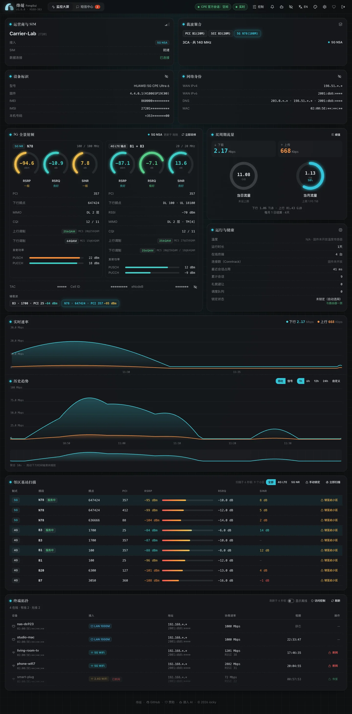

After logging in to the console, you see the dashboard. Data refreshes every 5 seconds. When querying the router, FengSui logs in for only tens to hundreds of milliseconds each time and logs out immediately, so you can log in to the router's own web page at any time.

## Header

- **Carrier and SIM**: Carrier name, SIM status, and connection mode (4G, 5G NSA, 5G SA).
- **Device identifiers**: IMEI, IMSI, and phone number are masked by default. Click the eye icon to reveal raw values for easy screenshots.
- **Session status**: "idle" means everything is normal; "Human admin online · yielding" means someone logged in to the router's own web page and FengSui is waiting; "Anti-lockout breaker tripped" means the router password is incorrect and you need to correct it under "Settings → Router".
- **Alert bell**: Recent alerts.

## Signals and carriers

The **Carrier aggregation** section lists each carrier the router is actively using simultaneously, such as `PCC B1(20M) + SCC B3(20M) + 5G N78(100M)`: PCC is the primary carrier, SCC is a secondary carrier. Greater combined bandwidth allows higher maximum speeds.

The **RF cards** are displayed separately for 4G and 5G:

| Metric | What it is | How to read it |
| :--- | :--- | :--- |
| RSRP | Reference signal received power | Closer to 0 is stronger: -80 dBm is excellent, below -110 dBm is weak |
| RSRQ | Reference signal received quality | Closer to 0 is better |
| SINR | Signal-to-interference-plus-noise ratio | Higher is better: above 20 dB is excellent, below 0 dB is very poor |
| PCI / Frequency | Cell identifier and frequency | Used when locking cells |
| Modulation | e.g., 256QAM | Higher indicates a cleaner signal |
| Transmit power | PUSCH / PUCCH | Higher means the router is working harder to transmit to the tower |

Ring colors indicate quality levels. Cell identifiers (TAC, Cell ID, eNodeB) are masked by default.

## Neighbor cells

The **Neighbor cells** table lists surrounding cells the router can detect, sorted by signal strength. Each row offers "Lock to this cell"; see [Band and cell locking](locking.md). The table scans every minute, or you can click "Scan now" manually.

## Traffic

- **Real-time rates**: Uplink and downlink throughput curves.
- **Daily / Monthly usage**: Two circular gauges. Click "Caps" to configure a monthly data limit, which changes color and triggers alerts when exceeded; the billing reset day follows the router's setting.

## Historical charts

View throughput and signals for the past 1, 6, 12, 24 hours, or a custom time range. Drag the brush slider at the bottom to zoom into a specific period. High-frequency data (one point every 5 seconds) is kept for 3 hours, then aggregated by minute, retained for 7 days total.

## Devices

The **Device topology** lists devices connected to the router: name, wired or Wi-Fi (2.4G / 5G), IP address, negotiated rate, and DHCP lease duration. Wi-Fi devices have "Block / Restore" buttons next to them; for more management, see [Device and access management](devices.md).

## Appearance

The top-right corner allows switching between Chinese / English and themes. FengSui includes 14 themes (7 light, 7 dark). When set to follow the system, you can select distinct themes for day and night, or create a custom palette using three colors. Preferences are stored only in your browser.
