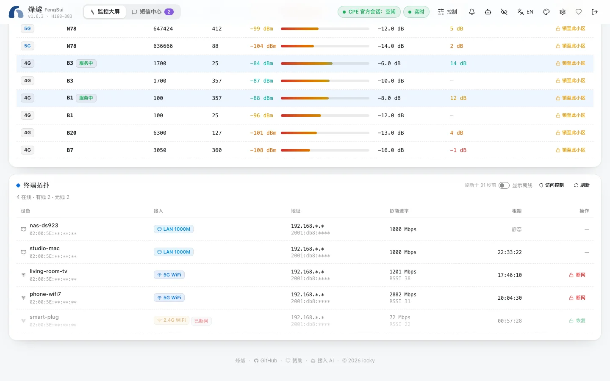

FengSui uses the router's built-in Wi-Fi MAC filtering and parental control features, which share the same lists as "Device Management" on the router's own web page, so changes made on either side are visible on both.

## View devices

The **Device topology** at the bottom of the dashboard lists all devices connected to the router:

- Wired (`LAN 1000M`) or Wi-Fi (2.4G / 5G);
- IPv4 and IPv6 addresses, negotiated rate, and Wi-Fi signal;
- Remaining DHCP lease time.

Turn on "Show offline" to see devices that are currently offline.

## Block a device from the internet

Clicking "Block" next to a Wi-Fi device adds it to the router's Wi-Fi blocklist, disconnecting the device immediately. Blocked devices remain in the list; click "Restore" to reconnect them.

> [!NOTE]
> Currently, you can only block Wi-Fi devices. For wired devices, manage them in the firewall on the router's own web page. The router firmware provides no interface for per-device rate limiting, so FengSui does not offer rate limiting.

## Blocklists and allowlists

The "Access control" drawer lets you switch Wi-Fi MAC filtering modes:

- **Disabled**: All devices can connect.
- **Blocklist**: Devices on the list cannot connect.
- **Allowlist**: Only devices on the list can connect. Use the checkboxes to select permitted devices before turning this on.

The router stores up to 64 entries; the drawer shows how many are currently in use.

## Internet access schedules

You can set allowed internet access times by device: select days of the week and 15-minute time slots, which can cross midnight (for example, 22:00 to 07:00 the next day). If time slots for the same device overlap, FengSui highlights the conflict directly.

## How it avoids locking you out

Every modification executes within a single login session: "read devices → read current list → plan changes → write → read back to verify". Two devices will never be blocked:

- **The machine running FengSui** (the router identifies the device making the request);
- **The device you are currently using**.

If a planned change would disconnect either of them, FengSui rejects the operation and explains why.
