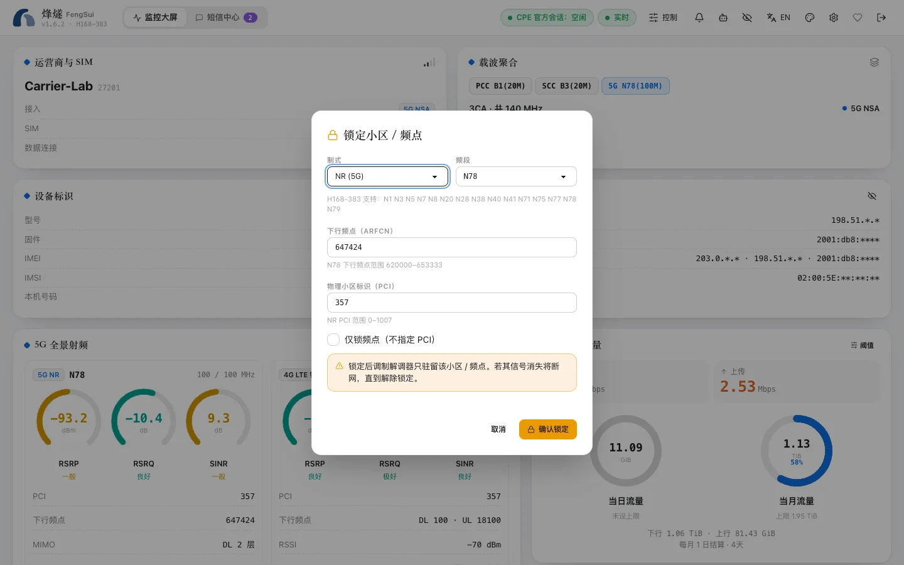

Band locking and cell locking restrict the router to only using your selected bands or cell. Done right, this can yield a more stable and faster connection; locked incorrectly, the router may lose internet access entirely. FengSui helps you avoid the latter at every step.

> [!WARNING]
> Locking changes how the router connects to the carrier network. Operate only on networks and bands you are authorized to use, and comply with local regulations and carrier terms.

## Lock bands

1. Open the "Controls" drawer in the top-right corner.
2. Check the bands you want to keep under 4G (LTE) and 5G (NR). You can select only bands supported by this router.
3. Click "Lock". The confirmation dialog lists the changes and explains whether automatic rollback will trigger if internet access drops after locking.

Band locking applies to both 5G SA and NSA. To restore normal operation, click "Unlock" to return to "All bands".

## Lock cells

Cell locking fixes the router to a specific base station sector (identified by band, frequency, and PCI).

1. Find a cell with good signal in the **Neighbor cells** table on the dashboard and click "Lock to this cell", or fill in the details manually in the Controls drawer.
2. FengSui allows locking only to **already observed** cells: the current serving cell, aggregated carriers, or cells detected in the most recent neighbor cell scan. This prevents losing connection from typing incorrect numbers.
3. You can also check "Frequency only (no PCI)" to lock only the frequency.

## What to do if you lose connection after locking

There are three options, ordered from fastest to slowest:

1. **Automatic rollback** (recommended to configure in advance): Set `LOCK_ROLLBACK_AFTER_MIN` in `.env`, such as `10`. After locking, the WAN connection must recover within 10 minutes and stay online continuously for 2 minutes; if it fails, FengSui automatically clears all locks and raises a `LOCK_ROLLED_BACK` alert.
2. **Click "Unlock" in the console**: FengSui accesses the router over the local network and does not depend on internet access, so you can still unlock when disconnected.
3. **Go to the router's own web page** (usually `http://192.168.8.1`) to restore all bands, or restart the router.

## WAN auto-reconnect

For disconnects unrelated to locking (such as carrier-side outages), you can let FengSui reconnect automatically. Set `WAN_AUTO_RECONNECT_AFTER_MIN` in `.env`, such as `3`: FengSui reconnects once after WAN has been down for 3 minutes, then retries at intervals of 10, 30, and 60 minutes, up to 4 times within 24 hours. FengSui **never** restarts the router automatically.

Both features are disabled by default because they modify the router when unattended. When enabled, the "WAN self-healing" section in the Controls drawer shows:

- Whether both features are enabled;
- When an observed lock will expire and since when WAN has recovered;
- How many reconnects were used in the past 24 hours, and the earliest time for the next attempt.

Self-healing relies strictly on the latest signal data. Before writing changes, it re-verifies the WAN status and mobile data switch in the same session: if WAN has already recovered, or if you manually turned off mobile data, it takes no action. If someone logs in to the router's own web page, it waits as well.

## When lock state differs

FengSui remembers the locks it applied and checks them against the router's actual state during every read. If someone changes locking from the router's own web page, the health card on the dashboard displays "differs from router" and triggers a lock drift alert. Lock again or unlock to re-align.
