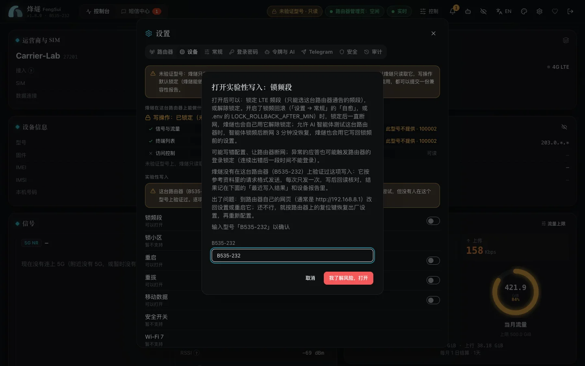

**FengSui is verified on the H168-383 (firmware 4.4.0.1) only.** Other Huawei HiLink / EMUI routers generally connect as well, but no one has verified them, so writes to them are locked by default: FengSui reads metrics only and does not change router settings. This page covers how FengSui works on those models; which models may work, and where each feature stands on each, is under [Supported devices](supported-devices.md).

## How FengSui detects your router

After startup, and whenever you test or save a connection in "Settings → Router", FengSui reads the model, authentication scheme, and supported features once (read-only, without altering settings). The results appear in "Settings → Device".

FengSui determines the authentication scheme before sending credentials (SCRAM for newer models, SHA-256 or Base64 for legacy models). It never retries the same password with alternative schemes, avoiding accidental consumption of router login attempts.

## What read-only means

- What you can see: Signal metrics, data usage, connected devices, and SMS messages reported by the router. Items that the router does not provide or that FengSui cannot parse are labeled "Not on this model", leaving other metrics unaffected. Models without 5G do not display 5G values.
- What is blocked: All write operations. The web interface, API, MCP, Telegram, and self-healing cannot bypass this barrier. The router receives no write requests, and endpoints return `409 DEVICE_UNVERIFIED_READ_ONLY`. The header displays "Unverified model · read-only".

## Experimental writes (risky, disabled by default)

For operations with dependable protocol documentation, FengSui provides generic implementations that you can enable individually:

- Band locking (4G only, using bands reported by the router)
- Reboot
- Reconnect
- Mobile data switch
- SMS (send, mark as read, delete)

Cell locking, security switches, Wi-Fi 7, antenna selection, and access control are not supported yet.

**How to enable**: Go to "Settings → Device" under "Experimental writes" to enable eligible items. Before enabling an item, a dialog explains which operations will be permitted and details the risks (writing incorrect configurations, losing internet connectivity, or triggering router login lockouts from unexpected responses). You must type the router model to confirm. Consent applies only to this specific model; switching to another router invalidates all prior consents automatically. Every activation and deactivation is recorded in the audit log.

**After enabling**: Only that specific feature is unlocked. Each write is sent once without retries, followed immediately by a read-back check that displays "read back: matches" or "differs". A mismatch raises a `WRITE_READBACK_MISMATCH` alert.

**If issues occur**: Open the router's own web page (typically `http://192.168.8.1`) to revert settings or restart, and use the physical reset button to restore factory settings if necessary.

## Report compatibility

Your feedback helps verify more router models:

1. Under "Settings → Device", click "Create device report", review the contents, and copy or download the JSON.
2. Click "Report on GitHub", open a new issue, paste the report, and note which features work and which do not.

The report contains only API structures and safe metadata (model, firmware, web interface version, feature toggles, and band numbers). It excludes IMEI, IMSI, MAC addresses, IP addresses, phone numbers, cell identifiers, and Wi-Fi network names. FengSui never uploads anything automatically.

Once someone confirms and reports that a feature works on physical hardware, maintainers add it to `VERIFIED_FEATURES` in the codebase. Its mark under [Supported devices](supported-devices.md) turns into ○, and that feature no longer requires individual consent on that model.

## Test with an AI agent

An AI agent connected to FengSui (Claude Code, Codex and the like) can run the tests for you:

1. Under Settings → Device, choose "Copy prompt and start test". FengSui first lists the settings the test turns on; confirm once, and it turns them all on and copies the prompt:
   - "Let AI agents test this router" and "Let agents change the router";
   - the experimental writes for band lock, redial and reboot (those this router offers);
   - the "Change the router" permission for the agent's token: FengSui picks the token that last connected to it, and you can pick another one or none;
   - SMS (ticked in the confirmation; you can untick it): the experimental SMS write, the agents' SMS access set to read and write and their sending to any number (the hourly limit still applies), and the SMS permissions for the token. The agent sends one test SMS to a number you give it (your plan charges for it); once you reply from your phone, it marks the reply read and deletes both.
2. Give the prompt to the agent. If the agent is already running, have it reconnect to FengSui first (in Claude Code: `/mcp`), so it sees the new tools.
3. The agent tests every read first; it asks you before each write test.
4. It also uses `probe_router_endpoints` to find, on this router, the endpoints FengSui does not use yet: only `GET`s, inside FengSui's own session, with results that hold structure and never a value.
5. Finally it gives you a desensitized report and the issue link, for you to check and post yourself.
6. When the test is done, you may keep whatever passed: those features work on your router. To undo the test, or if something failed, choose "End test" under Settings → Device: FengSui puts back only what the test turned on and you have not changed since.

While something the test turned on is still on, FengSui reminds you 3 hours after the agent's last test step (`AGENT_TEST_STILL_ON`: in the console's alerts, on Telegram if it is set up, and as a system notification when the console is open in a background browser tab that may show notifications), then once a day. The reminders stop as soon as one of these happens: the test's writes all read back as a match (those features work on your router, so you may keep them); you have seen the reminder in the console's alerts or chosen "Got it" in Telegram; you end the test.

After an agent locks bands, if the WAN stays down 3 minutes, FengSui writes back the band setting from before the lock. The agent never logs in to the router itself: every request goes through FengSui, which still steps aside when someone logs in to the router's web page.

## Try it first

No install needed: the [live demo's other-model mode](https://cky008.github.io/fengsui-demo/?router=other) simulates a Huawei router FengSui was not verified on (4G only). You can try the read-only mode, consents, experimental writes, the device report and the one-click AI agent test there; every value is fictional, and a reload resets it.

On your own computer, `DEMO_SCENARIO=unverified npm run demo` runs the real daemon against the same simulated router (4G only, legacy login), so you can go through the read-only mode, consents, writes and the report in full.

## Acknowledgments

Thanks to [Salamek/huawei-lte-api](https://github.com/Salamek/huawei-lte-api): when building compatibility for other Huawei models, FengSui referenced its API and model research. FengSui does not contain its code or depend on it.
