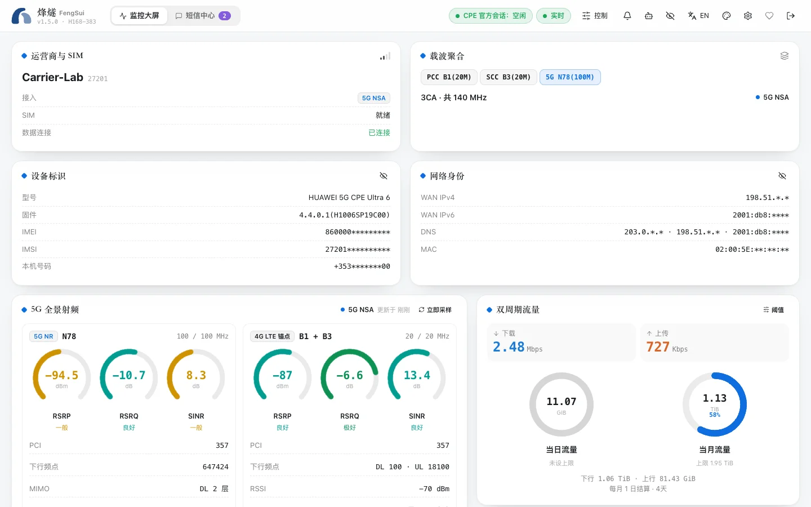

FengSui (repository name `cpe-dash`) is a web console that runs on your home NAS or computer to monitor and manage Huawei 5G routers (CPEs).

It brings scattered information from the router's own web page onto a single dashboard, adding features the router's own web page lacks: historical charts, alerts, Telegram notifications, threaded SMS views, and interfaces for AI agents.

## What it can do

- **Monitor signals**: RSRP, SINR, modulation, transmit power, and the band and bandwidth of each 4G / 5G carrier, refreshing every 5 seconds, with 7 days of history.
- **Lock bands and cells**: Fix the router to specific bands or a specific cell. Preview before locking; if you lose connection after locking, you can set it to unlock automatically a few minutes later.
- **Send and receive SMS**: Threaded view, one-click verification code copying, and contacts. Messages are stored encrypted on your hard drive.
- **Manage devices**: See who is connected to your network and how; block an individual device from the internet, or set internet access schedules for it.
- **Alerts and notifications**: Get notified when the connection drops, signal degrades, the router restarts, or SMS storage is full. Forward notifications to Telegram or your own webhook.
- **Connect AI agents**: Built-in MCP server allows Claude, Cursor, and other tools to read signals and history; operations that modify the router are disabled by default.

## Who it is for

- People who use a Huawei 5G router at home or in the office and want to monitor signals and optimize bands.
- People who have a NAS (Synology, QNAP, or custom Linux) or an always-on computer and know how to use Docker.
- People who want to forward SMS messages received by the router to their phone or Telegram.

## Supported routers

So far FengSui is verified on the **Huawei 5G CPE Ultra 6 (H168-383, firmware 4.4.0.1)** only. Other Huawei HiLink routers connect as well, and so do routers from ZTE, Pinsu, Tozed (ZLT), FiberHome and NRadio, and OpenWrt routers with a Quectel or Fibocom module; FengSui tells the brand itself, but none of them was verified on a real device. What FengSui implements for those routers works straight away: you can view the signal (on Huawei models also SMS and connected devices), and writes such as a band lock or a reboot are on by default, each read back after it is sent; you can turn each one off in the console. The brands and models it may support are listed under [Supported devices](supported-devices.md); which writes are available and how to turn one off is under [Other models and brands](other-routers.md).

## What it will not do

- **Does not compete with you for the router**. The router allows only one administrator logged in at a time. When you log in to the router's own web page, FengSui steps aside automatically and resumes after you log out.
- **Does not lock you out of the router**. Entering the wrong password 3 consecutive times locks the router. FengSui stops immediately on its first login failure and waits for you to fix it in the console; it never retries automatically.
- **Does not upload data**. FengSui connects to no cloud services and collects no usage data. Notifications are sent only to Telegram or webhooks that you configure yourself.
- **Does not bypass carrier restrictions**. It uses only features already available on the router's own web page and does not alter RF parameters or transmit power.

## Try before deciding

If you do not want to install it yet, open the [live demo](https://cky008.github.io/fengsui-demo/): the full console runs in your browser with simulated data. Every button is clickable, and refreshing resets everything.

When you are ready, follow [Quick start](quick-start.md) to set it up.
