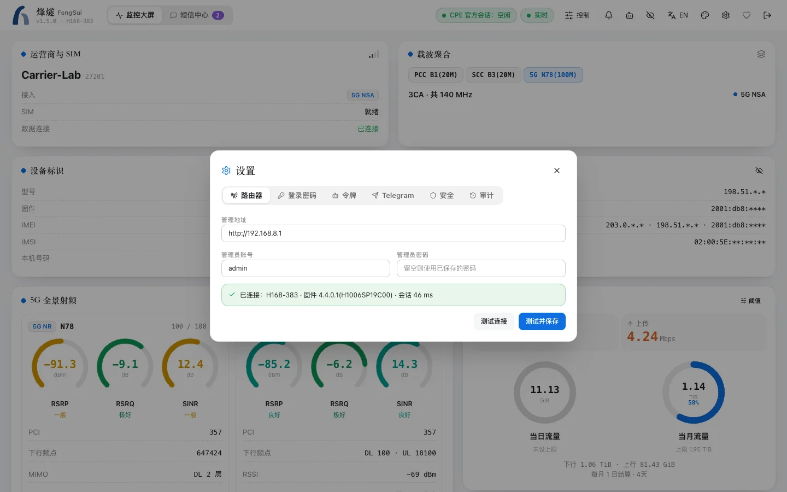

This is the shortest path: a machine that runs Docker, on the same local network as your Huawei router. For Synology Container Manager graphical setup, see [Installation and upgrade](install.md#synology-container-manager).

## Prerequisites

- A NAS or computer capable of running Docker and Docker Compose (Linux, macOS, or Windows), on either `amd64` or `arm64`.
- The router management address (usually `http://192.168.8.1`) and administrator password.
- This machine and the router must be on the same local network.

> [!WARNING]
> Entering the router administrator password incorrectly 3 consecutive times locks the router for a period. Verify the password in your browser before giving it to FengSui.

## 1. Download configuration files

Create a directory and download `docker-compose.yml` and `.env.example` from the repository:

```bash
mkdir -p ~/cpe-dash/data && cd ~/cpe-dash
curl -fsSLO https://raw.githubusercontent.com/cky008/cpe-dash/main/docker-compose.yml
curl -fsSL -o .env https://raw.githubusercontent.com/cky008/cpe-dash/main/.env.example
chmod 600 .env && chmod 700 data
```

## 2. Set the encryption key

FengSui encrypts the router password, SMS messages, and settings before storing them in `data/`. Open `.env` and set `DATA_ENCRYPTION_KEY` to a sufficiently long random string:

```bash
# Generate a random key and copy it to DATA_ENCRYPTION_KEY= in .env
openssl rand -hex 32
```

> [!IMPORTANT]
> Save a backup copy of this key. If you lose it, the data in `data/` cannot be recovered.

Then set two more variables in `.env`: `TZ` (timezone, such as `Asia/Shanghai`), and `PUID` / `PGID` (the user running the container, obtained by running `id -u` and `id -g` on this machine). You can leave everything else as is for now.

## 3. Start

```bash
docker compose pull          # Download the image (no source code required)
docker compose up -d
docker compose logs cpe-dash | grep "setup code"
```

The logs will show a one-time **setup code** (valid for 24 hours).

## 4. Open the console

Open `http://<this machine IP>:18384` in your browser:

1. Enter the setup code and set a login password for the console.
2. Follow the setup wizard to enter the router address, administrator username (usually `admin`), and password. FengSui tests the login first and saves only after a successful test.
3. Within seconds, the dashboard will display your signals, carriers, and traffic.



## Next steps

- To receive SMS messages and alerts on your phone or Telegram: see [Alerts and notifications](notifications.md).
- To lock bands or cells: read [Band and cell locking](locking.md) first to learn how to avoid losing your connection.
- To access the console remotely: read [Security and privacy](security.md) first. Do not map the port directly to the public internet.
- To adjust more settings: see [Configuration reference](configuration.md).
