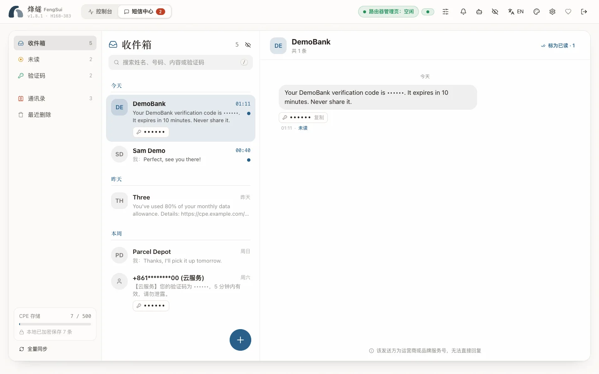

With a SIM card inserted, the router can send and receive SMS messages. FengSui organizes them into threads, lets you copy verification codes with one click, and can forward them to Telegram.

## Receive messages

FengSui reads the router's SMS count every 5 seconds, syncs only when there are new messages, and performs a full reconciliation every 30 minutes. On initial launch, existing messages on the router are treated as history and do not trigger notifications.

- **Threads**: The same number is grouped into one conversation thread however it is written (with a UK SIM, `07700900123` and `+447700900123`), sorted chronologically.
- **Verification codes**: Automatically detected and copied with a single click.
- **Multipart messages**: Multi-segment messages received in parts are merged into a single display.
- **Privacy toggle**: The eye icon in the header can hide both numbers and message bodies, useful for screenshots or screencasting.

## Send messages

Click "New message", select a country, enter a phone number or contact name, and compose your message. Before sending, the console shows the encoding (GSM-7 or UCS-2) and the number of segments; each message can have up to 4 segments, and you can send to up to 5 recipients at once.

**Country code**: Local numbers without a leading `+` are completed using the default country. The default country is derived from the country of the router's SIM card (for example, an Irish SIM card maps to `+353`), or can be fixed under Settings → General → SMS (`DEFAULT_COUNTRY_CODE` in `.env`). If FengSui does not yet know the country, it requires you to enter a full international number or select a country manually; it never guesses.

**"Submitted to the router, status unconfirmed"**: When the router accepts the message but does not report the delivery status within the expected window, this amber status is displayed. The message was likely sent already; **do not resend**.

> [!NOTE]
> SMS messages are billed by your carrier, and you are responsible for message content. FengSui test suites never send SMS messages to real numbers.

## Mark as read and delete

Within a thread, you can mark messages as read or delete them. With "Mark read on the router after forwarding" on under Settings → General (`SMS_AUTO_MARK_READ=true` in `.env`), newly forwarded messages are automatically marked as read on the router.

### Recently deleted

Deleting a message removes it from the router at once (the router's SMS storage is small), but FengSui keeps it encrypted in Recently deleted for a while (30 days by default), in case you deleted it by mistake. Open it from the left of the SMS centre (on a phone, the bin icon at the top of the list):

- **Restore**: the message goes back to its conversation. The router's copy is already gone, so a restored message is kept only in FengSui and is marked "Kept only in FengSui".
- **Delete for good**: one message, or all of them with "Delete all for good". This cannot be undone.
- **Expiry**: what stays longer than the set number of days is deleted for good automatically. Change the days under Settings → General → SMS (`SMS_TRASH_RETENTION_DAYS` in `.env`, `0` to `365`); `0` keeps nothing, so a delete is final at once. A shorter time clears what is already older at once.

Messages deleted from Telegram, with a token or by an AI agent go to Recently deleted too. Only a signed-in web console can delete for good or empty it, never a token or an agent, so a mistaken delete, or one that a message's text talked an agent into, can always be undone.

## Contacts

Contacts let threads display names instead of phone numbers. You can add them manually or import a `.vcf` file exported from your phone (importing thousands takes only seconds).

## When someone logs in to the router's own web page

While someone is logged in to the router's own web page, send, mark as read, and delete requests are rejected (with a notification that someone is using the router). Sync pauses and only checks for new messages via an unauthenticated endpoint; full synchronization catches up automatically after they log out.

## Routers of other brands

FengSui is currently verified on the Huawei H168-383 only. SMS on the brands below is implemented from each brand's interface notes and has not been checked on a real router; see [Supported devices](supported-devices.md) for each model.

| Brand | What you can do | What to know |
| :--- | :--- | :--- |
| ZTE (both interfaces, goform and zWRT) | Read, send, mark as read, delete | FengSui reads and writes the router's own storage; messages kept on the SIM card are not shown. |
| OpenWrt with a Quectel or Fibocom module | Read and delete; send as well on a router with QModem installed | The cellular module marks a message read as soon as it lists it, so FengSui keeps track of what you have not read. The module keeps no copy of what it sends, so the messages you send are kept by FengSui only. |
| Tozed / ZLT (also China Unicom VN007) | Read and send | The interface has no command on record to delete a message or to mark one read: you cannot delete, and FengSui keeps track of what you have not read. |
| FiberHome | Read, mark as read, send, delete a whole conversation | Sending takes plain English text only (letters, digits and common punctuation), and never text with `` ` ``, `$`, `"` or `\`: the router hands the text to a command line. To delete, select every message of the conversation. Where the router wants a separate web sign-in before it shows messages, the SMS page stays empty. |

The interface notes of Pinsu and NRadio have no SMS interface, so the SMS page stays empty on those two brands.

Sending, marking as read and deleting on these routers are [experimental writes](other-routers.md#safeguards): available by default, sent once, and read back afterwards; to stop them, turn off "Send and manage SMS" under Settings → Device. Conversations, verification codes, Recently deleted, contacts, Telegram, webhooks and the limits on what an AI agent may send are the same on every brand; the storage alerts come only where the router reports its capacity.

## Where SMS messages are stored

SMS messages (those in Recently deleted too) and contacts are encrypted with your `DATA_ENCRYPTION_KEY` and saved in `data/sms.json` and `data/contacts.json`. Each message is identified by a random ID containing no phone numbers. When router SMS storage fills up, FengSui triggers `SMS_STORAGE_HIGH` / `SMS_STORAGE_FULL` alerts to remind you to clean up.

To send and receive SMS messages in Telegram, see [Alerts and notifications](notifications.md); to let AI agents read messages, see [AI agents (MCP)](agents.md).
