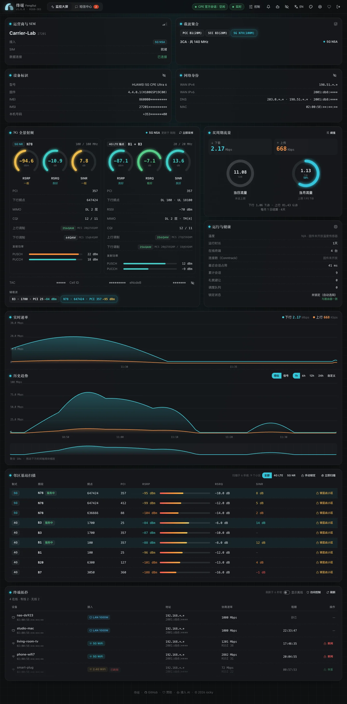

登录后看到的就是控制台首页。数据每 5 秒刷新一次；读取路由器时，烽燧每次只登录几十到几百毫秒，读完马上退出，所以你随时可以去路由器官方网页登录。

## 页头

- **运营商与 SIM**：运营商名称、SIM 状态、接入方式（4G、5G NSA、5G SA）。
- **设备信息**：型号、固件，以及默认打码的 IMEI、IMSI 和本机号码，点眼睛图标才显示原值，方便截图。
- **网络地址**：路由器在运营商网络里拿到的 IPv4、IPv6 和 DNS，同样默认打码。
- **路由器管理页状态**：「空闲」表示一切正常；「有人在用路由器管理页 · 已暂停」表示有人登录了路由器官方网页，烽燧在等对方退出；「路由器密码错误 · 已停止登录」表示需要你在「设置 → 路由器」里改正密码。
- **告警铃**：最近的告警。

页面上带 <kbd>?</kbd> 的词可以把鼠标移上去看一句话解释，点开看详细说明。不需要时，在「设置 → 外观」里关掉。

## 载波聚合

列出路由器正在同时使用的每个载波，例如 `B1(20M) + B3(20M) + n78(100M)`。载波越多、带宽越宽，速度上限越高。这些写法的意思见[频段、载波与小区](bands-and-cells.md#ca)。

## 信号

按 5G 和 4G 分两块，显示信号强度、质量、调制方式、发射功率等。每个数字的意思、多少算好，以及信号不好时可以做什么，见[看懂信号](signal.md)。

最值得看的是三个数：**RSRP**（信号强度）、**RSRQ**（信号质量）和 **SINR**（信号干净程度）。圆环的颜色已经按好坏分好了级。小区标识（TAC、Cell ID、eNodeB）默认打码。

## 附近的基站

列出路由器能听到的周边小区，按信号强度排序，标着「服务中」的是正在用的。每一行都可以「锁至此小区」，见[锁频与锁小区](locking.md#lock-cell)。表格每分钟刷新一次，也可以手动「立即扫描」。

## 流量

- **实时速率**：上下行速率曲线。
- **当日 / 当月用量**：两个圆环。点「流量上限」设置每月流量上限，超出时变色并告警；结算日取路由器的设置。

## 运行状态

在线时长、在线设备数、最近一次读取路由器的耗时，以及锁定状态：烽燧会核对路由器上的锁定是否和它下发的一致，不一致时显示「与路由器不一致」。

## 历史曲线

可以看最近 1、6、12、24 小时或自定义时段的速率和信号。拖动底部的刷选条放大某一段。5 秒一点的数据保留 3 小时，之后按分钟汇总，共保留 7 天。

## 已连接设备

列出连着路由器的设备：名称、有线还是 Wi-Fi（2.4G / 5G）、IP、连接速率和 DHCP 租期。Wi-Fi 设备旁边有「断网 / 恢复」，更多管理见[终端与上网管理](devices.md)。

## 外观

右上角可以切换中文 / 英文和主题。烽燧有 14 套主题（7 浅 7 深），跟随系统时可以分别选白天和夜间用的主题，也可以用三种颜色自己调一套。偏好只保存在你的浏览器里。
