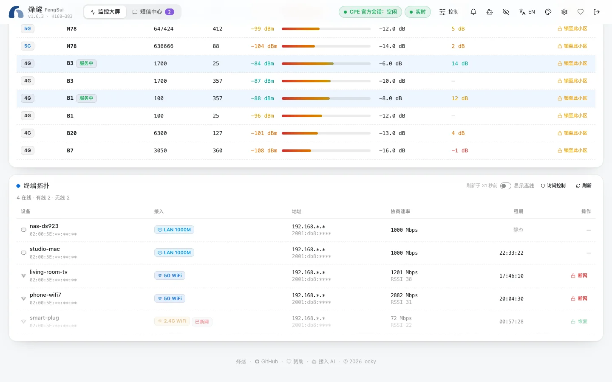

烽燧使用路由器自带的 Wi-Fi MAC 过滤和家长控制功能，和官方网页「设备管理」里是同一套名单，所以两边的改动互相可见。

## 查看设备

大屏底部的**终端拓扑**列出所有连着路由器的设备：

- 有线（`LAN 1000M`）还是 Wi-Fi（2.4G / 5G）；
- IPv4 和 IPv6 地址、协商速率、Wi-Fi 信号；
- DHCP 租期还剩多久。

打开「显示离线」可以看到暂时不在线的设备。

## 暂停一台设备上网

Wi-Fi 设备旁边的「断网」会把它加入路由器的 Wi-Fi 黑名单，设备随即掉线。被断网的设备仍保留在列表里，点「恢复」即可。

> [!NOTE]
> 目前只能暂停 Wi-Fi 设备，有线设备请在路由器官方网页的防火墙里处理。路由器固件没有按设备限速的接口，所以烽燧也不提供限速。

## 黑名单和白名单

「访问控制」抽屉里可以切换 Wi-Fi MAC 过滤：

- **关闭**：所有设备都能连。
- **黑名单**：名单里的设备不能连。
- **白名单**：只有名单里的设备能连。打开前用勾选器挑出允许的设备。

路由器最多保存 64 条，抽屉里会显示已用多少。

## 上网时段

可以按设备设置允许上网的时间：选星期几，以 15 分钟为单位选时间段，可以跨过午夜（例如 22:00 到次日 07:00）。同一台设备的时段重叠时，烽燧会直接提示冲突。

## 不会把你自己关在外面

每次修改都在一次登录里完成「读取设备 → 读取当前名单 → 计划改动 → 写入 → 再读一遍核对」。两台设备永远不会被断网：

- **运行烽燧的那台机器**（路由器会标出发出请求的设备）；
- **你正在操作的那台设备**。

计划会断掉它们时，烽燧会拒绝并说明原因。
