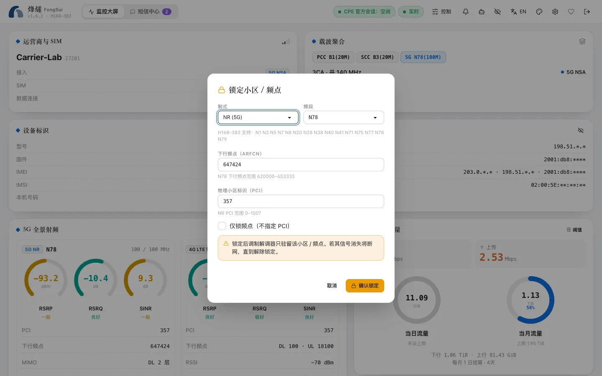

锁频和锁小区会让路由器只使用你选定的频段或小区。用得好可以换来更稳定、更快的连接；锁错了路由器可能连不上网。烽燧在每一步都尽量帮你避免后一种情况。

> [!WARNING]
> 锁定会改变路由器接入运营商网络的方式。只在你合法使用的网络和频段上操作，并遵守当地法规和运营商条款。

## 锁频段

1. 打开右上角的「控制」抽屉。
2. 在 4G（LTE）和 5G（NR）里勾选要保留的频段。只能选这台路由器支持的频段。
3. 点「锁定」，确认窗口会列出这次改动，并说明锁完断网时会不会自动回滚。

锁频段对 5G SA 和 NSA 都生效。要恢复，点「解锁」即可回到「全部频段」。

## 锁小区

锁小区把路由器固定到某一个基站扇区（由频段、频点和 PCI 确定）。

1. 在大屏的**邻区表**里找到信号好的小区，点「锁至此小区」；或者在控制抽屉里手动填写。
2. 烽燧只允许锁定**已经观测到**的小区：当前服务小区、聚合载波，或最近一次邻区扫描里出现过的小区。这能避免填错数字导致断网。
3. 也可以勾选「仅锁频点（不指定 PCI）」，只固定频率。

## 锁完断网了怎么办

有三种办法，从快到慢：

1. **自动回滚**（推荐提前开启）：在 `.env` 设置 `LOCK_ROLLBACK_AFTER_MIN`，例如 `10`。锁定后，WAN 必须在 10 分钟内恢复并连续在线 2 分钟；做不到，烽燧就自动解除全部锁定，并发出 `LOCK_ROLLED_BACK` 告警。
2. **在控制台点「解锁」**：烽燧通过局域网访问路由器，不依赖外网，断网时照样能解锁。
3. **到路由器官方网页**（通常是 `http://192.168.8.1`）里恢复全部频段，或者重启路由器。

## WAN 自动重拨

和锁定无关的断网（例如运营商侧故障），可以让烽燧自动重拨。在 `.env` 设置 `WAN_AUTO_RECONNECT_AFTER_MIN`，例如 `3`：WAN 断开 3 分钟后重拨一次，之后间隔 10、30、60 分钟再试，24 小时内最多 4 次。烽燧**从不**自动重启路由器。

这两项都默认关闭，因为它们会在没人操作时改动路由器。打开后，控制抽屉的「WAN 自愈」一栏会显示：

- 两项是否开启；
- 正在观察的锁定何时到期，WAN 自何时恢复；
- 最近 24 小时用了几次重拨，下次最早什么时候。

自愈只依据最新的信号数据，写入前会在同一个会话里再确认一次 WAN 状态和移动数据开关：WAN 已经恢复，或者你手动关了移动数据，它就不动手。有人登录官方网页时，它同样会等待。

## 锁定状态对不上

烽燧会记住它下发的锁定，并在每次读取时核对路由器的实际状态。如果有人在官方网页里改了锁定，大屏的健康卡会显示「与路由器不一致」，并发出锁定漂移告警。重新锁一次或解锁即可对齐。
