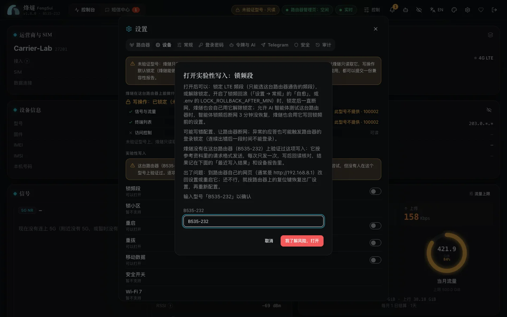

**烽燧只在 H168-383（固件 4.4.0.1）上验证过。** 其他华为 HiLink / EMUI 路由器通常也能连上，但没有人验证过，所以它们的写操作默认锁定：烽燧只读取，不改动路由器设置。

<!-- compat:begin -->
| 型号 | 固件 | 读取 | 写入 |
| :--- | :--- | :--- | :--- |
| H168-383 | `4.4.0.1(H1006SP19C00)` | ✅ 已验证 | ✅ 已验证 |
| H168-383 | 其他固件 | ✅ 照常，附 `FIRMWARE_UNVERIFIED` 告警 | ✅ 照常，附同一告警 |
| 其他华为 HiLink / EMUI 型号 | 任意 | ⚠️ 可能可用，未验证：路由器提供的项目 | 🔒 默认锁定；可逐项知情同意后打开实验性写入 |
<!-- compat:end -->

华为会自动给路由器升级固件，所以 H168-383 换了新固件时，烽燧照常工作，只发一次 `FIRMWARE_UNVERIFIED` 提醒。

## 烽燧怎样识别你的路由器

启动后，以及你在「设置 → 路由器」测试或保存连接时，烽燧读一次型号、登录方式和支持的功能（只读，不改任何设置）。结果显示在「设置 → 设备」。

登录方式在提交密码之前就确定好（新型号用 SCRAM，旧型号用 SHA-256 或 Base64），绝不拿同一个密码换方式重试，以免用掉路由器的登录机会。

## 只读意味着什么

- 能看到的：路由器提供的信号、流量、设备、短信等。路由器不提供或烽燧读不懂的项目标为「此型号不提供」，不影响其他项目。没有 5G 的型号就没有 5G 数值。
- 被挡住的：所有写操作。网页、API、MCP、Telegram 和自愈都绕不过这道闸门，路由器收不到任何写请求，接口返回 `409 DEVICE_UNVERIFIED_READ_ONLY`。页头显示「未验证型号 · 只读」。

## 实验性写入（有风险，默认关闭）

对于请求格式有可靠资料的少数操作，烽燧准备了通用实现，你可以逐项打开：

- 锁频（只锁 4G，频段取路由器报告的）
- 重启
- 重拨
- 移动数据开关
- 短信（发送、标为已读、删除）

锁小区、安全开关、Wi-Fi 7、天线和访问控制暂不支持。

**怎么打开**：在「设置 → 设备」的「实验性写入」里，路由器具备条件的项目可以打开。打开前会弹出说明，写明放行哪些操作和风险（可能写错配置、导致断网，异常应答还可能触发路由器的登录锁定），需要输入路由器型号确认。同意只对这个型号有效；换了别的路由器，所有同意自动失效。每次打开、关闭都记进审计日志。

**打开之后**：只放行那一项。每次写入只发一次、不重试，写完马上读回来核对，提示「回读一致」或「不一致」；不一致时发出 `WRITE_READBACK_MISMATCH` 告警。

**出了问题**：到路由器自己的网页（通常是 `http://192.168.8.1`）改回或重启，必要时按复位键恢复出厂设置。

## 报告兼容性

你的反馈能让更多型号得到验证：

1. 在「设置 → 设备」点「生成设备报告」，检查一遍，复制或下载 JSON。
2. 点「在 GitHub 报告」，在打开的新 issue 里粘贴报告，写上哪些能用、哪些不能用。

报告只含接口结构和少量白名单信息（型号、固件、网页版本、功能开关、频段号），不含 IMEI、IMSI、MAC、IP、号码、小区或 Wi-Fi 名称。烽燧不会自动上传任何东西。

有人在真机上确认某项功能可用并报告后，维护者会把它加进代码里的 `VERIFIED_FEATURES` 清单，上表随之多出一行，这一项在该型号上就不再需要逐项同意。

## 用 AI 智能体测试

接入了烽燧的 AI 智能体（Claude Code、Codex 等）可以替你把测试做完：

1. 在「设置 → 设备」点「复制提示词并开始测试」。烽燧先列出测试要打开的设置，你确认一次，它就全部打开并复制提示词：
   - 「允许 AI 智能体测试这台路由器」和「允许智能体改动路由器」；
   - 锁频段、重拨、重启的实验性写入（这台路由器提供的）；
   - 智能体用的令牌加上「改动路由器」权限：烽燧默认选最近连过它的令牌，你也可以换一个，或者不改。
2. 把提示词交给智能体。智能体已经开着的话，先让它重新连接烽燧（Claude Code 里输入 `/mcp`），它才看得到新的工具。
3. 智能体先测每个读取项；每项写入测试之前都会先问你。
4. 它还会用 `probe_router_endpoints` 在这台路由器上找出烽燧还没用到的接口：在烽燧自己的会话里只发 `GET`，结果只有结构，不含任何值。
5. 最后它给你一份脱敏报告和提交 issue 的链接，由你检查后自己提交。
6. 测完在「设置 → 设备」点「结束测试」。烽燧只恢复测试打开、并且你之后没再改过的设置。

忘了结束也没关系：智能体最后一次测试 3 小时后，如果测试打开的设置还开着，烽燧会在控制台的告警里提醒你（`AGENT_TEST_STILL_ON`，配置了 Telegram 时也推送过去），之后每天一次。下面任何一种情况出现后就不再提醒：测试的写入全部回读一致（这些功能在你的路由器上没问题，可以留着用）；你在控制台的告警里看过这条提醒，或在 Telegram 里点了「知道了」；你结束了测试。

智能体锁了频段以后，如果 WAN 断开 3 分钟还没恢复，烽燧会写回锁频前的频段设置。智能体从不自己登录路由器：所有请求都经过烽燧，有人登录路由器网页时照样让开。

## 先试试

`DEMO_SCENARIO=unverified npm run demo` 会模拟一台未验证的华为路由器（只有 4G、旧式登录），可以把只读、同意、写入和报告的流程完整走一遍。

## 致谢

感谢 [Salamek/huawei-lte-api](https://github.com/Salamek/huawei-lte-api)：烽燧为其他华为型号做兼容时，参考了它整理的接口与机型资料。烽燧不包含它的代码，也不依赖它。
