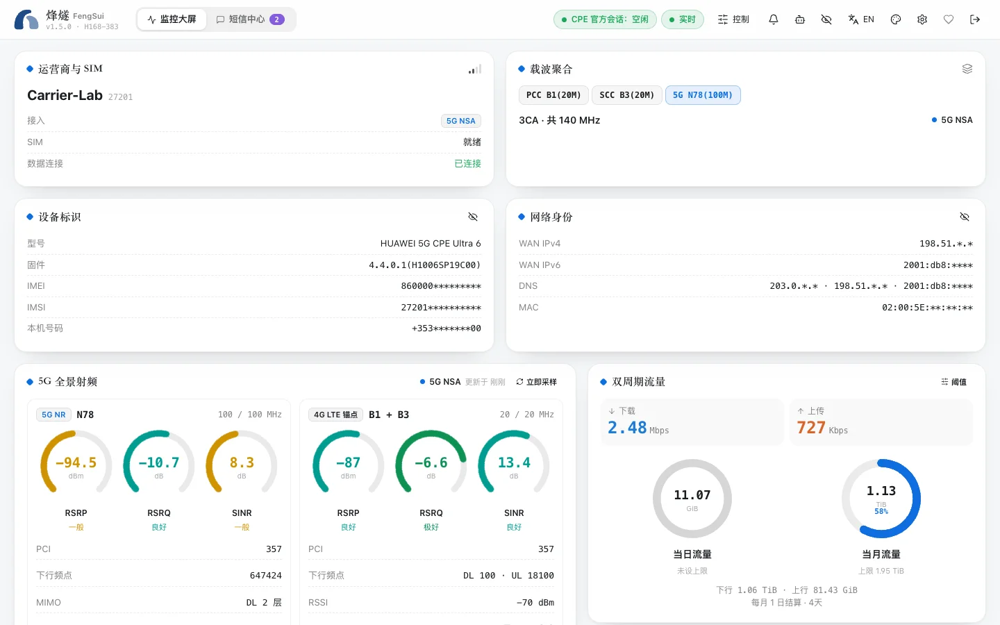

烽燧（FengSui，仓库名 `cpe-dash`）是一个网页控制台，运行在你家里的 NAS 或电脑上，用来查看和管理华为 5G 路由器（CPE）。

它把路由器官方网页里分散的信息集中到一个页面上，并补上官方网页没有的功能：历史曲线、告警、Telegram 通知、短信会话视图，以及给 AI 智能体用的接口。

## 它能做什么

- **看信号**：RSRP、SINR、调制方式、发射功率，以及 4G / 5G 每个载波的频段和带宽，每 5 秒刷新一次，保留 7 天历史。
- **锁频锁站**：把路由器固定在某些频段或某个小区上。锁之前先预览；锁完如果断了网，可以设置在几分钟后自动解锁。
- **收发短信**：会话视图、验证码一键复制、通讯录。短信加密保存在你的硬盘上。
- **管理设备**：谁连着你的网络、怎么连的；暂停某台设备上网，或给它设定上网时段。
- **告警与通知**：断网、信号变差、路由器重启、短信存满时提醒你，可以推送到 Telegram 或你自己的 Webhook。
- **接入 AI 智能体**：内置 MCP 服务器，Claude、Cursor 等可以读取信号和历史；会改动路由器的操作默认关闭。

## 适合谁

- 家里或办公室用华为 5G 路由器上网，想看清信号、调好频段的人。
- 有一台 NAS（群晖、威联通、自己装的 Linux）或一直开着的电脑，会用 Docker 的人。
- 想把路由器收到的短信转到手机或 Telegram 的人。

## 支持哪些路由器

烽燧只在 **华为 5G CPE Ultra 6（H168-383，固件 4.4.0.1）** 上完整验证过。其他华为 HiLink 路由器，以及中兴、品速、通则康威（ZLT）、烽火、鲲鹏无限和 OpenWrt（移远 / 广和通模组）的路由器也能连上，品牌由烽燧自动识别。它们只以只读方式工作：可以看信号（华为型号还能看短信和已连接设备），不会改动路由器设置，除非你在控制台里逐项同意打开实验性写入。可能支持的品牌和型号见[支持的设备](supported-devices.md)，只读和实验性写入详见[其他型号与品牌](other-routers.md)。

## 它不会做的事

- **不和你抢路由器**。路由器同一时间只允许一个管理员登录。你在官方网页登录时，烽燧会自动让开，等你退出再继续。
- **不会把路由器锁死**。密码连续输错 3 次会锁住路由器。烽燧第一次登录失败就停下，等你在控制台改正，绝不自动重试。
- **不上传数据**。烽燧不连接任何云服务，也不收集使用数据。只有你自己配置 Telegram 或 Webhook 时，通知才会发往那里。
- **不绕过运营商限制**。它只调用路由器官方网页本来就有的功能，不修改射频参数或发射功率。

## 先看看再决定

不想安装的话，打开[在线演示](https://cky008.github.io/fengsui-demo/)：完整的控制台跑在浏览器里，数据全是虚构的，所有按钮都能点，刷新即复原。

准备好了，就从[快速开始](quick-start.md)装起来。
