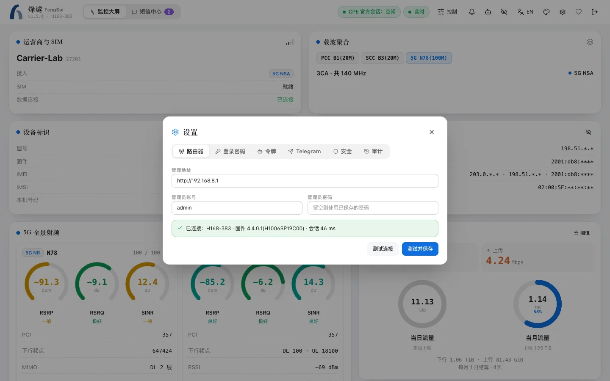

这是最短的路线：一台能运行 Docker 的机器，和华为路由器在同一个局域网里。群晖用户的图形界面步骤见[安装与升级](install.md#群晖-container-manager)。

## 准备工作

- 一台能运行 Docker 和 Docker Compose 的 NAS 或电脑（Linux、macOS、Windows 都可以），`amd64` 或 `arm64` 均可。
- 路由器的管理地址（通常是 `http://192.168.8.1`）和管理员密码。
- 这台机器和路由器在同一个局域网里。

> [!WARNING]
> 路由器的管理员密码连续输错 3 次会被锁定一段时间。先在浏览器里确认密码正确，再交给烽燧。

## 1. 下载配置文件

新建一个目录，放入仓库里的 `docker-compose.yml` 和 `.env.example`：

```bash
mkdir -p ~/cpe-dash/data && cd ~/cpe-dash
curl -fsSLO https://raw.githubusercontent.com/cky008/cpe-dash/main/docker-compose.yml
curl -fsSL -o .env https://raw.githubusercontent.com/cky008/cpe-dash/main/.env.example
chmod 600 .env && chmod 700 data
```

## 2. 设置加密密钥

烽燧会把路由器密码、短信和设置加密后存进 `data/`。打开 `.env`，给 `DATA_ENCRYPTION_KEY` 填一串足够长的随机字符：

```bash
# 生成一个随机密钥，复制到 .env 的 DATA_ENCRYPTION_KEY=
openssl rand -hex 32
```

> [!IMPORTANT]
> 把这个密钥另外保存一份。丢了它，`data/` 里的数据就再也打不开。

再在 `.env` 里填两项：`TZ`（时区，如 `Asia/Shanghai`），以及 `PUID` / `PGID`（运行容器的用户，在这台机器上执行 `id -u` 和 `id -g` 得到）。其他都可以先不管。

## 3. 启动

```bash
docker compose pull          # 下载镜像（不需要源码）
docker compose up -d
docker compose logs cpe-dash | grep "setup code"
```

日志里会有一行一次性**设置码**（24 小时内有效）。

## 4. 打开控制台

在浏览器里打开 `http://<这台机器的 IP>:18384`：

1. 输入设置码，给控制台设一个登录密码。
2. 按引导填写路由器地址、管理员账号（通常是 `admin`）和密码。烽燧会先测试一次登录，成功才保存。
3. 几秒后，控制台上就会出现信号、载波和流量。



## 接下来

- 想在手机或 Telegram 上收短信和告警：看[告警与通知](notifications.md)。
- 想锁定频段或小区：先读[锁频与锁小区](locking.md)，里面讲了怎样避免断网。
- 准备在外面访问控制台：先读[安全与隐私](security.md)。不要把端口直接映射到公网。
- 想调整更多设置：看[配置参考](configuration.md)；`docker-compose.yml` 的每一项见 [Docker Compose 配置](docker-compose.md)。
