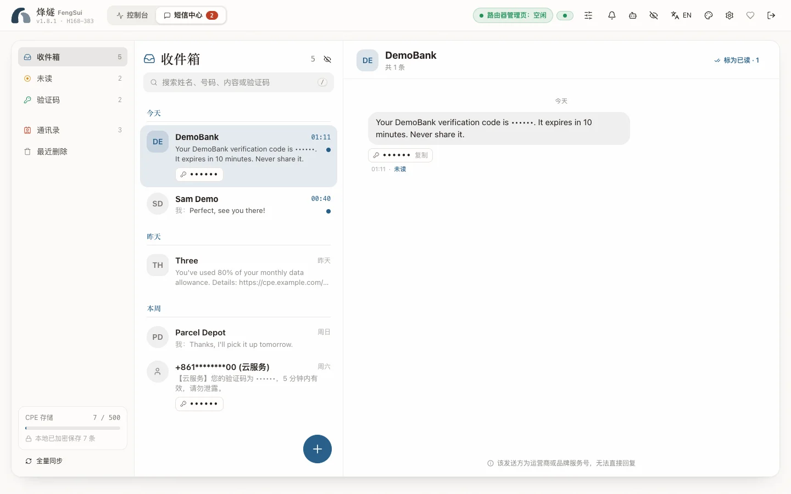

路由器插着 SIM 卡，就能收发短信。烽燧把它们整理成会话，验证码一键复制，还能推送到 Telegram。

## 收短信

烽燧每 5 秒读取一次路由器的短信计数，有新短信才去同步，另外每 30 分钟完整核对一次。第一次启动时，路由器上已有的短信被当作历史记录，不会推送通知。

- **会话**：同一个号码不管怎么写（例如英国 SIM 卡下的 `07700900123` 和 `+447700900123`）都归到一个会话里，按时间排序。
- **验证码**：自动识别，点一下就复制。
- **长短信**：分段收到的长短信合并成一条显示。
- **隐私开关**：页头的眼睛图标可以同时隐藏号码和短信内容，方便截图或投屏。

## 发短信

点「新短信」，选国家、输入号码或联系人名字，写好内容。发送前会显示编码（GSM-7 或 UCS-2）和会分成几段；一条最多 4 段，一次最多 5 个收件人。

**国家区号**：不带 `+` 的本地号码按默认国家补全。默认国家取路由器 SIM 卡所属的国家（例如爱尔兰的 SIM 卡对应 `+353`），也可以在「设置 → 常规」的「短信」里固定（`.env` 的 `DEFAULT_COUNTRY_CODE`）。烽燧还不知道国家时，会要求你输入完整的国际号码或手动选择国家，绝不猜。

**「已提交、状态未确认」**：路由器已经接受了短信，但在规定时间内没报告结果时，会显示成琥珀色的这个状态。短信很可能已经发出，**不要重发**。

> [!NOTE]
> 短信由运营商按资费收费，内容由你负责。烽燧的测试从不向真实号码发送短信。

## 已读和删除

在会话里可以标为已读或删除。在「设置 → 常规」打开「推送后在路由器上标为已读」（`.env` 的 `SMS_AUTO_MARK_READ=true`）后，新短信推送完会自动在路由器上标为已读。

### 最近删除

删除一条短信，会马上把它从路由器上删掉（路由器的短信存储很小），但烽燧会在「最近删除」里加密保留一段时间（默认 30 天），防止误删。短信中心左侧（手机上是列表顶部的垃圾桶图标）可以打开它：

- **恢复**：短信回到原来的会话。路由器上的那份已经删掉了，所以恢复的短信只保存在烽燧里，会标着「只保存在烽燧」。
- **彻底删除**：删掉一条，或者点「全部彻底删除」。彻底删除后无法恢复。
- **到期**：超过保留天数的自动彻底删除。天数在「设置 → 常规」的「短信」里改（`.env` 的 `SMS_TRASH_RETENTION_DAYS`，`0` 到 `365`）；`0` 表示不保留，删除后立即彻底删除。把天数改短时，已经超过新天数的会马上清掉。

在 Telegram 里删除、通过令牌或 AI 智能体删除的短信，也都进「最近删除」。只有登录了网页控制台才能彻底删除或清空，令牌和智能体都做不到，所以误删或者被短信内容诱导的删除总能找回来。

## 通讯录

通讯录让会话显示名字而不是号码。可以手动添加，也可以导入手机导出的 `.vcf` 文件（几千条也能在几秒内导入）。

## 有人登录官方网页时

有人登录路由器官方网页期间，发送、已读和删除会被拒绝（提示「有人正在使用路由器」），同步暂停，只通过不需要登录的接口看有没有新短信；对方退出后自动补上同步。

## 短信存在哪里

短信（包括「最近删除」里的）、通讯录都用你的 `DATA_ENCRYPTION_KEY` 加密，保存在 `data/sms.json` 和 `data/contacts.json`。每条短信用一个不包含号码的随机编号标识。路由器的短信存储满了时，烽燧会发出 `SMS_STORAGE_HIGH` / `SMS_STORAGE_FULL` 告警，提醒你清理。

在 Telegram 里收发短信见[告警与通知](notifications.md)；让 AI 智能体读短信见 [AI 智能体（MCP）](agents.md)。
